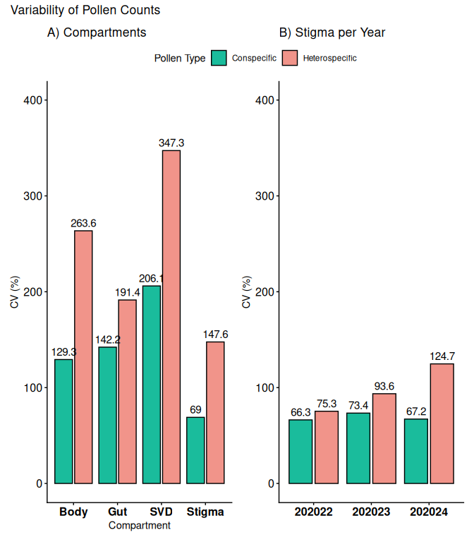
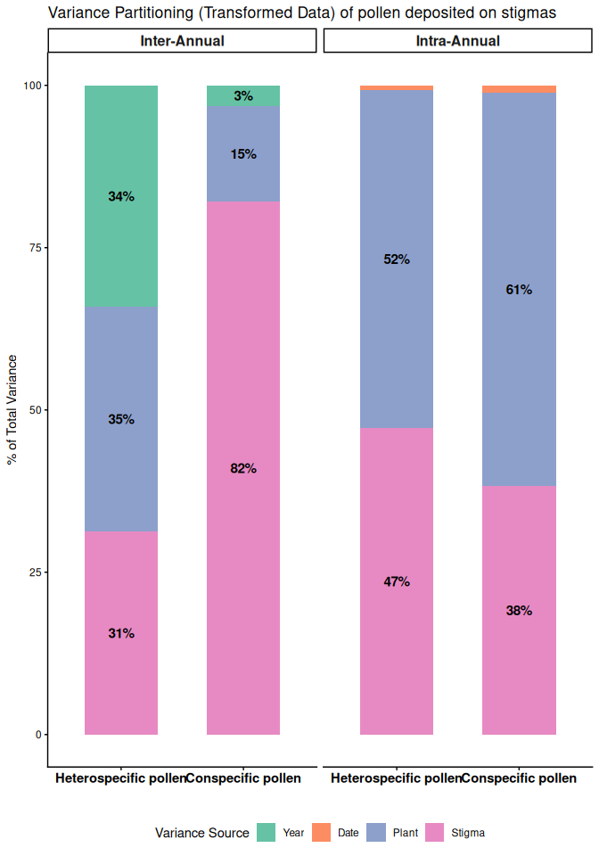
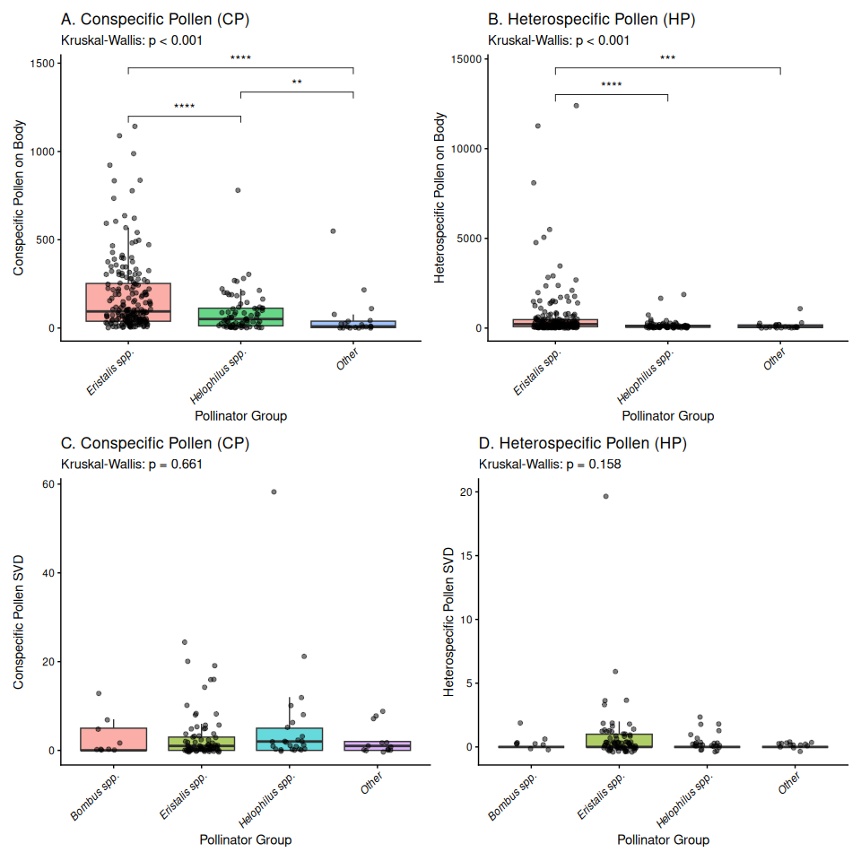
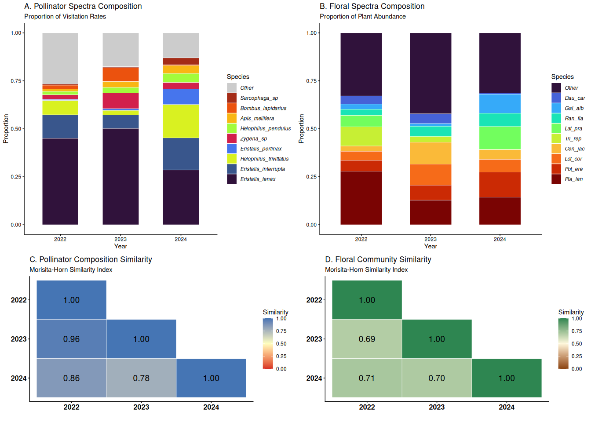
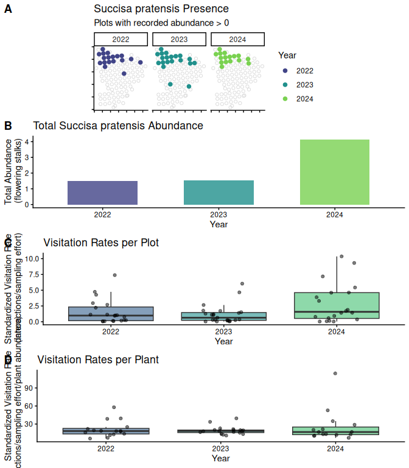
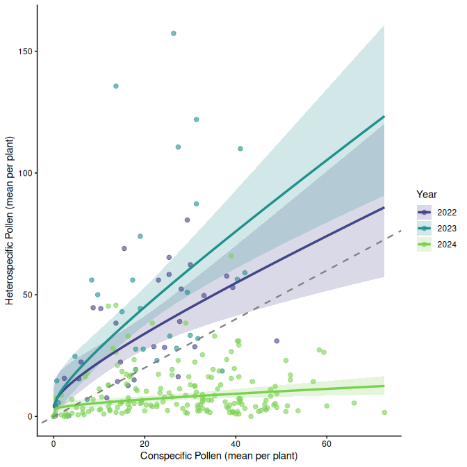
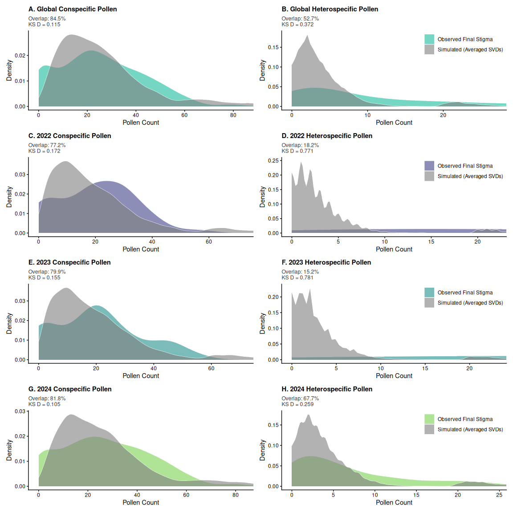
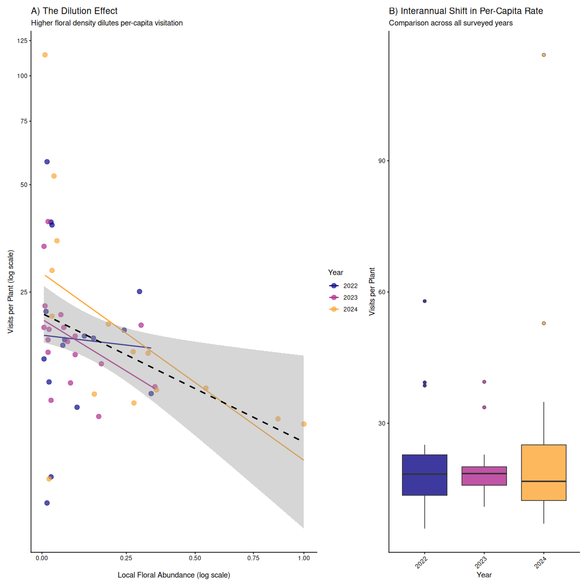
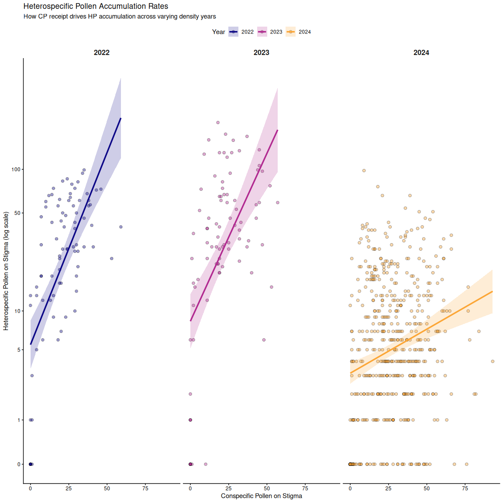

## Abstract

**Premise:** Pollen transfer by animal vectors is inherently stochastic at the micro-scale, yet terminal deposition of conspecific pollen (CP) often remains remarkably stable at the population level. It remains unclear how plants compensate for the extreme variance in individual pollinator visits to secure reliable CP receipt while simultaneously mitigating heterospecific pollen (HP) accumulation from co-flowering plants with shared pollinators.

**Methods:** Using a three-year dataset (2022–2024) for *Succisa pratensis* in a system with well-known plant-pollinator interactions, we evaluated pollen transfer dynamics across multiple hierarchical scales. We combined variance partitioning of terminal pollen deposition (TPD) on stigmas with single-visit deposition (SVD) experiments across pollinator taxa. Furthermore, we performed Monte Carlo simulations using SVD and visitation frequency data to reveal how pollen accumulation across highly stochastic visits leads to relatively stable TPD.

**Results:** Variance partitioning revealed that temporal shifts explained negligible variation in CP deposition; rather, the vast majority of variance occurred at the micro-scale among individual stigmas. SVD experiments confirmed that individual pollinator visits are highly stochastic and inefficient. However, Monte Carlo simulations demonstrated that at the whole-stigma level, the accumulation of pollen across multiple visits effectively neutralises micro-scale unpredictability, translating into stable terminal CP loads. In contrast, HP accumulation proved to be substantially more variable and partially depended on inter-annual variation in the floral neighbourhood.

**Conclusions:** Despite the mechanical unpredictability of pollen deposition during individual pollinator visits, plants can secure highly stable conspecific pollen deposition through the simple accumulation of pollen over the stigma lifespan. However, the potential for reproductive interference via heterospecific pollen relies heavily on context-dependent ecological traits.

## Introduction

Pollen transfer by animal vectors is inherently stochastic at the micro-level [reviewed in @Minnaar2019], characterised by highly variable, heterogeneous pollen loads delivered during individual foraging events [@richards2009variation; @king2013]. Yet, despite this fine-scale unpredictability, population-level studies demonstrate that conspecific pollen (CP) deposition on stigmas can remain remarkably stable across multiple years [e.g., @fang2019multi; @Fang2022]. This paradox highlights a fundamental gap in pollination ecology: how do plants compensate for the high variance in individual pollinator visits to secure reliable CP receipt on their stigmas, while simultaneously mitigating the accumulation of heterospecific pollen (HP) from other plants within the co-flowering community?

To resolve this paradox, it is critical to examine pollen transfer dynamics across hierarchical scales, from single-visit deposition (SVD) to terminal pollen deposition (TPD). At the scale of an SVD, the delivery of conspecific pollen is highly unpredictable, and pollen transfer is markedly inefficient. Even among legitimate pollinators, the quantity of pollen transferred fluctuates dramatically due to highly variable individual pollen loads [@king2013; @freudenfeld2025interannual]. This micro-scale stochasticity is further compounded by taxon-specific differences in pollinator behaviour, such as grooming [@holmquist2012influence], insect morphological traits that drive pollen load composition [@cullen2021diversity], complex pollen carryover dynamics across successive flower visits [@thomson1980], and fluctuating foraging decisions within the plant-pollinator community [@valdovinos2025effect]. Consequently, from the perspective of an individual receptive stigma, the absolute number of CP grains received during any single visit exhibits significant depositional variance [@herrera1987, @neeman2001 , @king2013], requiring plants to rely on broader ecological mechanisms to aggregate these variable events into a stable reproductive outcome [@richards2009variation].

To overcome the high unpredictability of individual visits, some plants rely on high visitation rates, accumulating a sufficient volume of visits to average out the extreme depositional variance of individual vectors and ensure reliable CP receipt. The attraction of numerous pollinators is often facilitated by dense local floral displays [@vazquez2005degree; @janovsky2013conspecific] and/or rich flowering communities that draw diverse pollinator assemblages [@venjakob2016plant; @aguirre2024floral]. However, accumulating pollinator visits within a network concurrently introduces the risk of reproductive interference in the form of HP received from other plant species sharing pollinators within the community [@morales2008interspecific; @morales2013heterospecific; @ArceoGomez2011]. Co-flowering heterospecific neighbouring plant species not only act as sources of HP, but they also potentially alter the composition and fidelity of the pollinator assemblage visiting the focal plant [@Lazaro2009; @ye2020]. Thus, inter-annual changes in the co-flowering plant community may alter pollinator composition and behaviour, leading to both direct and indirect effects on CP and HP transfer. Therefore, plants are under evolutionary pressure to secure stable CP delivery while buffering against unpredictable pollinator behaviour. High conspecific floral density may mitigate the proportion of deposited HP by pulling pollinators from co-flowering neighbours [@arceo2016patterns], providing density-dependent buffering.

Furthermore, density-dependent buffering can be significantly enhanced by the temporal stratification of plant-pollinator interactions within the community [@Stone1998; @Schwarz2021]. For example, the diurnal pollen release schedules previously observed in *Succisa pratensis* allow the plant to establish temporal dominance early in the day [@stenc2023pollinator]. By releasing pollen and attracting vectors before co-flowering competitors do, a plant can secure substantial CP delivery prior to the accumulation of heterogeneous pollen loads on shared vectors, functioning as a form of temporal specialisation [@Brosi2016]. This temporal stratification ensures that the highest-frequency visits occur within a specific time window, mitigating the subsequent accumulation of HP [@Schwarz2021; @stenc2023pollinator].

While the variability of individual visits and the theoretical frameworks for pollen accumulation are well known, empirical studies rarely measure these processes across multiple scales in a natural system to study them simultaneously. In this study, we evaluate pollen transfer using a three-year dataset (2022–2024) for the highly visited plant *Succisa pratensis*. We address the following objectives: (1) to quantify the hierarchical variance in pollen deposition across years, days, individual plants, and individual stigmas; (2) to compare the mechanical efficiency of CP and HP transfer across dominant vector taxa at the single-visit (SVD) scale; (3) to mathematically test whether visitation redundancy drives stable CP deposition using Monte Carlo simulations; and (4) to determine how year-to-year changes in local conspecific floral abundance influence the accumulation of HP. We hypothesise that despite the high variability of individual generalist visits, *S. pratensis* achieves stable CP deposition because high local floral abundance and early morning pollen release [@stenc2023pollinator; @stenc2025pollen] buffer the plant against unpredictable single-visit deliveries.

## Methods

### Study system

Our observations were conducted in a semi-natural grassland community characterised by a high abundance of flowering plants (especially *Succisa pratensis*) and a diverse pollinator community dominated by hoverflies. The study site, “K Handrkovu”, is located near the village of Vernýřov, Central Bohemia, Czech Republic (49.8466° N, 15.1498° E). The site can be classified as a mosaic of moist-to-mesophilic and eutrophic-to-mesotrophic grasslands, supporting more than 50 entomogamous plant species that flower in late summer each year [@janovsky2013conspecific]. Fieldwork was conducted from 2022 to 2024 during the peak of *S. pratensis* flowering activity (15–19 August, 13–20 August, and 11–18 August, respectively).

*Succisa pratensis*, our focal plant species, maintains a relatively large and stable population at our study site. It is frequently visited by a wide spectrum of pollinators—especially hoverflies (@fig-plant-pollinator-panel)—which feed on both its pollen and nectar. Important traits related to its pollination include distinctive open inflorescences accessible to most pollinators, protandry to prevent self-pollination [@bartos2020self], and a diurnal pollen release schedule occurring in the morning hours [@stenc2023pollinator].


::: {.cell}
::: {.cell-output-display}
{#fig-plant-pollinator-panel}
:::
:::


### Plant-Pollinator Interactions and Plant Abundance

Following the established protocol for this study locality [@Janovsky2013], we collected data on pollinator visitation activity in 93 permanent plots arranged in a semi-regular grid, spaced 20 m apart across the study site. All plots were permanently marked with a metal nail, recovered using a metal detector, and visibly marked prior to the sampling event each year. Within the plots, we recorded flowering plant abundance and all interactions of flower-visiting pollinators with flowering *S. pratensis*, as well as with other plant species in the surrounding community. To avoid pseudoreplication, all flowers within a plot were surveyed only once per individual sampling event. All interactions occurring during the survey moment were recorded, lasting up to five minutes per plot. Each plot was surveyed at least twenty times during a sampling period spanning 5–10 consecutive days at the peak of flowering (mid-August) each year. For this study, we utilised interactions recorded during the main diurnal period of pollinator activity (07:00–19:00). We recorded only the pollinators that made contact with the reproductive organs of the visited plant, counting each individual pollinator only once. Finally, we computed standardised interaction rates (total number of interactions per plot survey) for pollinators visiting *S. pratensis* from 2022 to 2024, and compared the distribution of interaction rates for the specific group of pollinators visiting *S. pratensis* against those visiting all other plant species.

To determine plant abundance, we surveyed the plots twice during each sampling event to control for potential phenological shifts; for this study, we used the average plant abundance per sampling event. To record abundance, we divided each plot into 64 individual cells using a string grid gently placed over the plot. Within each cell, we either counted the flowering stalks or recorded the presence/absence of flowering plants, depending on the species.

### Pollen Load

In 2024, we investigated the number of pollen grains carried on the pollinators' bodies. Foraging pollinators visiting *S. pratensis* inflorescences were captured with an entomological net and euthanised immediately. Following @beattie1971technique, we swabbed pollen grains from one half of each pollinator’s body (randomly selecting the left or right side) using a small block of Fuchsin jelly. Captured pollinators were subsequently stored in 70% ethanol. On the same day, we produced semi-permanent slides by melting the Fuchsin jelly onto a microscope slide using a heating pad, adding a coverslip, and sealing it with nail polish. We later counted and identified all pollen grains using a light microscope, sorting them into conspecific *S. pratensis* pollen and heterospecific pollen (HP) from other plant species.

### Single-Visit Deposition (SVD)

To estimate the pollinator single-visit deposition (SVD), we followed protocols adapted from previous studies [@king2013; @valverde2019]. To prevent prior pollinator access, we enclosed selected inflorescences in fine-mesh tulle bags before the plants entered the male phase and opened their anthers. Once a plant entered the female phase with receptive stigmas, we removed the bag and observed the inflorescence until the arrival of the first pollinator. Pollinators were allowed to visit only one flower within the inflorescence, after which we immediately collected its stigma into a microcentrifuge tube containing 70% ethanol. If a pollinator visited multiple flowers, we collected only the first visited stigma and removed the others from the plant. The SVD experiments were conducted in 2022, 2023 and 2024.

### Terminal Pollen Deposition (TPD) on Stigma

To determine terminal pollen deposition (TPD), we collected stigmas from flowers with visibly senesced or absent corollas, indicative of the late flowering stage (pers. obs.). Each year, we collected 3 randomly selected stigmas per flowerhead to account for intra-inflorescence variability, and from 30 randomly selected individuals from the population per day. In 2022 and 2023, we collected samples during only one day, in 2024 we sampled stigmas during 6 days, following the same 3 stigma per flowerhead and 30 plant individual design.

We placed the collected stigmas onto microscope slides and allowed the ethanol to evaporate on a heating pad. Subsequently, we applied 1 µL of 10% KOH and allowed the samples to dry, followed by 3 µL of 3% hydrogen peroxide. After another drying period, we added 13 µL of 8% acetic acid. Once completely dry, we applied 5 µL of a dye solution (safranin, water, and glycerol), covered the samples with a coverslip, applied gentle, even pressure to squash the stigma, and sealed the edges with nail polish to create semi-permanent samples. We discarded

### Statistical Analysis

All statistical analyses were performed in R (version 4.3.3; @Rcore). To systematically evaluate pollen transfer dynamics across hierarchical scales, our analyses were structured into four primary components: (1) community stability and visitation dynamics, (2) single-visit transfer efficiency, (3) variance partitioning of terminal pollen deposition (TPD), and (4) mathematical simulations of visitation redundancy.

#### Community Stability and Visitation Dynamics

To assess the temporal consistency of the local ecological network, we calculated the Morisita-Horn similarity index for both the pollinator visitation spectra and the co-flowering plant community across the three study years. Differences in standardised visitation rates (total interactions per plot) and per-capita visitation rates (interactions per focal plant) across years were analysed using Kruskal-Wallis rank-sum tests, followed by post hoc Dunn’s tests with Benjamini-Hochberg false discovery rate corrections. Furthermore, to formalise the density-dependent dilution effect, we fitted a log-log linear regression evaluating how per-capita visitation rates scaled with local *S. pratensis* plot abundance.

#### Single-Visit Deposition (SVD)

To evaluate micro-scale mechanical transfer, pollinators were categorised into dominant morpho-groups (e.g., *Eristalis* spp., *Helophilus* spp., *Bombus* spp.). Differences in both conspecific pollen (CP) delivery and heterospecific pollen (HP) carryover during a single visit were tested across these taxa using Kruskal-Wallis rank-sum tests.

#### Variance Partitioning

To identify the exact spatial and temporal scales driving unpredictability in terminal stigmatic pollen loads, we applied Variance Components Analysis (VCA) using Linear Mixed Models (LMMs). Prior to modelling, pollen counts were square-root transformed to stabilise variance and approximate normality, as confirmed by residual diagnostic plots ('Residuals vs. Fitted' and 'Normal Q-Q'). Because fine-scale daily data were exclusively available for the 2024 season, we constructed two complementary LMMs to prevent rank deficiency: an inter-annual model spanning 2022–2024 (`1 | year / plant_id`), and an intra-annual model restricted to 2024 (`1 | date / plant_id`). The statistical significance of these hierarchical random effects (Year, Date, and Plant) was evaluated using Likelihood Ratio Tests.

Furthermore, to test how HP accumulation scales with CP receipt, and whether this relationship shifted during the high-density anomaly of 2024, we aggregated pollen counts to the plant level. We fitted a linear model testing the interaction between transformed CP and Year (`sqrt(mean_HP) ~ sqrt(mean_CP) * Year`). Differences in the rates of HP accumulation across years were subsequently quantified using pairwise slope contrasts via estimated marginal means.

#### Monte Carlo Simulation of Visitation Redundancy

To test whether visitation redundancy mathematically drives stable pollen deposition, we constructed a Monte Carlo bootstrapping simulation. Because pollinator morphology and mechanical transfer efficiency are functionally consistent traits, we pooled all single-visit deposition (SVD) data across the three study years to create a single, highly robust global pool of vector deposition profiles. This allowed us to mathematically isolate the effect of the plant’s changing floral density while holding vector baseline deposition constant.

We parameterised the simulation independently for each study year (2022–2024). For a given year, we estimated the average required visitation rate by dividing the empirical mean of conspecific pollen (CP) on that year’s stigmas by the mean CP of the global SVD pool. We then generated 10,000 virtual stigmas per year, randomly sampling (with replacement) from the global SVD pool based on that year’s specific visitation rate.

Finally, we evaluated the fit of the simulated null models against our true field observations. Because the large sample size of the simulation (N = 10,000) renders traditional two-sample Kolmogorov-Smirnov (K-S) p-values hypersensitive to trivial biological deviations—such as physical stigma saturation limits—we focused on the K-S D-statistic to quantify the maximum distributional divergence as a measure of effect size. Furthermore, to provide a robust and intuitive measure of simulation accuracy independent of sample size, we calculated the Overlapping Coefficient (OVL; Pastore & Calcagnì, 2019). The OVL quantifies the exact proportion of area shared between the empirical and simulated probability density curves, providing a direct metric of functional overlap between the theoretical null model and field reality.

## Results

Across the three-year study period (2022–2024), we collected and analysed a total of 693 terminal-stage stigmas from 273 individual *Succisa pratensis* plants to evaluate terminal pollen deposition (TPD). We sampled 84 stigmas in 2022, 89 stigmas in 2023, and 520 stigmas in 2024, with collections conducted over 6 consecutive days. To quantify micro-scale transfer dynamics and vector efficiency, we captured pollen from **300** individual visitors of *S. pratensis* to assess body pollen loads, and we sampled **124** controlled single-visit deposition (SVD) events on virgin stigmas. Finally, we recorded **2998** individual plant-pollinator interactions during standardised focal plot observations. Detailed descriptions of the individual results follow.

### Coefficient of Variation and Variance Partitioning

To quantify the unpredictability of pollen transport, we compared the Coefficient of Variation (CV) across functional transport compartments (@fig-plots-2). Conspecific pollen (CP) exhibited high variability on pollinator bodies (CV = 129%) and in SVDs (CV = 206%). However, at the TPD stage, the variability decreased considerably (CV = 69%). Conversely, heterospecific pollen (HP) remained relatively variable across all compartments, from vector bodies (CV = 264%) through to final stigmatic loads (CV = 147%). The inter-annual variability of TPD remained relatively stable across years for CP (CVs ranging from 66% to 73%), but the variability of HP increased in 2024 (CV = 125%, @fig-plots-2).

Hierarchical variance partitioning further confirmed the micro-scale nature of this stochasticity in TPD (@fig-plots-3). For CP, temporal phenology (years and days) explained only a small proportion of the variation; instead, the vast majority of depositional variance occurred at the micro-spatial scale, driven by differences among individual plants (15%) and individual stigmas (82%). Variance partitioning and subsequent likelihood ratio tests revealed that HP deposition was significantly driven by temporal shifts at the macro-scale ($\chi^2 = 32.39, p < 0.001$) and by spatial variation among individual plants nested within the year ($\chi^2 = 104.73, p < 0.001$).

Notably, intra-annual analysis of the 2024 season showed that daily temporal variation was not a significant driver of either CP or HP deposition ($\chi^2 = 1.32, p = 0.517$ for CP; $\chi^2 = 0.19, p = 0.663$ for HP). Instead, variance during the 2024 season was heavily driven by differences among individual plants ($\chi^2 = 126.53, p < 0.001$), suggesting that plant-level traits or highly localised micro-spatial effects dictate heterospecific pollen transfer more than daily phenological shifts.


::: {#fig-plots-2 .cell}
::: {.cell-output .cell-output-stdout}

```
         CP       HP Compartment
1  68.98609 147.6278      Stigma
2 129.28536 263.5995        Body
```


:::

::: {.cell-output .cell-output-stdout}

```
# A tibble: 3 × 3
   year    CP    HP
  <int> <dbl> <dbl>
1  2022  66.3  75.3
2  2023  73.4  93.6
3  2024  67.2 125. 
```


:::

::: {.cell-output .cell-output-stdout}

```

--- Significance Test: Inter-Annual HP Variance ---
```


:::

::: {.cell-output .cell-output-stdout}

```
ANOVA-like table for random-effects: Single term deletions

Model:
sqrt_HP ~ 1 + (1 | plant_id:year_fac) + (1 | year_fac)
                        npar  logLik    AIC     LRT Df Pr(>Chisq)    
<none>                     4 -1479.6 2967.3                          
(1 | plant_id:year_fac)    3 -1532.0 3070.0 104.726  1  < 2.2e-16 ***
(1 | year_fac)             3 -1495.8 2997.7  32.389  1  1.262e-08 ***
---
Signif. codes:  0 '***' 0.001 '**' 0.01 '*' 0.05 '.' 0.1 ' ' 1
```


:::

::: {.cell-output .cell-output-stdout}

```

--- Significance Test: Intra-Annual HP Variance ---
```


:::

::: {.cell-output .cell-output-stdout}

```
ANOVA-like table for random-effects: Single term deletions

Model:
sqrt_HP ~ 1 + (1 | plant_id:date_fac) + (1 | date_fac)
                        npar  logLik    AIC    LRT Df Pr(>Chisq)    
<none>                     4  -973.0 1954.0                         
(1 | plant_id:date_fac)    3 -1036.3 2078.5 126.53  1     <2e-16 ***
(1 | date_fac)             3  -973.1 1952.2   0.19  1     0.6628    
---
Signif. codes:  0 '***' 0.001 '**' 0.01 '*' 0.05 '.' 0.1 ' ' 1
```


:::

::: {.cell-output-display}
{#fig-plots-2}
:::

Coefficient of Variation (CV) and Mean of Conspecific (CP) and Heterospecific (HP) pollen counts. A–B) CV of pollen counts; C–D) Mean pollen counts + SE.
:::


::: {.cell}
::: {.cell-output .cell-output-stdout}

```
          Part  level       vcov     sdcor    percent
1 Inter-Annual  Plant 3.56366722 1.8877678 34.6018630
2 Inter-Annual   Year 3.51320272 1.8743539 34.1118717
3 Inter-Annual Stigma 3.22219176 1.7950465 31.2862652
4 Intra-Annual  Plant 1.65860567 1.2878687 52.1072944
5 Intra-Annual   Date 0.02255309 0.1501769  0.7085353
6 Intra-Annual Stigma 1.50189975 1.2255202 47.1841703
                      Metric
1 Heterospecific Pollen (Sq)
2 Heterospecific Pollen (Sq)
3 Heterospecific Pollen (Sq)
4 Heterospecific Pollen (Sq)
5 Heterospecific Pollen (Sq)
6 Heterospecific Pollen (Sq)
```


:::

::: {.cell-output .cell-output-stdout}

```
          Part  level       vcov     sdcor   percent                  Metric
1 Inter-Annual  Plant 0.70553657 0.8399622 14.724533 Conspecific Pollen (Sq)
2 Inter-Annual   Year 0.15220613 0.3901360  3.176539 Conspecific Pollen (Sq)
3 Inter-Annual Stigma 3.93382906 1.9833883 82.098928 Conspecific Pollen (Sq)
4 Intra-Annual  Plant 2.76284959 1.6621822 60.673889 Conspecific Pollen (Sq)
5 Intra-Annual   Date 0.04910614 0.2215991  1.078401 Conspecific Pollen (Sq)
6 Intra-Annual Stigma 1.74164980 1.3197158 38.247709 Conspecific Pollen (Sq)
```


:::

::: {.cell-output-display}
{#fig-plots-3}
:::
:::


### Pollen Load and Single-Visit Deposition (SVD)

To evaluate the mechanical efficiency of pollen transfer, we compared the total pollen loads carried on vector bodies to the amounts of pollen successfully deposited on stigmas during single-visit depositions (SVD). Pollinators carried substantial pollen loads (Mean Body CP = 147.8 (SD = 393.6); Mean Body HP = 478.8 (SD = 1102.2)). However, per-visit mechanical transfer was remarkably inefficient. Only a minute fraction of the available body load, approximately 2.3% for CP and 0.1% for HP, was successfully deposited onto a receptive stigma during a single floral visit.

To determine if specific pollinator taxa drive the depositional variance observed across the network, we compared single-visit depositions (SVD) across the dominant floral visitor morphogroups (e.g., *Eristalis* spp., *Helophilus* spp., *Bombus* spp.). Kruskal-Wallis rank-sum tests revealed no significant differences among pollinator taxa in the amount of conspecific pollen deposited during a single visit ($H_3 = 1.59, p = 0.661$). Similarly, there were no significant differences across taxa in the deposition of heterospecific pollen per visit ($H_3 = 5.20, p = 0.158$). These results indicate that per-visit pollen transfer efficiency and heterospecific pollen carryover may be highly stochastic but functionally equivalent across the studied pollinator morphogroups. Consequently, the terminal stigmatic pollen loads received by *S. pratensis* are not dictated by the taxonomic identity or morphological specialisation of its visitors, but purely by the cumulative frequency of their visits.


::: {.cell}
::: {.cell-output .cell-output-stdout}

```

--- SVD Conspecific Pollen (CP) by Morphogroup ---
```


:::

::: {.cell-output .cell-output-stdout}

```

	Kruskal-Wallis rank sum test

data:  conspecific_pollen by morphogroup
Kruskal-Wallis chi-squared = 1.5917, df = 3, p-value = 0.6613
```


:::

::: {.cell-output .cell-output-stdout}

```

--- SVD Heterospecific Pollen (HP) by Morphogroup ---
```


:::

::: {.cell-output .cell-output-stdout}

```

	Kruskal-Wallis rank sum test

data:  heterospecific_pollen by morphogroup
Kruskal-Wallis chi-squared = 5.2009, df = 3, p-value = 0.1577
```


:::

::: {.cell-output-display}
{#fig-body-svd}
:::
:::


### Pollinator Visitation Spectra and Co-flowering Community Stability

To assess the temporal stability of the pollinator visitation spectra of *S. pratensis* and the co-flowering plant community, we compared species composition across years using the Morisita-Horn similarity index [@horn1966measurement]. The pollinator spectra showed high compositional overlap across the years, ranging from 0.78 to 0.96 similarity. The flowering plant community composition showed lower overlap, ranging from 0.69 to 0.71 (@fig-community-stability).


::: {.cell}
::: {.cell-output .cell-output-stdout}

```
# A tibble: 6 × 3
  year_label species_label        proportion
  <chr>      <chr>                     <dbl>
1 2022       Apis_mellifera          0.0128 
2 2022       Bombus_lapidarius       0.0197 
3 2022       Eristalis_interrupta    0.123  
4 2022       Eristalis_pertinax      0.00565
5 2022       Eristalis_tenax         0.450  
6 2022       Helophilus_pendulus     0.0175 
```


:::

::: {.cell-output-display}
{#fig-community-stability}
:::
:::


### Floral Density and Visitations

Despite the increase in *S. pratensis* abundance in 2024, sampling-effort-standardised visitation rates per plot and per plant did not differ significantly between years (@fig-spatial-temporal-abundance).


::: {.cell}
::: {.cell-output-display}
{#fig-spatial-temporal-abundance}
:::
:::


### Total Pollen Deposition (TPD)


::: {.cell}
::: {.cell-output .cell-output-stdout}

```
Analysis of Variance Table

Response: sqrt(mean_HP)
                    Df Sum Sq Mean Sq F value    Pr(>F)    
sqrt(mean_CP)        1  39.04  39.035  15.038 0.0001374 ***
Year                 2 552.94 276.470 106.510 < 2.2e-16 ***
sqrt(mean_CP):Year   2  72.94  36.468  14.049 1.746e-06 ***
Residuals          231 599.61   2.596                      
---
Signif. codes:  0 '***' 0.001 '**' 0.01 '*' 0.05 '.' 0.1 ' ' 1
```


:::

::: {.cell-output .cell-output-stdout}

```
 Year mean_CP.trend      SE  df lower.CL upper.CL
 2022        0.0834 0.01860 231  0.04686   0.1200
 2023        0.1068 0.01710 231  0.07310   0.1405
 2024        0.0216 0.00676 231  0.00823   0.0349

Confidence level used: 0.95 
```


:::

::: {.cell-output .cell-output-stdout}

```
 contrast            estimate     SE  df t.ratio p.value
 Year2022 - Year2023  -0.0234 0.0252 231  -0.927  0.6241
 Year2022 - Year2024   0.0619 0.0197 231   3.133  0.0055
 Year2023 - Year2024   0.0852 0.0184 231   4.637 <0.0001

P value adjustment: tukey method for comparing a family of 3 estimates 
```


:::

::: {.cell-output .cell-output-stdout}

```
                     Predictor  Df  Sum_Sq Mean_Sq F_value P_value
1      Conspecific Pollen (CP)   1  39.035  39.035   15.04  <0.001
2                         Year   2 552.940 276.470  106.51  <0.001
3 Conspecific Pollen (CP):Year   2  72.937  36.468   14.05  <0.001
4                    Residuals 231 599.614   2.596              NA
```


:::

::: {.cell-output .cell-output-stdout}

```
             Contrast Estimate    SE  Df t_ratio P_value
1 Year2022 - Year2023   -0.023 0.025 231   -0.93 0.62408
2 Year2022 - Year2024    0.062 0.020 231    3.13 0.00553
3 Year2023 - Year2024    0.085 0.018 231    4.64 < 0.001
```


:::

::: {.cell-output .cell-output-stdout}

```
Analysis of Variance Table

Response: mean_HP
                        Df  Sum Sq Mean Sq F value Pr(>F)
mean_CP                  1   220.9  220.85  2.1880 0.1410
as.factor(day)           5   750.7  150.14  1.4874 0.1965
mean_CP:as.factor(day)   5   551.4  110.28  1.0926 0.3664
Residuals              166 16756.1  100.94               
```


:::

::: {.cell-output-display}
{#fig-slope-showdown}
:::
:::


### Monte Carlo Simulation: The Interannual Variance Filter

The year-by-year Monte Carlo simulation confirmed that visitation redundancy effectively neutralises micro-scale stochasticity for conspecific pollen (CP) across all measured years in the TPD. Regardless of the study year, the random additive accumulation of SVDs from the global vector pool successfully recreated the stable mean CP loads observed in the field (e.g., 2024 Simulated CP Mean: 26.8; Observed CP Mean: 27.4). While the two-sample K-S tests flagged mathematical divergences ($p < 0.001$) due to the hypersensitivity of a 10,000-iteration model to biological saturation limits, the tight convergence of the central tendencies and the functional overlap of the distributions (D-statistics ranging from 0.103 to 0.166) demonstrate that visitation frequency alone acts as a robust mathematical filter, effectively translating single-visit variance into stable CP deposition.

Conversely, for heterospecific pollen (HP), the simulation’s accuracy varied sharply between years, revealing that HP accumulation is governed by environmental context rather than simple mechanical redundancy. If generalist vectors deposit mixed pollen loads based strictly on their baseline single-visit profiles, the null model dictates that stigmas should accumulate a low, normalised baseline load of HP (3.4 to 4.5 grains). In standard-density years (2022 and 2023), empirical stigmas accumulated HP loads that exceeded this mathematical expectation by more than tenfold (e.g., 2023 Observed HP: 50.4 vs. Simulated: 3.4), resulting in severe structural divergence from the null model ($D > 0.77$). Crucially, during the increased density of *S. pratensis* in 2024, this neighbourhood-driven accumulation declined. The observed HP dropped to 9.6 grains, forcing the empirical distribution significantly closer to the mechanical baseline ($D = 0.265$). Because vector mechanical efficiency was held constant in our simulation, this interannual shift confirms that while standard-density years suffer heavy reproductive interference from shared networks, the increased conspecific floral abundance in 2024 actively mitigated HP accumulation, suppressing it back toward the mechanical minimum.


::: {.cell}
::: {.cell-output .cell-output-stdout}

```

--- Monte Carlo Year-by-Year Validation (Global SVD Pool) ---
```


:::

::: {.cell-output .cell-output-stdout}

```
   Year Estimated_Visits Obs_Mean_CP Sim_Mean_CP KS_CP_D  KS_CP_p OVL_CP
D  2022                6        20.5        20.2   0.166 2.06e-02  0.779
D1 2023                6        20.5        20.6   0.150 3.85e-02  0.801
D2 2024                8        27.4        26.8   0.103 5.48e-05  0.820
   Obs_Mean_HP Sim_Mean_HP KS_HP_D KS_HP_p OVL_HP
D         35.2         3.4   0.771       0  0.182
D1        50.4         3.4   0.777       0  0.155
D2         9.6         4.5   0.265       0  0.669
```


:::

::: {.cell-output .cell-output-stdout}

```

--- Dilution Effect Model Summary (log-log) ---
```


:::

::: {.cell-output .cell-output-stdout}

```

Call:
lm(formula = log(rate_per_plant) ~ log(plot_abundance), data = visitation_per_plant_all)

Residuals:
     Min       1Q   Median       3Q      Max 
-1.35512 -0.22373 -0.02776  0.24671  1.53190 

Coefficients:
                    Estimate Std. Error t value Pr(>|t|)    
(Intercept)          2.52200    0.16257  15.513  < 2e-16 ***
log(plot_abundance) -0.14206    0.05173  -2.746  0.00852 ** 
---
Signif. codes:  0 '***' 0.001 '**' 0.01 '*' 0.05 '.' 0.1 ' ' 1

Residual standard error: 0.5087 on 47 degrees of freedom
Multiple R-squared:  0.1383,	Adjusted R-squared:  0.1199 
F-statistic: 7.541 on 1 and 47 DF,  p-value: 0.00852
```


:::

::: {.cell-output .cell-output-stdout}

```

--- Visitation Rate (Per Plot) by Year ---
```


:::

::: {.cell-output .cell-output-stdout}

```

	Kruskal-Wallis rank sum test

data:  total_rate by as.factor(year)
Kruskal-Wallis chi-squared = 2.8651, df = 2, p-value = 0.2387
```


:::

::: {.cell-output .cell-output-stdout}

```

--- Per-Capita Visitation Rate (Per Plant) by Year ---
```


:::

::: {.cell-output .cell-output-stdout}

```

	Kruskal-Wallis rank sum test

data:  rate_per_plant by as.factor(year)
Kruskal-Wallis chi-squared = 0.39872, df = 2, p-value = 0.8193
```


:::

::: {.cell-output .cell-output-stdout}

```

--- Pollen Accumulation Model (Does the slope change by year?) ---
```


:::

::: {.cell-output .cell-output-stdout}

```

Call:
lm(formula = heterospecific_pollen ~ conspecific_pollen * year, 
    data = stigma_accumulation)

Residuals:
    Min      1Q  Median      3Q     Max 
-76.085  -8.035  -4.881   4.552 161.462 

Coefficients:
                            Estimate Std. Error t value Pr(>|t|)    
(Intercept)                  13.6645     4.0331   3.388 0.000744 ***
conspecific_pollen            1.0511     0.1640   6.410 2.70e-10 ***
year2023                     13.1458     5.4448   2.414 0.016023 *  
year2024                     -5.8466     4.3393  -1.347 0.178311    
conspecific_pollen:year2023   0.1004     0.2182   0.460 0.645440    
conspecific_pollen:year2024  -0.9878     0.1710  -5.777 1.16e-08 ***
---
Signif. codes:  0 '***' 0.001 '**' 0.01 '*' 0.05 '.' 0.1 ' ' 1

Residual standard error: 20.34 on 687 degrees of freedom
Multiple R-squared:  0.4129,	Adjusted R-squared:  0.4087 
F-statistic: 96.65 on 5 and 687 DF,  p-value: < 2.2e-16
```


:::

::: {.cell-output .cell-output-stdout}

```

--- Overlap between Empirical and Simulated Global CP ---
```


:::

::: {.cell-output .cell-output-stdout}

```
[1] 0.8434117
```


:::

::: {.cell-output .cell-output-stdout}

```

--- Overlap between Empirical and Simulated Global HP ---
```


:::

::: {.cell-output .cell-output-stdout}

```
[1] 0.5263817
```


:::

::: {.cell-output-display}
{#fig-monte-carlo-svd-1}
:::

::: {.cell-output-display}
{#fig-monte-carlo-svd-2}
:::

::: {.cell-output-display}
{#fig-monte-carlo-svd-3}
:::
:::


## Discussion

Generalist pollination systems present a paradox: animal vectors are inherently unpredictable at the micro-level [@richards2009variation; @king2013], yet population-level pollen deposition often remains remarkably stable [@fang2019multi]. Our results demonstrate that even plants subject to highly stochastic single-visit pollen delivery can achieve stable terminal conspecific deposition. Specifically, our analysis confirms that visitation redundancy mathematically neutralises conspecific variance. However, this stabilising effect is asymmetric; while conspecific pollen (CP) receipt is heavily buffered, heterospecific pollen (HP) accumulation remains highly variable and probably influenced by environmental fluctuations [@arceo2016patterns].

Crucially, our variance partitioning revealed how this asymmetry functions across scales. CP receipt is stable against inter-annual shifts due to interaction frequency, restricting variance in TPD almost entirely to the individual stigmas and plants. Our Monte Carlo simulation supports this mechanism, demonstrating that the statistical law of large numbers naturally translates highly variable single visits into guaranteed population-level CP stability. Conversely, HP accumulation on *S. pratensis* stigmas was not successfully predicted by the Monte Carlo simulation. This likely reflects the highly dynamic behaviour of the pollinators, which is not accounted for in the simulation; the amount of heterospecific pollen an insect deposits is not a fixed mechanical baseline, but is dynamically changing by the previous visits to the surrounding co-flowering plants and the local floral density of the focal plant at the exact time of the visit [@ye2020].

Our single-visit deposition (SVD) analysis revealed no significant differences in CP or HP transfer across the dominant pollinator taxa; a single visit from a *Bombus* was functionally indistinguishable from a visit by an *Eristalis* syrphid fly (@fig-body-svd C). While failing to detect differences between morphological groups may be caused by insufficient sampling, the high stochasticity of individual visits may play a more significant role in pollen deposition than the morphological traits of the visitors. Consequently, highly stochastic pollen delivery poses a potentially high risk for plant reproduction [@richards2009variation]. In the case of *S. pratensis*, this risk is mitigated by the high visitation rates we observed, which provides reproductive assurance and may maximise the genetic diversity of pollen donors. Because *S. pratensis* possesses only a single ovule, successful fertilisation theoretically requires only one viable grain. However, accumulating CP loads that vastly exceed this minimum requirement shifts the reproductive bottleneck from the pollinator’s body to the plant’s stigmas. As highlighted by @Minnaar2019, such high-volume deposition triggers intense pollen-pollen competition. Consequently, high pollen deposition possibly serves as a mechanism to collect pollen from various donors, allowing for selection based on pollen quality [@madjidian2020direct; @hildesheim2019quantitative].

However, while the deposition of CP remains relatively stable across years, HP deposition exhibits high year-to-year variability (@fig-plots-2 B), highlighting the high unpredictability of HP and its potential negative impact on plant reproduction [@Ashman2013; @Briggs2016]. Our results underscore that, unlike the mathematically determined stability of CP, HP deposition is highly context-dependent. The extent of HP contamination is likely influenced by a complex and dynamic interplay of co-flowering phenology, relative neighbourhood abundances, and pollinator behaviour at the exact time of visitation [@ye2020; @labonte2023individual; @arceo2021spatial]. In years with increased density of co-flowering heterospecific neighbours, the attractive pull of competitors alters the fidelity of shared pollinators [@flanagan2022pollinator; @morales2008interspecific], driving interspecific transitions and increasing HP loads [@bell2005interspecific]. Therefore, mitigating HP deposition likely requires the focal plant to employ other traits, such as high floral density or fine-scale temporal stratification [@stenc2025pollen], to effectively maintain pollinator constancy. Furthermore, as demonstrated by @venjakob2016plant, higher plant diversity within the community can actively promote spatio-temporal niche complementarity among pollinators. By partitioning their foraging across different times of day, distinct pollinator groups can reduce their interspecific overlap, mitigating HP transfer.

Nevertheless, our study possesses limitations that must be addressed in future research. First, while we found no significant differences among morphological groups of pollinators in their single-visit pollen deposition, this lack of distinction may be partially obscured by the extreme stochasticity of individual visits, potentially requiring more exhaustive sampling to detect subtle taxonomic variations in pollinator effectiveness [@king2013]. Second, our single-visit deposition (SVD) methodology provides a robust snapshot of mechanical transfer, but it does not explicitly track the previous foraging history or complex pollen carryover dynamics of individual pollinators prior to capture [@thomson1980]. Consequently, while our data demonstrate that multiple SVD events mathematically aggregate into stable conspecific pollen (CP) loads, we currently lack the genetic parentage data, as well as the data on stigma receptivity and pollen tube germination required to confirm whether this high visitation redundancy translates into a highly diverse pollen donor pool and subsequent gametophytic competition along the pathway to paternity [@Minnaar2019; @stavert2020pollen].

The fact that the pollen deposited on stigmas is the result of multiple SVD events suggests that the composition of pollen competing for ovule fertilisation is potentially formed by pollen from several distinct donors. This has crucial implications for pollen-pollen competition, male reproductive success, and ultimately, population genetic variability. A vital remaining question is whether the pollen delivered during the first visits has a decisive competitive advantage over later-delivered pollen [@lankinen2011enhancing], or if this advantage is limited by the timing of stigma receptivity acting as a synchronised starting gate [@herrero2003male] . Beyond this micro-scale pollen-pollen competition, the macro-scale genetic implications of these stochastic visits remain entirely unknown. Because vector foraging behaviour and heterospecific carryover fluctuate wildly with local floral density [@ArceoGomez2011], the hidden donor-acceptor “mating network” may undergo radical year-to-year rewiring [@Fortuna2006]. Determining whether these dynamic micro-competitive mechanisms and macro-level network shifts are unique responses to the high-density anomaly of *S. pratensis*, or whether they represent a broadly generalisable feature of high-redundancy generalist systems, stands as a vital frontier for future ecological and evolutionary research.

#### Conclusions

Ultimately, our multi-scale analysis demonstrates that stable pollen transfer in generalised networks is driven by distinct, scale-dependent mechanisms. While individual generalist vectors exhibit extreme depositional stochasticity, plants achieve reliable conspecific pollen receipt through the statistical averaging of redundant visits. However, this visitation redundancy alone is functionally insufficient to prevent reproductive interference from the co-flowering community, and variations in community composition may influence HP transfer. Instead, the mitigation of heterospecific pollen accumulation relies on the local spatial structure of the focal population and possibly pollinator temporal specialisation [@Brosi2016; @stenc2025pollen].

## Data Availability

The datasets used in this study are available in the supplementary material and have been exported for archiving.


::: {.cell}

:::


## Acknowledgements

This research was supported by the Czech Science Foundation (grant No. 23-06433S). We are also grateful to the members of the PEE and PEG groups for suggestions during writing the manuscript, namely Tomáš Herben and Martin Weiser. Lastly, we acknowledge the support of the Municipality of Chlístovice in providing access to the study sites and field laboratory.

## Supplementary Material

## References
