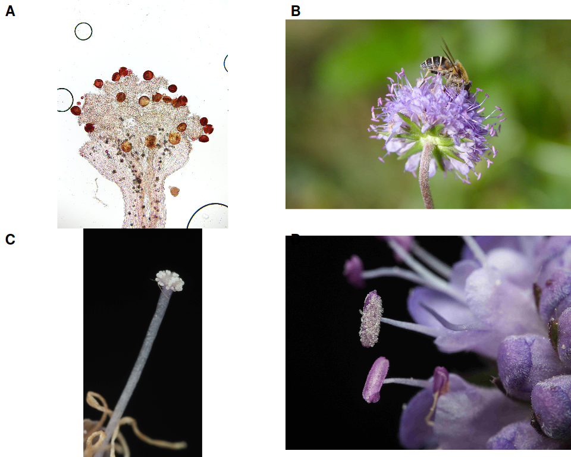
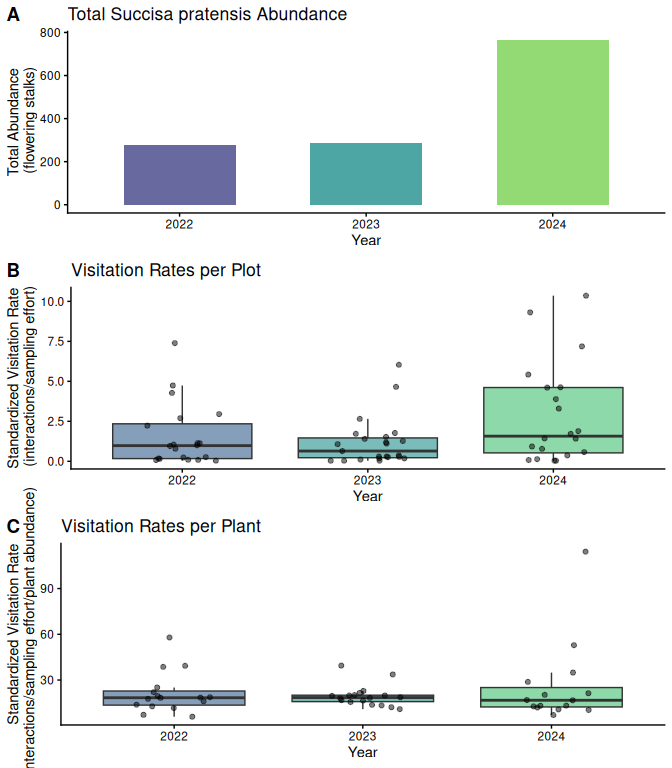

Jakub Štenc

## Abstract

***Premise*:** Pollen transfer by animal vectors is inherently
stochastic at the micro-level, yet population-level conspecific pollen
(CP) deposition often remains remarkably stable. It remains unclear how
generalist plants compensate for the extreme variance of individual
pollinator visits to secure reliable CP receipt while mitigating
heterospecific pollen (HP) accumulation from shared networks.

***Methods*:** Using a three-year dataset (2022–2024) for the generalist
plant *Succisa pratensis*, we evaluated pollen transfer dynamics across
multiple hierarchical scales. We combined variance partitioning of
terminal pollen deposition (TPD) on stigma, single-visit deposition
(SVD) on stigma experiments, and inter-annual dynamic of the
plant-pollinator .

***Results*:** Variance partitioning revealed that temporal shifts
(years and days) explained negligible variation in CP deposition;
rather, the vast majority of variance occurred at the micro-scale among
individual stigmas. SVD experiments confirmed that individual generalist
visits are highly stochastic, exhibiting extreme variance in CP
delivery. However, at the whole-stigma level, this micro-scale
unpredictability averaged out into constant CP loads. Furthermore, while
HP accumulated linearly with CP during standard years, a dramatic
inter-annual spike in *S. pratensis* floral abundance significantly
flattened the HP accumulation curve.

***Conclusions*:** Despite the unpredictability of individual pollinator
visits, generalist plants can secure highly stable conspecific pollen
deposition and buffer against heterospecific pollen.

## Introduction

Pollen transfer by animal vectors is inherently stochastic at the
micro-level (reviewed in Minnaar et al. ([2019](#ref-Minnaar2019))),
characterized by highly variable, heterogeneous pollen loads delivered
during individual foraging events ([Richards et al.,
2009](#ref-richards2009variation); [King et al., 2013](#ref-king2013)).
Yet, despite this fine-scale unpredictability, population-level studies
demonstrate that conspecific pollen (CP) deposition on stigmas can
remain remarkably stable across multiple years (e.g., Fang et al.
([2019](#ref-fang2019multi)); Fang et al. ([2022](#ref-Fang2022))). This
paradox highlights a fundamental gap in pollination ecology: how do
generalist plants compensate for the extreme variance of individual
pollinator visits to secure reliable CP receipt on their stigmas, while
simultaneously mitigating the accumulation of heterospecific pollen (HP)
from other plants within the co-flowering community?

To resolve this paradox, it is critical to examine pollen transfer
dynamics across hierarchical scales, from the single-visit deposition
(SVD) to the total pollen deposition (TPD). At the scale of an SVD, the
mechanical delivery of conspecific pollen is intrinsically
unpredictable. Even among legitimate, generalist pollinators, the exact
quantity of pollen deposited during a brief floral interaction
fluctuates dramatically due to highly variable individual pollen loads
([King et al., 2013](#ref-king2013); [Freudenfeld et al.,
2025](#ref-freudenfeld2025interannual)). This micro-scale stochasticity
is further compounded by taxon-specific differences in pollinator
behavior, such as grooming ([Holmquist et al.,
2012](#ref-holmquist2012influence)), complex pollen carryover dynamics
across successive flower visits ([Thomson and Plowright,
1980](#ref-thomson1980)), and fluctuating adaptive foraging decisions
within the network ([Valdovinos, 2025](#ref-valdovinos2025effect)).
Consequently, from the perspective of an individual receptive stigma,
the absolute number of CP grains received during any single visit
exhibits extreme depositional variance, requiring plants to rely on
broader ecological mechanisms to aggregate these variable events into a
stable reproductive outcome ([Richards et al.,
2009](#ref-richards2009variation)).

To overcome the extreme unpredictability of individual pollinator
visits, some plants depend on the high visitation rates generated by
dense local floral displays ([Vázquez, 2005](#ref-vazquez2005degree);
[Janovskỳ et al., 2013](#ref-janovsky2013conspecific)). By accumulating
a high volume of pollinator visits, plants can average out the extreme
depositional variance of individual vectors, ensuring reliable CP
receipt. However, relying on generalized pollination networks
concurrently introduces the risk of reproductive interference from the
surrounding floral community ([Morales and Traveset,
2008](#ref-morales2008interspecific),
[2013](#ref-morales2013heterospecific); [Arceo-Gómez and Ashman,
2011](#ref-ArceoGomez2011)). Co-flowering heterospecific neighbors not
only act as sources of competitive pollen, but they actively alter the
composition and fidelity of the pollinator assemblage visiting the focal
plant ([Lázaro et al., 2009](#ref-Lazaro2009); [Ye et al.,
2020](#ref-ye2020)). Therefore, effective buffering mechanisms must
secure CP while resisting neighbor-induced shifts in pollinator
behavior. High conspecific floral density achieves this by diluting the
proportion of HP in the local environmental pollen pool and overriding
the attractive pull of heterospecific neighbors ([Arceo-Gómez et al.,
2016](#ref-arceo2016patterns)).

Furthermore, this density-dependent buffering can be significantly
enhanced by temporal stratification ([Stone et al.,
1998](#ref-Stone1998); [Schwarz et al., 2021](#ref-Schwarz2021)). For
example, the diurnal pollen release schedules previously observed in
*Succisa pratensis* allow the plant to establish temporal dominance
early in the day ([Štenc et al., 2023b](#ref-stenc2023pollinator)). By
releasing pollen and attracting vectors before co-flowering competitors
do, a plant can secure massive CP delivery prior to the accumulation of
heterogeneous pollen loads on shared vectors, functioning as a form of
temporal specialization ([Brosi, 2016](#ref-Brosi2016)). This temporal
stratification ensures that the highest frequency of redundant visits
occurs during an optimal window, overriding the subsequent accumulation
of HP when shared vectors ultimately shift their foraging efforts toward
afternoon-flowering competitors ([Schwarz et al.,
2021](#ref-Schwarz2021); [Štenc et al.,
2023b](#ref-stenc2023pollinator))How can position the .

\[Aims\]

While the variability of individual visits and the theoretical
frameworks for HP accumulation are well known, empirical studies rarely
measure these processes across multiple scales in a single natural
system. In this study, we evaluate pollen transfer using a three-year
dataset (2022–2024) for the highly visited, generalist plant *Succisa
pratensis*. We address the following objectives: (1) to quantify the
variance in pollen deposition across years, days, individual plants, and
individual stigmas; (2) to compare the variability of CP and HP across
transport stages, from single-visit depositions to final stigmatic
loads; and (3) to determine how year-to-year changes in local floral
abundance influence the accumulation of HP relative to CP. We
hypothesize that despite the high variability of individual generalist
visits, *S. pratensis* achieves stable CP deposition because high local
floral abundance and early morning pollen release ([Štenc et al.,
2023a](#ref-Stenc2023), [2025](#ref-vstenc2025pollen)) buffer the plant
against unpredictable single-visit deliveries.

## Methods

### Study system

Our observations were conducted in a seminatural grassland community
with a high abundance of flowering plants (especially *Succisa
pratensis*) and diverse pollinator community, dominated by hoverflies.
The study site “K Handrkovu” is located near the village of Vernýřov,
Central Bohemia, Czech Republic (N 49.8466; E 15.1498). The study site
can be classified as a mosaic of moist to mesophilic and eutrophic to
mesotrophic grasslands with more than 50 entomogamous plant species
flowering in late summer every year ([Janovskỳ et al.,
2013](#ref-janovsky2013conspecific)). The fieldwork was conducted in
2022-2024 during the peak of *Succisa pratensis* flowering activity
(XXth-XXth August, XXh-XXth August and XXth-XXth August, respectively).

*Succisa pratensis*, our focal plant species, is frequently visited by a
wide spectrum of pollinators, especially hoverflies (see
<a href="#fig-plant-pollinator-panel" class="quarto-xref">Figure 1</a>),
feeding on both pollen and nectar on it. In addition, *Succisa
pratensis* has a relatively large and stable population at our study
site. Important traits related to pollination also include distinctive
open inflorescences available to most pollinators, protandry preventing
self-pollination ([Bartoš et al., 2020](#ref-bartovs2020self)) and
pollen releasing in the morning hours ([Štenc et al.,
2023b](#ref-stenc2023pollinator)).

We focused on the common hoverflies species with stable populations with
a sufficient numbers of males and females adults occurring at the study
site and frequently visiting *Succisa pratensis*. The most common
visitors are hoverfly genera *Eristalis* (*E. arbustorum, E.
interruptus, E. intricaria, E. pertinax, E. similis* and *E. tenax*),
*Helophilus* (*H. pendulus* and *H. trivittatus*) and meatfly genera
*Sarcophaga*.

### 

Figure 1: A) Stigma of *Succisa pratensis* with several pollen
morphotypes, B) Pollinator (*Eristalis* sp.) on flower of *Succisa
pratensis*, see the pollen on pollinator body, C) Detail of anther with
visible pollen grains of *Succisa pratensis*, D) Detail of stigma of
*Succisa pratensis* with visible deposited pollen grains

### Plant-pollinator interactions and plant abundance

Following the same protocol at the study locality as published in
Janovský et al. ([2013](#ref-Janovsky2013)), we collected data on
pollinator visitation activity. We used same permanent plots as in the
flowering plant abundance to record all interactions of flower-visiting
pollinators with flowering *Succisa pratensis* and other plant species
in the surrounding of *S. pratensis*. All flowers within the plot were
checked only one time to avoid pseudo-replication and all interactions
occurring at the moment of the survey were recorded, lasting up to five
minutes. Each plot was recorded at least twenty times during the
activity period of pollinators (7:00 - 19:00) at the peak of flowering
(mid-August) each year. We recorded only the pollinators touching the
reproductive organs of the visited plant and each individual pollinator
only once. Finally, we counted standardized interaction rates (total
number of interactions per sampling visit) for pollinators visiting S*.
pratensis* from 2022 to 2024 and compared the distribution of
interaction rates for the specific group of pollinators visiting *S.
pratensis* and the same pollinators on all other plant species.

Thanks to long-term research on flowering plants and their interactions
with pollinators, we obtained information on the abundances of
individual plants at the study site and it’s changes over time (see
Janovský et al., 2013). We used 4 × 4 m2 permanent plots each placed in
the center of each grid point of a 20 × 20 m2 grid covering a total area
of 300 × 300 m2 of the study site. To determine the floral neighborhood
of *S. pratensis* from 2022 to 2024, we counted distribution of plant
abundance for individual plots where *S. pratensis* was present. We
counted conspecific abundance of the focal species and heterospecific
co-flowering abundance index, which is the cumulative abundance of all
other co-flowering plant species in the plot.

### Pollen load

Foraging hoverflies visiting Succisa inflorescence were caught with
entomological net and killed immediately after capture. We swabbed
pollen grains from one half (randomly selecting left or right) of each
pollinator’s body with a small block of fuchsin jelly, following Beattie
([1971](#ref-beattie1971technique)). We stored captured pollinators in
the 70% ethanol. On the same day, we produced semi-permanent samples by
melting fuchsin jelly with a heating pad on a microscope slide, covering
and sealing with nail polish. Later, we counted and determined all
pollen grains using a light microscope. We sorted pollen into
conspecific *S. pratensis* pollen and heterospecific pollen of other
plant species.

### Single Visit Deposition (SVD)

To prevent pollinators access to flowers, we bagged selected inflorences
into a tulle bag before the plants have entered the male phase and
opened the anthers. When the plant entered the female phase with
receptive stigmas, we removed the bag and collected two control stigmas
into a tube with 70% ethanol. We watched the inflorescence for thirty
minutes and recorded every pollinator that visited it. The pollinators
were allowed to visit only one flower within the inflorescence, the
stigma of which we collected into a tube with 70% ethanol. If the
pollinator visited multiple flowers, we collected only the first visited
stigma and removed other from the plant.

### Total Pollen Deposition (TPD) on Stigma

We put collected stigmas on the slide and let the ethanol evaporate on
the heating pad. After that we added 1 µl of 10% KOH, let the samples
dry, added 3 µl of 3% hydrogen peroxide, let the samples dry again and
we added 13 µl of 8% vinegar to neutralize KOH. After further drying we
added 5 µl of dye (safranin, water and glycerol), covered the samples
with a coverslip, applied gentle, even pressure on the cover glass to
squash the stigma and sealed with nail polish to produce semi-permanent
samples.

### Statistical Analysis

## Results

### Plant-pollinator interactions and plant abundance

Plant abundance shift and the effect on visitation - needs to be tested.

Figure 2: Distribution and abundance of Succisa pratensis (2022-2024).
A) Spatial distribution of plots with Succisa presence. B) Total
abundance recorded per year. C) Differences in standardized visitation
rates to Succisa pratensis across years (2022-2024).

### Pollinator Spectra Comparison (2022-2024)

Change in pollinator composition - not that much

### Community Stability & Composition

To assess the temporal stability of the pollinator community, we
compared species composition across years using the **Morisita-Horn
similarity index** (Horn, 1966). This metric was selected for its
robustness to differences in sample size and species richness compared
to incidence-based metrics (Jost et al., 2011). Pairwise similarities
were calculated on abundance data (standardized by sampling effort)
using the `vegan` package.

The core structure of the pollinator community remained highly stable
across the three years. The Morisita-Horn index indicated high
compositional overlap (Similarity \> 0.9 for all pairwise comparisons),
driven by the consistent dominance of key generalist taxa such as
*Eristalis* spp. and *Syrphus* spp. (see Table S3 in Supplementary
Material).

### Pollen load

### Single Visit Deposition (SVD)

### TPD

    

      
      <table class="gt_table" data-quarto-disable-processing="false" data-quarto-bootstrap="false">
      <thead>
        <tr class="gt_heading">
          <td colspan="6" class="gt_heading gt_title gt_font_normal gt_bottom_border" style><strong>Model Results for Pollen Deposition: A) ANOVA Results</strong></td>
        </tr>
        
        <tr class="gt_col_headings">
          <th class="gt_col_heading gt_columns_bottom_border gt_left" rowspan="1" colspan="1" style="font-weight: bold;" scope="col" id="Term">Predictor</th>
          <th class="gt_col_heading gt_columns_bottom_border gt_center" rowspan="1" colspan="1" style="font-weight: bold;" scope="col" id="Df">df</th>
          <th class="gt_col_heading gt_columns_bottom_border gt_center" rowspan="1" colspan="1" style="font-weight: bold;" scope="col" id="Stat1">Sum Sq</th>
          <th class="gt_col_heading gt_columns_bottom_border gt_center" rowspan="1" colspan="1" style="font-weight: bold;" scope="col" id="Stat2">Mean Sq</th>
          <th class="gt_col_heading gt_columns_bottom_border gt_center" rowspan="1" colspan="1" style="font-weight: bold;" scope="col" id="Stat3">F-value</th>
          <th class="gt_col_heading gt_columns_bottom_border gt_center" rowspan="1" colspan="1" style="font-weight: bold;" scope="col" id="P_value">P-value</th>
        </tr>
      </thead>
      <tbody class="gt_table_body">
        <tr><td headers="Term" class="gt_row gt_left">Conspecific Pollen (CP)</td>
    <td headers="Df" class="gt_row gt_center">1</td>
    <td headers="Stat1" class="gt_row gt_center">39.035</td>
    <td headers="Stat2" class="gt_row gt_center">39.035</td>
    <td headers="Stat3" class="gt_row gt_center">15.04</td>
    <td headers="P_value" class="gt_row gt_center">&lt;0.001</td></tr>
        <tr><td headers="Term" class="gt_row gt_left">Year</td>
    <td headers="Df" class="gt_row gt_center">2</td>
    <td headers="Stat1" class="gt_row gt_center">552.940</td>
    <td headers="Stat2" class="gt_row gt_center">276.470</td>
    <td headers="Stat3" class="gt_row gt_center">106.51</td>
    <td headers="P_value" class="gt_row gt_center">&lt;0.001</td></tr>
        <tr><td headers="Term" class="gt_row gt_left">Conspecific Pollen (CP):Year</td>
    <td headers="Df" class="gt_row gt_center">2</td>
    <td headers="Stat1" class="gt_row gt_center">72.937</td>
    <td headers="Stat2" class="gt_row gt_center">36.468</td>
    <td headers="Stat3" class="gt_row gt_center">14.05</td>
    <td headers="P_value" class="gt_row gt_center">&lt;0.001</td></tr>
        <tr><td headers="Term" class="gt_row gt_left">Residuals</td>
    <td headers="Df" class="gt_row gt_center">231</td>
    <td headers="Stat1" class="gt_row gt_center">599.614</td>
    <td headers="Stat2" class="gt_row gt_center">2.596</td>
    <td headers="Stat3" class="gt_row gt_center"></td>
    <td headers="P_value" class="gt_row gt_center"></td></tr>
      </tbody>
      
    </table>
    

    

      
      <table class="gt_table" data-quarto-disable-processing="false" data-quarto-bootstrap="false">
      <thead>
        <tr class="gt_heading">
          <td colspan="6" class="gt_heading gt_title gt_font_normal gt_bottom_border" style><strong>Model Results for Pollen Deposition: B) Pairwise Slope Contrasts</strong></td>
        </tr>
        
        <tr class="gt_col_headings">
          <th class="gt_col_heading gt_columns_bottom_border gt_left" rowspan="1" colspan="1" style="font-weight: bold;" scope="col" id="Term">Contrast</th>
          <th class="gt_col_heading gt_columns_bottom_border gt_center" rowspan="1" colspan="1" style="font-weight: bold;" scope="col" id="Df">df</th>
          <th class="gt_col_heading gt_columns_bottom_border gt_center" rowspan="1" colspan="1" style="font-weight: bold;" scope="col" id="Stat1">Estimate</th>
          <th class="gt_col_heading gt_columns_bottom_border gt_center" rowspan="1" colspan="1" style="font-weight: bold;" scope="col" id="Stat2">SE</th>
          <th class="gt_col_heading gt_columns_bottom_border gt_center" rowspan="1" colspan="1" style="font-weight: bold;" scope="col" id="Stat3">t-ratio</th>
          <th class="gt_col_heading gt_columns_bottom_border gt_center" rowspan="1" colspan="1" style="font-weight: bold;" scope="col" id="P_value">P-value</th>
        </tr>
      </thead>
      <tbody class="gt_table_body">
        <tr><td headers="Term" class="gt_row gt_left">Year2022 - Year2023</td>
    <td headers="Df" class="gt_row gt_center">231</td>
    <td headers="Stat1" class="gt_row gt_center">-0.023</td>
    <td headers="Stat2" class="gt_row gt_center">0.025</td>
    <td headers="Stat3" class="gt_row gt_center">-0.93</td>
    <td headers="P_value" class="gt_row gt_center">0.62408</td></tr>
        <tr><td headers="Term" class="gt_row gt_left">Year2022 - Year2024</td>
    <td headers="Df" class="gt_row gt_center">231</td>
    <td headers="Stat1" class="gt_row gt_center">0.062</td>
    <td headers="Stat2" class="gt_row gt_center">0.020</td>
    <td headers="Stat3" class="gt_row gt_center">3.13</td>
    <td headers="P_value" class="gt_row gt_center">0.00553</td></tr>
        <tr><td headers="Term" class="gt_row gt_left">Year2023 - Year2024</td>
    <td headers="Df" class="gt_row gt_center">231</td>
    <td headers="Stat1" class="gt_row gt_center">0.085</td>
    <td headers="Stat2" class="gt_row gt_center">0.018</td>
    <td headers="Stat3" class="gt_row gt_center">4.64</td>
    <td headers="P_value" class="gt_row gt_center">&lt; 0.001</td></tr>
      </tbody>
      
    </table>
    

In total, we collected 693 stigmas from 273 individual plants in (84,
89, 520 stigmas in 2022, 2023 and 2024 respectively).

#### Variance Partitioning

Variance partitioning and subsequent likelihood ratio tests revealed
significant temporal and spatial drivers of heterospecific pollen (HP)
deposition. At the inter-annual scale (2022-2024), we found significant
variation in HP deposition driven by both the sampling year (χ2=32.39,
p\<0.001) and the individual plant nested within year (χ2=104.73,
p\<0.001).

However, fine-scale intra-annual analysis of the 2024 season showed that
daily temporal variation was not a significant driver of HP deposition
(χ2=0.19, p=0.663). Instead, variance during this single season was
heavily driven by differences among individual plants (χ2=126.53,
p\<0.001), suggesting that plant-level traits or highly localized
micro-spatial effects dictate heterospecific pollen transfer more than
daily phenological shifts.

### The Hierarchical Scale of Total Pollen Depositional Variance

### Variability Analysis: Coefficient of Variation

To assess the relative variability of pollen counts across the transport
network, we calculated the Coefficient of Variation (CV %) for
Conspecific (CP) and Heterospecific (HP) pollen loads on Stigmas,
Bodies, and in Guts.

### Monte Carlo SVD Simulation

To test if visitation redundancy alone could explain final pollen loads,
we used a Monte Carlo simulation to aggregate random single-visit
depositions (SVDs). This simulation revealed contrasting patterns for
conspecific (CP) and heterospecific (HP) pollen. For CP, the simulated
distribution closely mirrored the observed field data, confirming that
the high variation of individual visits is effectively averaged out
through cumulative, redundant interactions. However, for HP, the
simulation failed to match reality. The simulation predicted that
stigmas should accumulate a consistent, moderate amount of HP. In
contrast, our observed field data showed that most stigmas accumulated
almost zero HP, while a small number of stigmas received massive,
extreme loads (resulting in a long, right-skewed tail). This discrepancy
indicates that while simple visitation frequency explains CP stability,
additional ecological mechanisms actively alter the accumulation of HP.

## Discussion

keypoints: - CP is quite constant - HP is variable - Variability is
highest in the SVD

Our results suggest that the relationship between conspecific and
heterospecific pollen deposition is driven by specific functional
mechanisms rather than simple abundance.

Our Monte Carlo simulation proved that high visitation rates are
sufficient to explain how Succisa pratensis secures a stable, reliable
load of conspecific pollen (CP). The simple mathematical averaging of
multiple, highly variable single visits naturally produced the stable CP
loads we observed in the field.

However, simple visitation redundancy cannot explain the patterns of
heterospecific pollen (HP) deposition. If insects were simply depositing
random mixtures of pollen at a constant rate, our simulation showed that
every flower should receive a moderate, unavoidable dose of HP. Instead,
observed stigmas overwhelmingly avoided HP entirely, peaking near zero.
This disconnect between the simulation and reality proves that S.
pratensis actively filters out HP using broader ecological strategies.
By relying on dense local floral displays to dilute environmental HP,
and utilizing early-morning pollen release to ensure insects are loaded
with CP before visiting other species, the plant successfully overrides
the expected accumulation of heterospecific noise. The few observed
flowers that did receive massive HP loads likely represent rare events
where a pollinator exhibited extreme flower inconstancy, switching
directly from a neighboring heterospecific plant.

Our finding that Eristalis spp. drives the pollen economy despite
introducing the most heterospecific noise perfectly aligns with the
concept of ‘pollinator importance’ (Vázquez et al., 2005). Previous
empirical studies have similarly demonstrated that taxa with low
per-visit efficiency can dominate total pollen transfer simply through
overwhelming visitation frequency. For example, Sahli and Conner (2007)
found that while syrphid flies deposited minimal pollen during single
visits, their exceptionally high visitation rates made them the most
important contributors to total pollination. Likewise, our data proves
that for Succisa pratensis, the sheer volume of generalist visits acts
as a macro-scale filter, effectively drowning out the micro-scale
‘messiness’ of individual vectors.

## Data Availability

The datasets used in this study are available in the supplementary
material and have been exported for archiving.

## Supllements

## References

### 

Arceo-Gómez, G., L. Abdala-Roberts, A. Jankowiak, C. Kohler, G. A.
Meindl, C. M. Navarro-Fernández, V. Parra-Tabla, et al. 2016. Patterns
of among-and within-species variation in heterospecific pollen receipt:
The importance of ecological generalization. *American Journal of
Botany* 103: 396–407.

Arceo-Gómez, G., and T. L. Ashman. 2011. [Heterospecific pollen
deposition: Does diversity alter the
consequences?](https://doi.org/10.1111/J.1469-8137.2011.03831.X) *New
Phytologist* 192: 738–746.

Bartoš, M., Š. Janeček, P. Janečková, E. Padyšáková, R. Tropek, L.
Götzenberger, Y. Klomberg, and J. Jersáková. 2020. Self-compatibility
and autonomous selfing of plants in meadow communities. *Plant Biology*
22: 120–128.

Beattie, A. 1971. A technique for the study of insect-borne pollen. *The
Pan-Pacific Entomologist* 47: 82.

Brosi, B. J. 2016. [Pollinator specialization: From the individual to
the community](https://doi.org/10.1111/nph.13951). *New Phytologist*:
1190–1194.

Fang, Q., J. Gao, W. S. Armbruster, and S.-Q. Huang. 2019. Multi-year
stigmatic pollen-load sampling reveals temporal stability in
interspecific pollination of flowers in a subalpine meadow. *Oikos* 128:
1739–1747.

Fang, Q., S. Guo, T. Zhang, and X. Tang. 2022. [Relative stable
interannual variation in plant‒plant pollen transfer rather than the
plant‒pollinator network of a subalpine
meadow](https://doi.org/10.1093/jpe/rtac094). *Journal of Plant
Ecology*.

Freudenfeld, M., J. Štenc, J. Hadrava, M. Mikát, E. Matoušková, K.
Daňková, T. Jor, et al. 2025. Interannual differences in pollinator
contributions to pollen transfer are mainly driven by changes in
pollinator abundance. *AoB Plants* 17: plaf009.

Holmquist, K. G., R. J. Mitchell, and J. D. Karron. 2012. Influence of
pollinator grooming on pollen-mediated gene dispersal in mimulus ringens
(phrymaceae). *Plant Species Biology* 27: 77–85.

Janovský, Z., M. Mikát, J. Hadrava, E. Horčičková, K. Kmecová, D.
Požárová, J. Smyčka, and T. Herben. 2013. [Conspecific and
heterospecific plant densities at small-scale can drive plant-pollinator
interactions](https://doi.org/10.1371/journal.pone.0077361). *PLoS ONE*
8: 77361.

Janovskỳ, Z., M. Mikát, J. Hadrava, E. Horčičková, K. Kmecová, D.
Požárová, J. Smyčka, and T. Herben. 2013. Conspecific and heterospecific
plant densities at small-scale can drive plant-pollinator interactions.
*PLoS One* 8: e77361.

King, C., G. Ballantyne, and P. G. Willmer. 2013. [Why flower visitation
is a poor proxy for pollination: Measuring single-visit pollen
deposition, with implications for pollination networks and
conservation](https://doi.org/10.1111/2041-210X.12074). *Methods in
Ecology and Evolution* 4: 811818.

Lázaro, A., R. Lundgren, and Ø. Totland. 2009. [Co-flowering neighbors
influence the diversity and identity of pollinator groups visiting plant
species](https://doi.org/10.1111/j.1600-0706.2008.17168.x). *Oikos* 118:
691–702.

Minnaar, C., B. Anderson, M. L. D. Jager, and J. D. Karron. 2019.
[Plant-pollinator interactions along the pathway to
paternity](https://doi.org/10.1093/aob/mcy167). *Annals of Botany* 123:
225–245.

Morales, C. L., and A. Traveset. 2013. Heterospecific pollen deposition:
Does diversity matter? *Functional Ecology* 27: 130–137.

Morales, C. L., and A. Traveset. 2008. Interspecific pollen transfer:
Magnitude, prevalence and consequences for plant fitness. *Critical
Reviews in Plant Sciences* 27: 221–238.

Richards, S. A., N. M. Williams, and L. D. Harder. 2009. Variation in
pollination: Causes and consequences for plant reproduction. *The
American Naturalist* 174: 382–398.

Schwarz, B., C. F. Dormann, D. P. Vázquez, and J. Fründ. 2021.
[Within-day dynamics of plant–pollinator networks are dominated by early
flower closure: An experimental test of network
plasticity](https://doi.org/10.1007/s00442-021-04952-5). *Oecologia*
196: 781–794.

Štenc, J., L. Janošík, E. Matoušková, J. Hadrava, M. Mikát, and Z.
Janovský. 2023a. [Pollinator visitation closely tracks diurnal patterns
in pollen release](https://doi.org/10.1002/AJB2.16179). *American
Journal of Botany*: e16179.

Štenc, J., L. Janošı́k, M. Freudenfeld, E. Matoušková, J. Hadrava, M.
Mikát, K. Daňková, et al. 2025. Pollen presentation mitigates
competition for pollinators due to diurnal stratification of pollen
transfer. *Perspectives in Plant Ecology, Evolution and Systematics* 67:
125868.

Štenc, J., L. Janošı́k, E. Matoušková, J. Hadrava, M. Mikát, and Z.
Janovskỳ. 2023b. Pollinator visitation closely tracks diurnal patterns
in pollen release. *American Journal of Botany* 110: e16179.

Stone, G. N., P. Willmer, and J. A. Rowe. 1998. [Partitioning of
pollinators during flowering in an african acacia
community](https://doi.org/10.1890/0012-9658(1998)079[2808:popdfi]2.0.co;2).
*Ecology* 79: 2808–2827.

Thomson, J. D., and R. C. Plowright. 1980. [Pollen carryover, nectar
rewards, and pollinator behavior with special reference to diervilla
loniceraPollen carryover, nectar rewards, and pollinator behavior with
special reference to diervilla
lonicera](https://doi.org/10.1007/BF00346968). *Oecologia* 46: 68–74.

Valdovinos, F. S. 2025. Effect of network structure and adaptive
foraging on pollination services of species-rich plant-pollinator
communities. *Integrative and Comparative Biology* 65: 981–990.

Vázquez, D. P. 2005. Degree distribution in plant–animal mutualistic
networks: Forbidden links or random interactions? *Oikos* 108: 421–426.

Ye, Z. M., X. F. Jin, Q. F. Wang, and C. F. Yang. 2020. [Co-flowering
neighbor alters pollinator composition and influences reproductive
success in a plant pollinated by multiple
insects](https://doi.org/10.1007/S11258-020-01000-9/TABLES/2). *Plant
Ecology* 221: 219–228.

