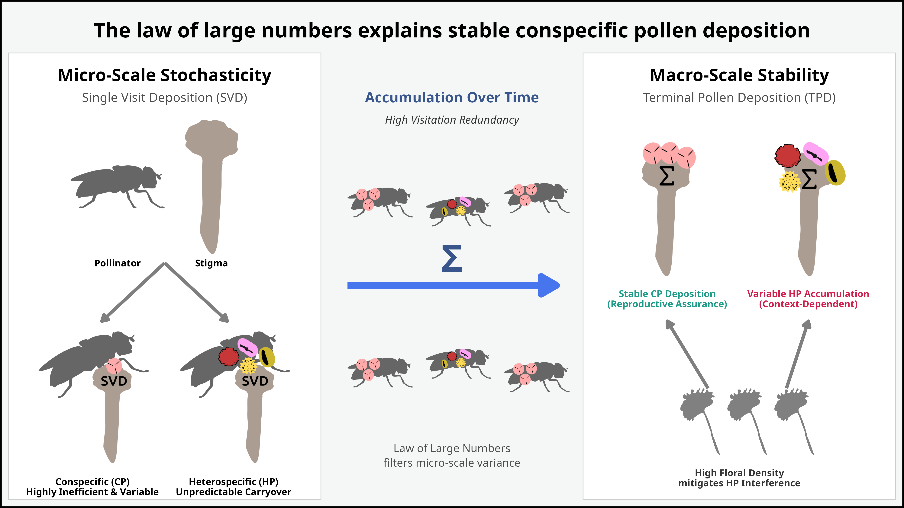

Authors:

Jakub Štenc^1,2,3^\*, Martin Freudenfeld^1^, Petr Švanda^1^, Eva Matoušková^1^, Jiří Hadrava^2^, Michael Mikát^2^, Tadeáš Ryšan^2^, Helena Pijálková^2^ , Eva Horčičková^4^, Zdeněk Janovský^5^

^1^ Department of Botany, Faculty of Science, Charles University, Benátská 2, 128 41 Prague, Czech Republic

^2^ Department of Zoology, Faculty of Science, Charles University, Viničná 7, 128 41 Prague, Czech Republic

^15^ Department of Environment, Faculty of Environment, Jan Evangelista Purkyně University in Ústí nad Labem, Pasteurova 3632/15, 400 96, Ústí nad Labem, Czech Republic

^16^ Department of Ecology, Faculty of Environmental Sciences, Czech University of Life Sciences, Kamýcká 129, 165 00, Prague , Czech Republic

^19^ Svatý Jan t. Krsovice 1, 285 04 Uhlířské Janovice, Czech Republic

\*Contact and corresponding author, e-mail address: [[jakubstenc\@gmail.com]{.underline}](mailto:jakub.stenc@gmail.com).

Affiliations:

```{r}
#| label: init-setup
#| include: false
knitr::read_chunk("scripts/Analysis_FML_Z.R")
```

```{r}
#| label: global-setup
#| include: false
```

## Abstract

**Premise:** Animal-mediated pollen transfer exhibits high micro-scale stochasticity, exerting selection pressure on plants to secure reproductive assurance. Although single-visit deposition (SVD) yields highly variable pollen loads, terminal pollen deposition (TPD), the final stigmatic pollen load, often remains stable at the population level. The mechanisms buffering this visit-level unpredictability while mitigating reproductive interference from heterospecific pollen (HP) remain unresolved.

**Methods:** We evaluated pollen transfer dynamics across hierarchical scales using a three-year dataset (2022–2024) for *Succisa pratensis*. We integrated variance partitioning of terminal pollen deposition (TPD; final stigmatic loads before senescence) with SVD experiments across dominant pollinator taxa. We used Monte Carlo simulations, parameterized with empirical SVD and visitation frequency data, to test whether accumulating multiple pollinator visits accounts for the observed stability of TPD.

**Results:** Variance partitioning revealed that temporal shifts explained negligible variation in CP deposition; rather, the vast majority of variance occurred at the micro-scale among individual stigmas. SVD experiments confirmed that individual pollinator visits are highly stochastic and inefficient. However, Monte Carlo simulations demonstrated that at the whole-stigma level, the accumulation of pollen across multiple visits effectively neutralises micro-scale unpredictability, translating into stable terminal CP loads. In contrast, HP accumulation proved to be substantially more variable and partially depended on inter-annual variation in the floral neighbourhood.

**Conclusions:** Despite the mechanical unpredictability of pollen deposition during individual pollinator visits, plants can secure highly stable conspecific pollen deposition through the simple accumulation of pollen over the stigma lifespan. However, the potential for reproductive interference via heterospecific pollen depends largely on the ecological context.

{#fig-graphical-abstract}

## Introduction

Pollen transfer by animal vectors is inherently stochastic at the micro-level [reviewed in @Minnaar2019], characterised by highly variable, heterogeneous pollen loads delivered during individual foraging events [@richards2009variation; @king2013]. Despite this unpredictability, population-level studies demonstrate that terminal pollen deposition (TPD)—the final stigmatic pollen load prior to senescence—remains stable across multiple years [e.g., @fang2019multi; @Fang2022]. This stability provides reproductive assurance, driven by the accumulation of conspecific pollen (CP). Conversely, the receipt of heterospecific pollen (HP) from co-flowering species may cause reproductive interference that negatively impacts plant fitness [@ArceoGomez2011]. Resolving how plants compensate for high variance in single-visit deposition (SVD), the absolute number of pollen grains delivered during one pollinator visit, to secure CP receipt while mitigating HP accumulation remains a central problem in pollination ecology.

To resolve this paradox, it is critical to examine pollen transfer dynamics across hierarchical scales, from single-visit deposition (SVD) of pollen on stigma to terminal pollen deposition (TPD). At the scale of an SVD, the delivery of conspecific pollen is highly unpredictable, and pollen transfer is markedly inefficient. Even among legitimate pollinators, the quantity of pollen transferred fluctuates dramatically due to highly variable individual pollen l Figure 6: Pollen Load and Single Visit Deposition (SVD). A) Conspecific Body Pollen Load, B) Heterospecific Body Pollen Load, C) Conspecific Single Visit Deposition, D) Heterospecific Single Visit Deposition. oads [@king2013; @freudenfeld2025interannual]. This micro-scale stochasticity is further compounded by taxon-specific differences in pollinator behaviour, such as grooming [@holmquist2012influence], insect morphological traits that drive pollen load composition [@cullen2021diversity], pollen carryover dynamics across successive flower visits [@thomson1980], and changing foraging decisions within the plant-pollinator community [@valdovinos2025effect]. Consequently, from the perspective of an individual receptive stigma, the number of CP grains received during any single visit exhibits significant variance [@herrera1987, @neeman2001 , @king2013], requiring plants to rely on broader ecological mechanisms to aggregate these variable events into a stable reproductive outcome [@richards2009variation].

To overcome the high unpredictability of individual visits, some plants rely on high visitation rates, accumulating a sufficient volume of visits to average out the variance of individual vectors and ensure reliable CP receipt. The attraction of numerous pollinators is often facilitated by dense local floral displays [@vazquez2005degree; @Janovsky2023] and/or rich flowering communities that draw diverse pollinator assemblages [@venjakob2016plant; @aguirre2024floral]. However, accumulating pollinator visits within a network concurrently introduces the risk of reproductive interference in the form of HP received from other plant species sharing pollinators within the community [@morales2008interspecific; @morales2013heterospecific; @ArceoGomez2011]. Co-flowering heterospecific neighbouring plant species not only act as sources of HP, but they also potentially alter the composition and fidelity of the pollinator assemblage visiting the focal plant [@Lazaro2009; @ye2020]. Thus, inter-annual changes in the co-flowering plant community may alter pollinator composition and behaviour, leading to both direct and indirect effects on CP and HP transfer. Therefore, plants are under evolutionary pressure to secure stable CP delivery while buffering against unpredictable pollinator behaviour.

However, high conspecific floral density may mitigate the proportion of deposited HP by pullin g pollinators from co-flowering neighbours [@arceo2016patterns], providing density-dependent buffering. Furthermore, the effect of plant density on pollination can be significantly enhanced by the temporal stratification of plant-pollinator interactions within the community [@Stone1998; @Schwarz2021]. For example, the diurnal pollen release schedules previously observed in *Succisa pratensis* allow the plant to establish temporal dominance by attracting pollinators primary early in the day [@stenc2023pollinator]. By releasing pollen and attracting vectors before co-flowering competitors do, a plant can secure substantial CP delivery prior to the accumulation of heterogeneous pollen loads on shared vectors, functioning as a form of temporal specialisation [@Brosi2016]. This temporal stratification ensures that the highest-frequency visits occur within a specific time window, mitigating the subsequent accumulation of HP [@Schwarz2021; @stenc2023pollinator].

While the variability of individual visits and the theoretical frameworks for pollen accumulation are well known, empirical studies rarely measure these processes across multiple scales in a natural system to study them simultaneously. In this study, we evaluate pollen transfer using a three-year dataset (2022–2024) for the highly visited plant *Succisa pratensis*. We address the following objectives: (1) to quantify the hierarchical variance in pollen deposition across years, days, individual plants, and individual stigmas; (2) to compare the mechanistic efficiency of CP and HP transfer across dominant vector taxa at the single-visit (SVD) scale; (3) to mathematically test whether visitation redundancy drives stable CP deposition using Monte Carlo simulations; and (4) to determine how year-to-year changes in local conspecific floral abundance influence the accumulation of HP. We hypothesise that despite the high variability of individual generalist visits, *S. pratensis* achieves stable CP deposition because high local floral abundance and early morning pollen release [@stenc2023pollinator; @stenc2025pollen] buffer the plant against unpredictable single-visit deliveries.

## Methods

### Study system

Our observations were conducted in a semi-natural grassland community characterised by a high abundance of flowering plants and a diverse pollinator community dominated by hoverflies. The study site, “K Handrkovu”, is located near the village of Vernýřov, Central Bohemia, Czech Republic (49.8466° N, 15.1498° E). The site can be classified as a mosaic of moist-to-mesophilic and eutrophic-to-mesotrophic grasslands, supporting more than 50 entomogamous plant species that flower in late summer each year [@Janovsky2013]. Fieldwork was conducted from 2022 to 2024 during the peak of *S. pratensis* flowering activity (15–19 August, 13–20 August, and 11–18 August, respectively).

*Succisa pratensis*, our focal plant species, maintains a relatively large and stable population at our study site. It is frequently visited by a wide spectrum of pollinators—especially hoverflies (@fig-plant-pollinator-panel)—which feed on both its pollen and nectar. Important traits related to its pollination include distinctive open inflorescences accessible to most pollinators, protandry to prevent self-pollination [@bartos2020self], and a diurnal pollen release schedule occurring in the morning hours [@stenc2023pollinator].

 

```{r}
#| label: fig-plant-pollinator-panel
#| fig-cap: "A) Stigma of *Succisa pratensis* with several pollen morphotypes; B) Pollinator (*Eristalis* sp.) on a flower of *S. pratensis*, highlighting pollen visible on the pollinator's body; C) Detail of an anther with visible pollen grains of *S. pratensis*; D) Detail of a stigma of *S. pratensis* with visible deposited pollen grains."
#| echo: false
#| warning: false
#| message: false
#| fig-width: 10
#| fig-height: 8
```

### Plant-Pollinator Interactions and Plant Abundance

Following the established protocol for this study locality [@Janovsky2013], we collected data on pollinator visitation activity in 93 permanent plots arranged in a semi-regular grid, spaced 20 m apart across the study site. All plots were permanently marked with a metal nail, recovered using a metal detector, and visibly marked prior to the sampling event each year. Within the plots, we recorded flowering plant abundance and all interactions of flower-visiting pollinators with flowering *S. pratensis*, as well as with other plant species in the surrounding community. To avoid pseudoreplication, all flowers within a plot were surveyed only once per individual sampling event. All interactions occurring during the survey moment were recorded, lasting up to five minutes per plot. Each plot was surveyed at least twenty times during a sampling period spanning 5–10 consecutive days at the peak of flowering (mid-August) each year. For this study, we utilised interactions recorded during the main diurnal period of pollinator activity (07:00–19:00). We recorded only the pollinators that made contact with the reproductive organs of the visited plant, counting each individual pollinator only once. Finally, we computed standardised interaction rates (total number of interactions per plot survey) for pollinators visiting *S. pratensis* from 2022 to 2024, and compared the distribution of interaction rates for the specific group of pollinators visiting *S. pratensis* against those visiting all other plant species.

To determine plant abundance, we surveyed the plots twice during each sampling event to control for potential phenological shifts; for this study, we used the average plant abundance per sampling event. To record abundance, we divided each plot into 64 individual cells using a string grid gently placed over the plot. Within each cell, we either counted the flowering stalks or recorded the presence/absence of flowering plants, depending on the species.

### Pollen Load

In 2024, we investigated the number of pollen grains carried on the pollinators' bodies. Foraging pollinators visiting *S. pratensis* inflorescences were captured with an entomological net and euthanised immediately. Following @beattie1971technique, we swabbed pollen grains from one half of each pollinator’s body (randomly selecting the left or right side) using a small block of Fuchsin jelly. Captured pollinators were subsequently stored in 70% ethanol. On the same day, we produced semi-permanent slides by melting the Fuchsin jelly onto a microscope slide using a heating pad, adding a coverslip, and sealing it with nail polish. We later counted and identified all pollen grains using a light microscope, sorting them into conspecific *S. pratensis* pollen and heterospecific pollen (HP) from other plant species.

### Single-Visit Deposition (SVD)

To estimate the pollinator single-visit deposition (SVD), we followed protocols adapted from previous studies [@king2013; @valverde2019]. To prevent prior pollinator access, we enclosed selected inflorescences in fine-mesh tulle bags before the plants entered the male phase and opened their anthers. Once a plant entered the female phase with receptive stigmas, we removed the bag and observed the inflorescence until the arrival of the first pollinator. Pollinators were allowed to visit only one flower within the inflorescence, after which we immediately collected its stigma into a microcentrifuge tube containing 70% ethanol. If a pollinator visited multiple flowers, we collected only the first visited stigma and removed the others from the plant. The SVD experiments were conducted in 2022, 2023 and 2024.

### Terminal Pollen Deposition (TPD) on Stigma

To determine terminal pollen deposition (TPD), we collected stigmas from flowers with visibly senesced or absent corollas, indicative of the late flowering stage (pers. obs.). Each year, we collected 3 randomly selected stigmas per flowerhead to account for intra-inflorescence variability, and from 30 randomly selected individuals from the population per day. In 2022 and 2023, we collected samples during only one day, in 2024 we sampled stigmas during 6 days, following the same 3 stigma per flowerhead and 30 plant individual design.

We placed the collected stigmas onto microscope slides and allowed the ethanol to evaporate on a heating pad. Subsequently, we applied 1 µL of 10% KOH and allowed the samples to dry, followed by 3 µL of 3% hydrogen peroxide. After another drying period, we added 13 µL of 8% acetic acid. Once completely dry, we applied 5 µL of a dye solution (safranin, water, and glycerol), covered the samples with a coverslip, applied gentle, even pressure to squash the stigma, and sealed the edges with nail polish to create semi-permanent samples. We discarded samples which were destroyed during the processing or were unsufficient for pollen counting. Pollen grains were counted and identified under a light microscope at 400× magnification. Based on the pollen morphology (size, shape and ornamentation), we distinguished conspecific (*Succisa pratensis*) pollen grains from heterospecific pollen grains (HP).

### Statistical Analysis

All statistical analyses were performed in R (version 4.3.3; @Rcore). To systematically evaluate pollen transfer dynamics across hierarchical scales, our analyses were structured into four primary components: (1) community stability and visitation dynamics, (2) single-visit transfer efficiency, (3) variance partitioning of terminal pollen deposition (TPD), and (4) mathematical simulations of visitation redundancy.

#### Community Stability and Visitation Dynamics

To assess the temporal consistency of the local ecological network, we calculated the Morisita-Horn similarity index for both the pollinator visitation spectra and the co-flowering plant community across the three study years. Differences in standardised visitation rates (total interactions per plot) and per-capita visitation rates (interactions per focal plant) across years were analysed using Kruskal-Wallis rank-sum tests, followed by post hoc Dunn’s tests with Benjamini-Hochberg false discovery rate corrections. Furthermore, to formalise the density-dependent dilution effect, we fitted a log-log linear regression evaluating how per-capita visitation rates scaled with local *S. pratensis* plot abundance.

#### Single-Visit Deposition (SVD)

To evaluate micro-scale mechanical transfer, pollinators were categorised into dominant morpho-groups (e.g., *Eristalis* spp., *Helophilus* spp., *Bombus* spp.). Differences in both conspecific pollen (CP) delivery and heterospecific pollen (HP) carryover during a single visit were tested across these taxa using Kruskal-Wallis rank-sum tests.

#### Variance Partitioning

To identify the exact spatial and temporal scales driving unpredictability in terminal stigmatic pollen loads, we applied Variance Components Analysis (VCA) using Linear Mixed Models (LMMs). Prior to modelling, pollen counts were square-root transformed to stabilise variance and approximate normality, as confirmed by residual diagnostic plots ('Residuals vs. Fitted' and 'Normal Q-Q', see Section S1). Because fine-scale daily data were exclusively available for the 2024 season, we constructed two complementary LMMs to prevent rank deficiency: an inter-annual model spanning 2022–2024 (`1 | year / plant_id`), and an intra-annual model restricted to 2024 (`1 | date / plant_id`). The statistical significance of these hierarchical random effects (Year, Date, and Plant) was evaluated using Likelihood Ratio Tests.

Furthermore, to test how HP accumulation scales with CP receipt, and whether this relationship shifted during the high-density anomaly of 2024, we aggregated pollen counts to the plant level. We fitted a linear model testing the interaction between transformed CP and Year (`sqrt(mean_HP) ~ sqrt(mean_CP) * Year`; see Section S2 for model selection and Section S3 for diagnostics). Differences in the rates of HP accumulation across years were subsequently quantified using pairwise slope contrasts via estimated marginal means.

#### Monte Carlo Simulation of Visitation Redundancy

To test whether visitation redundancy mathematically drives stable pollen deposition, we constructed a Monte Carlo bootstrapping simulation. Because pollinator morphology and mechanical transfer efficiency are functionally consistent traits, we pooled all single-visit deposition (SVD) data across the three study years to create a single, highly robust global pool of vector deposition profiles. This allowed us to mathematically isolate the effect of the plant’s changing floral density while holding vector baseline deposition constant.

We parameterised the simulation independently for each study year (2022–2024). For a given year, we estimated the average required visitation rate by dividing the empirical mean of conspecific pollen (CP) on that year’s stigmas by the mean CP of the global SVD pool. We then generated 10,000 virtual stigmas per year, randomly sampling (with replacement) from the global SVD pool based on that year’s specific visitation rate.

Finally, we evaluated the fit of the simulated null models against our true field observations. Because the large sample size of the simulation (N = 10,000) renders traditional two-sample Kolmogorov-Smirnov (K-S) p-values hypersensitive to trivial biological deviations—such as physical stigma saturation limits—we focused on the K-S D-statistic to quantify the maximum distributional divergence as a measure of effect size. Furthermore, to provide a robust and intuitive measure of simulation accuracy independent of sample size, we calculated the Overlapping Coefficient (OVL; @pastore2019measuring). The OVL quantifies the exact proportion of area shared between the empirical and simulated probability density curves, providing a direct metric of functional overlap between the theoretical null model and field reality.

## Results

Across the three-year study period (2022–2024), we collected and analysed a total of 693 terminal-stage stigmas from 273 individual *Succisa pratensis* plants to evaluate terminal pollen deposition (TPD). We sampled 84 stigmas in 2022, 89 stigmas in 2023, and 520 stigmas in 2024, with collections conducted over 6 consecutive days. To quantify micro-scale transfer dynamics and vector efficiency, we captured pollen from 300 individual visitors of *S. pratensis* to assess body pollen loads (Table S2), and we sampled 124 controlled single-visit deposition (SVD) events on virgin stigmas (Table S3). Finally, we recorded 2998 individual plant-pollinator interactions during standardised focal plot observations (Table S4). Detailed descriptions of the individual results follow.

### Coefficient of Variation and Variance Partitioning of TPD

To quantify the unpredictability of pollen transport, we compared the Coefficient of Variation (CV) across functional transport compartments (@fig-plots-2). Conspecific pollen (CP) exhibited high variability on pollinator bodies (CV = 129%) and in SVDs (CV = 206%). However, at the TPD stage, the variability decreased considerably (CV = 69%). Conversely, heterospecific pollen (HP) remained relatively variable across all compartments, from vector bodies (CV = 264%) through to final stigmatic loads (CV = 147%; see Section S7 for raw data distribution). The inter-annual variability of TPD remained relatively stable across years for CP (CVs ranging from 66% to 73%), but the variability of HP increased in 2024 (CV = 125%, @fig-plots-2).

Hierarchical variance partitioning further confirmed the micro-scale nature of this stochasticity in TPD (@fig-plots-3; Tables S5 and S6). For CP, temporal phenology (years and days) explained only a small proportion of the variation; instead, the vast majority of depositional variance occurred at the micro-spatial scale, driven by differences among individual plants (15%) and individual stigmas (82%). Variance partitioning and subsequent likelihood ratio tests (Table S7) revealed that HP deposition was significantly driven by temporal shifts at the macro-scale ($\chi^2 = 32.39, p < 0.001$) and by spatial variation among individual plants nested within the year ($\chi^2 = 104.73, p < 0.001$).

Notably, intra-annual analysis of the 2024 season showed that daily temporal variation was not a significant driver of either CP or HP deposition ($\chi^2 = 1.32, p = 0.517$ for CP; $\chi^2 = 0.19, p = 0.663$ for HP). Instead, variance during the 2024 season was heavily driven by differences among individual plants ($\chi^2 = 126.53, p < 0.001$), suggesting that plant-level traits or highly localised micro-spatial effects dictate heterospecific pollen transfer more than daily phenological shifts.

 

```{r}
#| label: fig-plots-2
#| echo: false
#| warning: false
#| message: false
#| fig-cap: "Coefficient of Variation (CV) and Mean of Conspecific (CP) and Heterospecific (HP) pollen counts across different compartments and years. A) Inter-compartmental variability (CV) comparing pollen loads on pollinator bodies (Body), single-visit deposition (SVD), and final Terminal Pollen Deposition (TPD). B) Interannual variability (CV) of TPD across 2022–2024. C) Mean pollen counts (± SE) across the three compartments, highlighting the significant drop from body loads to SVD. D) Mean TPD (± SE) across the three study years."
#| fig-height: 8
#| fig-width: 10
```

```{r}
#| label: slope-model-setup
#| include: false
```

 

```{r}
#| label: fig-plots-3
#| echo: false
#| warning: false
#| message: false
#| fig-cap: "Pollen Deposition Model and Variance Partitioning. A) Generalized Linear Mixed-Effects Model depicting the accumulation of Heterospecific Pollen (HP) relative to Conspecific Pollen (CP) on stigmas across three years (2022–2024). The dashed gray line represents the 1:1 expected relationship, illustrating that CP accumulates significantly faster than HP. B) Hierarchical Variance Partitioning of pollen deposited on stigmas, showing the proportion of variance explained by site-level spatial factors, temporal (yearly) variation, and residual individual variation."
#| fig-height: 10
```

**Table 1.** Results of Analysis of Variance (ANOVA) and subsequent pairwise slope contrasts examining the relationship between Conspecific Pollen (CP) and Heterospecific Pollen (HP) accumulation on stigmas. The ANOVA assesses the main effects of CP, Year, and their interaction on HP accumulation. Pairwise contrasts compare the rate of accumulation (slope) across the three sampling years (2022–2024), detailing differences in pollen deposition dynamics over time.

```{r}
#| label: tbl-cp-hp-accumulation
#| echo: false
#| warning: false
#| message: false
#| fig-height: 5

library(patchwork)

ft1 <- flextable(aov_table) %>%
    set_header_labels(
        Predictor = "Predictor",
        Df = "df",
        Sum_Sq = "Sum of Sq.",
        Mean_Sq = "Mean Sq.",
        F_value = "F-value",
        P_value = "P-value"
    ) %>%
    add_header_lines(values = "A) ANOVA Results") %>%
    autofit() %>%
    theme_vanilla()

ft2 <- flextable(contrasts_table) %>%
    set_header_labels(
        Contrast = "Contrast",
        Estimate = "Estimate",
        SE = "SE",
        Df = "df",
        t_ratio = "t-ratio",
        P_value = "P-value"
    ) %>%
    add_header_lines(values = "B) Pairwise Slope Contrasts") %>%
    autofit() %>%
    theme_vanilla()

# Convert tables to graphical objects and stitch them together vertically
wrap_elements(flextable::gen_grob(ft1)) / wrap_elements(flextable::gen_grob(ft2))
```

### Pollen Load and Single-Visit Deposition (SVD)

To evaluate the mechanical efficiency of pollen transfer, we compared the total pollen loads carried on vector bodies to the amounts of pollen successfully deposited on stigmas during single-visit depositions (SVD). Pollinators carried substantial pollen loads (Mean Body CP = 147.8 (SD = 393.6); Mean Body HP = 478.8 (SD = 1102.2)). However, per-visit mechanical transfer was remarkably inefficient. Only a minute fraction of the available body load, approximately 2.3% for CP and 0.1% for HP, was successfully deposited onto a receptive stigma during a single floral visit.

To determine if specific pollinator taxa drive the depositional variance observed across the network, we compared single-visit depositions (SVD) across the dominant floral visitor morphogroups (e.g., *Eristalis* spp., *Helophilus* spp., *Bombus* spp.). Kruskal-Wallis rank-sum tests revealed no significant differences among pollinator taxa in the amount of conspecific pollen deposited during a single visit ($H_3 = 1.59, p = 0.661$). Similarly, there were no significant differences across taxa in the deposition of heterospecific pollen per visit ($H_3 = 5.20, p = 0.158$). These results indicate that per-visit pollen transfer efficiency and heterospecific pollen carryover may be highly stochastic but functionally equivalent across the studied pollinator morphogroups. Consequently, the terminal stigmatic pollen loads received by *S. pratensis* are not dictated by the taxonomic identity or morphological specialisation of its visitors, but purely by the cumulative frequency of their visits.

 

```{r}
#| label: fig-body-svd
#| echo: false
#| warning: false
#| message: false
#| fig-cap: "Distribution of pollen loads carried by pollinators and deposited during single visits. A–B) Histograms showing the highly skewed distribution of Conspecific (CP) and Heterospecific (HP) pollen grains present on the bodies of captured pollinators. C–D) Corresponding distributions of CP and HP successfully deposited onto virgin stigmas during controlled single-visit deposition (SVD) experiments, demonstrating the high stochasticity and low efficiency of single transfer events."
#| fig-height: 10
#| fig-width: 10
```

### Pollinator Visitation Spectra and Co-flowering Community Stability

To assess the temporal stability of the pollinator visitation spectra of *S. pratensis* (@fig-community-stability) and the co-flowering plant community, we compared species composition across years using the Morisita-Horn similarity index [@horn1966measurement]. The pollinator spectra showed high compositional overlap across the years, ranging from 0.78 to 0.96 similarity. The flowering plant community composition showed lower overlap, ranging from 0.69 to 0.71.

The pollinator visitation spectra of *S. pratensis* (Table S4, @fig-community-stability A) was dominated by large hoverflies, namely *Eristalis tenax* (n = 1,127, 37.6%), *Eristalis interrupta* (n = 403, 13.4%), *Helophilus trivittatus* (n = 346, 11.5%), *Eristalis pertinax* (n = 138, 4.6%), and *Helophilus pendulus* (n = 105, 3.5%). Other frequent visitors included *Zygaena* sp. (n = 129, 4.3%), *Apis mellifera* (n = 98, 3.3%), and *Bombus lapidarius* (n = 71, 2.4%), with all other taxa each accounting for less than 2.2% of the total recorded visits.

 

```{r}
#| label: fig-community-stability
#| echo: false
#| warning: false
#| message: false
#| fig-cap: "Plant and pollinator community composition and temporal stability. A) Relative abundance of major pollinator functional groups visiting *Succisa pratensis* across the three study years. B) Relative floral abundance of the surrounding co-flowering plant community. C) Temporal stability of the pollinator community measured using the Morisita-Horn overlap index across consecutive years. D) Temporal stability of the floral community similarity, indicating high consistency in the background community over time."
#| fig-height: 10
#| fig-width: 14
```

### Floral Density and Visitations

Despite the increase in *S. pratensis* abundance in 2024, sampling-effort-standardised visitation rates per plot and per plant did not differ significantly between years.

 

```{r}
#| label: fig-spatial-temporal-abundance
#| fig-cap: "Spatial distribution and temporal abundance of *Succisa pratensis* and its pollinators (2022-2024). A) Spatial map showing the distribution and relative size of plots with *Succisa* presence. B) Total floral abundance of *Succisa pratensis* recorded across the study sites per year. C) Boxplots showing differences in standardized pollinator visitation rates to *Succisa pratensis* across the three years, with individual data points overlaid."
#| echo: false
#| warning: false
#| message: false
#| results: hide
#| fig-height: 12
#| fig-width: 12
```

### Monte Carlo Simulation: The Interannual Variance Filter

The year-by-year Monte Carlo simulation confirmed that visitation redundancy effectively neutralises micro-scale stochasticity for conspecific pollen (CP) across all measured years in the TPD. Regardless of the study year, the random additive accumulation of SVDs from the global vector pool successfully recreated the stable mean CP loads observed in the field (e.g., 2024 Simulated CP Mean: 26.8; Observed CP Mean: 27.4). While the two-sample K-S tests flagged mathematical divergences ($p < 0.001$) due to the hypersensitivity of a 10,000-iteration model to biological saturation limits, the tight convergence of the central tendencies and the functional overlap of the distributions (D-statistics ranging from 0.103 to 0.166) demonstrate that visitation frequency alone acts as a robust mathematical filter, effectively translating single-visit variance into stable CP deposition.

Conversely, for heterospecific pollen (HP), the simulation’s accuracy varied sharply between years, revealing that HP accumulation is governed by environmental context rather than simple mechanical redundancy. If generalist vectors deposit mixed pollen loads based strictly on their baseline single-visit profiles, the null model dictates that stigmas should accumulate a low, normalised baseline load of HP (3.4 to 4.5 grains). In standard-density years (2022 and 2023), empirical stigmas accumulated HP loads that exceeded this mathematical expectation by more than tenfold (e.g., 2023 Observed HP: 50.4 vs. Simulated: 3.4), resulting in severe structural divergence from the null model ($D > 0.77$). Crucially, during the increased density of *S. pratensis* in 2024, this neighbourhood-driven accumulation declined. The observed HP dropped to 9.6 grains, forcing the empirical distribution significantly closer to the mechanical baseline ($D = 0.265$). Because vector mechanical efficiency was held constant in our simulation, this interannual shift confirms that while standard-density years suffer heavy reproductive interference from shared networks, the increased conspecific floral abundance in 2024 actively mitigated HP accumulation, suppressing it back toward the mechanical minimum.

**Table 2.** Validation of the Monte Carlo simulation for interannual conspecific (CP) and heterospecific (HP) pollen accumulation. The table compares the simulated pollen deposition (assuming random accumulation from single visits) to the observed final Terminal Pollen Deposition (TPD) on stigmas. It details the estimated required visitation rates to achieve observed loads, observed versus simulated mean pollen loads, and structural divergence metrics (Kolmogorov-Smirnov D-statistics with corresponding p-values, and Overlapping Coefficients) across the three study years (2022–2024).

 

```{r}
#| label: monte-carlo-svd
#| echo: false
#| warning: false
#| message: false
ks_results %>%
    dplyr::mutate(
        Year = as.character(Year),
        KS_CP_p = format.pval(KS_CP_p, eps = 0.001, digits = 3),
        KS_HP_p = format.pval(KS_HP_p, eps = 0.001, digits = 3)
    ) %>%
    flextable() %>%
    set_header_labels(
        Year = "Year",
        Estimated_Visits = "Estimated\nVisits",
        Obs_Mean_CP = "Observed\nMean CP",
        Sim_Mean_CP = "Simulated\nMean CP",
        KS_CP_D = "CP K-S\n(D)",
        KS_CP_p = "CP K-S\n(p)",
        OVL_CP = "CP Overlap\n(%)",
        Obs_Mean_HP = "Observed\nMean HP",
        Sim_Mean_HP = "Simulated\nMean HP",
        KS_HP_D = "HP K-S\n(D)",
        KS_HP_p = "HP K-S\n(p)",
        OVL_HP = "HP Overlap\n(%)"
    ) %>%
    theme_vanilla() %>%
    set_table_properties(layout = "autofit", width = 1) %>%
    fontsize(size = 9, part = "all") %>%
    align(align = "center", part = "all")
```

 

```{r}
#| label: fig-monte-carlo-svd
#| echo: false
#| warning: false
#| message: false
#| fig-cap: "Validation of the Law of Large Numbers in pollen deposition via Monte Carlo Simulations. The density plots compare the observed final Terminal Pollen Deposition (TPD) (solid lines) against the simulated expected distribution (dashed lines) if stigmas accumulated pollen randomly from independent single-visit depositions (SVD). A–B) Global distribution comparisons for Conspecific (CP) and Heterospecific (HP) pollen across all years combined. C–H) Yearly breakdowns for CP and HP across 2022, 2023, and 2024, demonstrating strong structural alignment between simulated and observed deposition."
#| fig-width: 12
#| fig-height: 12
```

## Discussion

Generalist pollination systems present a paradox: animal vectors are inherently unpredictable at the micro-level [@richards2009variation; @king2013], yet population-level pollen deposition often remains remarkably stable [@fang2019multi]. Our results demonstrate that even plants subject to highly stochastic single-visit pollen delivery can achieve stable terminal conspecific deposition. Specifically, our analysis confirms that visitation redundancy mathematically neutralises conspecific variance. However, this stabilising effect is asymmetric; while conspecific pollen (CP) receipt is heavily buffered, heterospecific pollen (HP) accumulation remains highly variable and probably influenced by environmental fluctuations [@arceo2016patterns].

Crucially, our variance partitioning revealed how this asymmetry functions across scales. CP receipt is stable against inter-annual shifts due to interaction frequency, restricting variance in terminal pollen deposition (TPD) almost entirely to the individual stigmas and plants. Our Monte Carlo simulation supports this mechanism, demonstrating that the statistical law of large numbers naturally translates highly variable single visits into guaranteed population-level CP stability. Conversely, HP accumulation on *Susccisa pratensis* stigmas was not successfully predicted by the Monte Carlo simulation. This likely reflects the highly dynamic behaviour of the pollinators, which is not accounted for in the simulation; the amount of heterospecific pollen an insect deposits is not a fixed mechanical baseline, but is dynamically changing by the previous visits to the surrounding co-flowering plants and the local floral density of the focal plant at the exact time of the visit [@ye2020].

Our single-visit deposition (SVD) analysis revealed no significant differences in CP or HP transfer across the dominant pollinator taxa; a single visit from a *Bombus* was functionally indistinguishable from a visit by an *Eristalis* syrphid fly (@fig-body-svd C). While failing to detect differences between morphological groups may be caused by insufficient sampling, the high stochasticity of individual visits may play a more significant role in pollen deposition than the morphological traits of the visitors. Consequently, highly stochastic pollen delivery poses a potentially high risk for plant reproduction [@richards2009variation]. In the case of *S. pratensis*, this risk is mitigated by the high visitation rates we observed, which provides reproductive assurance and may maximise the genetic diversity of pollen donors. Because *S. pratensis* possesses only a single ovule, successful fertilisation theoretically requires only one viable grain. However, accumulating CP loads that vastly exceed this minimum requirement shifts the reproductive bottleneck from the pollinator’s body to the plant’s stigmas. As highlighted by @Minnaar2019, such high-volume deposition triggers intense pollen-pollen competition. Consequently, high pollen deposition possibly serves as a mechanism to collect pollen from various donors, allowing for selection based on pollen quality [@madjidian2020direct; @hildesheim2019quantitative].

However, while the deposition of CP remains relatively stable across years, HP deposition exhibits high year-to-year variability (@fig-plots-2 B), highlighting the high unpredictability of HP and its potential negative impact on plant reproduction [@Ashman2013; @Briggs2016]. Our results underscore that, unlike the mathematically determined stability of CP, HP deposition is highly context-dependent, i.e., depending on changes in plant and pollinator densities. The extent of HP deposition is likely influenced by a complex and dynamic interplay of co-flowering phenology, relative neighbourhood abundances, and pollinator behaviour at the exact time of visitation [@ye2020; @labonte2023individual; @arceo2021spatial]. In years with increased density of co-flowering heterospecific neighbours, the higher density of co-flowering species may alter the fidelity of shared pollinators [@flanagan2022pollinator; @morales2008interspecific], driving interspecific transitions and increasing HP loads [@bell2005interspecific]. Therefore, mitigating HP deposition likely requires the focal plant to employ other traits, such as high floral density or fine-scale temporal stratification [@stenc2025pollen], to effectively maintain pollinator constancy. Furthermore, as demonstrated by @venjakob2016plant, higher plant diversity within the community can actively promote spatio-temporal niche complementarity among pollinators. By partitioning their foraging across different times of day, distinct pollinator groups can reduce their interspecific overlap, mitigating HP transfer.

Nevertheless, our study possesses limitations that must be addressed in future research. First, while we found no significant differences among morphological groups of pollinators in their single-visit pollen deposition (SVD), this lack of difference may be partly due to the stochastic nature of individual depositions, potentially requiring more sampling to detect the subtle effects of pollinator traits on pollen deposition [@ne2010framework; @king2013]. Second, our SVD methodology provides an evidence of pollen transfer, but it does not explicitly track the previous foraging history or complex pollen carryover dynamics of individual pollinators prior to capture [@thomson1980; @cullen2021diversity]. Consequently, while our data demonstrate that multiple SVD events mathematically aggregate into stable CP loads, we currently lack the genetic parentage data, as well as the data on stigma receptivity and pollen tube germination required to confirm whether this high visitation redundancy translates into a highly diverse pollen donor pool and subsequent pollen-pollen competition along the pathway to paternity [@karron2012effects; @Minnaar2019; @stavert2020pollen].

Despite the limitations, the fact that the pollen deposited on stigmas is the result of multiple SVD events suggests that the composition of pollen competing for ovule fertilisation is potentially formed by pollen from several distinct donors. This has crucial implications for pollen-pollen competition, male reproductive success, and ultimately, population genetic variability [@bernasconi2004evolutionary]. A vital remaining question is whether the pollen delivered during the first visits has a decisive competitive advantage over later-delivered pollen [@lankinen2011enhancing], or if this advantage is limited by the timing of stigma receptivity acting as a synchronised starting gate [@herrero2003male]. Beyond this micro-scale pollen-pollen competition, the macro-scale genetic implications of these stochastic visits remain entirely unknown. Because vector foraging behaviour and heterospecific carryover fluctuate with local floral density [@ArceoGomez2011], the hidden donor-acceptor mating network may undergo radical year-to-year rewiring [@ArceoGomez2011; @caradonna2017interaction]. Determining whether these dynamic micro-competitive mechanisms and macro-level network shifts are unique responses to the high-density increase of *S. pratensis* in our study, or whether they represent a broadly generalisable feature of such plant-pollinator systems, remains as a vital question for future ecological and evolutionary research which needs to be addressed.

#### Conclusions

Ultimately, our multi-scale analysis demonstrates that stable pollen transfer in generalised networks is driven by distinct, scale-dependent mechanisms. While individual generalist vectors exhibit extreme depositional stochasticity, plants achieve reliable conspecific pollen receipt through the statistical averaging of redundant visits. However, this visitation redundancy alone is functionally insufficient to prevent reproductive interference from the co-flowering community, and variations in community composition may influence HP transfer. Instead, the mitigation of heterospecific pollen accumulation relies on the local spatial structure of the focal populatio Aggregated plot-level visitation network and stability metrics, derived from a combination of plant-pollinator visitation observations, stigmatic pollen load analyses, and floral abundance surveys.n and possibly pollinator temporal specialisation [@Brosi2016; @stenc2025pollen].

## Data Availability

The raw and processed datasets supporting the conclusions of this article, along with a comprehensive data dictionary (`Publication_Metadata.html`), are available in the Figshare repository at \[DOI TO BE ADDED\]. The complete analytical pipeline (R code) used to generate the figures and statistics in this study is available via the project's GitHub repository \[URL TO BE ADDED\] and as part of the Supplementary Material.

```{r}
#| label: export-publication-data
#| echo: false
#| eval: true
#| message: false
#| warning: false
```

## Authors' contributions

## Acknowledgements

This research was supported by the Czech Science Foundation GAČR (grant No. 23-06433S). We are also grateful to the members of the PEE and PEG groups for suggestions during writing the manuscript, namely Tomáš Herben and Martin Weiser. Lastly, we acknowledge the support of the Municipality of Chlístovice in providing access to the study sites and field laboratory. The work of JH has been supported by Charles University Research Centre program No. UNCE/24/SCI/006, Cooperatio no. 20702007, and SVV 260812/2026

## Artificial Intelligence (AI) Use

The authors used @geminiteam2025geminifamilyhighlycapable to edit code and language of the manuscript. After using this tool, the authors reviewed and edited the content as needed and take full responsibility for the content of the publication.

## Supplementary Material

The supplementary material provides extended methodological details and results, including:

-   **Model Diagnostics (Sections S1–S3)**: Transformation diagnostics and selection criteria for the variance component analyses.
-   **Sampling Summaries (Tables S2–S4)**: Comprehensive counts of raw pollinator abundances, single-visit deposition events, and body pollen load samples.
-   **Statistical Outputs (Tables S5–S7)**: Detailed results for hierarchical variance partitioning and significance testing.
-   **Dataset Metadata (Section S4)**: Comprehensive data dictionaries and summary statistics for all 7 published datasets.

## References