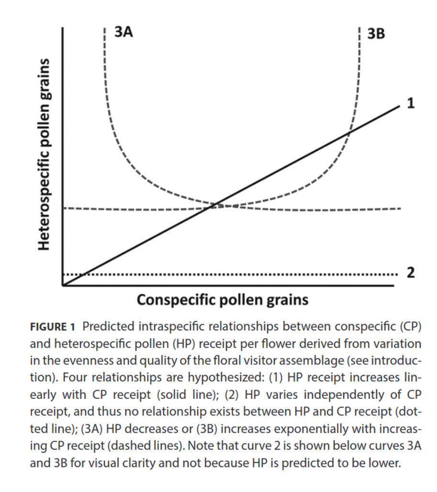

```{r setup, include=FALSE}
knitr::opts_chunk$set(echo = TRUE, warning = FALSE, message = FALSE)
library(ggplot2)
library(dplyr)
library(tidyr)

knitr::opts_chunk$set(echo = TRUE, message = FALSE, warning = FALSE)
library(ggplot2)
library(dplyr)
library(tidyr)
library(nlme)
library(stringr)

# Install devtools if you haven't already
if (!require("devtools")) install.packages("devtools")

# Check if HanPolNet is installed and load it; if not, install from local source
if (!require("HanPolNet")) {
  devtools::install("local_packages/HanPolNet", upgrade = "never")
  library(HanPolNet)
}

# Data


pollen_load_guts_24 <- read.csv(file.path("data", "pollen_load_and_guts_2024_Succisa_pratensis.csv"))

SVD_Suc_pra <- read.csv(file.path("data", "SVD_Succisa_pratensis.csv"))

# 1. Get interaction data
interaction_data_Succisa_22_24 <- get_interaction_data(
    years = c(22, 23, 24), # only 3 years of data
    plant_species = "Suc_pra", # only Succisa pratensis
    is_pollinator = TRUE, # only pollinators
    remove_zeros = TRUE, # remove interactions with 0 pollen
    standardize = TRUE # standardize interactions by sampling effort
)


```

# The Conceptual Framework

Arceo-Gómez et al. (2016) argue that intraspecific variation in pollen receipt is not random. By plotting HP against CP for individual flowers, two distinct patterns typically emerge. These patterns act as a signature of the pollinator community structure.

## Scenario A: The "Generalist" Assemblage (Type 1)

If the pollinator assemblage is **even** (many generalists contributing similarly), we expect **Type 1** dynamics. These visitors carry mixed loads; therefore, as they deposit more CP, they inevitably deposit more HP.

-   **Pattern:** Linear positive relationship.

-   **Ecological Driver:** High pollinator evenness; generalized interactions.

## Scenario B: The "Specialist/Uneven" Assemblage (Type 3)

If the assemblage is **uneven** (dominated by a few high-quality specialists and some "messy" low-quality generalists), we expect **Type 3** dynamics. High-quality pollinators deposit pure CP (high CP, low HP), while incidental visitors deposit mostly HP (low CP, high HP).

-   **Pattern:** Exponential decrease (or "L" shape).

-   **Ecological Driver:** Low pollinator evenness; high variation in pollinator quality.

{fig-align="center"}

# Abstract

# Introduction

In plant-pollinator communities, plants often share pollinators with other species, leading to deposition of pollen from other species (Heterospecific Pollen) on the stigmas. This is a common phenomenon in nature with significant implications for plant reproduction and evolution and it has been studied in multiple systems [@arceo2016patterns]. Based on previous studies, it is expected that the network structure (particularly pollinator evenness) may drive the pattern of conspecific and heterospecific pollen deposition on stigmas. However, the relationship between deposited pollen, pollinator evenness and pollinator pollen transfer capability is not well understood.

*Pollen deposition dynamics*

*Pollen load and pollen feeding*

*The effect of the network properties to the pollen deposition dynamics*

This study aims to determine if the composition of pollinator spectra of *Succisa pratensis* functionally constrains the plant to high heterospecific pollen (HP) receipt, and whether pollinator pollen body load and content of pollinator intestines explain the persistence of this pattern across years. We structure our analysis around three specific objectives:

-   Determine if the relationship between Conspecific (CP) and Heterospecific (HP) pollen deposition on *Succisa* stigmas follows a linear (generalist) or exponential (specialist-shielded) trajectory, and assess its stability across years.

-   Link the stigmatic deposition pattern to the "pollen transport quality" of the dominant visitors (e.g., *Eristalis* spp.). We hypothesize that the "Linear" pattern is driven by dominant visitors being "messy vectors," carrying large conspecific loads but also significant heterospecific loads.

-   Assess whether the network evenness (the diversity of partners) correlates with the intensity of heterospecific pollen deposition. Following @arceo2016patterns, we test if high evenness drives Type 1 curves, even when absolute pollen pressure varies.

To do so, we employ data on pollen load and pollen feeding of pollinators, pollen deposition on stigmas, and network evenness, collected in 2022-2024 within a diverse plant-pollinator community with *Succisa pratensis* Moench (Caprifoliaceae) as the focal species. In our previous studies, we identified that *Succisa pratensis* is a

{#fig-panel}

## Methods

### Study system

Our observations were conducted in a seminatural grassland community with a high abundance of flowering plants (especially *Succisa pratensis*) and diverse pollinator community, dominated by hoverflies. The study site "K Handrkovu" is located near the village of Vernýřov, Central Bohemia, Czech Republic (N 49.8466; E 15.1498). The study site can be classified as a mosaic of moist to mesophilic and eutrophic to mesotrophic grasslands with more than 50 entomogamous plant species flowering in late summer every year [@janovsky2013conspecific]. The fieldwork was conducted in 2022-2024 during the peak of *Succisa pratensis* flowering activity (XXth-XXth August, XXh-XXth August and XXth-XXth August, respectively).

*Succisa pratensis*, our focal plant species, is frequently visited by a wide spectrum of pollinators, especially hoverflies (see @fig-panel), feeding on both pollen and nectar on it. In addition, *Succisa pratensis* has a relatively large and stable population at our study site. Important traits related to pollination also include distinctive open inflorescences available to most pollinators, protandry preventing self-pollination [@bartovs2020self] and pollen releasing in the morning hours [@stenc2023pollinator].

We focused on the common hoverflies species with stable populations with a sufficient numbers of males and females adults occurring at the study site and frequently visiting *Succisa pratensis*. The most common visitors are hoverfly genera Eristalis (E. arbustorum, E. interruptus, E. intricaria, E. pertinax, E. similis and E. tenax) and Helophilus (H. pendulus and H. trivittatus) and meatfly genera Sarcophaga.

### Pollen load and pollen feeding

Foraging hoverflies visiting Succisa inflorescence were caught with entomological net and killed immediately after capture. We swabbed pollen grains from one half (randomly selecting left or right) of each pollinator’s body with a small block of fuchsin jelly as in Beattie (1971). We stored captured pollinators in the 70% ethanol. On the same day, we produced semi-permanent samples by melting fuchsin jelly with a heating pad on a microscope slide, covering and sealing with nail polish. Later, we counted and determined all pollen grains using a light microscope. We sorted pollen into conspecific Succisa pollen and heterospecific pollen of other plant species.

To find out how much and what types of pollen grains were consumed by hoverflies we dissected the guts of captured and killed individuals stored in 70% ethanol using tweezers and sharp scissors under a stereomicroscope. We put separated intestines into small closable tubes with 5 µl of 70% ethanol. Shortly afterwards, we added 50 µl of 10% KOH into the samples and moved it to the warming bath at a temperature of 70° C for 3 hours. After cooling down, we vortexed the samples for 30 seconds to be homogenized and placed 5 µl of the solution on the microscope slides. We let the samples dry on a heating pad and we added 13 µl of 8% vinegar to neutralize KOH. After further drying, we added 5 µl of dye (safranin, water and glycerol), covered the samples with a coverslip and sealed with nail polish to produce semi-permanent samples.

### Single visit deposition

To prevent pollinators access to flowers, we bagged selected inflorences into a tulle bag before the plants have entered the male phase and opened the anthers. When the plant entered the female phase with receptive stigmas, we removed the bag and collected two control stigmas into a tube with 70% ethanol. We watched the inflorescence for thirty minutes and recorded every pollinator that visited it. The pollinators were allowed to visit only one flower within the inflorescence, the stigma of which we collected into a tube with 70% ethanol. If the pollinator visited multiple flowers, we collected only the first visited stigma and removed other from the plant.

### Pollen deposited on stigmas

We put collected stigmas on the slide and let the ethanol evaporate on the heating pad. After that we added 1 µl of 10% KOH, let the samples dry, added 3 µl of 3% hydrogen peroxide, let the samples dry again and we added 13 µl of 8% vinegar to neutralize KOH. After further drying we added 5 µl of dye (safranin, water and glycerol), covered the samples with a coverslip, applied gentle, even pressure on the cover glass to squash the stigma and sealed with nail polish to produce semi-permanent samples.

### Plant-pollinator interactions and plant abundace

Following Janovský et al. (2013) we collected data on pollinator visitation activity. We used same permanent plots as in the flowering plant abundance to record all interactions of flower-visiting pollinators with flowering Succisa pratensis and other plant species in the surrounding of S. pratensis. All flowers within the plot were checked only one time to avoid pseudo-replication and all interactions occurring at the moment of the survey were recorded, lasting up to five minutes. Each plot was recorded at least twenty times during the activity period of pollinators (7:00 - 19:00) at the peak of flowering (mid-August) each year. We recorded only the pollinators touching the reproductive organs of the visited plant and each individual pollinator only once. Finally, we counted standardized interaction rates (total number of interactions per sampling visit) for pollinators visiting S. pratensis from 2022 to 2024 and compared the distribution of interaction rates for the specific group of pollinators visiting S. pratensis and the same pollinators on all other plant species.

Thanks to long-term research on flowering plants and their interactions with pollinators, we obtained information on the abundances of individual plants at the study site and it’s changes over time (see Janovský et al., 2013). We used 4 × 4 m2 permanent plots each placed in the center of each grid point of a 20 × 20 m2 grid covering a total area of 300 × 300 m2 of the study site. To determine the floral neighborhood of Succisa pratensis from 2022 to 2024, we counted distribution of plant abundance for individual plots where S. pratensis was present. We counted conspecific abundance of the focal species and heterospecific co-flowering abundance index, which is the cumulative abundance of all other co-flowering plant species in the plot.

### Data analysis

Full metadata, variable definitions, and summary statistics for the datasets used in this study are available in the Supplementary material S1.

## Results

### Succisa pratensis Distribution

The presence of *Succisa pratensis* in the study plots across the surveyed years (2022-2024) is visualized below.

```{r}
#| label: fig-succisa-map-abundance
#| fig-cap: "Distribution and abundance of Succisa pratensis (2022-2024). A) Spatial distribution of plots with Succisa presence. B) Total abundance recorded per year."
#| echo: true
#| warning: false
#| message: false
#| fig-height: 8

library(sf)
library(dplyr)
library(ggplot2)
library(ggpubr) # For arranging plots

# --- PART A: MAP ---

# 1. Prepare Presence Data
succisa_presence <- plant_abundance %>%
  filter(year %in% c(22, 23, 24)) %>%
  select(year, plot_id, Suc_pra) %>%
  filter(Suc_pra > 0) %>% 
  mutate(
    year_label = paste0("20", year),
    plot_id_join = as.character(as.integer(plot_id)) 
  )

# 2. Prepare Spatial Data
plots_sf <- hanpolnet_plots %>%
  mutate(
    plot_id_join = ifelse(grepl("^[0-9]+$", plot_id), 
                          as.character(as.integer(plot_id)), 
                          plot_id)
  )

# 3. Join
map_data <- succisa_presence %>%
  inner_join(plots_sf, by = "plot_id_join") %>%
  st_as_sf()

# 4. Create Map Plot Object
p_map <- ggplot() +
  geom_sf(data = plots_sf, color = "grey85", size = 1.5, shape = 1) +
  geom_sf(data = map_data, aes(color = year_label), size = 2) +
  facet_wrap(~year_label) +
  scale_color_viridis_d(begin = 0.2, end = 0.8, option = "D") +
  theme_minimal() +
  labs(
    title = "Succisa pratensis Presence",
    subtitle = "Plots with recorded abundance > 0",
    color = "Year"
  ) +
  theme(
    axis.text = element_blank(),
    axis.title = element_blank(),
    panel.grid = element_blank(),
    legend.position = "right"
  )

# --- PART B: ABUNDANCE ---

# 1. Summarize
abundance_summary <- plant_abundance %>%
  filter(year %in% c(22, 23, 24)) %>%
  group_by(year) %>%
  summarise(total_abundance = sum(Suc_pra, na.rm = TRUE)) %>%
  mutate(year_label = paste0("20", year))

# 2. Create Barplot Object
p_abundance <- ggplot(abundance_summary, aes(x = year_label, y = total_abundance, fill = year_label)) +
  geom_col(alpha = 0.8, width = 0.6) +
  labs(
    title = "Total Succisa pratensis Abundance",
    x = "Year",
    y = "Total Abundance (flowering stalks)"
  ) +
  scale_fill_viridis_d(begin = 0.2, end = 0.8, option = "D") +
  theme_minimal() +
  theme(legend.position = "none") 


# --- COMBINE ---
ggarrange(p_map, p_abundance, 
          ncol = 1, 
          labels = c("A", "B"),
          heights = c(1.5, 1)) # Give more height to the map
```


### Pollinator Visitation Rates

We also examined the changes in visitation intensity to *Succisa pratensis* across the three years.

```{r}
#| label: fig-visitation-diff
#| fig-cap: "Differences in standardized visitation rates to Succisa pratensis across years (2022-2024)."
#| echo: true
#| warning: false
#| message: false

# Sum rates per plot to get total visitation intensity per plot
visitation_per_plot <- interaction_data_Succisa_22_24 %>%
  group_by(year, plot_id) %>%
  summarise(total_rate = sum(rate, na.rm = TRUE), .groups = "drop") %>%
  mutate(year = factor(paste0("20", year)))

# Plot
ggplot(visitation_per_plot, aes(x = year, y = total_rate, fill = year)) +
  geom_boxplot(alpha = 0.6, outlier.shape = NA) +
  geom_jitter(width = 0.2, alpha = 0.5) +
  labs(
    title = "Visitation Rates per Plot",
    x = "Year",
    y = "Standardized Visitation Rate (interactions / visit)"
  ) +
  scale_fill_viridis_d(begin = 0.3, end = 0.7) +
  theme_minimal() +
  theme(legend.position = "none")
```


```{r}
#| eval: false
#| code-fold: true

pollen_deposition <- pollen_deposition[!is.na(pollen_deposition$heterospecific_pollen), ] # Remove rows with NA in heterospecific_pollen

pollen_deposition$plant_id <- str_sub(pollen_deposition$id, end = -3) # Extract plant ID from stigma ID

model_linear_mixed <- lme(
    heterospecific_pollen ~ conspecific_pollen * year, # Fixed effect: conspecific pollen and year
    random = ~ 1 | plant_id, # This tells R: "Group stigmas by inflorescence"
    data = pollen_deposition
)

summary(model_linear_mixed)


```

```{r}
#| echo: true
#| code-fold: true

# Ensure library is loaded
library(nlme)
library(stringr)

# Pre-process data to create plant_id if not already present
# (Assuming 'id' has a format where removing the last 2 chars gives plant_id, per previous user code)
# UPDATE: Also grouping by day to avoid pseudoreplication across days
if(!"plant_id" %in% names(pollen_deposition)) {
    pollen_deposition$plant_id <- paste(str_sub(pollen_deposition$id, end = -3), pollen_deposition$day, sep = "_")
}

test_curve_shape <- function(year_data, year_label) {
    # 0. Data Aggregation (Mean per Plant)
    # Using the 'plant_id' we created earlier
    agg_data <- year_data %>%
      group_by(plant_id) %>%
      summarise(
        mean_HP = mean(heterospecific_pollen, na.rm = TRUE),
        mean_CP = mean(conspecific_pollen, na.rm = TRUE),
        .groups = "drop"
      )

    # 1. Fit Linear Model (Type 1) - Simple LM on Means
    fit_linear <- lm(mean_HP ~ mean_CP, data = agg_data)

    # 2. Fit Exponential Model (Type 3) - Simple NLS on Means
    fit_exp <- tryCatch(
        {
            nls(mean_HP ~ a * exp(b * mean_CP),
                data = agg_data,
                start = list(a = max(agg_data$mean_HP, na.rm = TRUE), b = -0.01)
            )
        },
        error = function(e) {
             # Fallback start values
             tryCatch({
                 nls(mean_HP ~ a * exp(b * mean_CP),
                    data = agg_data,
                    start = list(a = mean(agg_data$mean_HP, na.rm = TRUE), b = -0.001)
                )
             }, error = function(e2) NULL)
        }
    )

    # 3. Compare AIC
    aic_lin <- AIC(fit_linear)
    aic_exp <- if (!is.null(fit_exp)) AIC(fit_exp) else NA

    return(data.frame(
        Year = year_label,
        Linear_AIC = round(aic_lin, 2),
        Exp_AIC = if(is.na(aic_exp)) NA else round(aic_exp, 2),
        Best_Fit = case_when(
            is.na(aic_exp) ~ "Linear (Type 1) [Exp Failed]",
            aic_exp < (aic_lin - 2) ~ "Exponential (Type 3)",
            TRUE ~ "Linear (Type 1)"
        )
    ))
}

# Run the test
results_2022 <- test_curve_shape(subset(pollen_deposition, year == 2022), "2022")
results_2023 <- test_curve_shape(subset(pollen_deposition, year == 2023), "2023")
results_2024 <- test_curve_shape(subset(pollen_deposition, year == 2024), "2024")

# Display Results
knitr::kable(rbind(results_2022, results_2023, results_2024), caption = "Model Comparison Results")

```

### Slope Showdown: Analysis of Aggregated Data

To address potential pseudoreplication (multiple stigmas per plant) and compare the deposition rates across years, we aggregated the pollen counts to the plant level (mean per plant). We then compared the slopes of the Heterospecific vs. Conspecific pollen relationship between years.

```{r}
#| label: slope-showdown
#| echo: true
#| warning: false
#| message: false
#| fig-cap: "Relationship between Conspecific and Heterospecific pollen (Plant Means). Lines represent linear regression fits for each year."

library(dplyr)
library(emmeans)
library(ggplot2)

# 1. Data Aggregation
# Group by year and plant_id to calculate means
aggregated_data <- pollen_deposition %>%
  group_by(year, plant_id) %>%
  summarise(
    mean_HP = mean(heterospecific_pollen, na.rm = TRUE),
    mean_CP = mean(conspecific_pollen, na.rm = TRUE),
    .groups = "drop"
  )

# 2. Model Fitting (Standard Linear Model on Means)
# Interaction term allows slopes to differ by year
fit_agg <- lm(mean_HP ~ mean_CP * as.factor(year), data = aggregated_data)

# 3. Slope Comparison
# Estimate slopes (trends) for each year
slopes <- emtrends(fit_agg, pairwise ~ year, var = "mean_CP")

# Display slope estimates
print("Slope Estimates per Year:")
print(slopes$emtrends)

# Display pairwise comparisons of slopes
print("Pairwise Comparison of Slopes:")
print(slopes$contrasts)

# 4. Visualization
ggplot(aggregated_data, aes(x = mean_CP, y = mean_HP, color = as.factor(year))) +
  geom_point(alpha = 0.6, size = 2) +
  geom_smooth(method = "lm", se = FALSE, size = 1, aes(group = year)) +
  labs(
    title = "Slope Showdown: CP vs HP (Plant Means)",
    x = "Mean Conspecific Pollen (per plant)",
    y = "Mean Heterospecific Pollen (per plant)",
    color = "Year"
  ) +
  scale_color_viridis_d(begin = 0.2, end = 0.8, option = "D") +
  theme_minimal()
```

### Daily Stability Test (2024)

To determine if the relationship between Conspecific and Heterospecific pollen deposition changes over the course of the flowering season, we analyzed the 2024 data. We tested the interaction between Conspecific Pollen and Day (`mean_CP * as.factor(day)`) on data aggregated by plant.

```{r}
#| label: daily-stability-2024
#| echo: true
#| warning: false
#| message: false
#| fig-cap: "Daily stability of pollen deposition network structure in 2024. Facets represent different sampling dates."

# 1. Data Prep
# Filter for 2024 and aggregate by plant_id (which is day-specific)
agg_data_2024 <- pollen_deposition %>%
  filter(year == 2024) %>%
  group_by(plant_id, day) %>%
  summarise(
    mean_HP = mean(heterospecific_pollen, na.rm = TRUE),
    mean_CP = mean(conspecific_pollen, na.rm = TRUE),
    .groups = "drop"
  )

# 2. Model Fitting
# Test if the slope (CP -> HP) varies by day (Interaction term)
fit_daily <- lm(mean_HP ~ mean_CP * as.factor(day), data = agg_data_2024)

# 3. Statistical Test
# ANOVA to check significance of the interaction term
anova_results <- anova(fit_daily)
print(anova_results)

# 4. Visualization
ggplot(agg_data_2024, aes(x = mean_CP, y = mean_HP)) +
  geom_point(alpha = 0.6, color = "darkblue") +
  geom_smooth(method = "lm", se = FALSE, color = "darkred", linetype = "dashed") +
  facet_wrap(~day) +
  labs(
    title = "Daily Stability of Pollen Deposition (2024)",
    subtitle = "Relationship between Conspecific and Heterospecific Pollen by Date",
    x = "Mean Conspecific Pollen (per plant)",
    y = "Mean Heterospecific Pollen (per plant)"
  ) +
  theme_minimal()
```


```{r}
suc_pra_222324 <- get_interaction_data(
    plant_species = "Suc_pra",
    start_time = "7:00",
    end_time = "18:00",
    remove_zeros = TRUE,
    standardize = TRUE
)
```

```{r}
### Mechanism: Pollen Transport Quality

To understand *why* the deposition pattern follows a specific functional form (Type 1 or Type 3), we analyzed the pollen loads on the bodies of foraging pollinators. If dominant visitors are "messy" (carrying mixed loads), we expect a positive correlation between Conspecific and Heterospecific pollen on their bodies.

```{r}
#| label: mechanism-pollen-loads
#| echo: true
#| warning: false
#| message: false
#| fig-cap: "Pollen Transport Quality. A) Relationship between Conspecific (CP) and Heterospecific (HP) pollen loads on pollinator bodies. B) Pollen purity (proportion of CP) by species."

library(ggpubr)

# 1. Prepare Data
pollen_loads <- pollen_load_guts_24 %>%
  filter(!is.na(suc_pra_load) & !is.na(other_pollen_load)) %>% 
  mutate(
    Year = as.factor(year),
    Species = pollinator_species,
    Total_Load = suc_pra_load + other_pollen_load,
    Purity = suc_pra_load / Total_Load
  ) %>%
  filter(Total_Load > 0)

# Filter for dominant species (e.g., > 5 individuals) to avoid clutter
dominant_species <- names(which(table(pollen_loads$Species) >= 5))
pollen_loads_dom <- pollen_loads %>% filter(Species %in% dominant_species)

# 2. Model: Do they carry mixed loads?
# Test correlation between CP and HP for dominant groups
fit_loads <- lm(other_pollen_load ~ suc_pra_load * Species, data = pollen_loads_dom)
# summary(fit_loads)

# 3. Visualization

# A) CP vs HP Scatter
p_loads_scatter <- ggplot(pollen_loads_dom, aes(x = suc_pra_load, y = other_pollen_load, color = Species)) +
  geom_point(size = 2, alpha = 0.6) +
  geom_smooth(method = "lm", se = FALSE) +
  scale_color_viridis_d(option = "D", end = 0.9) +
  labs(
    title = "A. Body Loads: CP vs HP",
    x = "Conspecific Pollen (CP)",
    y = "Heterospecific Pollen (HP)"
  ) +
  theme_minimal() +
  theme(legend.position = "right")

# B) Purity Boxplot
p_purity <- ggplot(pollen_loads_dom, aes(x = Species, y = Purity, fill = Species)) +
  geom_boxplot(alpha = 0.7, outlier.shape = NA) +
  geom_jitter(width = 0.2, alpha = 0.5) +
  scale_fill_viridis_d(option = "D", end = 0.9) +
  labs(
    title = "B. Pollen Purity",
    y = "Proportion Conspecific (CP / Total)"
  ) +
  theme_minimal() +
  theme(
    axis.text.x = element_text(angle = 45, hjust = 1),
    legend.position = "none"
  )

ggarrange(p_loads_scatter, p_purity, ncol = 2, widths = c(1.3, 1))

```

### Driver: Network Structure

Finally, we link the observed deposition patterns to the structure of the visitation network.


```{r}
#| label: calc-diversity-panel
#| echo: true
#| fig-height: 6
#| fig-width: 10

# 1. Calculate Evenness (Alpha Diversity)
succisa_evenness <- calculate_pollinator_evenness(
    data = interaction_data_Succisa_22_24,
    group_by = c("year", "plot_id")
)

p_evenness <- ggplot(succisa_evenness, aes(x = as.factor(year), y = J, fill = as.factor(year))) +
    geom_boxplot(alpha = 0.6, outlier.shape = NA) +
    geom_jitter(width = 0.2, alpha = 0.5) +
    labs(
        title = "A. Pollinator Evenness (J')",
        subtitle = "Per plot",
        x = "Year",
        y = "Pielou's Evenness (J')"
    ) +
    theme_minimal() +
    theme(legend.position = "none")

# 2. Calculate Similarity (Beta Diversity)
# We need to reshape the interaction data to a wide format (Site x Species) for the similarity calculation
interaction_matrix <- interaction_data_Succisa_22_24 %>%
    group_by(year, plot_id, pollinator_id) %>%
    # Use 'rate' if using standardized data, or 'interaction_count' for raw
    summarise(abundance = sum(rate, na.rm = TRUE), .groups = "drop") %>% 
    pivot_wider(names_from = pollinator_id, values_from = abundance, values_fill = 0)

# Calculate full similarity matrix
sim_results <- calculate_similarity(interaction_matrix, group_by = c("year", "plot_id"))

# Visualize using package function
p_similarity <- plot_similarity_change(sim_results, plot_type = "plot_turnover") +
    labs(
        title = "B. Community Similarity",
        subtitle = "Pairwise plot turnover (Ruzicka)"
    ) +
    theme(legend.position = "none")

# 3. Combine Plots
# Ensure ggpubr or patchwork is available. Using ggpubr as it is a dependency of HanPolNet.
if (!requireNamespace("ggpubr", quietly = TRUE)) install.packages("ggpubr")
ggpubr::ggarrange(p_evenness, p_similarity, ncol = 2)
```


# Discussion

Our results suggest that the relationship between conspecific and heterospecific pollen deposition is driven by specific functional mechanisms rather than simple abundance.

## Functional Signal of the Network

The dominance of specific pollinator groups (e.g., Eristalis) acts as a filter. As shown in our "Mechanism" analysis, these visitors carry mixed loads, acting as "messy vectors" that drive the observed Type 1 (linear) relationship. This confirms that high abundance of these pollinators does not shield the plant from heterospecific pollen; rather, it increases the rate of HP deposition proportionally to CP.

## Network Structure as a Driver

We hypothesized that years or sites with higher pollinator evenness would exhibit stronger linear (Type 1) dynamics. Our "Driver" analysis (Fig. X) shows [To be completed with results]. 
This moves our analysis beyond simple abundance ("we found less HP") to **functional mechanisms**. If *Succisa* fits a **Type 3** curve in years with low evenness, it suggests that "pollinator sharing" (a network metric) does not translate linearly to pollen deposition. It would prove that the *identity* and *quality* of specific visitors shield the plant from heterospecific pollen interference, even when surrounded by heterospecific neighbors.

The ratio of HP/CP deposited on stigmas is thus a function of both the "messiness" of the dominant vector and the overall evenness of the visitor community.


## References