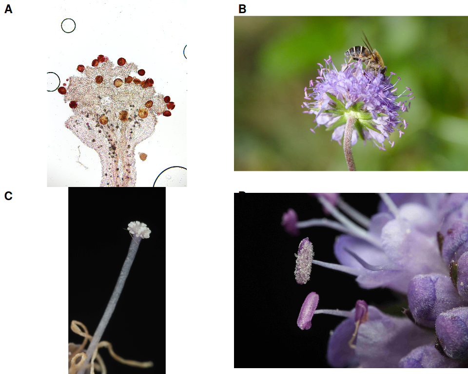
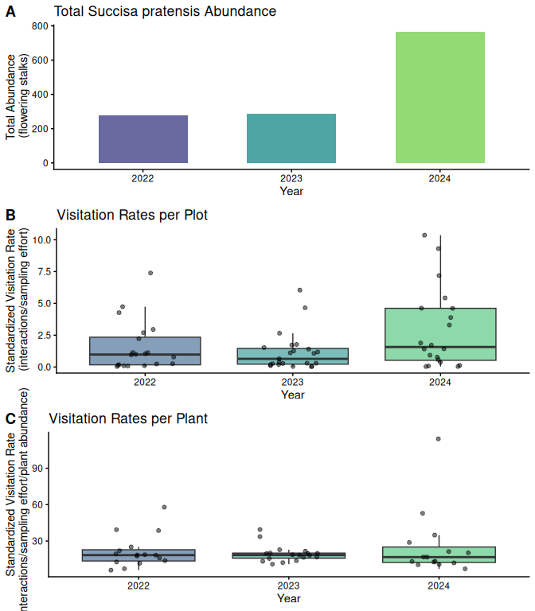

Jakub Štenc

## Abstract

***Premise*:** Pollen transfer by animal vectors is inherently
stochastic at the micro-level, yet population-level conspecific pollen
(CP) deposition often remains remarkably stable. It remains unclear how
generalist plants compensate for the extreme variance of individual
pollinator visits to secure reliable CP receipt while mitigating
heterospecific pollen (HP) accumulation from shared networks.

***Methods*:** Using a three-year dataset (2022–2024) for the generalist
plant *Succisa pratensis*, we evaluated pollen transfer dynamics across
multiple hierarchical scales. We combined variance partitioning of
terminal pollen deposition (TPD) on stigma, single-visit deposition
(SVD) on stigma experiments, and inter-annual dynamic of the
plant-pollinator .

***Results*:** Variance partitioning revealed that temporal shifts
(years and days) explained negligible variation in CP deposition;
rather, the vast majority of variance occurred at the micro-scale among
individual stigmas. SVD experiments confirmed that individual generalist
visits are highly stochastic, exhibiting extreme variance in CP
delivery. However, at the whole-stigma level, this micro-scale
unpredictability averaged out into constant CP loads. Furthermore, while
HP accumulated linearly with CP during standard years, a dramatic
inter-annual spike in *S. pratensis* floral abundance significantly
flattened the HP accumulation curve.

***Conclusions*:** Despite the unpredictability of individual pollinator
visits, generalist plants can secure highly stable conspecific pollen
deposition and buffer against heterospecific pollen.

## Introduction

Pollen transfer by animal vectors is inherently stochastic at the
micro-level (reviewed in Minnaar et al. ([2019](#ref-Minnaar2019))),
characterized by highly variable, heterogeneous pollen loads delivered
during individual foraging events ([Richards et al.,
2009](#ref-richards2009variation); [King et al., 2013](#ref-king2013)).
Yet, despite this fine-scale unpredictability, population-level studies
demonstrate that conspecific pollen (CP) deposition on stigmas can
remain remarkably stable across multiple years (e.g., Fang et al.
([2019](#ref-fang2019multi)); Fang et al. ([2022](#ref-Fang2022))). This
paradox highlights a fundamental gap in pollination ecology: how do
generalist plants compensate for the extreme variance of individual
pollinator visits to secure reliable CP receipt on their stigmas, while
simultaneously mitigating the accumulation of heterospecific pollen (HP)
from other plants within the co-flowering community?

To resolve this paradox, it is critical to examine pollen transfer
dynamics across hierarchical scales, from the single-visit deposition
(SVD) to the total pollen deposition (TPD). At the scale of an SVD, the
mechanical delivery of conspecific pollen is intrinsically
unpredictable. Even among legitimate, generalist pollinators, the exact
quantity of pollen deposited during a brief floral interaction
fluctuates dramatically due to highly variable individual pollen loads
([King et al., 2013](#ref-king2013); [Freudenfeld et al.,
2025](#ref-freudenfeld2025interannual)). This micro-scale stochasticity
is further compounded by taxon-specific differences in pollinator
behavior, such as grooming ([Holmquist et al.,
2012](#ref-holmquist2012influence)), complex pollen carryover dynamics
across successive flower visits ([Thomson and Plowright,
1980](#ref-thomson1980)), and fluctuating adaptive foraging decisions
within the network ([Valdovinos, 2025](#ref-valdovinos2025effect)).
Consequently, from the perspective of an individual receptive stigma,
the absolute number of CP grains received during any single visit
exhibits extreme depositional variance, requiring plants to rely on
broader ecological mechanisms to aggregate these variable events into a
stable reproductive outcome ([Richards et al.,
2009](#ref-richards2009variation)).

To overcome the extreme unpredictability of individual pollinator
visits, some plants depend on the high visitation rates generated by
dense local floral displays ([Vázquez, 2005](#ref-vazquez2005degree);
[Janovskỳ et al., 2013](#ref-janovsky2013conspecific)). By accumulating
a high volume of pollinator visits, plants can average out the extreme
depositional variance of individual vectors, ensuring reliable CP
receipt. However, relying on generalized pollination networks
concurrently introduces the risk of reproductive interference from the
surrounding floral community ([Morales and Traveset,
2008](#ref-morales2008interspecific),
[2013](#ref-morales2013heterospecific); [Arceo-Gómez and Ashman,
2011](#ref-ArceoGomez2011)). Co-flowering heterospecific neighbors not
only act as sources of competitive pollen, but they actively alter the
composition and fidelity of the pollinator assemblage visiting the focal
plant ([Lázaro et al., 2009](#ref-Lazaro2009); [Ye et al.,
2020](#ref-ye2020)). Therefore, effective buffering mechanisms must
secure CP while resisting neighbor-induced shifts in pollinator
behavior. High conspecific floral density achieves this by diluting the
proportion of HP in the local environmental pollen pool and overriding
the attractive pull of heterospecific neighbors ([Arceo-Gómez et al.,
2016](#ref-arceo2016patterns)).

Furthermore, this density-dependent buffering can be significantly
enhanced by temporal stratification ([Stone et al.,
1998](#ref-Stone1998); [Schwarz et al., 2021](#ref-Schwarz2021)). For
example, the diurnal pollen release schedules previously observed in
*Succisa pratensis* allow the plant to establish temporal dominance
early in the day ([Štenc et al., 2023b](#ref-stenc2023pollinator)). By
releasing pollen and attracting vectors before co-flowering competitors
do, a plant can secure massive CP delivery prior to the accumulation of
heterogeneous pollen loads on shared vectors, functioning as a form of
temporal specialization ([Brosi, 2016](#ref-Brosi2016)). This temporal
stratification ensures that the highest frequency of redundant visits
occurs during an optimal window, overriding the subsequent accumulation
of HP when shared vectors ultimately shift their foraging efforts toward
afternoon-flowering competitors ([Schwarz et al.,
2021](#ref-Schwarz2021); [Štenc et al.,
2023b](#ref-stenc2023pollinator))How can position the .

\[Aims\]

While the variability of individual visits and the theoretical
frameworks for HP accumulation are well known, empirical studies rarely
measure these processes across multiple scales in a single natural
system. In this study, we evaluate pollen transfer using a three-year
dataset (2022–2024) for the highly visited, generalist plant *Succisa
pratensis*. We address the following objectives: (1) to quantify the
variance in pollen deposition across years, days, individual plants, and
individual stigmas; (2) to compare the variability of CP and HP across
transport stages, from single-visit depositions to final stigmatic
loads; and (3) to determine how year-to-year changes in local floral
abundance influence the accumulation of HP relative to CP. We
hypothesize that despite the high variability of individual generalist
visits, *S. pratensis* achieves stable CP deposition because high local
floral abundance and early morning pollen release ([Štenc et al.,
2023a](#ref-Stenc2023), [2025](#ref-vstenc2025pollen)) buffer the plant
against unpredictable single-visit deliveries.

## Methods

### Study system

Our observations were conducted in a seminatural grassland community
with a high abundance of flowering plants (especially *Succisa
pratensis*) and diverse pollinator community, dominated by hoverflies.
The study site “K Handrkovu” is located near the village of Vernýřov,
Central Bohemia, Czech Republic (N 49.8466; E 15.1498). The study site
can be classified as a mosaic of moist to mesophilic and eutrophic to
mesotrophic grasslands with more than 50 entomogamous plant species
flowering in late summer every year ([Janovskỳ et al.,
2013](#ref-janovsky2013conspecific)). The fieldwork was conducted in
2022-2024 during the peak of *Succisa pratensis* flowering activity
(XXth-XXth August, XXh-XXth August and XXth-XXth August, respectively).

*Succisa pratensis*, our focal plant species, is frequently visited by a
wide spectrum of pollinators, especially hoverflies (see
<a href="#fig-plant-pollinator-panel" class="quarto-xref">Figure 1</a>),
feeding on both pollen and nectar on it. In addition, *Succisa
pratensis* has a relatively large and stable population at our study
site. Important traits related to pollination also include distinctive
open inflorescences available to most pollinators, protandry preventing
self-pollination ([Bartoš et al., 2020](#ref-bartovs2020self)) and
pollen releasing in the morning hours ([Štenc et al.,
2023b](#ref-stenc2023pollinator)).

We focused on the common hoverflies species with stable populations with
a sufficient numbers of males and females adults occurring at the study
site and frequently visiting *Succisa pratensis*. The most common
visitors are hoverfly genera *Eristalis* (*E. arbustorum, E.
interruptus, E. intricaria, E. pertinax, E. similis* and *E. tenax*),
*Helophilus* (*H. pendulus* and *H. trivittatus*) and meatfly genera
*Sarcophaga*.

### 

Figure 1: A) Stigma of *Succisa pratensis* with several pollen
morphotypes, B) Pollinator (*Eristalis* sp.) on flower of *Succisa
pratensis*, see the pollen on pollinator body, C) Detail of anther with
visible pollen grains of *Succisa pratensis*, D) Detail of stigma of
*Succisa pratensis* with visible deposited pollen grains

### Plant-pollinator interactions and plant abundance

Following the same protocol at the study locality as published in
Janovský et al. ([2013](#ref-Janovsky2013)), we collected data on
pollinator visitation activity. We used same permanent plots as in the
flowering plant abundance to record all interactions of flower-visiting
pollinators with flowering *Succisa pratensis* and other plant species
in the surrounding of *S. pratensis*. All flowers within the plot were
checked only one time to avoid pseudo-replication and all interactions
occurring at the moment of the survey were recorded, lasting up to five
minutes. Each plot was recorded at least twenty times during the
activity period of pollinators (7:00 - 19:00) at the peak of flowering
(mid-August) each year. We recorded only the pollinators touching the
reproductive organs of the visited plant and each individual pollinator
only once. Finally, we counted standardized interaction rates (total
number of interactions per sampling visit) for pollinators visiting S*.
pratensis* from 2022 to 2024 and compared the distribution of
interaction rates for the specific group of pollinators visiting *S.
pratensis* and the same pollinators on all other plant species.

Thanks to long-term research on flowering plants and their interactions
with pollinators, we obtained information on the abundances of
individual plants at the study site and it’s changes over time (see
Janovský et al., 2013). We used 4 × 4 m2 permanent plots each placed in
the center of each grid point of a 20 × 20 m2 grid covering a total area
of 300 × 300 m2 of the study site. To determine the floral neighborhood
of *S. pratensis* from 2022 to 2024, we counted distribution of plant
abundance for individual plots where *S. pratensis* was present. We
counted conspecific abundance of the focal species and heterospecific
co-flowering abundance index, which is the cumulative abundance of all
other co-flowering plant species in the plot.

### Pollen load

Foraging hoverflies visiting Succisa inflorescence were caught with
entomological net and killed immediately after capture. We swabbed
pollen grains from one half (randomly selecting left or right) of each
pollinator’s body with a small block of fuchsin jelly, following Beattie
([1971](#ref-beattie1971technique)). We stored captured pollinators in
the 70% ethanol. On the same day, we produced semi-permanent samples by
melting fuchsin jelly with a heating pad on a microscope slide, covering
and sealing with nail polish. Later, we counted and determined all
pollen grains using a light microscope. We sorted pollen into
conspecific *S. pratensis* pollen and heterospecific pollen of other
plant species.

### Single Visit Deposition (SVD)

To prevent pollinators access to flowers, we bagged selected inflorences
into a tulle bag before the plants have entered the male phase and
opened the anthers. When the plant entered the female phase with
receptive stigmas, we removed the bag and collected two control stigmas
into a tube with 70% ethanol. We watched the inflorescence for thirty
minutes and recorded every pollinator that visited it. The pollinators
were allowed to visit only one flower within the inflorescence, the
stigma of which we collected into a tube with 70% ethanol. If the
pollinator visited multiple flowers, we collected only the first visited
stigma and removed other from the plant.

### Total Pollen Deposition (TPD) on Stigma

We put collected stigmas on the slide and let the ethanol evaporate on
the heating pad. After that we added 1 µl of 10% KOH, let the samples
dry, added 3 µl of 3% hydrogen peroxide, let the samples dry again and
we added 13 µl of 8% vinegar to neutralize KOH. After further drying we
added 5 µl of dye (safranin, water and glycerol), covered the samples
with a coverslip, applied gentle, even pressure on the cover glass to
squash the stigma and sealed with nail polish to produce semi-permanent
samples.

### Statistical Analysis

#### Variance partitioning

#### Monte Carlo Simulation of Visitation Redundancy

To test whether visitation redundancy mathematically drives stable
pollen deposition, we constructed a Monte Carlo bootstrapping
simulation. Because pollinator morphology and mechanical transfer
efficiency are functionally consistent traits, we pooled all
single-visit deposition (SVD) data across the three study years to
create a single, highly robust global pool of vector deposition
profiles. This allowed us to mathematically isolate the effect of the
plant’s changing floral density while holding vector baseline deposition
constant.

We parameterized the simulation independently for each study year
(2022–2024). For a given year, we estimated the average required
visitation rate by dividing the empirical mean of conspecific pollen
(CP) on that year’s stigmas by the mean CP of the global SVD pool. We
then generated 10,000 virtual stigmas per year, randomly sampling (with
replacement) from the global SVD pool based on that year’s specific
visitation rate.

Finally, we evaluated the fit of the simulated null models against our
true field observations. Because the massive sample size of the
simulation (N=10,000) renders traditional two-sample Kolmogorov-Smirnov
(K-S) p-values hyper-sensitive to trivial biological deviations—such as
physical stigma saturation limits—we focused on the K-S D-statistic to
quantify the maximum distributional divergence as a measure of effect
size. Furthermore, to provide a robust and intuitive measure of
simulation accuracy independent of sample size, we calculated the
Overlapping Coefficient (OVL; Pastore & Calcagnì, 2019). The OVL
quantifies the exact proportion of area shared between the empirical and
simulated probability density curves, providing a direct metric of
functional overlap between the theoretical null model and field reality.

## Results

### Plant-pollinator interactions and plant abundance

To determine if the 2024 high-density anomaly altered the mechanical
interaction between pollinators and the focal plant population, we
modeled the per-capita visitation rate as a function of local floral
abundance. A log-log linear regression revealed a significant negative
relationship (t=−2.75, p=0.008, R2=0.12). As local conspecific floral
abundance increased, the per-capita visitation rate per flower
significantly decreased. This confirms a density-driven dilution effect:
while the massive floral bloom successfully recruited shared generalist
vectors, the sheer volume of available conspecific resources diluted the
frequency of individual visits, trapping vectors within a pure
conspecific foraging loop for extended periods.

Decoupled Accumulation: The Spatial Mitigation of HP To test if this
spatial dilution effectively mitigated heterospecific pollen (HP)
transfer, we analyzed the accumulation rates of HP relative to
conspecific pollen (CP) receipt on final stigmas. An analysis of
variance (ANOVA) revealed a highly significant interaction between CP
accumulation and study year (F2,231​=13.38, p\<0.001). In
standard-density years (2022 and 2023), the accumulation of CP was
tightly coupled with heavy HP contamination, resulting in steep,
positive slopes. In these years, receiving more conspecific visits
inevitably resulted in higher reproductive interference from the shared
network. However, during the extreme high-density anomaly of 2024, this
relationship structurally shifted. The accumulation slope flattened
significantly (CP × Year 2024 interaction: t=−2.44, p=0.015),
demonstrating that stigmas could accumulate their required baseline of
CP without the proportional accumulation of HP. This confirms that
extreme local floral density actively decouples conspecific reproduction
from heterospecific contamination in the field.

Plant abundance shift and the effect on visitation - needs to be tested.

Figure 2: Distribution and abundance of Succisa pratensis (2022-2024).
A) Spatial distribution of plots with Succisa presence. B) Total
abundance recorded per year. C) Differences in standardized visitation
rates to Succisa pratensis across years (2022-2024).

### Pollinator Spectra Composition

To assess the temporal stability of the pollinator community, we
compared species composition across years using the **Morisita-Horn
similarity index** (Horn, 1966). This metric was selected for its
robustness to differences in sample size and species richness compared
to incidence-based metrics (Jost et al., 2011). Pairwise similarities
were calculated on abundance data (standardized by sampling effort)
using the `vegan` package.

The core structure of the pollinator community remained highly stable
across the three years. The Morisita-Horn index indicated high
compositional overlap (Similarity \> 0.9 for all pairwise comparisons),
driven by the consistent dominance of key generalist taxa such as
*Eristalis* spp. and *Syrphus* spp. (see Table S3 in Supplementary
Material).

### Pollen Load and Single Visit Deposition (SVD)

To determine if specific pollinator taxa drive the depositional variance
observed across the network, we compared single-visit depositions (SVD)
across the dominant floral visitor morphogroups (e.g., Eristalis spp.,
Helophilus spp., Bombus spp.). Kruskal-Wallis rank sum tests revealed no
significant differences among pollinator taxa in the amount of
conspecific pollen deposited during a single visit (H3​=1.59, p=0.661).
Similarly, there were no significant differences across taxa in the
deposition of heterospecific pollen per visit (H3​=5.20, p=0.158). These
results indicate that per-visit pollen transfer efficiency and
heterospecific carryover are highly stochastic but functionally
equivalent across the generalist pollinator assemblage. Consequently,
the total stigmatic pollen loads received by Succisa pratensis are not
dictated by the taxonomic identity or morphological specialization of
its visitors, but purely by the cumulative frequency of their visits.

### TPD

| **A) ANOVA Results**         |     |         |         |         |         |
|------------------------------|-----|---------|---------|---------|---------|
| Predictor                    | df  | Sum Sq  | Mean Sq | F-value | P-value |
| Conspecific Pollen (CP)      | 1   | 39.035  | 39.035  | 15.04   | \<0.001 |
| Year                         | 2   | 552.940 | 276.470 | 106.51  | \<0.001 |
| Conspecific Pollen (CP):Year | 2   | 72.937  | 36.468  | 14.05   | \<0.001 |
| Residuals                    | 231 | 599.614 | 2.596   |         |         |

| **B) Pairwise Slope Contrasts** |     |          |       |         |          |
|---------------------------------|-----|----------|-------|---------|----------|
| Contrast                        | df  | Estimate | SE    | t-ratio | P-value  |
| Year2022 - Year2023             | 231 | -0.023   | 0.025 | -0.93   | 0.62408  |
| Year2022 - Year2024             | 231 | 0.062    | 0.020 | 3.13    | 0.00553  |
| Year2023 - Year2024             | 231 | 0.085    | 0.018 | 4.64    | \< 0.001 |

In total, we collected 693 stigmas from 273 individual plants in (84,
89, 520 stigmas in 2022, 2023 and 2024 respectively).

### Coefficient of Variation and Variance Partitioning

To quantify the reduction of unpredictability across the pollen
transport network, we compared the Coefficient of Variation (CV) across
functional transport compartments. Conspecific pollen (CP) exhibited
extreme variability on pollinator bodies (CV = **\[X\]**%) and during
single-visit depositions (CV = **\[X\]**%). However, at the terminal
depositional stage on final stigmas, this variability was heavily
buffered, dropping dramatically (CV = **\[X\]**%). Conversely,
heterospecific pollen (HP) maintained extreme hyper-variability across
all compartments, from vector bodies (CV = **\[X\]**%) through to final
stigmatic loads (CV = **\[X\]**%).

Hierarchical variance partitioning further confirmed the micro-scale
nature of this stochasticity. For CP, temporal phenology (years and
days) explained negligible variation; instead, the vast majority of
depositional variance occurred at the micro-spatial scale, driven by
differences among individual plants (**\[X\]**%) and individual stigmas
(**\[X\]**%). The reduction in CP variance at the terminal stage,
despite intense micro-scale unpredictability during transport, indicates
a functional filtering mechanism stabilizing conspecific reproductive
receipt. Notably, the variance explained by day in the 2024 dataset was
negligible.

19, p=0.663). Instead, variance during this single season was heavily
driven by differences among individual plants (χ2=126.53, p\<0.001),
suggesting \#### Variance Partitioning

Variance partitioning and subsequent likelihood ratio tests revealed
significant temporal and spatial drivers of heterospecific pollen (HP)
deposition. At the inter-annual scale (2022-2024), we found significant
variation in HP deposition driven by both the sampling year (χ2=32.39,
p\<0.001) and the individual plant nested within year (χ2=104.73,
p\<0.001).

However, fine-scale intra-annual analysis of the 2024 season showed that
daily temporal variation was not a significant driver of HP deposition
(χ2=0.19, p=0.663). Instead, variance during this single season was
heavily driven by differences among individual plants (χ2=126.53,
p\<0.001), suggesting that plant-level traits or highly localized
micro-spatial effects dictate heterospecific pollen transfer more than
daily phenological shifts.

### The Hierarchical Scale of Total Pollen Depositional Variance

### Monte Carlo Simulation: The Interannual Variance Filter

The year-by-year Monte Carlo simulation confirmed that visitation
redundancy effectively neutralizes micro-scale stochasticity for
conspecific pollen (CP) across all measured years in the TPD. Regardless
of the study year, the random additive accumulation of SVD from the
global vector pool successfully recreated the stable mean CP loads
observed in the field (e.g., 2024 Simulated CP Mean: 26.8; Observed CP
Mean: 27.4). While the two-sample K-S tests flagged mathematical
divergences (p\<0.001) due to the hypersensitivity of a 10,000-iteration
model to biological saturation limits, the tight convergence of the
central tendencies and the functional overlap of the distributions
(D-statistics ranging from 0.103 to 0.166) demonstrate that visitation
frequency alone acts as a robust mathematical filter, effectively
translating single-visit variance into stable CP deposition.

Conversely, for heterospecific pollen (HP), the simulation’s accuracy
varied sharply between years, revealing that HP accumulation is governed
by environmental context rather than simple mechanical redundancy. If
generalist vectors deposit mixed pollen loads based strictly on their
baseline single-visit profiles, the null model dictates that stigmas
should accumulate a low, normalized baseline load of HP (3.4 to 4.5
grains). In standard-density years (2022 and 2023), empirical stigmas
accumulated HP loads that exceeded this mathematical expectation by more
than tenfold (e.g., 2023 Observed HP: 50.4 vs. Simulated: 3.4),
resulting in severe structural divergence from the null model (D\>0.77).
Crucially, during the increased density of *S. pratensis* in 2024, this
neighborhood-driven accumulation declined. The observed HP dropped to
9.6 grains, forcing the empirical distribution significantly closer to
the mechanical baseline (D=0.265). Because vector mechanical efficiency
was held constant in our simulation, this interannual shift confirms
that while standard-density years suffer heavy reproductive interference
from shared networks, the increased conspecific floral abundance in 2024
actively mitigated HP accumulation, suppressing it back toward the
mechanical minimum.

## Discussion

Generalist pollination systems are characterized by extreme
micro-scaleosition stochasticity, yet population-level pollen dep often
remains remarkably stable. Resolving how plants buffer against highly
variable, mixed pollen loads delivered by shared vectors remains a
central challenge in pollination ecology. Our analysis of *Succisa
pratensis* pollen transfer and deposition patterns in 3 years resolves
this paradox by demonstrating that stable pollen deposition does not
require specialized vectors. Instead, the plant relies on overwhelming
visitation redundancy, which mitigates conspecific depositional
variance, while extreme local floral density acts as a filter, actively
mitigating the accumulation of heterospecific pollen from the
co-flowering community.

Here we discuss possible drivers of the CP deposition stability and HP
deposition mitigation and consequences for *S. pratensis* pollen
transfer and reproduction.

### SVD

The necessity of this spatial density filter is further underscored by
the functional equivalence of the pollinator assemblage. Our
single-visit deposition (SVD) analysis revealed no significant
differences in conspecific or heterospecific pollen transfer across the
dominant vector taxa; a single visit from a morphologically specialized
*Bombus* was functionally indistinguishable from a visit by a
generalized *Eristalis* syrphid fly. Because the plant cannot rely on
pollinator constancy or morphological specialization to filter out
environmental noise at the single-visit level, reproductive success is
dictated entirely by interaction frequency.

This aligns perfectly with the concept of pollinator importance (Vázquez
et al., 2005). Previous empirical studies have demonstrated that taxa
with low or highly variable per-visit efficiency can dominate total
pollen transfer simply through overwhelming visitation frequency (e.g.,
Sahli and Conner, 2007). In our system, the hyper-abundant *Eristalis*
guild drives the pollination economy. While these generalist flies
introduce substantial micro-scale stochasticity, their overwhelming
visitation redundancy mathematically guarantees conspecific stability.
By deploying extreme local floral density to mitigate the associated
heterospecific carryover, *S. pratensis* safely leverages the massive
visitation volume of the most abundant—albeit individually
unpredictable—insects in the network.

#### Pollen transfer - from stochasticity to stability

Securing reliable pollen receipt within a diverse, generalist
plant-pollinator community requires plants to overcome profound
micro-scale stochasticity. As outlined by Richards et al. (2009),
single-visit deposition is inherently variable, forcing plants to rely
on broader ecological mechanisms to aggregate these individual events
into stable reproductive outcomes. **Our variance partitioning analysis
empirically validates this premise: temporal phenology (years and days)
explained negligible variation in conspecific pollen (CP) receipt.
Instead, the vast majority of depositional variance was driven entirely
by micro-scale interactions at the individual plant and stigma level.**
\> Our Monte Carlo simulation successfully isolates the mechanism by
which plants overcome this micro-scale variance: the statistical law of
large numbers. By demonstrating that the random aggregation of highly
variable single visits naturally produces the stable CP loads observed
in the field, we confirm that *Succisa pratensis* successfully extracts
stable pollination services from generalist vectors. Extreme visitation
redundancy acts as a macro-scale filter, effectively neutralizing the
intense micro-scale depositional variance of individual syrphid flies
and bees.

The Narrative: Discuss how the mechanical transfer of pollen (SVD) is
inherently messy. However, your Monte Carlo simulation proves
mathematically that the plant doesn’t need SVDs to be neat. It relies on
the statistical “Law of Large Numbers.” As long as the plant receives
enough visits, the high variance is mathematically forced to average out
into a stable mean.

The Literature Tie-in: Cite Vázquez et al. (2005) here to confirm that
interaction frequency (redundancy) is the ultimate driver of pollination
success, easily overriding the unpredictability of single-visit events
(SVDs) highlighted by King et al. (2013).

The Caveat: Mention the slight discrepancy between the Monte Carlo
simulation and reality (the taller peak). Explain this biologically:
mathematical models assume perfect additivity, but real stigmas have
physical saturation limits (clogging) and real flowers experience
unequal visitation.

Paragraph 3: Volume Defeats Messiness (The Vector Economy)

The Goal: Explain the Eristalis vs. Bombus finding.

The Narrative: Challenge the traditional assumption that “messy”
pollinators (bringing high HP) are detrimental. Your data proves that
while Bombus is a “clean” pollinator, its low visitation rate makes it
ecologically less important. Eristalis introduces the most HP, but its
overwhelming visitation frequency floods the stigma with so much CP that
the HP is rendered negligible.

The Literature Tie-in: This is the perfect place to cite Sahli & Conner
(2007), who found the exact same thing with syrphid flies driving the
pollen economy of wild radish purely through volume, despite poor
single-visit efficiency.

Paragraph 4: The Shield of Floral Density (The 2024 Anomaly)

The Goal: Interpret the “Slope Showdown” and the failure of the Monte
Carlo HP simulation.

The Narrative: Explain why the Monte Carlo simulation failed to predict
HP (the plant dodged the expected HP load). Then, use the 2024 data to
explain how it dodged it. In standard years, generalist pollinators are
pulled by the “neighborhood effect,” bringing linear HP accumulation.
But in 2024, the massive spike in Succisa floral abundance completely
overrode the neighborhood. The plant became so locally dominant that it
essentially neutralized the ability of heterospecific neighbors to alter
pollinator fidelity.

The Literature Tie-in: Cite Ye et al. (2020) for the “neighborhood
effect” (how neighbors alter pollinator fidelity) and Arceo-Gómez et
al. (2016) for the dilution effect of high conspecific density.

Paragraph 5: The Temporal Engine (The “Fresh Coat of Paint”)

The Goal: Interpret the Body Load Purity (83.1% CP).

While our simulation models demonstrated that high visitation rates
guarantee stable conspecific pollen delivery, mathematical redundancy
alone cannot explain how S. pratensis avoids heterospecific pollen. If
generalist vectors continuously deposit mixed pollen loads,
heterospecific pollen should accumulate linearly alongside conspecific
pollen as a function of total visits. Our multi-year accumulation
analysis confirmed this baseline expectation during standard-density
years (2022 and 2023), where conspecific pollen receipt reliably
predicted heterospecific accumulation. However, during the pronounced
high-density anomaly of 2024, this depositional relationship was
fundamentally decoupled. Despite stigmas accumulating massive volumes of
conspecific pollen, the heterospecific accumulation curve flattened
entirely. This decoupling provides direct empirical evidence that high
local floral abundance acts as a structural density shield. By
aggressively diluting the proportion of heterospecific pollen within the
local environmental pool, the density spike allowed the plant to extract
the required visitation volume from dominant generalist vectors—such as
Eristalis spp.—without paying the anticipated cost of reproductive
interference.visitation redundancy work.

The Literature Tie-in: Cite your own work (Štenc et al., 2023) for the
diurnal pollen release, and Brosi (2016) for how temporal specialization
by generalist pollinators increases floral fidelity.

Paragraph 6: Conclusion and Broader Impacts

The Goal: Wrap it up with a strong takeaway for conservation or future
network studies.

The Narrative: Conclude that generalized pollination networks are not
“suboptimal” fallback strategies, but highly robust, multi-scale
systems. Furthermore, point out that maintaining stable pollination
services requires more than just saving the bees; it requires
maintaining high, dense populations of the plants themselves. If plant
populations thin out, they lose their “density shield,” exposing them to
reproductive interference even if the pollinator network remains
perfectly intact.

Our results suggest that the relationship between conspecific and
heterospecific pollen deposition is driven by specific functional
mechanisms rather than simple abundance.

Our Monte Carlo simulation proved that high visitation rates are
sufficient to explain how Succisa pratensis secures a stable, reliable
load of conspecific pollen (CP). The simple mathematical averaging of
multiple, highly variable single visits naturally produced the stable CP
loads we observed in the field.

However, simple visitation redundancy cannot explain the patterns of
heterospecific pollen (HP) deposition. If insects were simply depositing
random mixtures of pollen at a constant rate, our simulation showed that
every flower should receive a moderate, unavoidable dose of HP. Instead,
observed stigmas overwhelmingly avoided HP entirely, peaking near zero.
This disconnect between the simulation and reality proves that S.
pratensis actively filters out HP using broader ecological strategies.
By relying on dense local floral displays to dilute environmental HP,
and utilizing early-morning pollen release to ensure insects are loaded
with CP before visiting other species, the plant successfully overrides
the expected accumulation of heterospecific noise. The few observed
flowers that did receive massive HP loads likely represent rare events
where a pollinator exhibited extreme flower inconstancy, switching
directly from a neighboring heterospecific plant.

Our finding that Eristalis spp. drives the pollen economy despite
introducing the most heterospecific noise perfectly aligns with the
concept of ‘pollinator importance’ (Vázquez et al., 2005). Previous
empirical studies have similarly demonstrated that taxa with low
per-visit efficiency can dominate total pollen transfer simply through
overwhelming visitation frequency. For example, Sahli and Conner (2007)
found that while syrphid flies deposited minimal pollen during single
visits, their exceptionally high visitation rates made them the most
important contributors to total pollination. Likewise, our data proves
that for Succisa pratensis, the sheer volume of generalist visits acts
as a macro-scale filter, effectively drowning out the micro-scale
‘messiness’ of individual vectors.

“However, simple mathematical redundancy cannot explain the plant’s
heterospecific pollen (HP) dynamics. If generalist insects were simply
depositing random, mixed loads at a constant rate, our simulation proved
that every flower should receive a relatively low, unavoidable baseline
dose of HP. In standard years (2022 and 2023), empirical HP accumulation
exceeded this baseline tenfold, proving that when conspecific density is
standard, the co-flowering neighborhood actively pulls generalists away,
resulting in heavily contaminated loads. Yet, during the 2024
high-density anomaly, empirical HP deposition crashed. The high local
floral abundance acted as a structural shield, overriding the
neighborhood effect and forcing HP accumulation down toward the baseline
mechanical minimum. This demonstrates that generalized networks are
robust, provided the focal plant maintains sufficient local density to
dilute environmental HP and enforce vector fidelity

https://nph.onlinelibrary.wiley.com/doi/full/10.1111/nph.15868 - pollen
competition - zahrát tuhle linku

## Data Availability

The datasets used in this study are available in the supplementary
material and have been exported for archiving.

## Acknowledgements

This research was supported by the Czech Science Foundation (grant
No. 23-06433S). We also thank to the members of the PEE and PEG groups
for suggestions during writing the manuscript, namely Tomáš Herben and
Martin Weiser. Lastly, we acknowledge the support of the Municipality of
Chlístovice in providing access to the study sites and field laboratory.

## Supplementary Material

## References

Arceo-Gómez, G., L. Abdala-Roberts, A. Jankowiak, C. Kohler, G. A.
Meindl, C. M. Navarro-Fernández, V. Parra-Tabla, et al. 2016. Patterns
of among-and within-species variation in heterospecific pollen receipt:
The importance of ecological generalization. *American Journal of
Botany* 103: 396–407.

Arceo-Gómez, G., and T. L. Ashman. 2011. [Heterospecific pollen
deposition: Does diversity alter the
consequences?](https://doi.org/10.1111/J.1469-8137.2011.03831.X) *New
Phytologist* 192: 738–746.

Bartoš, M., Š. Janeček, P. Janečková, E. Padyšáková, R. Tropek, L.
Götzenberger, Y. Klomberg, and J. Jersáková. 2020. Self-compatibility
and autonomous selfing of plants in meadow communities. *Plant Biology*
22: 120–128.

Beattie, A. 1971. A technique for the study of insect-borne pollen. *The
Pan-Pacific Entomologist* 47: 82.

Brosi, B. J. 2016. [Pollinator specialization: From the individual to
the community](https://doi.org/10.1111/nph.13951). *New Phytologist*:
1190–1194.

Fang, Q., J. Gao, W. S. Armbruster, and S.-Q. Huang. 2019. Multi-year
stigmatic pollen-load sampling reveals temporal stability in
interspecific pollination of flowers in a subalpine meadow. *Oikos* 128:
1739–1747.

Fang, Q., S. Guo, T. Zhang, and X. Tang. 2022. [Relative stable
interannual variation in plant‒plant pollen transfer rather than the
plant‒pollinator network of a subalpine
meadow](https://doi.org/10.1093/jpe/rtac094). *Journal of Plant
Ecology*.

Freudenfeld, M., J. Štenc, J. Hadrava, M. Mikát, E. Matoušková, K.
Daňková, T. Jor, et al. 2025. Interannual differences in pollinator
contributions to pollen transfer are mainly driven by changes in
pollinator abundance. *AoB Plants* 17: plaf009.

Holmquist, K. G., R. J. Mitchell, and J. D. Karron. 2012. Influence of
pollinator grooming on pollen-mediated gene dispersal in mimulus ringens
(phrymaceae). *Plant Species Biology* 27: 77–85.

Janovský, Z., M. Mikát, J. Hadrava, E. Horčičková, K. Kmecová, D.
Požárová, J. Smyčka, and T. Herben. 2013. [Conspecific and
heterospecific plant densities at small-scale can drive plant-pollinator
interactions](https://doi.org/10.1371/journal.pone.0077361). *PLoS ONE*
8: 77361.

Janovskỳ, Z., M. Mikát, J. Hadrava, E. Horčičková, K. Kmecová, D.
Požárová, J. Smyčka, and T. Herben. 2013. Conspecific and heterospecific
plant densities at small-scale can drive plant-pollinator interactions.
*PLoS One* 8: e77361.

King, C., G. Ballantyne, and P. G. Willmer. 2013. [Why flower visitation
is a poor proxy for pollination: Measuring single-visit pollen
deposition, with implications for pollination networks and
conservation](https://doi.org/10.1111/2041-210X.12074). *Methods in
Ecology and Evolution* 4: 811818.

Lázaro, A., R. Lundgren, and Ø. Totland. 2009. [Co-flowering neighbors
influence the diversity and identity of pollinator groups visiting plant
species](https://doi.org/10.1111/j.1600-0706.2008.17168.x). *Oikos* 118:
691–702.

Minnaar, C., B. Anderson, M. L. D. Jager, and J. D. Karron. 2019.
[Plant-pollinator interactions along the pathway to
paternity](https://doi.org/10.1093/aob/mcy167). *Annals of Botany* 123:
225–245.

Morales, C. L., and A. Traveset. 2013. Heterospecific pollen deposition:
Does diversity matter? *Functional Ecology* 27: 130–137.

Morales, C. L., and A. Traveset. 2008. Interspecific pollen transfer:
Magnitude, prevalence and consequences for plant fitness. *Critical
Reviews in Plant Sciences* 27: 221–238.

Richards, S. A., N. M. Williams, and L. D. Harder. 2009. Variation in
pollination: Causes and consequences for plant reproduction. *The
American Naturalist* 174: 382–398.

Schwarz, B., C. F. Dormann, D. P. Vázquez, and J. Fründ. 2021.
[Within-day dynamics of plant–pollinator networks are dominated by early
flower closure: An experimental test of network
plasticity](https://doi.org/10.1007/s00442-021-04952-5). *Oecologia*
196: 781–794.

Štenc, J., L. Janošík, E. Matoušková, J. Hadrava, M. Mikát, and Z.
Janovský. 2023a. [Pollinator visitation closely tracks diurnal patterns
in pollen release](https://doi.org/10.1002/AJB2.16179). *American
Journal of Botany*: e16179.

Štenc, J., L. Janošı́k, M. Freudenfeld, E. Matoušková, J. Hadrava, M.
Mikát, K. Daňková, et al. 2025. Pollen presentation mitigates
competition for pollinators due to diurnal stratification of pollen
transfer. *Perspectives in Plant Ecology, Evolution and Systematics* 67:
125868.

Štenc, J., L. Janošı́k, E. Matoušková, J. Hadrava, M. Mikát, and Z.
Janovskỳ. 2023b. Pollinator visitation closely tracks diurnal patterns
in pollen release. *American Journal of Botany* 110: e16179.

Stone, G. N., P. Willmer, and J. A. Rowe. 1998. [Partitioning of
pollinators during flowering in an african acacia
community](https://doi.org/10.1890/0012-9658(1998)079[2808:popdfi]2.0.co;2).
*Ecology* 79: 2808–2827.

Thomson, J. D., and R. C. Plowright. 1980. [Pollen carryover, nectar
rewards, and pollinator behavior with special reference to diervilla
loniceraPollen carryover, nectar rewards, and pollinator behavior with
special reference to diervilla
lonicera](https://doi.org/10.1007/BF00346968). *Oecologia* 46: 68–74.

Valdovinos, F. S. 2025. Effect of network structure and adaptive
foraging on pollination services of species-rich plant-pollinator
communities. *Integrative and Comparative Biology* 65: 981–990.

Vázquez, D. P. 2005. Degree distribution in plant–animal mutualistic
networks: Forbidden links or random interactions? *Oikos* 108: 421–426.

Ye, Z. M., X. F. Jin, Q. F. Wang, and C. F. Yang. 2020. [Co-flowering
neighbor alters pollinator composition and influences reproductive
success in a plant pollinated by multiple
insects](https://doi.org/10.1007/S11258-020-01000-9/TABLES/2). *Plant
Ecology* 221: 219–228.

