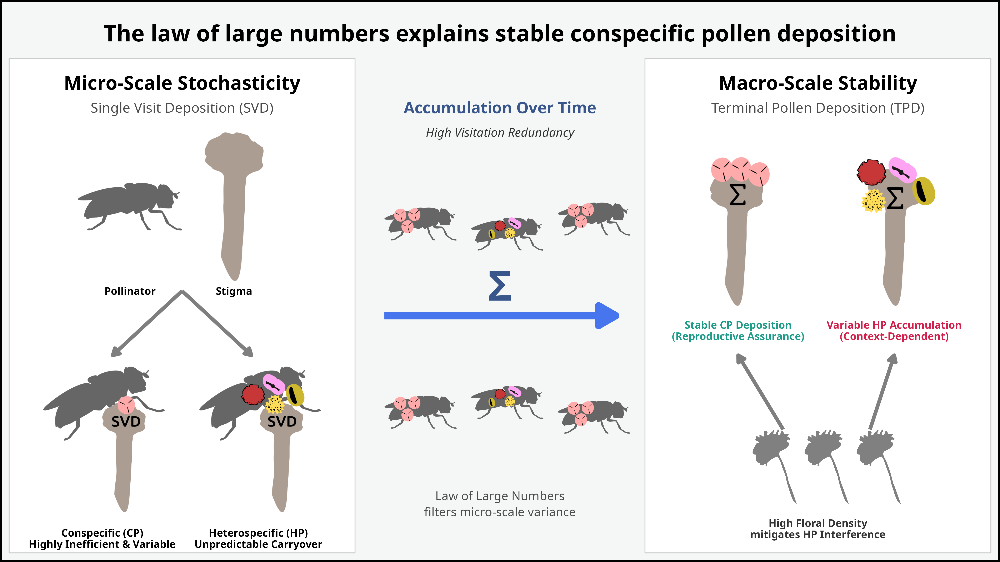
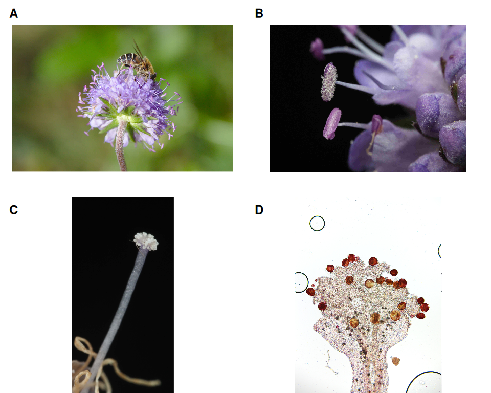
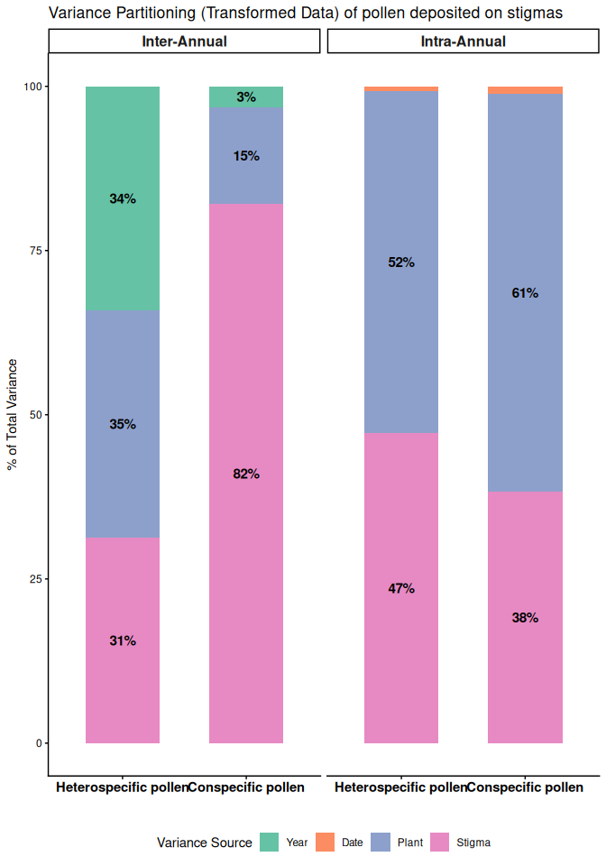
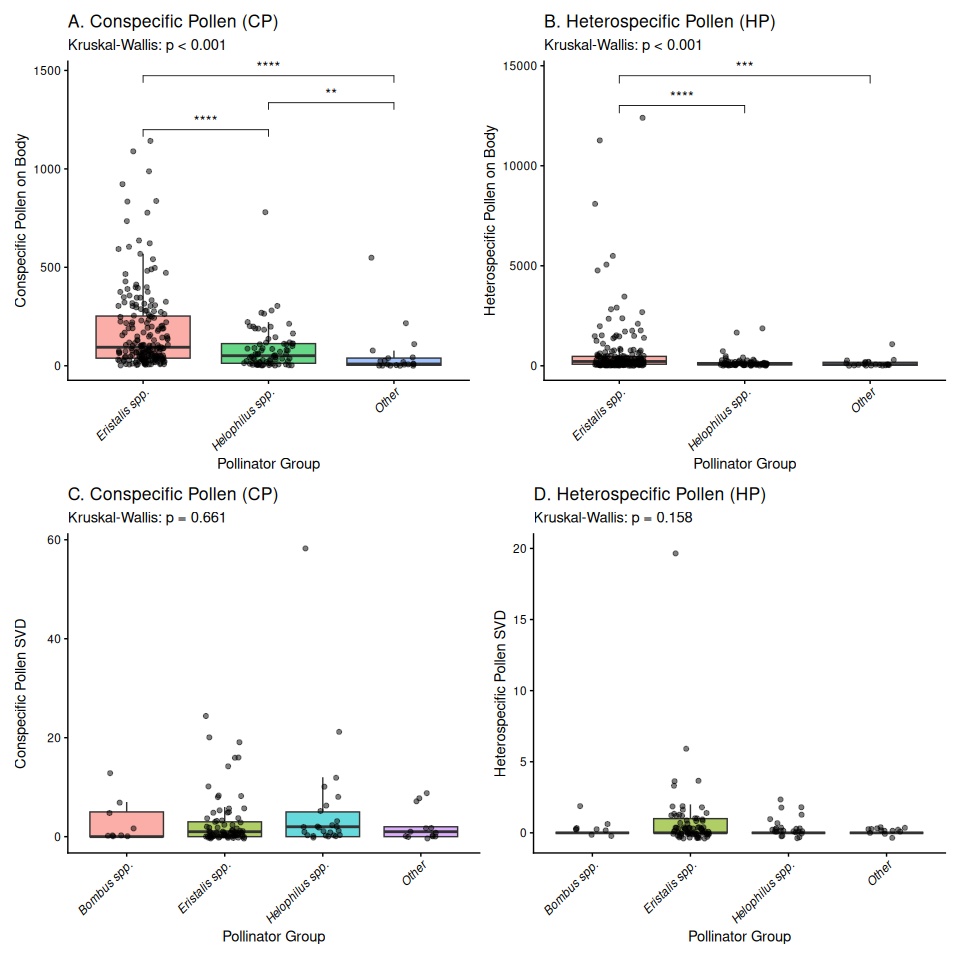
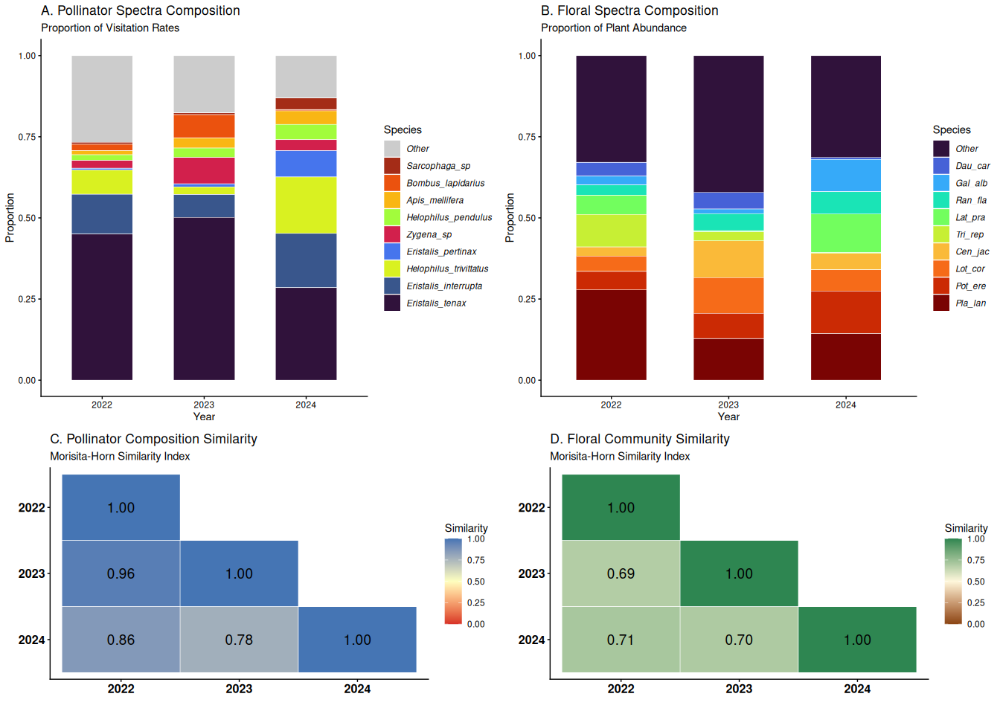
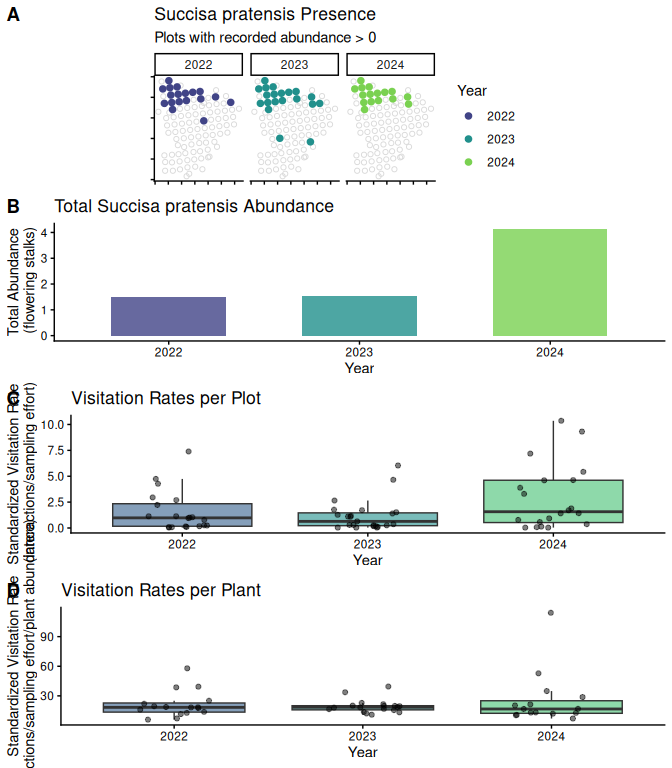
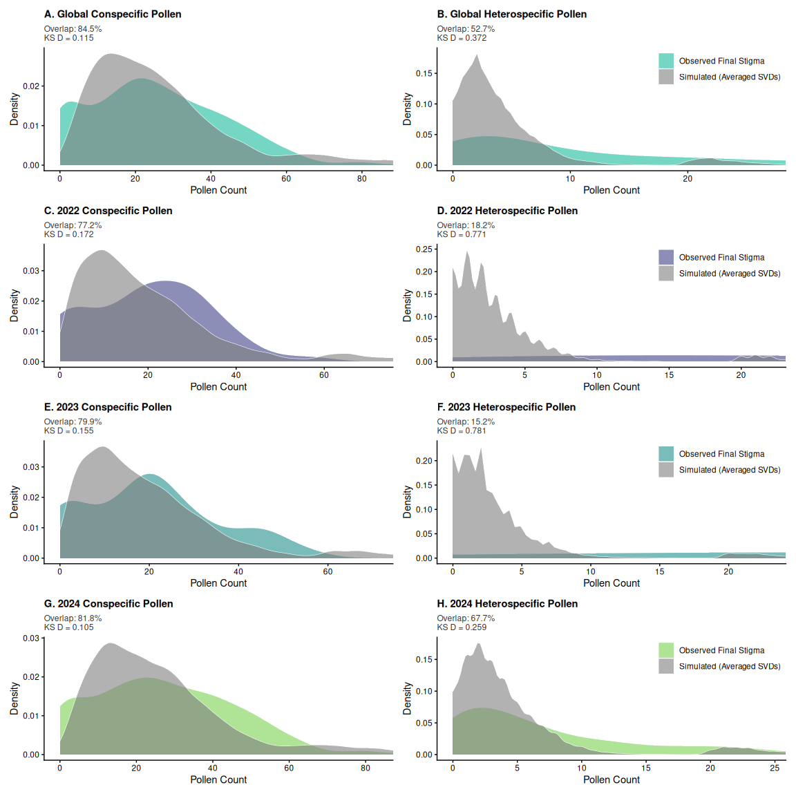

# The law of large numbers explains stable conspecific pollen deposition

**Article type:** Original Article

**Running title:** Law of large numbers stabilizes conspecific pollen
deposition

**Authors:**

Jakub Štenc1,2,3\*, Martin Freudenfeld1, Petr
Švanda1,2, Eva Matoušková1, Tadeáš
Ryšan2,4, Helena Pijálková2, Jiří
Hadrava2, Michael Mikát2, Eva
Horčičková5, Zdeněk Janovský6

**Affiliations:**

1 Department of Botany, Faculty of Science, Charles
University, Benátská 2, 128 41 Prague, Czech Republic

2 Department of Zoology, Faculty of Science, Charles
University, Viničná 7, 128 41 Prague, Czech Republic

3 CREAF - Centre de Recerca Ecològica i Aplicacions
Forestals, 08193 Bellaterra, Barcelona, Spain

4 Institute of Entomology, Biology Centre of Czech Academy of
Sciences, Branišovská 1160/31, 370 05 České Budějovice, Czech Republic

5 Department of Environment, Faculty of Environment, Jan
Evangelista Purkyně University in Ústí nad Labem, Pasteurova 3632/15,
400 96 Ústí nad Labem, Czech Republic

6 Svatý Jan t. Krsovice 1, 285 04 Uhlířské Janovice, Czech
Republic

\*For correspondence. E-mail: <jakub.stenc@natur.cuni.cz>

**ORCIDs:**

- Jakub Štenc:
  [0000-0003-0678-8452](https://orcid.org/0000-0003-0678-8452)
- Martin Freudenfeld:
  [0009-0008-6812-9843](https://orcid.org/0009-0008-6812-9843)
- Petr Švanda:
  [0000-0003-3288-7224](https://orcid.org/0000-0003-3288-7224)
- Eva Matoušková:
  [0000-0002-9486-4824](https://orcid.org/0000-0002-9486-4824)
- Tadeáš Ryšan:
  [0009-0003-9864-5906](https://orcid.org/0009-0003-9864-5906)
- Helena Pijálková:
  [0009-0005-8816-0299](https://orcid.org/0009-0005-8816-0299)
- Jiří Hadrava:
  [0000-0003-3247-6399](https://orcid.org/0000-0003-3247-6399)
- Michael Mikát:
  [0000-0001-5364-7180](https://orcid.org/0000-0001-5364-7180)
- Eva Horčičková:
  [0000-0003-2915-548X](https://orcid.org/0000-0003-2915-548X)
- Zdeněk Janovský:
  [0000-0002-0438-6778](https://orcid.org/0000-0002-0438-6778)

## Abstract

- **Background and Aims** Animal-mediated pollen transfer is inherently
  stochastic: single-visit deposition (SVD) yields highly variable
  pollen loads, yet terminal pollen deposition (TPD), the final
  stigmatic load, often remains stable at the population level. How
  generalized plants buffer this visit-level unpredictability while
  mitigating reproductive interference from heterospecific pollen (HP)
  remains unresolved.
- **Methods** Using a three-year dataset (2022–2024) for *Succisa
  pratensis*, we combined hierarchical variance partitioning of TPD
  across temporal and micro-spatial scales with pollinator body-load
  quantification, controlled SVD experiments across dominant pollinator
  morphogroups, and Monte Carlo simulations parameterized with empirical
  SVD and visitation data.
- **Key Results** Variance partitioning revealed that inter-annual and
  daily shifts explained negligible variation in conspecific pollen (CP)
  deposition; nearly all variance occurred at the micro-scale among
  individual stigmas and plants. SVD experiments showed that individual
  visits are highly stochastic, mechanically inefficient, and
  functionally equivalent across dominant hoverfly and bumblebee
  morphogroups. Monte Carlo simulations demonstrated that visit
  accumulation neutralises single-visit unpredictability, reproducing
  stable terminal CP loads. Conversely, HP accumulation diverged sharply
  from the random-visit null model across years and declined
  substantially under high conspecific floral density.
- **Conclusions** Despite extreme mechanical unpredictability in
  individual generalist visits, plants secure reliable conspecific
  pollen receipt through the law of large numbers: visit accumulation
  filters stochastic single-visit deliveries into stable terminal loads
  without requiring pollinator morphological specialization. In
  contrast, reproductive interference via heterospecific pollen is
  governed by floral neighbourhood context and mitigated by conspecific
  floral density and temporal pollen presentation.

**Key words:** Conspecific pollen deposition, heterospecific pollen, law
of large numbers, plant–pollinator networks, pollen transfer mechanics,
reproductive interference, single-visit deposition, *Succisa pratensis*.

## Introduction

Pollen transfer by animal vectors is an inherently stochastic process
(reviewed in [Minnaar *et al.*, 2019](#ref-Minnaar2019)), where the
number of pollen grains delivered during one pollinator visit
(Single-Visit Deposition; SVD) exhibits high variance ([Richards *et
al.*, 2009](#ref-richards2009variation); [King *et al.*,
2013](#ref-king2013)). Despite this micro-scale unpredictability,
population-level studies demonstrate that terminal pollen deposition
(TPD)—the final stigmatic pollen load prior to senescence—remains stable
across multiple years (e.g., [Fang *et al.*, 2019](#ref-fang2019multi),
[2023](#ref-Fang2022)). This stability provides reproductive assurance,
driven by the accumulation of conspecific pollen (CP). Conversely, the
receipt of heterospecific pollen (HP) from co-flowering species causes
reproductive interference that negatively impacts plant fitness
([Arceo-Gómez and Ashman, 2011](#ref-ArceoGomez2011)). Determining how
plants mitigate the high variance of SVD to secure CP receipt while
mitigating HP accumulation remains a pending objective in pollination
ecology.

At the SVD scale, the delivery of conspecific pollen is highly
unpredictable, and pollen transfer is markedly inefficient. Even among
legitimate pollinators, the quantity of pollen transferred fluctuates
dramatically due to highly variable individual pollen loads ([King *et
al.*, 2013](#ref-king2013); [Freudenfeld *et al.*,
2025](#ref-freudenfeld2025interannual)). This stochasticity is
compounded by taxon-specific differences in pollinator behaviour, such
as grooming ([Holmquist *et al.*, 2012](#ref-holmquist2012influence)),
insect morphological traits that drive pollen load composition ([Cullen
*et al.*, 2021](#ref-cullen2021diversity)), pollen carryover dynamics
across successive flower visits ([Thomson and Plowright,
1980](#ref-thomson1980)), and changing foraging decisions within the
plant-pollinator community ([Valdovinos,
2025](#ref-valdovinos2025effect)). Because the quantity and purity of
deposited pollen directly dictate ovule fertilization and plant fitness,
this high SVD variance exerts strong selective pressure on plants.
Consequently, plants must evolve ecological and morphological mechanisms
to aggregate these variable events into a stable reproductive outcome
([Richards *et al.*, 2009](#ref-richards2009variation)).

To overcome the unpredictability of individual visits, some plants may
rely on high visitation rates, accumulating a sufficient volume of
visits to average out the variance of individual vectors and ensure
reliable CP receipt. This is a direct consequence of the law of large
numbers: as the number of independent stochastic events increases, their
mean converges towards the expected value, such that the cumulative
pollen load on a stigma becomes increasingly predictable even when
individual visits are highly variable. The attraction of numerous
pollinators is often facilitated by dense local floral displays
([Vázquez, 2005](#ref-vazquez2005degree); [Janovský and Štenc,
2023](#ref-Janovsky2023)) or rich flowering communities that draw
diverse pollinator assemblages ([Venjakob *et al.*,
2016](#ref-venjakob2016plant); [Aguirre and Junker,
2024](#ref-aguirre2024floral)). However, accumulating pollinator visits
within a network concurrently introduces the risk of reproductive
interference in the form of HP received from other plant species sharing
pollinators within the community ([Morales and Traveset,
2008](#ref-morales2008interspecific); [Arceo-Gómez and Ashman,
2011](#ref-ArceoGomez2011)). Co-flowering heterospecific neighbouring
plant species act as sources of HP and alter the composition and
fidelity of the pollinator assemblage visiting the focal plant ([Lázaro
*et al.*, 2009](#ref-Lazaro2009); [Ye *et al.*, 2020](#ref-ye2020)).
Therefore, plants face conflicting evolutionary pressures: maximizing
visitation redundancy to ensure CP delivery while mitigating the
associated influx of HP. High conspecific floral density serves as one
density-dependent buffering mechanism, diluting the proportion of
deposited HP by pulling pollinators from co-flowering neighbours
([Arceo-Gómez *et al.*, 2016](#ref-arceo2016patterns)).

Other mechanisms may be involved as well. For example, the
density-dependent buffering can be significantly enhanced by the
temporal stratification of plant-pollinator interactions within the
community ([Stone *et al.*, 1998](#ref-Stone1998); [Schwarz *et al.*,
2021](#ref-Schwarz2021)). For example, the diurnal pollen release
schedules previously observed in *Succisa pratensis* allow the plant to
establish temporal dominance by attracting pollinators primarily early
in the day ([Štenc *et al.*, 2023](#ref-Stenc2023)). By releasing pollen
and attracting vectors before co-flowering competitors do, a plant can
secure substantial CP delivery prior to the accumulation of
heterogeneous pollen loads on shared vectors, functioning as a form of
temporal specialisation ([Brosi, 2016](#ref-Brosi2016)). This temporal
stratification ensures that the highest-frequency visits occur within a
specific time window, mitigating the subsequent accumulation of HP
([Schwarz *et al.*, 2021](#ref-Schwarz2021); [Štenc *et al.*,
2023](#ref-Stenc2023)).

While the variability of individual visits and the theoretical
frameworks for pollen accumulation are well known, empirical studies
rarely measure these processes across multiple scales in a natural
system. In this study, we evaluate pollen transfer using a three-year
dataset (2022–2024) for the highly visited plant *Succisa pratensis*. We
address the following objectives: (1) to quantify the hierarchical
variance in pollen deposition across years, days, individual plants, and
individual stigmas; (2) to compare the mechanistic efficiency of CP and
HP transfer across dominant vector taxa at the SVD scale; (3) to
mathematically test whether visitation redundancy drives stable CP
deposition using Monte Carlo simulations; and (4) to determine how
year-to-year changes in local conspecific floral abundance influence the
accumulation of HP. We hypothesise that despite the high variability of
individual generalist visits, *S. pratensis* achieves stable CP
deposition because its high local floral abundance and early morning
pollen release ([Štenc *et al.*, 2023](#ref-Stenc2023),
[2025](#ref-stenc2025pollen)) evolved as traits that buffer the plant
against unpredictable single-visit deliveries.

Figure 1: **Conceptual diagram of the proposed pollen deposition
framework.** Individual pollinator visits deliver highly variable
conspecific (CP) and heterospecific (HP) pollen loads to *Succisa
pratensis* stigmas (left; Single-Visit Deposition, SVD). The
accumulation of many independent visits over the stigma lifespan
(centre) filters micro-scale variance through the law of large numbers,
producing stable terminal CP loads (right). In contrast, HP accumulation
remains ecologically context-dependent and is partially buffered by high
conspecific floral density.

## Materials and Methods

### Study system

Our observations were conducted in a semi-natural grassland community
characterised by a high abundance of flowering plants and a diverse
pollinator community dominated by hoverflies. The study site, “K
Handrkovu”, is located near the village of Vernýřov, Central Bohemia,
Czech Republic (49.8466° N, 15.1498° E). The site can be classified as a
mosaic of moist-to-mesophilic and eutrophic-to-mesotrophic grasslands,
supporting more than 50 entomogamous plant species that flower in late
summer each year ([Janovský *et al.*, 2013](#ref-Janovsky2013)).
Fieldwork was conducted from 2022 to 2024 during the peak of *S.
pratensis* flowering activity (15–19 August, 13–20 August, and 11–18
August, respectively).

*Succisa pratensis*, our focal plant species, maintains a relatively
large and stable population at our study site. It is frequently visited
by a wide spectrum of pollinators—especially hoverflies
(<a href="#fig-plant-pollinator-panel" class="quarto-xref">Figure 2</a>)—which
feed on both its pollen and nectar. Important traits related to its
pollination include distinctive open inflorescences accessible to most
pollinators, protandry to prevent self-pollination ([Bartoš *et al.*,
2020](#ref-bartos2020self)), and a diurnal pollen release schedule
occurring in the morning hours ([Štenc *et al.*, 2023](#ref-Stenc2023)).

 

Figure 2: A) Stigma of *Succisa pratensis* with several pollen
morphotypes; B) Pollinator (*Eristalis* sp.) on a flower of *S.
pratensis*, highlighting pollen visible on the pollinator’s body; C)
Detail of an anther with visible pollen grains of *S. pratensis*; D)
Detail of a stigma of *S. pratensis* with visible deposited pollen
grains.

### Plant-Pollinator Interactions and Plant Abundance

Following the established protocol for this study locality ([Janovský
*et al.*, 2013](#ref-Janovsky2013)), we collected data on pollinator
visitation activity in 93 permanent plots arranged in a semi-regular
grid, spaced 20 m apart across the study site. All plots were
permanently marked with a metal nail, recovered using a metal detector,
and visibly marked prior to the sampling event each year. Within the
plots, we recorded flowering plant abundance and all interactions of
flower-visiting pollinators with flowering *S. pratensis*, as well as
with other plant species in the surrounding community. To avoid
pseudoreplication, all flowers within a plot were surveyed only once per
individual sampling event. All interactions occurring during the survey
moment were recorded, lasting up to five minutes per plot. Each plot was
surveyed at least twenty times during a sampling period spanning 5–10
consecutive days at the peak of flowering (mid-August) each year. For
this study, we utilised interactions recorded during the main diurnal
period of pollinator activity (07:00–19:00). We recorded only the
pollinators that made contact with the reproductive organs of the
visited plant, counting each individual pollinator only once. Finally,
we computed standardised interaction rates (total number of interactions
per plot survey) for pollinators visiting *S. pratensis* from 2022 to
2024, and compared the distribution of interaction rates for the
specific group of pollinators visiting *S. pratensis* against those
visiting all other plant species.

To determine plant abundance, we surveyed the plots twice during each
sampling event to control for potential phenological shifts; for this
study, we used the average plant abundance per sampling event. To record
abundance, we divided each plot into 64 individual cells using a string
grid gently placed over the plot. Within each cell, we either counted
the flowering stalks or recorded the presence/absence of flowering
plants, depending on the species.

### Pollen Load

In 2024, we investigated the number of pollen grains carried on the
pollinators’ bodies. Foraging pollinators visiting *S. pratensis*
inflorescences were captured with an entomological net and euthanised
immediately. Following Beattie ([1971](#ref-beattie1971technique)), we
swabbed pollen grains from one half of each pollinator’s body (randomly
selecting the left or right side) using a small block of Fuchsin jelly.
Captured pollinators were subsequently stored in 70% ethanol. On the
same day, we produced semi-permanent slides by melting the Fuchsin jelly
onto a microscope slide using a heating pad, adding a coverslip, and
sealing it with nail polish. We later counted and identified all pollen
grains using a light microscope, sorting them into conspecific *S.
pratensis* pollen and heterospecific pollen (HP) from other plant
species.

### Single-Visit Deposition (SVD)

To estimate the pollinator single-visit deposition (SVD), we followed
protocols adapted from previous studies ([King *et al.*,
2013](#ref-king2013); [Valverde *et al.*, 2019](#ref-valverde2019)). To
prevent prior pollinator access, we enclosed selected inflorescences in
fine-mesh tulle bags before the plants entered the male phase and opened
their anthers. Once a plant entered the female phase with receptive
stigmas, we removed the bag and observed the inflorescence until the
arrival of the first pollinator. Pollinators were allowed to visit only
one flower within the inflorescence, after which we immediately
collected its stigma into a microcentrifuge tube containing 70% ethanol.
If a pollinator visited multiple flowers, we collected only the first
visited stigma and removed the others from the plant. The SVD
experiments were conducted in 2022, 2023 and 2024.

### Terminal Pollen Deposition (TPD) on Stigma

To determine terminal pollen deposition (TPD), we collected stigmas from
flowers with visibly senesced or absent corollas, indicative of the late
flowering stage (pers. obs.). Each year, we collected 3 randomly
selected stigmas per flowerhead to account for intra-inflorescence
variability, and from 30 randomly selected individuals from the
population per day. In 2022 and 2023, we collected samples during only
one day, in 2024 we sampled stigmas during 6 days, following the same 3
stigma per flowerhead and 30 plant individual design.

We placed the collected stigmas onto microscope slides and allowed the
ethanol to evaporate on a heating pad. Subsequently, we applied 1 µL of
10% KOH and allowed the samples to dry, followed by 3 µL of 3% hydrogen
peroxide. After another drying period, we added 13 µL of 8% acetic acid.
Once completely dry, we applied 5 µL of a dye solution (safranin, water,
and glycerol), covered the samples with a coverslip, applied gentle,
even pressure to squash the stigma, and sealed the edges with nail
polish to create semi-permanent samples. We discarded samples which were
destroyed during the processing or were insufficient for pollen
counting. Pollen grains were counted and identified under a light
microscope at 400× magnification. Based on the pollen morphology (size,
shape and ornamentation), we distinguished conspecific (*Succisa
pratensis*) pollen grains from heterospecific pollen grains (HP).

### Statistical Analysis

All statistical analyses were performed in R (version 4.3.3; R Core Team
([2024](#ref-Rcore))). To systematically evaluate pollen transfer
dynamics across hierarchical scales, our analyses were structured into
four primary components: (1) community stability and visitation
dynamics, (2) single-visit transfer efficiency, (3) variance
partitioning of terminal pollen deposition (TPD), and (4) mathematical
simulations of visitation redundancy.

#### Community Stability and Visitation Dynamics

To assess the temporal consistency of the local ecological network, we
calculated the Morisita-Horn similarity index for both the pollinator
visitation spectra and the co-flowering plant community across the three
study years. Differences in standardised visitation rates (total
interactions per plot) and per-capita visitation rates (interactions per
focal plant) across years were analysed using Kruskal-Wallis rank-sum
tests, followed by post hoc Dunn’s tests with Benjamini-Hochberg false
discovery rate corrections. Furthermore, to formalise the
density-dependent dilution effect, we fitted a log-log linear regression
evaluating how per-capita visitation rates scaled with local *S.
pratensis* plot abundance.

#### Single-Visit Deposition (SVD)

To evaluate micro-scale mechanical transfer, pollinators were
categorised into dominant morpho-groups (e.g., *Eristalis* spp.,
*Helophilus* spp., *Bombus* spp.). Differences in both conspecific
pollen (CP) delivery and heterospecific pollen (HP) carryover during a
single visit were tested across these taxa using Kruskal-Wallis rank-sum
tests.

#### Variance Partitioning

To identify the exact spatial and temporal scales driving
unpredictability in terminal stigmatic pollen loads, we applied Variance
Components Analysis (VCA) using Linear Mixed Models (LMMs). Prior to
modelling, pollen counts were square-root transformed to stabilise
variance and approximate normality, as confirmed by residual diagnostic
plots (‘Residuals vs. Fitted’ and ‘Normal Q-Q’, see Section S1). Because
fine-scale daily data were exclusively available for the 2024 season, we
constructed two complementary LMMs to prevent rank deficiency: an
inter-annual model spanning 2022–2024 (`1 | year / plant_id`), and an
intra-annual model restricted to 2024 (`1 | date / plant_id`). The
statistical significance of these hierarchical random effects (Year,
Date, and Plant) was evaluated using Likelihood Ratio Tests.

Furthermore, to test how HP accumulation scales with CP receipt, and
whether this relationship shifted during the high-density anomaly of
2024, we aggregated pollen counts to the plant level. We fitted a linear
model testing the interaction between transformed CP and Year
(`sqrt(mean_HP) ~ sqrt(mean_CP) * Year`; see Section S2 for model
selection and Section S3 for diagnostics). Differences in the rates of
HP accumulation across years were subsequently quantified using pairwise
slope contrasts via estimated marginal means.

#### Monte Carlo Simulation of Visitation Redundancy

To test whether visitation redundancy mathematically drives stable
pollen deposition, we constructed a Monte Carlo bootstrapping
simulation. Because pollinator morphology and mechanical transfer
efficiency are functionally consistent traits, we pooled all
single-visit deposition (SVD) data across the three study years to
create a single, highly robust global pool of vector deposition
profiles. This allowed us to mathematically isolate the effect of the
plant’s changing floral density while holding vector baseline deposition
constant.

We parameterised the simulation independently for each study year
(2022–2024). For a given year, we estimated the average required
visitation rate by dividing the empirical mean of conspecific pollen
(CP) on that year’s stigmas by the mean CP of the global SVD pool. We
then generated 10,000 virtual stigmas per year, randomly sampling (with
replacement) from the global SVD pool based on that year’s specific
visitation rate.

Finally, we evaluated the fit of the simulated null models against our
true field observations. Because the large sample size of the simulation
(N = 10,000) renders traditional two-sample Kolmogorov-Smirnov (K-S)
p-values hypersensitive to trivial biological deviations—such as
physical stigma saturation limits—we focused on the K-S D-statistic to
quantify the maximum distributional divergence as a measure of effect
size. Furthermore, to provide a robust and intuitive measure of
simulation accuracy independent of sample size, we calculated the
Overlapping Coefficient (OVL; Pastore and Calcagnì
([2019](#ref-pastore2019measuring))). The OVL quantifies the exact
proportion of area shared between the empirical and simulated
probability density curves, providing a direct metric of functional
overlap between the theoretical null model and field reality.

## Results

Across the three-year study period (2022–2024), we collected and
analysed a total of 693 terminal-stage stigmas from 273 individual
*Succisa pratensis* plants to evaluate terminal pollen deposition (TPD).
We sampled 84 stigmas in 2022, 89 stigmas in 2023, and 520 stigmas in
2024, with collections conducted over 6 consecutive days. To quantify
micro-scale transfer dynamics and vector efficiency, we captured pollen
from 300 individual visitors of *S. pratensis* to assess body pollen
loads (Table S1), and we sampled 124 controlled single-visit deposition
(SVD) events on virgin stigmas (Table S2). Finally, we recorded 2998
individual plant-pollinator interactions during standardised focal plot
observations (Table S3). Detailed descriptions of the individual results
follow.

### Coefficient of Variation and Variance Partitioning of TPD

To quantify the unpredictability of pollen transport, we compared the
Coefficient of Variation (CV) across functional transport compartments
(<a href="#fig-plots-3" class="quarto-xref">Figure 3</a>). Conspecific
pollen (CP) exhibited high variability on pollinator bodies (CV = 129%)
and in SVDs (CV = 206%). However, at the TPD stage, the variability
decreased considerably (CV = 69%). Conversely, heterospecific pollen
(HP) remained relatively variable across all compartments, from vector
bodies (CV = 264%) through to final stigmatic loads (CV = 147%; see
Section S7 for raw data distribution). The inter-annual variability of
TPD remained relatively stable across years for CP (CVs ranging from 66%
to 73%), but the variability of HP increased in 2024 (CV = 125%,
<a href="#fig-plots-3" class="quarto-xref">Figure 3</a>).

Hierarchical variance partitioning further confirmed the micro-scale
nature of this stochasticity in TPD
(<a href="#fig-plots-4" class="quarto-xref">Figure 4</a>; Tables S4 and
S5). For CP, temporal phenology (years and days) explained only a small
proportion of the variation; instead, the vast majority of depositional
variance occurred at the micro-spatial scale, driven by differences
among individual plants (15%) and individual stigmas (82%). Variance
partitioning and subsequent likelihood ratio tests (Table S6) revealed
that HP deposition was significantly driven by temporal shifts at the
macro-scale ($\chi^2 = 32.39, p < 0.001$) and by spatial variation among
individual plants nested within the year ($\chi^2 = 104.73, p < 0.001$).

Notably, intra-annual analysis of the 2024 season showed that daily
temporal variation was not a significant driver of either CP or HP
deposition ($\chi^2 = 1.32, p = 0.517$ for CP;
$\chi^2 = 0.19, p = 0.663$ for HP). Instead, variance during the 2024
season was heavily driven by differences among individual plants
($\chi^2 = 126.53, p < 0.001$), suggesting that plant-level traits or
highly localised micro-spatial effects dictate heterospecific pollen
transfer more than daily phenological shifts.

 

Figure 3: Coefficient of Variation (CV) and Mean of Conspecific (CP) and
Heterospecific (HP) pollen counts across different compartments and
years. A) Inter-compartmental variability (CV) comparing pollen loads on
pollinator bodies (Body), single-visit deposition (SVD), and final
Terminal Pollen Deposition (TPD). B) Interannual variability (CV) of TPD
across 2022–2024. C) Mean pollen counts (± SE) across the three
compartments, highlighting the significant drop from body loads to SVD.
D) Mean TPD (± SE) across the three study years.

 

Figure 4: Pollen Deposition Model and Variance Partitioning. A)
Back-transformed predictions (± 95% CI) from a linear model fitted to
square-root transformed plant-level mean pollen counts
(`sqrt(mean_HP) ~ sqrt(mean_CP) * Year`), showing the accumulation of
Heterospecific Pollen (HP) relative to Conspecific Pollen (CP) across
three years (2022–2024; points denote individual plant means). The
dashed grey line indicates the 1:1 relationship, illustrating that CP
accumulates substantially faster than HP. B) Hierarchical variance
partitioning of square-root transformed terminal pollen loads (Linear
Mixed-Effects Models), showing the percentage of variance in HP and CP
explained by Year, Plant, and individual Stigma (Inter-Annual,
2022–2024) and by Date, Plant, and individual Stigma (Intra-Annual,
2024).

**Table 1.** Results of Analysis of Variance (ANOVA) and subsequent
pairwise slope contrasts examining the relationship between Conspecific
Pollen (CP) and Heterospecific Pollen (HP) accumulation on stigmas. The
ANOVA assesses the main effects of CP, Year, and their interaction on HP
accumulation. Pairwise contrasts compare the rate of accumulation
(slope) across the three sampling years (2022–2024), detailing
differences in pollen deposition dynamics over time.

Table 1

### Pollen Load and Single-Visit Deposition (SVD)

To evaluate the mechanical efficiency of pollen transfer, we compared
the total pollen loads carried on vector bodies to the amounts of pollen
successfully deposited on stigmas during single-visit depositions (SVD).
Pollinators carried substantial pollen loads (Mean Body CP = 147.8 (SD =
393.6); Mean Body HP = 478.8 (SD = 1102.2)). However, per-visit
mechanical transfer was remarkably inefficient. Only a minute fraction
of the available body load, approximately 2.3% for CP and 0.1% for HP,
was successfully deposited onto a receptive stigma during a single
floral visit.

To determine if specific pollinator taxa drive the depositional variance
observed across the network, we compared single-visit depositions (SVD)
across the dominant floral visitor morphogroups (e.g., *Eristalis* spp.,
*Helophilus* spp., *Bombus* spp.). Kruskal-Wallis rank-sum tests
revealed no significant differences among pollinator taxa in the amount
of conspecific pollen deposited during a single visit
($H_3 = 1.59, p = 0.661$). Similarly, there were no significant
differences across taxa in the deposition of heterospecific pollen per
visit ($H_3 = 5.20, p = 0.158$). These results indicate that per-visit
pollen transfer efficiency and heterospecific pollen carryover may be
highly stochastic but functionally equivalent across the studied
pollinator morphogroups. Consequently, the terminal stigmatic pollen
loads received by *S. pratensis* are not dictated by the taxonomic
identity or morphological specialisation of its visitors, but purely by
the cumulative frequency of their visits.

 

Figure 5: Distribution of pollen loads carried by pollinators and
deposited during single visits. A–B) Histograms showing the highly
skewed distribution of Conspecific (CP) and Heterospecific (HP) pollen
grains present on the bodies of captured pollinators. C–D) Corresponding
distributions of CP and HP successfully deposited onto virgin stigmas
during controlled single-visit deposition (SVD) experiments,
demonstrating the high stochasticity and low efficiency of single
transfer events.

### Pollinator Visitation Spectra and Co-flowering Community Stability

To assess the temporal stability of the pollinator visitation spectra of
*S. pratensis*
(<a href="#fig-community-stability" class="quarto-xref">Figure 6</a>)
and the co-flowering plant community, we compared species composition
across years using the Morisita-Horn similarity index ([Horn,
1966](#ref-horn1966measurement)). The pollinator spectra showed high
compositional overlap across the years, ranging from 0.78 to 0.96
similarity. The flowering plant community composition showed lower
overlap, ranging from 0.69 to 0.71.

The pollinator visitation spectra of *S. pratensis* (Table S3,
<a href="#fig-community-stability" class="quarto-xref">Figure 6</a> A)
was dominated by large hoverflies, namely *Eristalis tenax* (n = 1,127,
37.6%), *Eristalis interrupta* (n = 403, 13.4%), *Helophilus
trivittatus* (n = 346, 11.5%), *Eristalis pertinax* (n = 138, 4.6%), and
*Helophilus pendulus* (n = 105, 3.5%). Other frequent visitors included
*Zygaena* sp. (n = 129, 4.3%), *Apis mellifera* (n = 98, 3.3%), and
*Bombus lapidarius* (n = 71, 2.4%), with all other taxa each accounting
for less than 2.2% of the total recorded visits.

 

Figure 6: Plant and pollinator community composition and temporal
stability. A) Relative abundance of major pollinator functional groups
visiting *Succisa pratensis* across the three study years. B) Relative
floral abundance of the surrounding co-flowering plant community. C)
Temporal stability of the pollinator community measured using the
Morisita-Horn overlap index across consecutive years. D) Temporal
stability of the floral community similarity, indicating high
consistency in the background community over time.

### Floral Density and Visitations

Despite the increase in *S. pratensis* abundance in 2024,
sampling-effort-standardised visitation rates per plot and per plant did
not differ significantly between years.

Figure 7: Spatial distribution and temporal abundance of *Succisa
pratensis* and its pollinators (2022-2024). A) Spatial map showing the
distribution and relative size of plots with *Succisa* presence. B)
Total floral abundance of *Succisa pratensis* recorded across the study
sites per year. C) Boxplots showing differences in standardized
pollinator visitation rates to *Succisa pratensis* across the three
years, with individual data points overlaid.

### Monte Carlo Simulation: The Interannual Variance Filter

The year-by-year Monte Carlo simulation confirmed that visitation
redundancy effectively neutralises micro-scale stochasticity for
conspecific pollen (CP) across all measured years in the TPD. Regardless
of the study year, the random additive accumulation of SVDs from the
global vector pool successfully recreated the stable mean CP loads
observed in the field (e.g., 2024 Simulated CP Mean: 26.8; Observed CP
Mean: 27.4). While the two-sample K-S tests flagged mathematical
divergences ($p < 0.001$) due to the hypersensitivity of a
10,000-iteration model to biological saturation limits, the tight
convergence of the central tendencies and the functional overlap of the
distributions (D-statistics ranging from 0.103 to 0.166) demonstrate
that visitation frequency alone acts as a robust mathematical filter,
effectively translating single-visit variance into stable CP deposition.

Conversely, for heterospecific pollen (HP), the simulation’s accuracy
varied sharply between years, revealing that HP accumulation is governed
by environmental context rather than simple mechanical redundancy. If
generalist vectors deposit mixed pollen loads based strictly on their
baseline single-visit profiles, the null model dictates that stigmas
should accumulate a low, normalised baseline load of HP (3.4 to 4.5
grains). In standard-density years (2022 and 2023), empirical stigmas
accumulated HP loads that exceeded this mathematical expectation by more
than tenfold (e.g., 2023 Observed HP: 50.4 vs. Simulated: 3.4),
resulting in severe structural divergence from the null model
($D > 0.77$). Crucially, during the increased density of *S. pratensis*
in 2024, this neighbourhood-driven accumulation declined. The observed
HP dropped to 9.6 grains, forcing the empirical distribution
significantly closer to the mechanical baseline ($D = 0.265$). Because
vector mechanical efficiency was held constant in our simulation, this
interannual shift confirms that while standard-density years suffer
heavy reproductive interference from shared networks, the increased
conspecific floral abundance in 2024 actively mitigated HP accumulation,
suppressing it back toward the mechanical minimum.

**Table 2.** Validation of the Monte Carlo simulation for interannual
conspecific (CP) and heterospecific (HP) pollen accumulation. The table
compares the simulated pollen deposition (assuming random accumulation
from single visits) to the observed final Terminal Pollen Deposition
(TPD) on stigmas. It details the estimated required visitation rates to
achieve observed loads, observed versus simulated mean pollen loads, and
structural divergence metrics (Kolmogorov-Smirnov D-statistics with
corresponding p-values, and Overlapping Coefficients) across the three
study years (2022–2024).

 

 

Figure 8: Validation of the Law of Large Numbers in pollen deposition
via Monte Carlo Simulations. The density plots compare the observed
final Terminal Pollen Deposition (TPD) (solid lines) against the
simulated expected distribution (dashed lines) if stigmas accumulated
pollen randomly from independent single-visit depositions (SVD). A–B)
Global distribution comparisons for Conspecific (CP) and Heterospecific
(HP) pollen across all years combined. C–H) Yearly breakdowns for CP and
HP across 2022, 2023, and 2024, demonstrating strong structural
alignment between simulated and observed deposition.

## Discussion

Generalist pollination systems operate under high micro-scale
unpredictability ([Richards *et al.*, 2009](#ref-richards2009variation);
[King *et al.*, 2013](#ref-king2013)), yet population-level conspecific
pollen deposition often remains stable ([Fang *et al.*,
2019](#ref-fang2019multi)). Our results demonstrate that plants subject
to highly stochastic single-visit pollen delivery achieve stable
terminal conspecific deposition simply through mathematical averaging.
Visitation redundancy neutralizes conspecific variance. Variance
partitioning revealed that CP receipt is stable against inter-annual
shifts, restricting variance in TPD almost entirely to individual
stigmas and plants. The Monte Carlo simulation supports this mechanism,
demonstrating that the statistical law of large numbers translates
highly variable single visits into population-level CP stability. This
stabilizing effect is asymmetric; while CP receipt is buffered by
visitation frequency, HP accumulation remains highly variable and
environment-dependent ([Arceo-Gómez *et al.*,
2016](#ref-arceo2016patterns)).

Achieving stable TPD through visitation redundancy directly influences
plant fitness and sexual selection. *Succisa pratensis* possesses a
single ovule; successful fertilization theoretically requires one viable
grain. Accumulating CP loads that vastly exceed this minimum requirement
shifts the reproductive bottleneck from the pollinator’s body to the
plant’s stigmas. High-volume CP deposition triggers intense
pollen-pollen competition ([Minnaar *et al.*, 2019](#ref-Minnaar2019)).
By securing excessive CP loads despite highly variable individual
deliveries, high visitation rates act as a mechanism to sample multiple
pollen donors, enabling post-pollination selection based on pollen
competitive ability ([Hildesheim *et al.*,
2019](#ref-hildesheim2019quantitative); [Madjidian *et al.*,
2020](#ref-madjidian2020direct)). The micro-scale unpredictability of
individual visits potentially acts as a selective pressure driving
floral traits that maximize pollinator attraction and visitation
redundancy.

Single-visit deposition (SVD) analysis revealed no significant
differences in CP or HP transfer across dominant pollinator taxa.
Functionally, a single visit from a *Bombus* bee was indistinguishable
from a visit by an *Eristalis* syrphid fly
(<a href="#fig-body-svd" class="quarto-xref">Figure 5</a> C). While
previous frameworks emphasize morphological specialization, our data
show that the extreme stochasticity of individual visits overrides
taxonomic differences in mechanical transfer efficiency. Reproductive
success in this system is driven by vector abundance rather than
morphological specialization. These results support recent findings that
large hoverflies and bees exhibit functional equivalence in pollen
transfer capacity ([Freudenfeld *et al.*,
2025](#ref-freudenfeld2025interannual)).

Unlike the mathematically determined stability of CP, HP deposition is
context-dependent and exhibits high inter-annual variability. The extent
of HP contamination represents reproductive interference driven by
environmental fluctuations rather than mechanical redundancy. HP
accumulation is not successfully predicted by simple visitation models
because pollinator fidelity fluctuates dynamically based on co-flowering
phenology and local floral density. In years with increased density of
co-flowering heterospecific neighbors, the attractive pull of
competitors alters the fidelity of shared generalist pollinators
([Morales and Traveset, 2008](#ref-morales2008interspecific); [Flanagan
*et al.*, 2010](#ref-flanagan2010increased)), driving interspecific
transitions and increasing HP loads ([Bell *et al.*,
2005](#ref-bell2005interspecific)). To mitigate environmentally driven
HP accumulation, focal plants are under selective pressure to employ
spatial or temporal isolation traits. High conspecific floral density
acts as a spatial buffer against HP transfer, while diurnal pollen
release schedules establish temporal dominance over shared vectors.

Nevertheless, our study possesses limitations that must be addressed in
future research. First, while we found no significant differences among
morphological groups of pollinators in their single-visit pollen
deposition (SVD), this lack of difference may be partly due to the
stochastic nature of individual depositions, potentially requiring more
sampling to detect the subtle effects of pollinator traits on pollen
deposition ([Ne’eman *et al.*, 2010](#ref-ne2010framework); [King *et
al.*, 2013](#ref-king2013)). Second, our SVD methodology provides an
evidence of pollen transfer, but it does not explicitly track the
previous foraging history or complex pollen carryover dynamics of
individual pollinators prior to capture ([Thomson and Plowright,
1980](#ref-thomson1980); [Cullen *et al.*,
2021](#ref-cullen2021diversity)). Consequently, while our data
demonstrate that multiple SVD events mathematically aggregate into
stable CP loads, we currently lack the genetic parentage data, as well
as the data on stigma receptivity and pollen tube germination required
to confirm whether this high visitation redundancy translates into a
highly diverse pollen donor pool and subsequent pollen-pollen
competition along the pathway to paternity ([Karron and Mitchell,
2012](#ref-karron2012effects); [Minnaar *et al.*,
2019](#ref-Minnaar2019); [Stavert *et al.*,
2020](#ref-stavert2020pollen)).

The fact that the pollen deposited on stigmas is the result of multiple
SVD events suggests that the composition of pollen competing for ovule
fertilization is formed by pollen from several distinct donors. This has
direct implications for pollen-pollen competition, male reproductive
success, and population genetic variability ([Bernasconi *et al.*,
2004](#ref-bernasconi2004evolutionary)). A remaining question is whether
the pollen delivered during the first visits has a decisive competitive
advantage over later-delivered pollen ([Lankinen and Madjidian,
2011](#ref-lankinen2011enhancing)), or if this advantage is limited by
the timing of stigma receptivity acting as a synchronized starting gate
([Herrero, 2003](#ref-herrero2003male)). Beyond this micro-scale
pollen-pollen competition, the macro-scale genetic implications of
stochastic visits remain unknown. Because vector foraging behavior and
heterospecific carryover fluctuate with local floral density
([Arceo-Gómez and Ashman, 2011](#ref-ArceoGomez2011)), the hidden
donor-acceptor mating network may undergo radical year-to-year rewiring
([CaraDonna *et al.*, 2017](#ref-caradonna2017interaction)). Determining
whether these dynamic micro-competitive mechanisms and macro-level
network shifts represent a generalizable feature of plant-pollinator
systems remains an open question for future ecological and evolutionary
research.

#### Conclusions

Stable pollen transfer in generalized networks is driven by distinct,
scale-dependent mechanisms. While individual generalist vectors exhibit
extreme depositional stochasticity, plants achieve reliable conspecific
pollen receipt through the law of large numbers: the accumulation of
many independent, variable visits converges on a stable mean load,
providing reproductive assurance without requiring morphological
specialization of individual vectors. Visitation redundancy alone is
functionally insufficient to prevent reproductive interference from the
co-flowering community, and variations in community composition
influence HP transfer. The mitigation of heterospecific pollen
accumulation then possibly relies on several mechanisms such as the
local spatial structure of the focal population and pollinator temporal
specialization ([Brosi, 2016](#ref-Brosi2016); [Štenc *et al.*,
2025](#ref-stenc2025pollen)).

## Supplementary Data

Supplementary data are available online and consist of the following:

- **Model Diagnostics (Sections S1–S3)**: Transformation diagnostics and
  model selection criteria for the variance component analyses.
- **Sampling Summaries (Section S4, Tables S1–S3)**: Comprehensive
  counts of raw pollinator body pollen loads, single-visit deposition
  events, and plant–pollinator interactions.
- **Variance Partitioning Components (Section S5, Tables S4–S5)**:
  Detailed hierarchical variance components for conspecific and
  heterospecific pollen deposition.
- **Significance Testing (Section S6, Table S6)**: Likelihood ratio test
  results for all random effects.
- **Data Distribution (Section S7)**: Raw distribution of heterospecific
  pollen counts on stigmas.
- **Archived Data and Code (Section S8)**: List of the data files
  archived on Figshare.

## Funding

This work was supported by the Czech Science Foundation (GAČR, grant no.
23-06433S). The work of J.H. was supported by the Charles University
Research Centre program (no. UNCE/24/SCI/006), Cooperatio (no.
20702007), and SVV (260812/2026).

## Acknowledgements

We are grateful to the members of the PEE and PEG groups for suggestions
during the preparation of the manuscript, namely Tomáš Herben and Martin
Weiser. We also acknowledge the support of the Municipality of
Chlístovice in providing access to the study sites and field laboratory.

## Conflict of Interest

None declared.

## Author Contributions

J.Š. planned and designed the research, developed the methodology, and
acquired funding. J.Š., M.F., P.Š., E.M., J.H., M.M., T.R., H.P., E.H.
and Z.J. performed fieldwork and collected data. J.Š. analysed and
interpreted the data. J.Š. and M.F. wrote the manuscript. M.F. and P.Š.
contributed substantially to writing, and all authors reviewed and
edited the manuscript.

## Artificial Intelligence (AI) Use

The authors used Gemini Team *et al.*
([2023](#ref-geminiteam2025geminifamilyhighlycapable)) to edit code and
language of the manuscript. After using this tool, the authors reviewed
and edited the content as needed and take full responsibility for the
content of the publication.

## Data Availability

All data and the R code used for the analyses and figures are available
on Figshare at <https://doi.org/10.6084/m9.figshare.35119726>. The
archive includes a README file describing every variable. During peer
review, the dataset can be accessed via the private link
<https://figshare.com/s/15bd3310c8fbe6d34a36>.

## Literature Cited

****Aguirre LA**, **Junker RR****. **2024**. Floral and pollinator
functional diversity mediate network structure along an elevational
gradient. *Alpine Botany* **134**: 193–206.
doi:[10.1007/s00035-024-00308-w](https://doi.org/10.1007/s00035-024-00308-w).

****Arceo-Gómez G**, **Ashman T-L****. **2011**. Heterospecific pollen
deposition: does diversity alter the
consequences? *New Phytologist* **192**: 738–746.
doi:[10.1111/j.1469-8137.2011.03831.x](https://doi.org/10.1111/j.1469-8137.2011.03831.x).

****Arceo-Gómez G**, **Abdala-Roberts L**, **Jankowiak A**, *et al.***
**2016**. Patterns of among- and within-species variation in
heterospecific pollen receipt: the
importance of ecological generalization. *American Journal of Botany*
**103**: 396–407.
doi:[10.3732/ajb.1500155](https://doi.org/10.3732/ajb.1500155).

****Bartoš M**, **Janeček Š**, **Janečková P**, *et al.*** **2020**.
Self-compatibility and autonomous selfing of plants in meadow
communities. *Plant Biology* **22**: 120–128.
doi:[10.1111/plb.13049](https://doi.org/10.1111/plb.13049).

****Beattie AJ****. **1971**. A technique for the study of insect-borne
pollen. *The Pan-Pacific Entomologist* **47**: 82.

****Bell JM**, **Karron JD**, **Mitchell RJ****. **2005**. Interspecific
competition for pollination lowers seed production and outcrossing in
Mimulus ringens. *Ecology* **86**: 762–771.
doi:[10.1890/04-0694](https://doi.org/10.1890/04-0694).

****Bernasconi G**, **Ashman T-L**, **Birkhead TR**, *et al.***
**2004**. Evolutionary ecology of the prezygotic stage. *Science*
**303**: 971–975.
doi:[10.1126/science.1092180](https://doi.org/10.1126/science.1092180).

****Brosi BJ****. **2016**. Pollinator specialization:
from the individual to the community. *New
Phytologist* **210**: 1190–1194.
doi:[10.1111/nph.13951](https://doi.org/10.1111/nph.13951).

****CaraDonna PJ**, **Petry WK**, **Brennan RM**, *et al.*** **2017**.
Interaction rewiring and the rapid turnover of plant–pollinator
networks. *Ecology Letters* **20**: 385–394.
doi:[10.1111/ele.12740](https://doi.org/10.1111/ele.12740).

****Cullen N**, **Xia J**, **Wei N**, *et al.*** **2021**. Diversity and
composition of pollen loads carried by pollinators are primarily driven
by insect traits, not floral community characteristics. *Oecologia*
**196**: 131–143.
doi:[10.1007/s00442-021-04911-0](https://doi.org/10.1007/s00442-021-04911-0).

****Fang Q**, **Gao J**, **Armbruster WS**, **Huang S-Q****. **2019**.
Multi-year stigmatic pollen-load sampling reveals temporal stability in
interspecific pollination of flowers in a subalpine meadow. *Oikos*
**128**: 1739–1747.
doi:[10.1111/oik.06447](https://doi.org/10.1111/oik.06447).

****Fang Q**, **Guo S**, **Zhang T**, **Tang X****. **2023**. Relative
stable interannual variation in plant–plant pollen transfer rather than
the plant–pollinator network of a subalpine meadow. *Journal of Plant
Ecology* **16**: rtac094.
doi:[10.1093/jpe/rtac094](https://doi.org/10.1093/jpe/rtac094).

****Flanagan RJ**, **Mitchell RJ**, **Karron JD****. **2010**. Increased
relative abundance of an invasive competitor for pollination,
Lythrum salicaria, reduces seed number in
Mimulus ringens. *Oecologia* **164**:
445–454.
doi:[10.1007/s00442-010-1693-2](https://doi.org/10.1007/s00442-010-1693-2).

****Freudenfeld M**, **Štenc J**, **Hadrava J**, *et al.*** **2025**.
Interannual differences in pollinator contributions to pollen transfer
are mainly driven by changes in pollinator abundance. *AoB PLANTS*
**17**: plaf009.
doi:[10.1093/aobpla/plaf009](https://doi.org/10.1093/aobpla/plaf009).

****Gemini Team**, **Anil R**, **Borgeaud S**, *et al.*** **2023**.
Gemini: a family of highly capable
multimodal models. *arXiv preprint arXiv:2312.11805*.
doi:[10.48550/arXiv.2312.11805](https://doi.org/10.48550/arXiv.2312.11805).

****Herrero M****. **2003**. Male and female synchrony and the
regulation of mating in flowering plants. *Philosophical Transactions of
the Royal Society of London. Series B: Biological Sciences* **358**:
1019–1024.
doi:[10.1098/rstb.2003.1285](https://doi.org/10.1098/rstb.2003.1285).

****Hildesheim LS**, **Opedal ØH**, **Armbruster WS**, **Pélabon C****.
**2019**. Quantitative and qualitative consequences of reduced pollen
loads in a mixed-mating plant. *Ecology and Evolution* **9**:
14253–14260. doi:[10.1002/ece3.5858](https://doi.org/10.1002/ece3.5858).

****Holmquist KG**, **Mitchell RJ**, **Karron JD****. **2012**.
Influence of pollinator grooming on pollen-mediated gene dispersal in
Mimulus ringens (Phrymaceae). *Plant Species
Biology* **27**: 77–85.
doi:[10.1111/j.1442-1984.2011.00329.x](https://doi.org/10.1111/j.1442-1984.2011.00329.x).

****Horn HS****. **1966**. Measurement of "overlap" in comparative
ecological studies. *The American Naturalist* **100**: 419–424.
doi:[10.1086/282436](https://doi.org/10.1086/282436).

****Janovský Z**, **Štenc J****. **2023**. Pollinator community and
generalisation of pollinator spectra changes with plant niche width and
local dominance. *Functional Ecology* **37**: 2967–2976.
doi:[10.1111/1365-2435.14439](https://doi.org/10.1111/1365-2435.14439).

****Janovský Z**, **Mikát M**, **Hadrava J**, *et al.*** **2013**.
Conspecific and heterospecific plant densities at small-scale can drive
plant-pollinator interactions. *PLoS ONE* **8**: e77361.
doi:[10.1371/journal.pone.0077361](https://doi.org/10.1371/journal.pone.0077361).

****Karron JD**, **Mitchell RJ****. **2012**. Effects of floral display
size on male and female reproductive success in
Mimulus ringens. *Annals of Botany* **109**:
563–570. doi:[10.1093/aob/mcr193](https://doi.org/10.1093/aob/mcr193).

****King C**, **Ballantyne G**, **Willmer PG****. **2013**. Why flower
visitation is a poor proxy for pollination:
measuring single-visit pollen deposition,
with implications for pollination networks and conservation. *Methods in
Ecology and Evolution* **4**: 811–818.
doi:[10.1111/2041-210X.12074](https://doi.org/10.1111/2041-210X.12074).

****Lankinen Å**, **Madjidian JA****. **2011**. Enhancing pollen
competition by delaying stigma receptivity:
pollen deposition schedules affect siring
ability, paternal diversity, and seed production in
Collinsia heterophylla (Plantaginaceae).
*American Journal of Botany* **98**: 1191–1200.
doi:[10.3732/ajb.1000510](https://doi.org/10.3732/ajb.1000510).

****Lázaro A**, **Lundgren R**, **Totland Ø****. **2009**. Co-flowering
neighbors influence the diversity and identity of pollinator groups
visiting plant species. *Oikos* **118**: 691–702.
doi:[10.1111/j.1600-0706.2008.17168.x](https://doi.org/10.1111/j.1600-0706.2008.17168.x).

****Madjidian JA**, **Smith HG**, **Andersson S**, **Lankinen Å****.
**2020**. Direct and indirect selection on mate choice during pollen
competition: effects of male and female
sexual traits on offspring performance following two-donor crosses.
*Journal of Evolutionary Biology* **33**: 1452–1467.
doi:[10.1111/jeb.13684](https://doi.org/10.1111/jeb.13684).

****Minnaar C**, **Anderson B**, **de Jager ML**, **Karron JD****.
**2019**. Plant–pollinator interactions along the pathway to paternity.
*Annals of Botany* **123**: 225–245.
doi:[10.1093/aob/mcy167](https://doi.org/10.1093/aob/mcy167).

****Morales CL**, **Traveset A****. **2008**. Interspecific pollen
transfer: magnitude, prevalence and
consequences for plant fitness. *Critical Reviews in Plant Sciences*
**27**: 221–238.
doi:[10.1080/07352680802205631](https://doi.org/10.1080/07352680802205631).

****Ne’eman G**, **Jürgens A**, **Newstrom-Lloyd L**, **Potts SG**,
**Dafni A****. **2010**. A framework for comparing pollinator
performance: effectiveness and efficiency.
*Biological Reviews* **85**: 435–451.
doi:[10.1111/j.1469-185X.2009.00108.x](https://doi.org/10.1111/j.1469-185X.2009.00108.x).

****Pastore M**, **Calcagnì A****. **2019**. Measuring distribution
similarities between samples: a
distribution-free overlapping index. *Frontiers in Psychology* **10**:
1089.
doi:[10.3389/fpsyg.2019.01089](https://doi.org/10.3389/fpsyg.2019.01089).

****R Core Team****. **2024**. *[R: A language and environment for
statistical computing](https://www.R-project.org/)*. Vienna, Austria: R
Foundation for Statistical Computing.

****Richards SA**, **Williams NM**, **Harder LD****. **2009**. Variation
in pollination: causes and consequences for
plant reproduction. *The American Naturalist* **174**: 382–398.
doi:[10.1086/603626](https://doi.org/10.1086/603626).

****Schwarz B**, **Dormann CF**, **Vázquez DP**, **Fründ J****.
**2021**. Within-day dynamics of plant–pollinator networks are dominated
by early flower closure: an experimental
test of network plasticity. *Oecologia* **196**: 781–794.
doi:[10.1007/s00442-021-04952-5](https://doi.org/10.1007/s00442-021-04952-5).

****Stavert JR**, **Bailey C**, **Kirkland L**, **Rader R****. **2020**.
Pollen tube growth from multiple pollinator visits more accurately
quantifies pollinator performance and plant reproduction. *Scientific
Reports* **10**: 16958.
doi:[10.1038/s41598-020-73637-5](https://doi.org/10.1038/s41598-020-73637-5).

****Štenc J**, **Janošík L**, **Matoušková E**, **Hadrava J**, **Mikát
M**, **Janovský Z****. **2023**. Pollinator visitation closely tracks
diurnal patterns in pollen release. *American Journal of Botany*
**110**: e16179.
doi:[10.1002/ajb2.16179](https://doi.org/10.1002/ajb2.16179).

****Štenc J**, **Janošík L**, **Freudenfeld M**, *et al.*** **2025**.
Pollen presentation mitigates competition for pollinators due to diurnal
stratification of pollen transfer. *Perspectives in Plant Ecology,
Evolution and Systematics* **67**: 125868.
doi:[10.1016/j.ppees.2025.125868](https://doi.org/10.1016/j.ppees.2025.125868).

****Stone GN**, **Willmer P**, **Rowe JA****. **1998**. Partitioning of
pollinators during flowering in an African Acacia community. *Ecology*
**79**: 2808–2827.
doi:[10.1890/0012-9658(1998)079\[2808:popdfi\]2.0.co;2](https://doi.org/10.1890/0012-9658(1998)079[2808:popdfi]2.0.co;2).

****Thomson JD**, **Plowright RC****. **1980**. Pollen carryover, nectar
rewards, and pollinator behavior with special reference to
Diervilla lonicera. *Oecologia* **46**:
68–74. doi:[10.1007/BF00346968](https://doi.org/10.1007/BF00346968).

****Valdovinos FS****. **2025**. Effect of network structure and
adaptive foraging on pollination services of species-rich
plant-pollinator communities. *Integrative and Comparative Biology*
**65**: 981–990.
doi:[10.1093/icb/icaf024](https://doi.org/10.1093/icb/icaf024).

****Valverde J**, **Perfectti F**, **Gómez JM****. **2019**. Pollination
effectiveness in a generalist plant: adding
the genetic component. *New Phytologist* **223**: 354–365.
doi:[10.1111/nph.15743](https://doi.org/10.1111/nph.15743).

****Vázquez DP****. **2005**. Degree distribution in plant–animal
mutualistic networks: forbidden links or
random interactions? *Oikos* **108**: 421–426.
doi:[10.1111/j.0030-1299.2005.13619.x](https://doi.org/10.1111/j.0030-1299.2005.13619.x).

****Venjakob C**, **Klein A-M**, **Ebeling A**, **Tscharntke T**,
**Scherber C****. **2016**. Plant diversity increases spatio-temporal
niche complementarity in plant–pollinator interactions. *Ecology and
Evolution* **6**: 2249–2261.
doi:[10.1002/ece3.2026](https://doi.org/10.1002/ece3.2026).

****Ye ZM**, **Jin XF**, **Wang QF**, **Yang CF****. **2020**.
Co-flowering neighbor alters pollinator composition and influences
reproductive success in a plant pollinated by multiple insects. *Plant
Ecology* **221**: 219–228.
doi:[10.1007/s11258-020-01000-9](https://doi.org/10.1007/s11258-020-01000-9).

