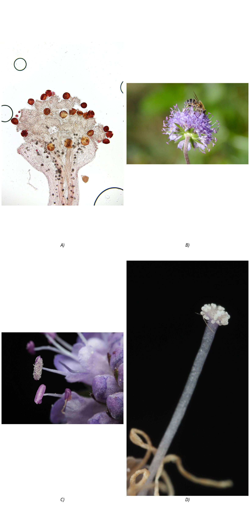

# Linking Pollen Deposition Dynamics to Plant-Pollinator Network
Structure
Jakub Štenc

# The Conceptual Framework

Arceo-Gómez et al. (2016) argue that intraspecific variation in pollen
receipt is not random. By plotting HP against CP for individual flowers,
two distinct patterns typically emerge. These patterns act as a
signature of the pollinator community structure.

## Scenario A: The “Generalist” Assemblage (Type 1)

If the pollinator assemblage is **even** (many generalists contributing
similarly), we expect **Type 1** dynamics. These visitors carry mixed
loads; therefore, as they deposit more CP, they inevitably deposit more
HP.

- **Pattern:** Linear positive relationship.

- **Ecological Driver:** High pollinator evenness; generalized
  interactions.

## Scenario B: The “Specialist/Uneven” Assemblage (Type 3)

If the assemblage is **uneven** (dominated by a few high-quality
specialists and some “messy” low-quality generalists), we expect **Type
3** dynamics. High-quality pollinators deposit pure CP (high CP, low
HP), while incidental visitors deposit mostly HP (low CP, high HP).

- **Pattern:** Exponential decrease (or “L” shape).

- **Ecological Driver:** Low pollinator evenness; high variation in
  pollinator quality.


# Abstract

# Introduction

In plant-pollinator communities, plants often share pollinators with
other species, leading to deposition of pollen from other species
(Heterospecific Pollen) on the stigmas. This is a common phenomenon in
nature with significant implications for plant reproduction and
evolution and it has been studied in multiple systems ([Arceo-Gómez et
al., 2016](#ref-arceo2016patterns)). Based on previous studies, it is
expected that the network structure (particularly pollinator evenness)
may drive the pattern of conspecific and heterospecific pollen
deposition on stigmas. However, the relationship between deposited
pollen, pollinator evenness and pollinator pollen transfer capability is
not well understood.

*Pollen deposition dynamics*

*Pollen load and pollen feeding*

*The effect of the network properties to the pollen deposition dynamics*

This study aims to determine if the composition of pollinator spectra of
*Succisa pratensis* functionally constrains the plant to high
heterospecific pollen (HP) receipt, and whether pollinator pollen body
load and content of pollinator intestines explain the persistence of
this pattern across years. We structure our analysis around three
specific objectives:

- Determine if the relationship between Conspecific (CP) and
  Heterospecific (HP) pollen deposition on *Succisa* stigmas follows a
  linear (generalist) or exponential (specialist-shielded) trajectory,
  and assess its stability across years.

- Link the stigmatic deposition pattern to the “pollen transport
  quality” of the dominant visitors (e.g., *Eristalis* spp.). We
  hypothesize that the “Linear” pattern is driven by dominant visitors
  being “messy vectors,” carrying large conspecific loads but also
  significant heterospecific loads.

- Assess whether the network evenness (the diversity of partners)
  correlates with the intensity of heterospecific pollen deposition.
  Following Arceo-Gómez et al. ([2016](#ref-arceo2016patterns)), we test
  if high evenness drives Type 1 curves, even when absolute pollen
  pressure varies.

To do so, we employ data on pollen load and pollen feeding of
pollinators, pollen deposition on stigmas, and network evenness,
collected in 2022-2024 within a diverse plant-pollinator community with
*Succisa pratensis* Moench (Caprifoliaceae) as the focal species.

<div id="fig-panel">



Figure 1: A) Stigma of *Succisa pratensis* with several pollen
morphotypes, B) Pollinator (*Eristalis* sp.) on flower of *Succisa
pratensis*, see the pollen on pollinator body, C) Detail of anther with
visible pollen grains of *Succisa pratensis*, D) Detail of stigma of
*Succisa pratensis* with visible deposited pollen grains

</div>

## Methods

### Pollen deposited on stigmas

### Data analysis

Full metadata, variable definitions, and summary statistics for the
datasets used in this study are available in the Supplementary material
S1.

## Results

<details class="code-fold">
<summary>Code</summary>

``` r
ggplot(pollen_deposition, aes(x = conspecific_pollen, y = heterospecific_pollen, color = as.factor(year))) +
    geom_point(alpha = 0.5) +
    geom_smooth(method = "loess", se = FALSE, size = 1.2) + # Smoothed trend line
    theme_minimal() +
    labs(x = "Conspecific Pollen", y = "Heterospecific Pollen", color = "Year")
```

</details>


<details class="code-fold">
<summary>Code</summary>

``` r
pollen_deposition <- pollen_deposition[!is.na(pollen_deposition$heterospecific_pollen), ] # Remove rows with NA in heterospecific_pollen

pollen_deposition$plant_id <- str_sub(pollen_deposition$id, end = -3) # Extract plant ID from stigma ID

model_linear_mixed <- lme(
    heterospecific_pollen ~ conspecific_pollen * year, # Fixed effect: conspecific pollen and year
    random = ~ 1 | plant_id, # This tells R: "Group stigmas by inflorescence"
    data = pollen_deposition
)

summary(model_linear_mixed)
```

</details>

<details class="code-fold">
<summary>Code</summary>

``` r
test_curve_shape <- function(year_data, year_label) {
    # 1. Fit Linear Model (Type 1)
    fit_linear <- lm(heterospecific_pollen ~ conspecific_pollen, data = year_data)

    # 2. Fit Exponential Model (Type 3)
    fit_exp <- tryCatch(
        {
            nls(heterospecific_pollen ~ a * exp(b * conspecific_pollen),
                data = year_data,
                start = list(a = max(year_data$heterospecific_pollen), b = -0.01)
            )
        },
        error = function(e) NULL
    )

    # 3. Compare AIC
    aic_lin <- AIC(fit_linear)
    aic_exp <- if (!is.null(fit_exp)) AIC(fit_exp) else NA

    return(data.frame(
        Year = year_label,
        Linear_AIC = round(aic_lin, 2),
        Exp_AIC = round(aic_exp, 2),
        Best_Fit = ifelse(!is.na(aic_exp) && aic_exp < (aic_lin - 2), "Exponential (Type 3)", "Linear (Type 1)")
    ))
}

# Run the test
results_2022 <- test_curve_shape(subset(pollen_deposition, year == 2022), "2022")
results_2023 <- test_curve_shape(subset(pollen_deposition, year == 2023), "2023")
results_2024 <- test_curve_shape(subset(pollen_deposition, year == 2024), "2024")

# Display Results
knitr::kable(rbind(results_2022, results_2023, results_2024), caption = "Model Comparison Results")
```

</details>

| Year | Linear_AIC | Exp_AIC | Best_Fit        |
|:-----|-----------:|--------:|:----------------|
| 2022 |     765.44 |  773.08 | Linear (Type 1) |
| 2023 |     930.86 |      NA | Linear (Type 1) |
| 2024 |    4052.84 |      NA | Linear (Type 1) |

Model Comparison Results

``` r
suc_pra_222324 <- get_interaction_data(
    plant_species = "Suc_pra",
    start_time = "7:00",
    end_time = "18:00",
    remove_zeros = TRUE,
    standardize = TRUE
)
```

``` r
ggplot(pollen_load_guts_24, aes(x = suc_pra_load, y = other_pollen_load, color = as.factor(pollinator_species))) +
    geom_point(alpha = 0.5) +
    theme_minimal() +
    labs(x = "Conspecific Pollen", y = "Heterospecific Pollen", color = "Pollinator species")
```


``` r
ggplot(pollen_load_guts_24, aes(x = suc_pra_guts, y = other_pollen_guts, color = as.factor(pollinator_species))) +
    geom_point(alpha = 0.5) +
    theme_minimal() +
    labs(x = "Conspecific Pollen", y = "Heterospecific Pollen", color = "Pollinator species")
```


``` r
# 1. Calculate Evenness (Alpha Diversity)
succisa_evenness <- calculate_pollinator_evenness(
    data = interaction_data_Succisa_22_24,
    group_by = c("year", "plot_id")
)

p_evenness <- ggplot(succisa_evenness, aes(x = as.factor(year), y = J, fill = as.factor(year))) +
    geom_boxplot(alpha = 0.6, outlier.shape = NA) +
    geom_jitter(width = 0.2, alpha = 0.5) +
    labs(
        title = "A. Pollinator Evenness (J')",
        subtitle = "Per plot",
        x = "Year",
        y = "Pielou's Evenness (J')"
    ) +
    theme_minimal() +
    theme(legend.position = "none")

# 2. Calculate Similarity (Beta Diversity)
# Pivot to wide format as required by calculate_similarity
wide_interaction_data <- interaction_data_Succisa_22_24 %>%
    dplyr::select(year, plot_id, pollinator_id, rate) %>%
    # Aggregate rates by summing interactions across all samples within the plot (handle NAs)
    tidyr::pivot_wider(names_from = pollinator_id, values_from = rate, values_fill = 0, values_fn = function(x) sum(x, na.rm = TRUE)) # Ensure no NAs in aggregation

# Calculate full similarity matrix
sim_results <- calculate_similarity(wide_interaction_data, group_by = c("year", "plot_id"))

# Visualize using package function
p_similarity <- plot_similarity_change(sim_results, plot_type = "within_year_heterogeneity") +
    labs(
        title = "B. Community Similarity",
        subtitle = "Pairwise within year (Ruzicka)"
    ) +
    theme(legend.position = "none")

# 3. Combine Plots
# Ensure ggpubr or patchwork is available. Using ggpubr as it is a dependency of HanPolNet.
if (!requireNamespace("ggpubr", quietly = TRUE)) install.packages("ggpubr")
ggpubr::ggarrange(p_evenness, p_similarity, ncol = 2)
```


# Proposed Analysis

We test our hypothesis using independent datasets for both the **curve**
(pollen counts) and the **driver** (visitation networks), following our
three-step logic:

## Step 1: The Pattern (Validation)

For each year of *Succisa* data (2022-2024), we fit two models to the
stigmatic pollen counts to characterize the CP-HP relationship: 1.
**Linear Model (Type 1)**: $HP \sim CP$ 2. **Exponential Model (Type
3)**: $HP \sim a \cdot e^{b \cdot CP}$

We assess whether the “linear” pattern (ecological exposure to HP)
persists across years despite variations in pollinator abundance.

## Step 2: The Mechanism (Body Loads)

We analyze the “pollen transport quality” of dominant visitors by
examining their body loads (and potentially gut contents). We test if
the dominant visitors (e.g., Syrphids) carry mixed loads (high CP and
high HP), effectively acting as “messy vectors” that drive the Type 1
relationship.

## Step 3: The Driver (Network Evenness)

We calculate **Simpson’s Evenness** for the sub-network of visitors to
*Succisa pratensis* for each year. We then link this network metric to
the deposition pattern: - **Hypothesis**: Years/Sites with **Type 1
(Linear)** curves correspond to **higher pollinator evenness**. - This
tests if the network structure (high variation in partners) functionally
prevents the plant from escaping heterospecific pollen.

# Why This Matters

This moves our analysis beyond simple abundance (“we found less HP”) to
**functional mechanisms**.

If we confirm that *Succisa* fits a **Type 3** curve in years with low
evenness, it suggests that “pollinator sharing” (a network metric) does
not translate linearly to pollen deposition. It would prove that the
*identity* and *quality* of specific visitors shield the plant from
heterospecific pollen interference, even when surrounded by
heterospecific neighbors.

# Next Steps

1.  **Data Prep:** I will merge the pollen count CSVs with the
    plot-level IDs.

2.  **Modelling:** I will run the `nls` (non-linear least squares) and
    `lm` models in R for the three years.

3.  **Network Metrics:** I will extract the specific visitor diversity
    indices for *Succisa* from the `HanPolNet` pipeline.

## Discussion

## References

<div id="refs" class="references csl-bib-body hanging-indent">

<div id="ref-arceo2016patterns" class="csl-entry">

Arceo-Gómez, G., L. Abdala-Roberts, A. Jankowiak, C. Kohler, G. A.
Meindl, C. M. Navarro-Fernández, V. Parra-Tabla, et al. 2016. Patterns
of among-and within-species variation in heterospecific pollen receipt:
The importance of ecological generalization. *American Journal of
Botany* 103: 396–407.

</div>

</div>
