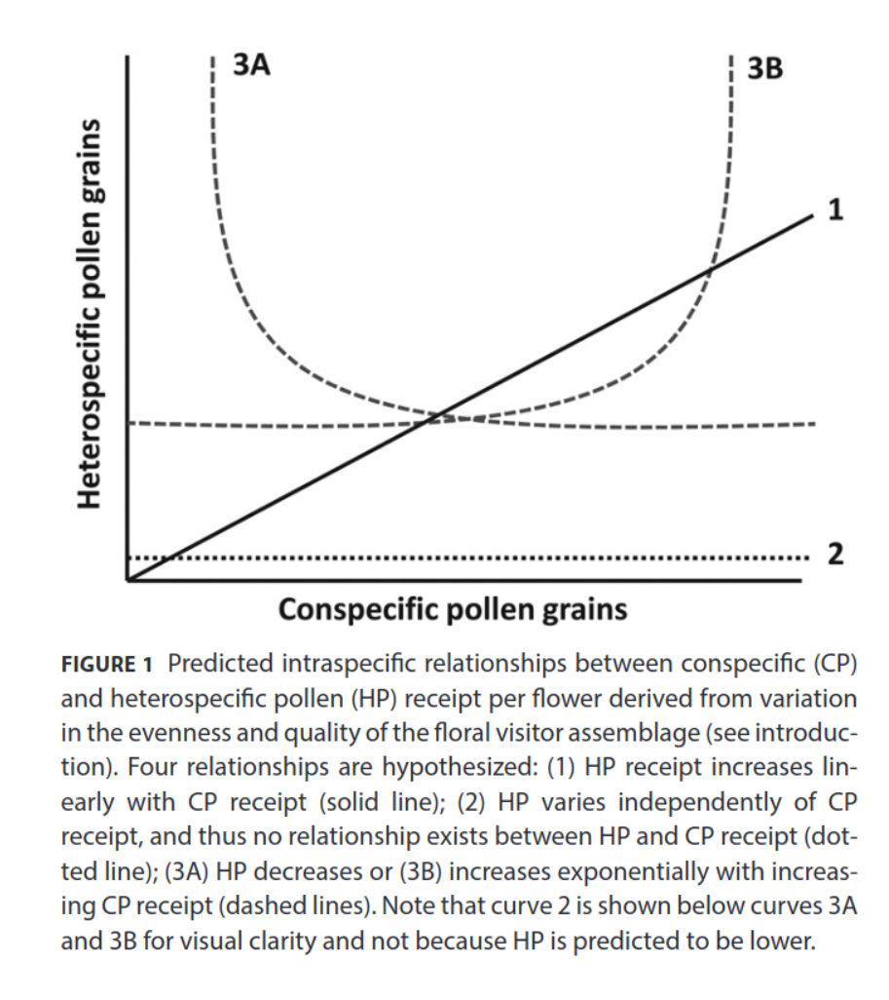
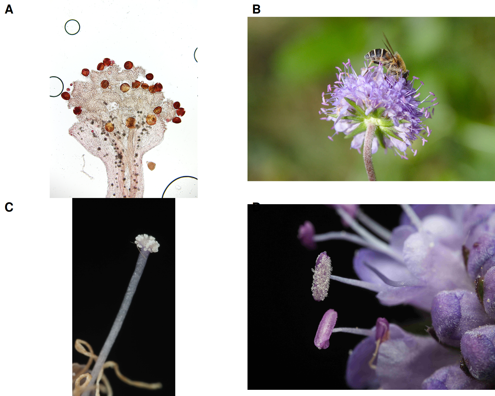
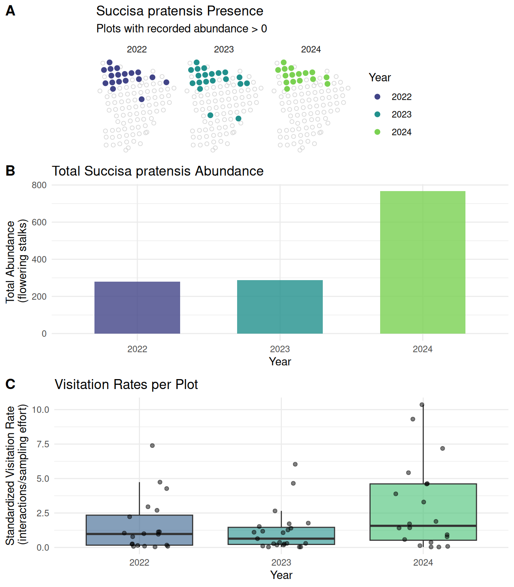

# Linking Pollen Deposition Dynamics to Plant-Pollinator Network
Structure:
Jakub Štenc

## The Conceptual Framework

Arceo-Gómez et al. (2016) argue that intraspecific variation in pollen
receipt is not random. By plotting HP against CP for individual flowers,
two distinct patterns typically emerge. These patterns act as a
signature of the pollinator community structure.

### Scenario A: The “Generalist” Assemblage (Type 1)

If the pollinator assemblage is **even** (many generalists contributing
similarly), we expect **Type 1** dynamics. These visitors carry mixed
loads; therefore, as they deposit more CP, they inevitably deposit more
HP.

- **Pattern:** Linear positive relationship.

- **Ecological Driver:** High pollinator evenness; generalized
  interactions.

### Scenario B: The “Specialist/Uneven” Assemblage (Type 3)

If the assemblage is **uneven** (dominated by a few high-quality
specialists and some “messy” low-quality generalists), we expect **Type
3** dynamics. High-quality pollinators deposit pure CP (high CP, low
HP), while incidental visitors deposit mostly HP (low CP, high HP).

- **Pattern:** Exponential decrease (or “L” shape).

- **Ecological Driver:** Low pollinator evenness; high variation in
  pollinator quality.



## Abstract

## Introduction

In plant-pollinator communities, plants often share pollinators with
other species ([Lázaro et al., 2009](#ref-Lazaro2009)), leading to
deposition of pollen from other species (Heterospecific Pollen) on the
stigmas ([Morales and Traveset, 2008](#ref-morales2008interspecific)).
This is a common phenomenon in nature with significant implications for
plant reproduction and evolution. Based on previous studies
([Arceo-Gómez et al., 2016](#ref-arceo2016patterns)), it is expected
that the network structure (particularly pollinator evenness) may drive
the pattern of conspecific and heterospecific pollen deposition on
stigmas. However, the relationship between deposited pollen, pollinator
transfer capability and network structure is not well understood.

*Pollen deposition dynamics* Pollinators visit flower to feed on nectar
and pollen. Pollen is then deposited on the stigma of the same flower or
another flower of the same plant (conspecific pollen) or another plant
(heterospecific pollen). Pollen load is the amount of pollen a
pollinator carries on its body.

- 

*Pollen load and pollen feeding*

“Pollinator quality, in particular, is likely a complex trait that
results from not only inconstancy but also pollinator grooming (Thomson,
1986; Holmquist et al., 2012), pollen carryover (Thomson and Plowright,
1980), and pollen loss during transport (Wilcock and Neiland, 2002).
Thus, pollinator quality may be difficult to capture with only
information on the visitor functional groups defined herein.”
([Arceo-Gómez et al., 2016](#ref-arceo2016patterns))

*The effect of the network structure to the pollen deposition dynamics*

- how may the pollen deposition dynamics be affected by the network
  structure

In their study Arceo-Gómez et al. ([2016](#ref-arceo2016patterns)) found
that the network structure (pollinator evenness) may drive the pattern
of conspecific and heterospecific pollen deposition on stigmas.

This study aims to investigate interannual variation in pollen
deposition patterns on *Succisa pratensis* stigmas, determine if the
composition of pollinator spectra of *Succisa pratensis* functionally
constrains the plant to high heterospecific pollen (HP) receipt, and
whether pollinator pollen body load and content of pollinator intestines
explain the persistence of this pattern across years. We structure our
analysis around three specific objectives:

- Determine if the relationship between Conspecific (CP) and
  Heterospecific (HP) pollen deposition on *Succisa* stigmas follows a
  linear (generalist) or exponential (specialist-shielded) trajectory,
  and assess variability across years, days and plant individuals.

- Link the stigmatic deposition pattern to the “pollen transport
  quality” of the dominant visitors (e.g., *Eristalis* spp.). We
  hypothesize that the “Linear” pattern is driven by dominant visitors
  being “messy vectors,” carrying large conspecific loads but also
  significant heterospecific loads.

- Assess whether the network evenness (the diversity of partners)
  correlates with the intensity of heterospecific pollen deposition.
  Following Arceo-Gómez et al. ([2016](#ref-arceo2016patterns)), we test
  if high evenness drives Type 1 curves, even when absolute pollen
  pressure varies.

To do so, we employ data on pollen load and pollen feeding of
pollinators, pollen deposition on stigmas, and network evenness,
collected in 2022-2024 within a diverse plant-pollinator community with
*Succisa pratensis* Moench (Caprifoliaceae) as the focal species. In our
previous studies, we identified that *Succisa pratensis* is visited by a
diverse community of pollinators, dominated by hoverflies of genus
*Eristalis*, which may be considered as generalistic pollinators
carrying both conspecific and heterospecific pollen([Štenc et al.,
2025](#ref-vstenc2025pollen)). Based on our previous studies, we expect
high variation in pollen load and visitation rate of pollinators
([Freudenfeld et al., 2025](#ref-freudenfeld2025interannual)), leading
to high variation in pollen deposition on stigmas.

<div id="fig-plant-pollinator-panel">



Figure 1: A) Stigma of *Succisa pratensis* with several pollen
morphotypes, B) Pollinator (*Eristalis* sp.) on flower of *Succisa
pratensis*, see the pollen on pollinator body, C) Detail of anther with
visible pollen grains of *Succisa pratensis*, D) Detail of stigma of
*Succisa pratensis* with visible deposited pollen grains

</div>

## Methods

### Study system

Our observations were conducted in a seminatural grassland community
with a high abundance of flowering plants (especially *Succisa
pratensis*) and diverse pollinator community, dominated by hoverflies.
The study site “K Handrkovu” is located near the village of Vernýřov,
Central Bohemia, Czech Republic (N 49.8466; E 15.1498). The study site
can be classified as a mosaic of moist to mesophilic and eutrophic to
mesotrophic grasslands with more than 50 entomogamous plant species
flowering in late summer every year ([Janovskỳ et al.,
2013](#ref-janovsky2013conspecific)). The fieldwork was conducted in
2022-2024 during the peak of *Succisa pratensis* flowering activity
(XXth-XXth August, XXh-XXth August and XXth-XXth August, respectively).

*Succisa pratensis*, our focal plant species, is frequently visited by a
wide spectrum of pollinators, especially hoverflies (see
<a href="#fig-plant-pollinator-panel" class="quarto-xref">Figure 1</a>),
feeding on both pollen and nectar on it. In addition, *Succisa
pratensis* has a relatively large and stable population at our study
site. Important traits related to pollination also include distinctive
open inflorescences available to most pollinators, protandry preventing
self-pollination ([Bartoš et al., 2020](#ref-bartovs2020self)) and
pollen releasing in the morning hours ([Štenc et al.,
2023](#ref-stenc2023pollinator)).

We focused on the common hoverflies species with stable populations with
a sufficient numbers of males and females adults occurring at the study
site and frequently visiting *Succisa pratensis*. The most common
visitors are hoverfly genera Eristalis (E. arbustorum, E. interruptus,
E. intricaria, E. pertinax, E. similis and E. tenax) and Helophilus (H.
pendulus and H. trivittatus) and meatfly genera Sarcophaga.

### Pollen load and pollen feeding

Foraging hoverflies visiting Succisa inflorescence were caught with
entomological net and killed immediately after capture. We swabbed
pollen grains from one half (randomly selecting left or right) of each
pollinator’s body with a small block of fuchsin jelly as in Beattie
(1971). We stored captured pollinators in the 70% ethanol. On the same
day, we produced semi-permanent samples by melting fuchsin jelly with a
heating pad on a microscope slide, covering and sealing with nail
polish. Later, we counted and determined all pollen grains using a light
microscope. We sorted pollen into conspecific Succisa pollen and
heterospecific pollen of other plant species.

To find out how much and what types of pollen grains were consumed by
hoverflies we dissected the guts of captured and killed individuals
stored in 70% ethanol using tweezers and sharp scissors under a
stereomicroscope. We put separated intestines into small closable tubes
with 5 µl of 70% ethanol. Shortly afterwards, we added 50 µl of 10% KOH
into the samples and moved it to the warming bath at a temperature of
70° C for 3 hours. After cooling down, we vortexed the samples for 30
seconds to be homogenized and placed 5 µl of the solution on the
microscope slides. We let the samples dry on a heating pad and we added
13 µl of 8% vinegar to neutralize KOH. After further drying, we added 5
µl of dye (safranin, water and glycerol), covered the samples with a
coverslip and sealed with nail polish to produce semi-permanent samples.

### Single visit deposition

To prevent pollinators access to flowers, we bagged selected inflorences
into a tulle bag before the plants have entered the male phase and
opened the anthers. When the plant entered the female phase with
receptive stigmas, we removed the bag and collected two control stigmas
into a tube with 70% ethanol. We watched the inflorescence for thirty
minutes and recorded every pollinator that visited it. The pollinators
were allowed to visit only one flower within the inflorescence, the
stigma of which we collected into a tube with 70% ethanol. If the
pollinator visited multiple flowers, we collected only the first visited
stigma and removed other from the plant.

### Pollen deposited on stigmas

We put collected stigmas on the slide and let the ethanol evaporate on
the heating pad. After that we added 1 µl of 10% KOH, let the samples
dry, added 3 µl of 3% hydrogen peroxide, let the samples dry again and
we added 13 µl of 8% vinegar to neutralize KOH. After further drying we
added 5 µl of dye (safranin, water and glycerol), covered the samples
with a coverslip, applied gentle, even pressure on the cover glass to
squash the stigma and sealed with nail polish to produce semi-permanent
samples.

### Plant-pollinator interactions and plant abundace

Following Janovský et al. (2013) we collected data on pollinator
visitation activity. We used same permanent plots as in the flowering
plant abundance to record all interactions of flower-visiting
pollinators with flowering Succisa pratensis and other plant species in
the surrounding of S. pratensis. All flowers within the plot were
checked only one time to avoid pseudo-replication and all interactions
occurring at the moment of the survey were recorded, lasting up to five
minutes. Each plot was recorded at least twenty times during the
activity period of pollinators (7:00 - 19:00) at the peak of flowering
(mid-August) each year. We recorded only the pollinators touching the
reproductive organs of the visited plant and each individual pollinator
only once. Finally, we counted standardized interaction rates (total
number of interactions per sampling visit) for pollinators visiting S.
pratensis from 2022 to 2024 and compared the distribution of interaction
rates for the specific group of pollinators visiting S. pratensis and
the same pollinators on all other plant species.

Thanks to long-term research on flowering plants and their interactions
with pollinators, we obtained information on the abundances of
individual plants at the study site and it’s changes over time (see
Janovský et al., 2013). We used 4 × 4 m2 permanent plots each placed in
the center of each grid point of a 20 × 20 m2 grid covering a total area
of 300 × 300 m2 of the study site. To determine the floral neighborhood
of Succisa pratensis from 2022 to 2024, we counted distribution of plant
abundance for individual plots where S. pratensis was present. We
counted conspecific abundance of the focal species and heterospecific
co-flowering abundance index, which is the cumulative abundance of all
other co-flowering plant species in the plot.

### Statistical Analysis

All statistical analyses were performed in R (v4.x). Count data for
heterospecific (HP) and conspecific (CP) pollen were **square-root
transformed** prior to parametric modeling. Diagnostic plots
(Supplementary Material Figs S1–S2) confirmed that this transformation
stabilized variance and satisfied homoscedasticity assumptions more
effectively than raw or log-transformed data.

#### Variance Component Analysis

To quantify the hierarchical scale of stochasticity in pollen
deposition, we fitted Linear Mixed Models (LMMs) using the `lme4`
package. We partitioned the total variance of sqrt-transformed pollen
counts into **Year** (random effect), **Plant** (nested within Year),
and **Stigma** (Residual variation). For the high-resolution 2024
dataset, we further partitioned variance into **Sampling Date**,
**Plant** (nested within Date), and **Stigma**. While statistical
inference focused on transformed counts, we also visualized the
proportion of heterospecific pollen (`HP / (HP + CP)`) to assess
deposition purity.

#### Pollen Accumulation Dynamics

To test if the rate of heterospecific pollen accumulation differed
between years, we fitted a Linear Model (`lm`) of the form:
`sqrt(HP) ~ CP * Year`. We used the `emtrends` function (from the
`emmeans` package) to estimate and compare the slopes ($\beta$) of the
HP-CP relationship for each year, interpreted as the “pollution
efficiency” of the community.

#### Network Stability

We assessed the temporal stability of the pollinator community
composition using the **Morisita-Horn similarity index**, calculated
with the `vegan` package. This metric was selected for its robustness to
differences in sample size and species richness.

#### Single Visit Deposition

To assess the efficiency and ‘messiness’ of major pollinator groups, we
conducted a Single Visit Deposition (SVD) experiment. We presented
unvisited (bagged) *Succisa* stigmas to foraging insects, allowed a
single visit, and subsequently counted conspecific (CP) and
heterospecific (HP) pollen loads. We classified visitors into broad
morphogroups (e.g., *Eristalis* spp., *Bombus* spp.) and compared their
CP and HP deposition using a Kruskal-Wallis test, followed by Dunn’s
post-hoc test (Benjamini-Hochberg correction), as pollen counts were
zero-inflated and non-normal.

#### Macro-Ecological Context

To contextualize the deposition results, we calculated annual network
specialization ($H_2'$) using the `bipartite` package and estimated
community floral resource abundance by summing plant counts in the
permanent plots.

## Results

### Succisa pratensis Distribution

The presence of *Succisa pratensis* in the study plots across the
surveyed years (2022-2024) is visualized below.

``` r
# --- PART A: MAP ---

# 1. Prepare Presence Data
succisa_presence <- plant_abundance %>%
    filter(year %in% c(22, 23, 24)) %>%
    select(year, plot_id, Suc_pra) %>%
    filter(Suc_pra > 0) %>%
    mutate(
        year_label = paste0("20", year),
        plot_id_join = as.character(as.integer(plot_id))
    )

# 2. Prepare Spatial Data
plots_sf <- hanpolnet_plots %>%
    mutate(
        plot_id_join = ifelse(grepl("^[0-9]+$", plot_id),
            as.character(as.integer(plot_id)),
            plot_id
        )
    )

# 3. Join
map_data <- succisa_presence %>%
    inner_join(plots_sf, by = "plot_id_join") %>%
    st_as_sf()

# 4. Create Map Plot Object
p_map <- ggplot() +
    geom_sf(data = plots_sf, color = "grey85", size = 1.5, shape = 1) +
    geom_sf(data = map_data, aes(color = year_label), size = 2) +
    facet_wrap(~year_label) +
    scale_color_viridis_d(begin = 0.2, end = 0.8, option = "D") +
    theme_minimal() +
    labs(
        title = "Succisa pratensis Presence",
        subtitle = "Plots with recorded abundance > 0",
        color = "Year"
    ) +
    theme(
        axis.text = element_blank(),
        axis.title = element_blank(),
        panel.grid = element_blank(),
        legend.position = "right"
    )

# --- PART B: ABUNDANCE ---

# 1. Summarize
abundance_summary <- plant_abundance %>%
    filter(year %in% c(22, 23, 24)) %>%
    group_by(year) %>%
    summarise(total_abundance = sum(Suc_pra, na.rm = TRUE)) %>%
    mutate(year_label = paste0("20", year))

# 2. Create Barplot Object
p_abundance <- ggplot(abundance_summary, aes(x = year_label, y = total_abundance, fill = year_label)) +
    geom_col(alpha = 0.8, width = 0.6) +
    labs(
        title = "Total Succisa pratensis Abundance",
        x = "Year",
        y = "Total Abundance\n (flowering stalks)"
    ) +
    scale_fill_viridis_d(begin = 0.2, end = 0.8, option = "D") +
    theme_minimal() +
    theme(legend.position = "none")


# Sum rates per plot to get total visitation intensity per plot
visitation_per_plot <- interaction_data_Succisa_22_24 %>%
    group_by(year, plot_id) %>%
    summarise(total_rate = sum(rate, na.rm = TRUE), .groups = "drop") %>%
    filter(!is.na(year)) %>%
    mutate(year = factor(paste0("20", year)))

# Plot
p_visitation <- ggplot(visitation_per_plot, aes(x = year, y = total_rate, fill = year)) +
    geom_boxplot(alpha = 0.6, outlier.shape = NA) +
    geom_jitter(width = 0.2, alpha = 0.5) +
    labs(
        title = "Visitation Rates per Plot",
        x = "Year",
        y = "Standardized Visitation Rate\n (interactions / visit)"
    ) +
    scale_fill_viridis_d(begin = 0.3, end = 0.7) +
    theme_minimal() +
    theme(legend.position = "none")

# --- COMBINE ---
ggarrange(p_map, p_abundance, p_visitation,
    ncol = 1,
    labels = c("A", "B", "C"),
    heights = c(1.5, 2, 2)
) # Give more height to the map
```

<div id="fig-spatial-temporal-abundance">



Figure 2: Distribution and abundance of Succisa pratensis (2022-2024).
A) Spatial distribution of plots with Succisa presence. B) Total
abundance recorded per year. C) Differences in standardized visitation
rates to Succisa pratensis across years (2022-2024).

</div>

### Pollinator Spectra Comparison (2022-2024)

Comparisons of the proportional representation of different pollinator
species visiting *Succisa pratensis* across the three years reveal the
stability of the pollinator community composition.

``` r
# 1. Aggregation
# Calculate total visitation rate per species per year
species_composition <- interaction_data_Succisa_22_24 %>%
    filter(!is.na(year)) %>% # Remove NA years
    group_by(year, pollinator_id) %>%
    summarise(total_rate = sum(rate, na.rm = TRUE), .groups = "drop") %>%
    group_by(year) %>%
    mutate(
        yearly_total = sum(total_rate),
        proportion = total_rate / yearly_total,
        year_label = paste0("20", year)
    )

# 2. Lump Rare Species
# Select top N most abundant species across all years to show individually
top_n_species <- 9
top_species_list <- species_composition %>%
    group_by(pollinator_id) %>%
    summarise(grand_total = sum(total_rate)) %>%
    arrange(desc(grand_total)) %>%
    slice_head(n = top_n_species) %>%
    pull(pollinator_id)

# Lump others
species_composition_grouped <- species_composition %>%
    mutate(
        species_label = ifelse(pollinator_id %in% top_species_list,
            pollinator_id,
            "Other"
        )
    ) %>%
    group_by(year_label, species_label) %>%
    summarise(proportion = sum(proportion), .groups = "drop")

# Reorder species for plotting (Other at bottom or top, others by abundance)
# We make "Other" the first level so it appears at one end of the stack
species_composition_grouped$species_label <- factor(
    species_composition_grouped$species_label,
    levels = c("Other", rev(top_species_list)) # Stack order
)

# Define Consistent Colors
pollinator_colors <- c(
    "Eristalis_tenax" = "#30123B", # Dark Purple
    "Eristalis_pertinax" = "#4675ED", # Blue
    "Eristalis_interrupta" = "#39568C", # Dark Blue
    "Eristalis_arbustorum" = "#42F4EB", # Cyan-ish
    "Eristalis_intricaria" = "#1E9C89", # Teal
    "Eristalis_similis" = "#248641", # Green
    "Eristalis_sp" = "#248641", # Green (fallback)
    "Helophilus_pendulus" = "#A2FC3C", # Light Green
    "Helophilus_trivittatus" = "#D9F121", # Yellow-Green
    "Helophilus_hybridus" = "#D9F121", # Yellow-Green
    "Myathropa_florea" = "#F9B614", # Yellow/Orange
    "Apis_mellifera" = "#F9B614", # Orange
    "Bombus_lapidarius" = "#EB520E", # Red-Orange
    "Sarcophaga_sp" = "#A42C17", # Dark Red
    "Zygena_sp" = "#D2204C", # Red/Pink
    "Sericomyia" = "#D2204C", # Red/Pink
    "Tachinidae" = "grey50",
    "Other" = "grey80"
)

# 3. Visualization
ggplot(species_composition_grouped, aes(x = year_label, y = proportion, fill = species_label)) +
    geom_col(width = 0.6, color = "white", size = 0.2) +
    scale_fill_manual(values = pollinator_colors, name = "Species") +
    labs(
        title = "Pollinator Spectra Composition",
        subtitle = "Proportion of Visitation Rates",
        x = "Year",
        y = "Proportion"
    ) +
    theme_minimal() +
    theme(
        legend.position = "right",
        legend.text = element_text(face = "italic")
    )
```


### Pollinator Visitation Rates

We also examined the changes in visitation intensity to *Succisa
pratensis* across the three years.

<details class="code-fold">
<summary>Code</summary>

``` r
test_curve_shape <- function(year_data, year_label) {
    # 0. Data Aggregation (Mean per Plant)
    # Using the 'plant_id' we created earlier
    agg_data <- year_data %>%
        group_by(plant_id) %>%
        summarise(
            mean_HP = mean(heterospecific_pollen, na.rm = TRUE),
            mean_CP = mean(conspecific_pollen, na.rm = TRUE),
            .groups = "drop"
        )

    # 1. Fit Linear Model (Type 1) - Simple LM on Means
    fit_linear <- lm(mean_HP ~ mean_CP, data = agg_data)

    # 2. Fit Exponential Model (Type 3) - Simple NLS on Means
    fit_exp <- tryCatch(
        {
            nls(mean_HP ~ a * exp(b * mean_CP),
                data = agg_data,
                start = list(a = max(agg_data$mean_HP, na.rm = TRUE), b = -0.01)
            )
        },
        error = function(e) {
            # Fallback start values
            tryCatch(
                {
                    nls(mean_HP ~ a * exp(b * mean_CP),
                        data = agg_data,
                        start = list(a = mean(agg_data$mean_HP, na.rm = TRUE), b = -0.001)
                    )
                },
                error = function(e2) NULL
            )
        }
    )

    # 3. Compare AIC
    aic_lin <- AIC(fit_linear)
    aic_exp <- if (!is.null(fit_exp)) AIC(fit_exp) else NA

    return(data.frame(
        Year = year_label,
        Linear_AIC = round(aic_lin, 2),
        Exp_AIC = if (is.na(aic_exp)) NA else round(aic_exp, 2),
        Best_Fit = case_when(
            is.na(aic_exp) ~ "Linear (Type 1) [Exp Failed]",
            aic_exp < (aic_lin - 2) ~ "Exponential (Type 3)",
            TRUE ~ "Linear (Type 1)"
        )
    ))
}

# Run the test
results_2022 <- test_curve_shape(subset(pollen_deposition, year == 2022), "2022")
results_2023 <- test_curve_shape(subset(pollen_deposition, year == 2023), "2023")
results_2024 <- test_curve_shape(subset(pollen_deposition, year == 2024), "2024")

# Display Results
# Display Results
rbind(results_2022, results_2023, results_2024) %>%
    gt() %>%
    tab_header(title = "Model Comparison Results") %>%
    fmt_number(columns = c(Linear_AIC, Exp_AIC), decimals = 2) %>%
    cols_label(
        Year = "Year",
        Linear_AIC = "Linear AIC",
        Exp_AIC = "Exponential AIC",
        Best_Fit = "Best Fit Model"
    ) %>%
    tab_style(
        style = cell_text(weight = "bold"),
        locations = cells_column_labels()
    ) %>%
    tab_options(
        column_labels.background.color = "#F0F0F0",
        column_labels.font.weight = "bold",
        table.border.top.color = "black",
        table.border.top.width = px(2),
        table.border.bottom.color = "black",
        table.border.bottom.width = px(2),
        table_body.hlines.color = "#E5E5E5",
        data_row.padding = px(6)
    ) %>%
    tab_style(
        style = list(
            cell_text(color = "black", weight = "bold")
        ),
        locations = cells_column_labels()
    ) %>%
    opt_align_table_header(align = "left")
```

</details>

<div id="rgucnnchum" style="padding-left:0px;padding-right:0px;padding-top:10px;padding-bottom:10px;overflow-x:auto;overflow-y:auto;width:auto;height:auto;">
<style>#rgucnnchum table {
  font-family: system-ui, 'Segoe UI', Roboto, Helvetica, Arial, sans-serif, 'Apple Color Emoji', 'Segoe UI Emoji', 'Segoe UI Symbol', 'Noto Color Emoji';
  -webkit-font-smoothing: antialiased;
  -moz-osx-font-smoothing: grayscale;
}
&#10;#rgucnnchum thead, #rgucnnchum tbody, #rgucnnchum tfoot, #rgucnnchum tr, #rgucnnchum td, #rgucnnchum th {
  border-style: none;
}
&#10;#rgucnnchum p {
  margin: 0;
  padding: 0;
}
&#10;#rgucnnchum .gt_table {
  display: table;
  border-collapse: collapse;
  line-height: normal;
  margin-left: auto;
  margin-right: auto;
  color: #333333;
  font-size: 16px;
  font-weight: normal;
  font-style: normal;
  background-color: #FFFFFF;
  width: auto;
  border-top-style: solid;
  border-top-width: 2px;
  border-top-color: #000000;
  border-right-style: none;
  border-right-width: 2px;
  border-right-color: #D3D3D3;
  border-bottom-style: solid;
  border-bottom-width: 2px;
  border-bottom-color: #000000;
  border-left-style: none;
  border-left-width: 2px;
  border-left-color: #D3D3D3;
}
&#10;#rgucnnchum .gt_caption {
  padding-top: 4px;
  padding-bottom: 4px;
}
&#10;#rgucnnchum .gt_title {
  color: #333333;
  font-size: 125%;
  font-weight: initial;
  padding-top: 4px;
  padding-bottom: 4px;
  padding-left: 5px;
  padding-right: 5px;
  border-bottom-color: #FFFFFF;
  border-bottom-width: 0;
}
&#10;#rgucnnchum .gt_subtitle {
  color: #333333;
  font-size: 85%;
  font-weight: initial;
  padding-top: 3px;
  padding-bottom: 5px;
  padding-left: 5px;
  padding-right: 5px;
  border-top-color: #FFFFFF;
  border-top-width: 0;
}
&#10;#rgucnnchum .gt_heading {
  background-color: #FFFFFF;
  text-align: left;
  border-bottom-color: #FFFFFF;
  border-left-style: none;
  border-left-width: 1px;
  border-left-color: #D3D3D3;
  border-right-style: none;
  border-right-width: 1px;
  border-right-color: #D3D3D3;
}
&#10;#rgucnnchum .gt_bottom_border {
  border-bottom-style: solid;
  border-bottom-width: 2px;
  border-bottom-color: #D3D3D3;
}
&#10;#rgucnnchum .gt_col_headings {
  border-top-style: solid;
  border-top-width: 2px;
  border-top-color: #D3D3D3;
  border-bottom-style: solid;
  border-bottom-width: 2px;
  border-bottom-color: #D3D3D3;
  border-left-style: none;
  border-left-width: 1px;
  border-left-color: #D3D3D3;
  border-right-style: none;
  border-right-width: 1px;
  border-right-color: #D3D3D3;
}
&#10;#rgucnnchum .gt_col_heading {
  color: #333333;
  background-color: #F0F0F0;
  font-size: 100%;
  font-weight: bold;
  text-transform: inherit;
  border-left-style: none;
  border-left-width: 1px;
  border-left-color: #D3D3D3;
  border-right-style: none;
  border-right-width: 1px;
  border-right-color: #D3D3D3;
  vertical-align: bottom;
  padding-top: 5px;
  padding-bottom: 6px;
  padding-left: 5px;
  padding-right: 5px;
  overflow-x: hidden;
}
&#10;#rgucnnchum .gt_column_spanner_outer {
  color: #333333;
  background-color: #F0F0F0;
  font-size: 100%;
  font-weight: bold;
  text-transform: inherit;
  padding-top: 0;
  padding-bottom: 0;
  padding-left: 4px;
  padding-right: 4px;
}
&#10;#rgucnnchum .gt_column_spanner_outer:first-child {
  padding-left: 0;
}
&#10;#rgucnnchum .gt_column_spanner_outer:last-child {
  padding-right: 0;
}
&#10;#rgucnnchum .gt_column_spanner {
  border-bottom-style: solid;
  border-bottom-width: 2px;
  border-bottom-color: #D3D3D3;
  vertical-align: bottom;
  padding-top: 5px;
  padding-bottom: 5px;
  overflow-x: hidden;
  display: inline-block;
  width: 100%;
}
&#10;#rgucnnchum .gt_spanner_row {
  border-bottom-style: hidden;
}
&#10;#rgucnnchum .gt_group_heading {
  padding-top: 8px;
  padding-bottom: 8px;
  padding-left: 5px;
  padding-right: 5px;
  color: #333333;
  background-color: #FFFFFF;
  font-size: 100%;
  font-weight: initial;
  text-transform: inherit;
  border-top-style: solid;
  border-top-width: 2px;
  border-top-color: #D3D3D3;
  border-bottom-style: solid;
  border-bottom-width: 2px;
  border-bottom-color: #D3D3D3;
  border-left-style: none;
  border-left-width: 1px;
  border-left-color: #D3D3D3;
  border-right-style: none;
  border-right-width: 1px;
  border-right-color: #D3D3D3;
  vertical-align: middle;
  text-align: left;
}
&#10;#rgucnnchum .gt_empty_group_heading {
  padding: 0.5px;
  color: #333333;
  background-color: #FFFFFF;
  font-size: 100%;
  font-weight: initial;
  border-top-style: solid;
  border-top-width: 2px;
  border-top-color: #D3D3D3;
  border-bottom-style: solid;
  border-bottom-width: 2px;
  border-bottom-color: #D3D3D3;
  vertical-align: middle;
}
&#10;#rgucnnchum .gt_from_md > :first-child {
  margin-top: 0;
}
&#10;#rgucnnchum .gt_from_md > :last-child {
  margin-bottom: 0;
}
&#10;#rgucnnchum .gt_row {
  padding-top: 6px;
  padding-bottom: 6px;
  padding-left: 5px;
  padding-right: 5px;
  margin: 10px;
  border-top-style: solid;
  border-top-width: 1px;
  border-top-color: #E5E5E5;
  border-left-style: none;
  border-left-width: 1px;
  border-left-color: #D3D3D3;
  border-right-style: none;
  border-right-width: 1px;
  border-right-color: #D3D3D3;
  vertical-align: middle;
  overflow-x: hidden;
}
&#10;#rgucnnchum .gt_stub {
  color: #333333;
  background-color: #FFFFFF;
  font-size: 100%;
  font-weight: initial;
  text-transform: inherit;
  border-right-style: solid;
  border-right-width: 2px;
  border-right-color: #D3D3D3;
  padding-left: 5px;
  padding-right: 5px;
}
&#10;#rgucnnchum .gt_stub_row_group {
  color: #333333;
  background-color: #FFFFFF;
  font-size: 100%;
  font-weight: initial;
  text-transform: inherit;
  border-right-style: solid;
  border-right-width: 2px;
  border-right-color: #D3D3D3;
  padding-left: 5px;
  padding-right: 5px;
  vertical-align: top;
}
&#10;#rgucnnchum .gt_row_group_first td {
  border-top-width: 2px;
}
&#10;#rgucnnchum .gt_row_group_first th {
  border-top-width: 2px;
}
&#10;#rgucnnchum .gt_summary_row {
  color: #333333;
  background-color: #FFFFFF;
  text-transform: inherit;
  padding-top: 8px;
  padding-bottom: 8px;
  padding-left: 5px;
  padding-right: 5px;
}
&#10;#rgucnnchum .gt_first_summary_row {
  border-top-style: solid;
  border-top-color: #D3D3D3;
}
&#10;#rgucnnchum .gt_first_summary_row.thick {
  border-top-width: 2px;
}
&#10;#rgucnnchum .gt_last_summary_row {
  padding-top: 8px;
  padding-bottom: 8px;
  padding-left: 5px;
  padding-right: 5px;
  border-bottom-style: solid;
  border-bottom-width: 2px;
  border-bottom-color: #D3D3D3;
}
&#10;#rgucnnchum .gt_grand_summary_row {
  color: #333333;
  background-color: #FFFFFF;
  text-transform: inherit;
  padding-top: 8px;
  padding-bottom: 8px;
  padding-left: 5px;
  padding-right: 5px;
}
&#10;#rgucnnchum .gt_first_grand_summary_row {
  padding-top: 8px;
  padding-bottom: 8px;
  padding-left: 5px;
  padding-right: 5px;
  border-top-style: double;
  border-top-width: 6px;
  border-top-color: #D3D3D3;
}
&#10;#rgucnnchum .gt_last_grand_summary_row_top {
  padding-top: 8px;
  padding-bottom: 8px;
  padding-left: 5px;
  padding-right: 5px;
  border-bottom-style: double;
  border-bottom-width: 6px;
  border-bottom-color: #D3D3D3;
}
&#10;#rgucnnchum .gt_striped {
  background-color: rgba(128, 128, 128, 0.05);
}
&#10;#rgucnnchum .gt_table_body {
  border-top-style: solid;
  border-top-width: 2px;
  border-top-color: #D3D3D3;
  border-bottom-style: solid;
  border-bottom-width: 2px;
  border-bottom-color: #D3D3D3;
}
&#10;#rgucnnchum .gt_footnotes {
  color: #333333;
  background-color: #FFFFFF;
  border-bottom-style: none;
  border-bottom-width: 2px;
  border-bottom-color: #D3D3D3;
  border-left-style: none;
  border-left-width: 2px;
  border-left-color: #D3D3D3;
  border-right-style: none;
  border-right-width: 2px;
  border-right-color: #D3D3D3;
}
&#10;#rgucnnchum .gt_footnote {
  margin: 0px;
  font-size: 90%;
  padding-top: 4px;
  padding-bottom: 4px;
  padding-left: 5px;
  padding-right: 5px;
}
&#10;#rgucnnchum .gt_sourcenotes {
  color: #333333;
  background-color: #FFFFFF;
  border-bottom-style: none;
  border-bottom-width: 2px;
  border-bottom-color: #D3D3D3;
  border-left-style: none;
  border-left-width: 2px;
  border-left-color: #D3D3D3;
  border-right-style: none;
  border-right-width: 2px;
  border-right-color: #D3D3D3;
}
&#10;#rgucnnchum .gt_sourcenote {
  font-size: 90%;
  padding-top: 4px;
  padding-bottom: 4px;
  padding-left: 5px;
  padding-right: 5px;
}
&#10;#rgucnnchum .gt_left {
  text-align: left;
}
&#10;#rgucnnchum .gt_center {
  text-align: center;
}
&#10;#rgucnnchum .gt_right {
  text-align: right;
  font-variant-numeric: tabular-nums;
}
&#10;#rgucnnchum .gt_font_normal {
  font-weight: normal;
}
&#10;#rgucnnchum .gt_font_bold {
  font-weight: bold;
}
&#10;#rgucnnchum .gt_font_italic {
  font-style: italic;
}
&#10;#rgucnnchum .gt_super {
  font-size: 65%;
}
&#10;#rgucnnchum .gt_footnote_marks {
  font-size: 75%;
  vertical-align: 0.4em;
  position: initial;
}
&#10;#rgucnnchum .gt_asterisk {
  font-size: 100%;
  vertical-align: 0;
}
&#10;#rgucnnchum .gt_indent_1 {
  text-indent: 5px;
}
&#10;#rgucnnchum .gt_indent_2 {
  text-indent: 10px;
}
&#10;#rgucnnchum .gt_indent_3 {
  text-indent: 15px;
}
&#10;#rgucnnchum .gt_indent_4 {
  text-indent: 20px;
}
&#10;#rgucnnchum .gt_indent_5 {
  text-indent: 25px;
}
&#10;#rgucnnchum .katex-display {
  display: inline-flex !important;
  margin-bottom: 0.75em !important;
}
&#10;#rgucnnchum div.Reactable > div.rt-table > div.rt-thead > div.rt-tr.rt-tr-group-header > div.rt-th-group:after {
  height: 0px !important;
}
</style>

| Model Comparison Results |            |                 |                 |
|--------------------------|------------|-----------------|-----------------|
| Year                     | Linear AIC | Exponential AIC | Best Fit Model  |
| 2022                     | 255.68     | 258.04          | Linear (Type 1) |
| 2023                     | 306.89     | 307.97          | Linear (Type 1) |
| 2024                     | 1,333.43   | 1,333.80        | Linear (Type 1) |

</div>

### Slope Showdown: Analysis of Aggregated Data

To address potential pseudoreplication (multiple stigmas per plant) and
heteroscedasticity (variance increasing with mean), we aggregated pollen
counts to the plant level and modeled the **square root** of
Heterospecific Pollen (HP). We then compared the slopes of the HP vs. CP
relationship between years. While statistical inference was performed on
square-root transformed data to satisfy model assumptions, figures
presented below show back-transformed estimates (curves) or raw data
points for biological interpretability.

``` r
# 1. Data Aggregation
aggregated_data <- pollen_deposition %>%
    group_by(year, plant_id) %>%
    summarise(
        mean_HP = mean(heterospecific_pollen, na.rm = TRUE),
        mean_CP = mean(conspecific_pollen, na.rm = TRUE),
        .groups = "drop"
    ) %>%
    filter(is.finite(mean_HP) & is.finite(mean_CP)) %>%
    filter(!is.na(year)) %>%
    mutate(Year = as.factor(year))

# 2. Model Fitting (Square Root Transformation)
# sqrt(mean_HP) ~ mean_CP * Year
fit_sqrt <- lm(sqrt(mean_HP) ~ mean_CP * Year, data = aggregated_data)

# 3. Model Results
# Type III ANOVA (if using car::Anova) or standard anova
# Type III ANOVA (if using car::Anova) or standard anova
anova_res <- anova(fit_sqrt)
anova_res %>%
    as.data.frame() %>%
    tibble::rownames_to_column(var = "Term") %>%
    gt() %>%
    tab_header(title = "Analysis of Variance: sqrt(HP) ~ CP * Year") %>%
    fmt_number(columns = c("Sum Sq", "Mean Sq", "F value", "Pr(>F)"), decimals = 3) %>%
    sub_small_vals(columns = "Pr(>F)", threshold = 0.001) %>%
    fmt_missing(columns = everything(), missing_text = "") %>%
    cols_label(Term = "Source") %>%
    tab_style(
        style = cell_text(weight = "bold"),
        locations = cells_body(
            rows = `Pr(>F)` < 0.05
        )
    ) %>%
    tab_style(
        style = cell_text(weight = "bold"),
        locations = cells_column_labels()
    ) %>%
    tab_options(
        column_labels.background.color = "#F0F0F0",
        column_labels.font.weight = "bold",
        table.border.top.color = "black",
        table.border.top.width = px(2),
        table.border.bottom.color = "black",
        table.border.bottom.width = px(2),
        table_body.hlines.color = "#E5E5E5",
        data_row.padding = px(6)
    ) %>%
    tab_style(
        style = list(
            cell_text(color = "black", weight = "bold")
        ),
        locations = cells_column_labels()
    ) %>%
    opt_align_table_header(align = "left")
```

<div id="stchnxiffx" style="padding-left:0px;padding-right:0px;padding-top:10px;padding-bottom:10px;overflow-x:auto;overflow-y:auto;width:auto;height:auto;">
<style>#stchnxiffx table {
  font-family: system-ui, 'Segoe UI', Roboto, Helvetica, Arial, sans-serif, 'Apple Color Emoji', 'Segoe UI Emoji', 'Segoe UI Symbol', 'Noto Color Emoji';
  -webkit-font-smoothing: antialiased;
  -moz-osx-font-smoothing: grayscale;
}
&#10;#stchnxiffx thead, #stchnxiffx tbody, #stchnxiffx tfoot, #stchnxiffx tr, #stchnxiffx td, #stchnxiffx th {
  border-style: none;
}
&#10;#stchnxiffx p {
  margin: 0;
  padding: 0;
}
&#10;#stchnxiffx .gt_table {
  display: table;
  border-collapse: collapse;
  line-height: normal;
  margin-left: auto;
  margin-right: auto;
  color: #333333;
  font-size: 16px;
  font-weight: normal;
  font-style: normal;
  background-color: #FFFFFF;
  width: auto;
  border-top-style: solid;
  border-top-width: 2px;
  border-top-color: #000000;
  border-right-style: none;
  border-right-width: 2px;
  border-right-color: #D3D3D3;
  border-bottom-style: solid;
  border-bottom-width: 2px;
  border-bottom-color: #000000;
  border-left-style: none;
  border-left-width: 2px;
  border-left-color: #D3D3D3;
}
&#10;#stchnxiffx .gt_caption {
  padding-top: 4px;
  padding-bottom: 4px;
}
&#10;#stchnxiffx .gt_title {
  color: #333333;
  font-size: 125%;
  font-weight: initial;
  padding-top: 4px;
  padding-bottom: 4px;
  padding-left: 5px;
  padding-right: 5px;
  border-bottom-color: #FFFFFF;
  border-bottom-width: 0;
}
&#10;#stchnxiffx .gt_subtitle {
  color: #333333;
  font-size: 85%;
  font-weight: initial;
  padding-top: 3px;
  padding-bottom: 5px;
  padding-left: 5px;
  padding-right: 5px;
  border-top-color: #FFFFFF;
  border-top-width: 0;
}
&#10;#stchnxiffx .gt_heading {
  background-color: #FFFFFF;
  text-align: left;
  border-bottom-color: #FFFFFF;
  border-left-style: none;
  border-left-width: 1px;
  border-left-color: #D3D3D3;
  border-right-style: none;
  border-right-width: 1px;
  border-right-color: #D3D3D3;
}
&#10;#stchnxiffx .gt_bottom_border {
  border-bottom-style: solid;
  border-bottom-width: 2px;
  border-bottom-color: #D3D3D3;
}
&#10;#stchnxiffx .gt_col_headings {
  border-top-style: solid;
  border-top-width: 2px;
  border-top-color: #D3D3D3;
  border-bottom-style: solid;
  border-bottom-width: 2px;
  border-bottom-color: #D3D3D3;
  border-left-style: none;
  border-left-width: 1px;
  border-left-color: #D3D3D3;
  border-right-style: none;
  border-right-width: 1px;
  border-right-color: #D3D3D3;
}
&#10;#stchnxiffx .gt_col_heading {
  color: #333333;
  background-color: #F0F0F0;
  font-size: 100%;
  font-weight: bold;
  text-transform: inherit;
  border-left-style: none;
  border-left-width: 1px;
  border-left-color: #D3D3D3;
  border-right-style: none;
  border-right-width: 1px;
  border-right-color: #D3D3D3;
  vertical-align: bottom;
  padding-top: 5px;
  padding-bottom: 6px;
  padding-left: 5px;
  padding-right: 5px;
  overflow-x: hidden;
}
&#10;#stchnxiffx .gt_column_spanner_outer {
  color: #333333;
  background-color: #F0F0F0;
  font-size: 100%;
  font-weight: bold;
  text-transform: inherit;
  padding-top: 0;
  padding-bottom: 0;
  padding-left: 4px;
  padding-right: 4px;
}
&#10;#stchnxiffx .gt_column_spanner_outer:first-child {
  padding-left: 0;
}
&#10;#stchnxiffx .gt_column_spanner_outer:last-child {
  padding-right: 0;
}
&#10;#stchnxiffx .gt_column_spanner {
  border-bottom-style: solid;
  border-bottom-width: 2px;
  border-bottom-color: #D3D3D3;
  vertical-align: bottom;
  padding-top: 5px;
  padding-bottom: 5px;
  overflow-x: hidden;
  display: inline-block;
  width: 100%;
}
&#10;#stchnxiffx .gt_spanner_row {
  border-bottom-style: hidden;
}
&#10;#stchnxiffx .gt_group_heading {
  padding-top: 8px;
  padding-bottom: 8px;
  padding-left: 5px;
  padding-right: 5px;
  color: #333333;
  background-color: #FFFFFF;
  font-size: 100%;
  font-weight: initial;
  text-transform: inherit;
  border-top-style: solid;
  border-top-width: 2px;
  border-top-color: #D3D3D3;
  border-bottom-style: solid;
  border-bottom-width: 2px;
  border-bottom-color: #D3D3D3;
  border-left-style: none;
  border-left-width: 1px;
  border-left-color: #D3D3D3;
  border-right-style: none;
  border-right-width: 1px;
  border-right-color: #D3D3D3;
  vertical-align: middle;
  text-align: left;
}
&#10;#stchnxiffx .gt_empty_group_heading {
  padding: 0.5px;
  color: #333333;
  background-color: #FFFFFF;
  font-size: 100%;
  font-weight: initial;
  border-top-style: solid;
  border-top-width: 2px;
  border-top-color: #D3D3D3;
  border-bottom-style: solid;
  border-bottom-width: 2px;
  border-bottom-color: #D3D3D3;
  vertical-align: middle;
}
&#10;#stchnxiffx .gt_from_md > :first-child {
  margin-top: 0;
}
&#10;#stchnxiffx .gt_from_md > :last-child {
  margin-bottom: 0;
}
&#10;#stchnxiffx .gt_row {
  padding-top: 6px;
  padding-bottom: 6px;
  padding-left: 5px;
  padding-right: 5px;
  margin: 10px;
  border-top-style: solid;
  border-top-width: 1px;
  border-top-color: #E5E5E5;
  border-left-style: none;
  border-left-width: 1px;
  border-left-color: #D3D3D3;
  border-right-style: none;
  border-right-width: 1px;
  border-right-color: #D3D3D3;
  vertical-align: middle;
  overflow-x: hidden;
}
&#10;#stchnxiffx .gt_stub {
  color: #333333;
  background-color: #FFFFFF;
  font-size: 100%;
  font-weight: initial;
  text-transform: inherit;
  border-right-style: solid;
  border-right-width: 2px;
  border-right-color: #D3D3D3;
  padding-left: 5px;
  padding-right: 5px;
}
&#10;#stchnxiffx .gt_stub_row_group {
  color: #333333;
  background-color: #FFFFFF;
  font-size: 100%;
  font-weight: initial;
  text-transform: inherit;
  border-right-style: solid;
  border-right-width: 2px;
  border-right-color: #D3D3D3;
  padding-left: 5px;
  padding-right: 5px;
  vertical-align: top;
}
&#10;#stchnxiffx .gt_row_group_first td {
  border-top-width: 2px;
}
&#10;#stchnxiffx .gt_row_group_first th {
  border-top-width: 2px;
}
&#10;#stchnxiffx .gt_summary_row {
  color: #333333;
  background-color: #FFFFFF;
  text-transform: inherit;
  padding-top: 8px;
  padding-bottom: 8px;
  padding-left: 5px;
  padding-right: 5px;
}
&#10;#stchnxiffx .gt_first_summary_row {
  border-top-style: solid;
  border-top-color: #D3D3D3;
}
&#10;#stchnxiffx .gt_first_summary_row.thick {
  border-top-width: 2px;
}
&#10;#stchnxiffx .gt_last_summary_row {
  padding-top: 8px;
  padding-bottom: 8px;
  padding-left: 5px;
  padding-right: 5px;
  border-bottom-style: solid;
  border-bottom-width: 2px;
  border-bottom-color: #D3D3D3;
}
&#10;#stchnxiffx .gt_grand_summary_row {
  color: #333333;
  background-color: #FFFFFF;
  text-transform: inherit;
  padding-top: 8px;
  padding-bottom: 8px;
  padding-left: 5px;
  padding-right: 5px;
}
&#10;#stchnxiffx .gt_first_grand_summary_row {
  padding-top: 8px;
  padding-bottom: 8px;
  padding-left: 5px;
  padding-right: 5px;
  border-top-style: double;
  border-top-width: 6px;
  border-top-color: #D3D3D3;
}
&#10;#stchnxiffx .gt_last_grand_summary_row_top {
  padding-top: 8px;
  padding-bottom: 8px;
  padding-left: 5px;
  padding-right: 5px;
  border-bottom-style: double;
  border-bottom-width: 6px;
  border-bottom-color: #D3D3D3;
}
&#10;#stchnxiffx .gt_striped {
  background-color: rgba(128, 128, 128, 0.05);
}
&#10;#stchnxiffx .gt_table_body {
  border-top-style: solid;
  border-top-width: 2px;
  border-top-color: #D3D3D3;
  border-bottom-style: solid;
  border-bottom-width: 2px;
  border-bottom-color: #D3D3D3;
}
&#10;#stchnxiffx .gt_footnotes {
  color: #333333;
  background-color: #FFFFFF;
  border-bottom-style: none;
  border-bottom-width: 2px;
  border-bottom-color: #D3D3D3;
  border-left-style: none;
  border-left-width: 2px;
  border-left-color: #D3D3D3;
  border-right-style: none;
  border-right-width: 2px;
  border-right-color: #D3D3D3;
}
&#10;#stchnxiffx .gt_footnote {
  margin: 0px;
  font-size: 90%;
  padding-top: 4px;
  padding-bottom: 4px;
  padding-left: 5px;
  padding-right: 5px;
}
&#10;#stchnxiffx .gt_sourcenotes {
  color: #333333;
  background-color: #FFFFFF;
  border-bottom-style: none;
  border-bottom-width: 2px;
  border-bottom-color: #D3D3D3;
  border-left-style: none;
  border-left-width: 2px;
  border-left-color: #D3D3D3;
  border-right-style: none;
  border-right-width: 2px;
  border-right-color: #D3D3D3;
}
&#10;#stchnxiffx .gt_sourcenote {
  font-size: 90%;
  padding-top: 4px;
  padding-bottom: 4px;
  padding-left: 5px;
  padding-right: 5px;
}
&#10;#stchnxiffx .gt_left {
  text-align: left;
}
&#10;#stchnxiffx .gt_center {
  text-align: center;
}
&#10;#stchnxiffx .gt_right {
  text-align: right;
  font-variant-numeric: tabular-nums;
}
&#10;#stchnxiffx .gt_font_normal {
  font-weight: normal;
}
&#10;#stchnxiffx .gt_font_bold {
  font-weight: bold;
}
&#10;#stchnxiffx .gt_font_italic {
  font-style: italic;
}
&#10;#stchnxiffx .gt_super {
  font-size: 65%;
}
&#10;#stchnxiffx .gt_footnote_marks {
  font-size: 75%;
  vertical-align: 0.4em;
  position: initial;
}
&#10;#stchnxiffx .gt_asterisk {
  font-size: 100%;
  vertical-align: 0;
}
&#10;#stchnxiffx .gt_indent_1 {
  text-indent: 5px;
}
&#10;#stchnxiffx .gt_indent_2 {
  text-indent: 10px;
}
&#10;#stchnxiffx .gt_indent_3 {
  text-indent: 15px;
}
&#10;#stchnxiffx .gt_indent_4 {
  text-indent: 20px;
}
&#10;#stchnxiffx .gt_indent_5 {
  text-indent: 25px;
}
&#10;#stchnxiffx .katex-display {
  display: inline-flex !important;
  margin-bottom: 0.75em !important;
}
&#10;#stchnxiffx div.Reactable > div.rt-table > div.rt-thead > div.rt-tr.rt-tr-group-header > div.rt-th-group:after {
  height: 0px !important;
}
</style>

<table class="gt_table" style="width:100%;"
data-quarto-postprocess="true" data-quarto-disable-processing="false"
data-quarto-bootstrap="false">
<colgroup>
<col style="width: 16%" />
<col style="width: 16%" />
<col style="width: 16%" />
<col style="width: 16%" />
<col style="width: 16%" />
<col style="width: 16%" />
</colgroup>
<thead>
<tr class="gt_heading">
<th colspan="6"
class="gt_heading gt_title gt_font_normal gt_bottom_border">Analysis of
Variance: sqrt(HP) ~ CP * Year</th>
</tr>
<tr class="gt_col_headings">
<th id="Term" class="gt_col_heading gt_columns_bottom_border gt_left"
data-quarto-table-cell-role="th"
style="font-weight: bold; color: #000000" scope="col">Source</th>
<th id="Df" class="gt_col_heading gt_columns_bottom_border gt_right"
data-quarto-table-cell-role="th"
style="font-weight: bold; color: #000000" scope="col">Df</th>
<th id="Sum-Sq" class="gt_col_heading gt_columns_bottom_border gt_right"
data-quarto-table-cell-role="th"
style="font-weight: bold; color: #000000" scope="col">Sum Sq</th>
<th id="Mean-Sq"
class="gt_col_heading gt_columns_bottom_border gt_right"
data-quarto-table-cell-role="th"
style="font-weight: bold; color: #000000" scope="col">Mean Sq</th>
<th id="F-value"
class="gt_col_heading gt_columns_bottom_border gt_right"
data-quarto-table-cell-role="th"
style="font-weight: bold; color: #000000" scope="col">F value</th>
<th id="Pr(&gt;F)"
class="gt_col_heading gt_columns_bottom_border gt_right"
data-quarto-table-cell-role="th"
style="font-weight: bold; color: #000000" scope="col">Pr(&gt;F)</th>
</tr>
</thead>
<tbody class="gt_table_body">
<tr>
<td class="gt_row gt_left" headers="Term">mean_CP</td>
<td class="gt_row gt_right" headers="Df">1</td>
<td class="gt_row gt_right" headers="Sum Sq">9.785</td>
<td class="gt_row gt_right" headers="Mean Sq">9.785</td>
<td class="gt_row gt_right" headers="F value">3.501</td>
<td class="gt_row gt_right" headers="Pr(&gt;F)">0.063</td>
</tr>
<tr>
<td class="gt_row gt_left" headers="Term"
style="font-weight: bold">Year</td>
<td class="gt_row gt_right" headers="Df"
style="font-weight: bold">2</td>
<td class="gt_row gt_right" headers="Sum Sq"
style="font-weight: bold">534.335</td>
<td class="gt_row gt_right" headers="Mean Sq"
style="font-weight: bold">267.167</td>
<td class="gt_row gt_right" headers="F value"
style="font-weight: bold">95.589</td>
<td class="gt_row gt_right" headers="Pr(&gt;F)"
style="font-weight: bold">&lt;0.001</td>
</tr>
<tr>
<td class="gt_row gt_left" headers="Term"
style="font-weight: bold">mean_CP:Year</td>
<td class="gt_row gt_right" headers="Df"
style="font-weight: bold">2</td>
<td class="gt_row gt_right" headers="Sum Sq"
style="font-weight: bold">74.770</td>
<td class="gt_row gt_right" headers="Mean Sq"
style="font-weight: bold">37.385</td>
<td class="gt_row gt_right" headers="F value"
style="font-weight: bold">13.376</td>
<td class="gt_row gt_right" headers="Pr(&gt;F)"
style="font-weight: bold">&lt;0.001</td>
</tr>
<tr>
<td class="gt_row gt_left" headers="Term">Residuals</td>
<td class="gt_row gt_right" headers="Df">231</td>
<td class="gt_row gt_right" headers="Sum Sq">645.636</td>
<td class="gt_row gt_right" headers="Mean Sq">2.795</td>
<td class="gt_row gt_right" headers="F value"><br />
</td>
<td class="gt_row gt_right" headers="Pr(&gt;F)"><br />
</td>
</tr>
</tbody>
</table>

</div>

Relationship between Conspecific and Heterospecific pollen (Plant
Means). Curves represent back-transformed fits from the sqrt-scale
model.

``` r
# 4. Slope Comparisons (on Sqrt Scale)
slopes_sqrt <- emtrends(fit_sqrt, pairwise ~ Year, var = "mean_CP")

# Format Slope Estimates
# Format Slope Estimates
slope_est <- as.data.frame(slopes_sqrt$emtrends) %>%
    select(Year, Slope = mean_CP.trend, SE, df, lower.CL, upper.CL)

slope_est %>%
    gt() %>%
    tab_header(title = "Slope Estimates (Sqrt Scale)") %>%
    fmt_number(columns = c(Slope, SE, lower.CL, upper.CL), decimals = 4) %>%
    cols_label(
        lower.CL = "Lower CI",
        upper.CL = "Upper CI"
    ) %>%
    tab_style(
        style = cell_text(weight = "bold"),
        locations = cells_column_labels()
    ) %>%
    tab_options(
        column_labels.background.color = "#F0F0F0",
        column_labels.font.weight = "bold",
        table.border.top.color = "black",
        table.border.top.width = px(2),
        table.border.bottom.color = "black",
        table.border.bottom.width = px(2),
        table_body.hlines.color = "#E5E5E5",
        data_row.padding = px(6)
    ) %>%
    tab_style(
        style = list(
            cell_text(color = "black", weight = "bold")
        ),
        locations = cells_column_labels()
    ) %>%
    opt_align_table_header(align = "left")
```

<div id="vcloxafaxj" style="padding-left:0px;padding-right:0px;padding-top:10px;padding-bottom:10px;overflow-x:auto;overflow-y:auto;width:auto;height:auto;">
<style>#vcloxafaxj table {
  font-family: system-ui, 'Segoe UI', Roboto, Helvetica, Arial, sans-serif, 'Apple Color Emoji', 'Segoe UI Emoji', 'Segoe UI Symbol', 'Noto Color Emoji';
  -webkit-font-smoothing: antialiased;
  -moz-osx-font-smoothing: grayscale;
}
&#10;#vcloxafaxj thead, #vcloxafaxj tbody, #vcloxafaxj tfoot, #vcloxafaxj tr, #vcloxafaxj td, #vcloxafaxj th {
  border-style: none;
}
&#10;#vcloxafaxj p {
  margin: 0;
  padding: 0;
}
&#10;#vcloxafaxj .gt_table {
  display: table;
  border-collapse: collapse;
  line-height: normal;
  margin-left: auto;
  margin-right: auto;
  color: #333333;
  font-size: 16px;
  font-weight: normal;
  font-style: normal;
  background-color: #FFFFFF;
  width: auto;
  border-top-style: solid;
  border-top-width: 2px;
  border-top-color: #000000;
  border-right-style: none;
  border-right-width: 2px;
  border-right-color: #D3D3D3;
  border-bottom-style: solid;
  border-bottom-width: 2px;
  border-bottom-color: #000000;
  border-left-style: none;
  border-left-width: 2px;
  border-left-color: #D3D3D3;
}
&#10;#vcloxafaxj .gt_caption {
  padding-top: 4px;
  padding-bottom: 4px;
}
&#10;#vcloxafaxj .gt_title {
  color: #333333;
  font-size: 125%;
  font-weight: initial;
  padding-top: 4px;
  padding-bottom: 4px;
  padding-left: 5px;
  padding-right: 5px;
  border-bottom-color: #FFFFFF;
  border-bottom-width: 0;
}
&#10;#vcloxafaxj .gt_subtitle {
  color: #333333;
  font-size: 85%;
  font-weight: initial;
  padding-top: 3px;
  padding-bottom: 5px;
  padding-left: 5px;
  padding-right: 5px;
  border-top-color: #FFFFFF;
  border-top-width: 0;
}
&#10;#vcloxafaxj .gt_heading {
  background-color: #FFFFFF;
  text-align: left;
  border-bottom-color: #FFFFFF;
  border-left-style: none;
  border-left-width: 1px;
  border-left-color: #D3D3D3;
  border-right-style: none;
  border-right-width: 1px;
  border-right-color: #D3D3D3;
}
&#10;#vcloxafaxj .gt_bottom_border {
  border-bottom-style: solid;
  border-bottom-width: 2px;
  border-bottom-color: #D3D3D3;
}
&#10;#vcloxafaxj .gt_col_headings {
  border-top-style: solid;
  border-top-width: 2px;
  border-top-color: #D3D3D3;
  border-bottom-style: solid;
  border-bottom-width: 2px;
  border-bottom-color: #D3D3D3;
  border-left-style: none;
  border-left-width: 1px;
  border-left-color: #D3D3D3;
  border-right-style: none;
  border-right-width: 1px;
  border-right-color: #D3D3D3;
}
&#10;#vcloxafaxj .gt_col_heading {
  color: #333333;
  background-color: #F0F0F0;
  font-size: 100%;
  font-weight: bold;
  text-transform: inherit;
  border-left-style: none;
  border-left-width: 1px;
  border-left-color: #D3D3D3;
  border-right-style: none;
  border-right-width: 1px;
  border-right-color: #D3D3D3;
  vertical-align: bottom;
  padding-top: 5px;
  padding-bottom: 6px;
  padding-left: 5px;
  padding-right: 5px;
  overflow-x: hidden;
}
&#10;#vcloxafaxj .gt_column_spanner_outer {
  color: #333333;
  background-color: #F0F0F0;
  font-size: 100%;
  font-weight: bold;
  text-transform: inherit;
  padding-top: 0;
  padding-bottom: 0;
  padding-left: 4px;
  padding-right: 4px;
}
&#10;#vcloxafaxj .gt_column_spanner_outer:first-child {
  padding-left: 0;
}
&#10;#vcloxafaxj .gt_column_spanner_outer:last-child {
  padding-right: 0;
}
&#10;#vcloxafaxj .gt_column_spanner {
  border-bottom-style: solid;
  border-bottom-width: 2px;
  border-bottom-color: #D3D3D3;
  vertical-align: bottom;
  padding-top: 5px;
  padding-bottom: 5px;
  overflow-x: hidden;
  display: inline-block;
  width: 100%;
}
&#10;#vcloxafaxj .gt_spanner_row {
  border-bottom-style: hidden;
}
&#10;#vcloxafaxj .gt_group_heading {
  padding-top: 8px;
  padding-bottom: 8px;
  padding-left: 5px;
  padding-right: 5px;
  color: #333333;
  background-color: #FFFFFF;
  font-size: 100%;
  font-weight: initial;
  text-transform: inherit;
  border-top-style: solid;
  border-top-width: 2px;
  border-top-color: #D3D3D3;
  border-bottom-style: solid;
  border-bottom-width: 2px;
  border-bottom-color: #D3D3D3;
  border-left-style: none;
  border-left-width: 1px;
  border-left-color: #D3D3D3;
  border-right-style: none;
  border-right-width: 1px;
  border-right-color: #D3D3D3;
  vertical-align: middle;
  text-align: left;
}
&#10;#vcloxafaxj .gt_empty_group_heading {
  padding: 0.5px;
  color: #333333;
  background-color: #FFFFFF;
  font-size: 100%;
  font-weight: initial;
  border-top-style: solid;
  border-top-width: 2px;
  border-top-color: #D3D3D3;
  border-bottom-style: solid;
  border-bottom-width: 2px;
  border-bottom-color: #D3D3D3;
  vertical-align: middle;
}
&#10;#vcloxafaxj .gt_from_md > :first-child {
  margin-top: 0;
}
&#10;#vcloxafaxj .gt_from_md > :last-child {
  margin-bottom: 0;
}
&#10;#vcloxafaxj .gt_row {
  padding-top: 6px;
  padding-bottom: 6px;
  padding-left: 5px;
  padding-right: 5px;
  margin: 10px;
  border-top-style: solid;
  border-top-width: 1px;
  border-top-color: #E5E5E5;
  border-left-style: none;
  border-left-width: 1px;
  border-left-color: #D3D3D3;
  border-right-style: none;
  border-right-width: 1px;
  border-right-color: #D3D3D3;
  vertical-align: middle;
  overflow-x: hidden;
}
&#10;#vcloxafaxj .gt_stub {
  color: #333333;
  background-color: #FFFFFF;
  font-size: 100%;
  font-weight: initial;
  text-transform: inherit;
  border-right-style: solid;
  border-right-width: 2px;
  border-right-color: #D3D3D3;
  padding-left: 5px;
  padding-right: 5px;
}
&#10;#vcloxafaxj .gt_stub_row_group {
  color: #333333;
  background-color: #FFFFFF;
  font-size: 100%;
  font-weight: initial;
  text-transform: inherit;
  border-right-style: solid;
  border-right-width: 2px;
  border-right-color: #D3D3D3;
  padding-left: 5px;
  padding-right: 5px;
  vertical-align: top;
}
&#10;#vcloxafaxj .gt_row_group_first td {
  border-top-width: 2px;
}
&#10;#vcloxafaxj .gt_row_group_first th {
  border-top-width: 2px;
}
&#10;#vcloxafaxj .gt_summary_row {
  color: #333333;
  background-color: #FFFFFF;
  text-transform: inherit;
  padding-top: 8px;
  padding-bottom: 8px;
  padding-left: 5px;
  padding-right: 5px;
}
&#10;#vcloxafaxj .gt_first_summary_row {
  border-top-style: solid;
  border-top-color: #D3D3D3;
}
&#10;#vcloxafaxj .gt_first_summary_row.thick {
  border-top-width: 2px;
}
&#10;#vcloxafaxj .gt_last_summary_row {
  padding-top: 8px;
  padding-bottom: 8px;
  padding-left: 5px;
  padding-right: 5px;
  border-bottom-style: solid;
  border-bottom-width: 2px;
  border-bottom-color: #D3D3D3;
}
&#10;#vcloxafaxj .gt_grand_summary_row {
  color: #333333;
  background-color: #FFFFFF;
  text-transform: inherit;
  padding-top: 8px;
  padding-bottom: 8px;
  padding-left: 5px;
  padding-right: 5px;
}
&#10;#vcloxafaxj .gt_first_grand_summary_row {
  padding-top: 8px;
  padding-bottom: 8px;
  padding-left: 5px;
  padding-right: 5px;
  border-top-style: double;
  border-top-width: 6px;
  border-top-color: #D3D3D3;
}
&#10;#vcloxafaxj .gt_last_grand_summary_row_top {
  padding-top: 8px;
  padding-bottom: 8px;
  padding-left: 5px;
  padding-right: 5px;
  border-bottom-style: double;
  border-bottom-width: 6px;
  border-bottom-color: #D3D3D3;
}
&#10;#vcloxafaxj .gt_striped {
  background-color: rgba(128, 128, 128, 0.05);
}
&#10;#vcloxafaxj .gt_table_body {
  border-top-style: solid;
  border-top-width: 2px;
  border-top-color: #D3D3D3;
  border-bottom-style: solid;
  border-bottom-width: 2px;
  border-bottom-color: #D3D3D3;
}
&#10;#vcloxafaxj .gt_footnotes {
  color: #333333;
  background-color: #FFFFFF;
  border-bottom-style: none;
  border-bottom-width: 2px;
  border-bottom-color: #D3D3D3;
  border-left-style: none;
  border-left-width: 2px;
  border-left-color: #D3D3D3;
  border-right-style: none;
  border-right-width: 2px;
  border-right-color: #D3D3D3;
}
&#10;#vcloxafaxj .gt_footnote {
  margin: 0px;
  font-size: 90%;
  padding-top: 4px;
  padding-bottom: 4px;
  padding-left: 5px;
  padding-right: 5px;
}
&#10;#vcloxafaxj .gt_sourcenotes {
  color: #333333;
  background-color: #FFFFFF;
  border-bottom-style: none;
  border-bottom-width: 2px;
  border-bottom-color: #D3D3D3;
  border-left-style: none;
  border-left-width: 2px;
  border-left-color: #D3D3D3;
  border-right-style: none;
  border-right-width: 2px;
  border-right-color: #D3D3D3;
}
&#10;#vcloxafaxj .gt_sourcenote {
  font-size: 90%;
  padding-top: 4px;
  padding-bottom: 4px;
  padding-left: 5px;
  padding-right: 5px;
}
&#10;#vcloxafaxj .gt_left {
  text-align: left;
}
&#10;#vcloxafaxj .gt_center {
  text-align: center;
}
&#10;#vcloxafaxj .gt_right {
  text-align: right;
  font-variant-numeric: tabular-nums;
}
&#10;#vcloxafaxj .gt_font_normal {
  font-weight: normal;
}
&#10;#vcloxafaxj .gt_font_bold {
  font-weight: bold;
}
&#10;#vcloxafaxj .gt_font_italic {
  font-style: italic;
}
&#10;#vcloxafaxj .gt_super {
  font-size: 65%;
}
&#10;#vcloxafaxj .gt_footnote_marks {
  font-size: 75%;
  vertical-align: 0.4em;
  position: initial;
}
&#10;#vcloxafaxj .gt_asterisk {
  font-size: 100%;
  vertical-align: 0;
}
&#10;#vcloxafaxj .gt_indent_1 {
  text-indent: 5px;
}
&#10;#vcloxafaxj .gt_indent_2 {
  text-indent: 10px;
}
&#10;#vcloxafaxj .gt_indent_3 {
  text-indent: 15px;
}
&#10;#vcloxafaxj .gt_indent_4 {
  text-indent: 20px;
}
&#10;#vcloxafaxj .gt_indent_5 {
  text-indent: 25px;
}
&#10;#vcloxafaxj .katex-display {
  display: inline-flex !important;
  margin-bottom: 0.75em !important;
}
&#10;#vcloxafaxj div.Reactable > div.rt-table > div.rt-thead > div.rt-tr.rt-tr-group-header > div.rt-th-group:after {
  height: 0px !important;
}
</style>

| Slope Estimates (Sqrt Scale) |        |        |     |          |          |
|------------------------------|--------|--------|-----|----------|----------|
| Year                         | Slope  | SE     | df  | Lower CI | Upper CI |
| 2022                         | 0.0994 | 0.0258 | 231 | 0.0486   | 0.1502   |
| 2023                         | 0.1331 | 0.0249 | 231 | 0.0841   | 0.1822   |
| 2024                         | 0.0171 | 0.0080 | 231 | 0.0012   | 0.0329   |

</div>

Relationship between Conspecific and Heterospecific pollen (Plant
Means). Curves represent back-transformed fits from the sqrt-scale
model.

``` r
# Format Pairwise Comparisons
# Format Pairwise Comparisons
slope_contrasts <- as.data.frame(slopes_sqrt$contrasts) %>%
    select(contrast, estimate, SE, df, t.ratio, p.value)

slope_contrasts %>%
    gt() %>%
    tab_header(title = "Pairwise Slope Comparisons") %>%
    fmt_number(columns = c(estimate, SE, t.ratio, p.value), decimals = 4) %>%
    sub_small_vals(columns = p.value, threshold = 0.001) %>%
    tab_style(
        style = cell_text(weight = "bold"),
        locations = cells_body(
            rows = p.value < 0.05
        )
    ) %>%
    tab_style(
        style = cell_text(weight = "bold"),
        locations = cells_column_labels()
    ) %>%
    tab_options(
        column_labels.background.color = "#F0F0F0",
        column_labels.font.weight = "bold",
        table.border.top.color = "black",
        table.border.top.width = px(2),
        table.border.bottom.color = "black",
        table.border.bottom.width = px(2),
        table_body.hlines.color = "#E5E5E5",
        data_row.padding = px(6)
    ) %>%
    tab_style(
        style = list(
            cell_text(color = "black", weight = "bold")
        ),
        locations = cells_column_labels()
    ) %>%
    opt_align_table_header(align = "left")
```

<div id="scqlihfsbq" style="padding-left:0px;padding-right:0px;padding-top:10px;padding-bottom:10px;overflow-x:auto;overflow-y:auto;width:auto;height:auto;">
<style>#scqlihfsbq table {
  font-family: system-ui, 'Segoe UI', Roboto, Helvetica, Arial, sans-serif, 'Apple Color Emoji', 'Segoe UI Emoji', 'Segoe UI Symbol', 'Noto Color Emoji';
  -webkit-font-smoothing: antialiased;
  -moz-osx-font-smoothing: grayscale;
}
&#10;#scqlihfsbq thead, #scqlihfsbq tbody, #scqlihfsbq tfoot, #scqlihfsbq tr, #scqlihfsbq td, #scqlihfsbq th {
  border-style: none;
}
&#10;#scqlihfsbq p {
  margin: 0;
  padding: 0;
}
&#10;#scqlihfsbq .gt_table {
  display: table;
  border-collapse: collapse;
  line-height: normal;
  margin-left: auto;
  margin-right: auto;
  color: #333333;
  font-size: 16px;
  font-weight: normal;
  font-style: normal;
  background-color: #FFFFFF;
  width: auto;
  border-top-style: solid;
  border-top-width: 2px;
  border-top-color: #000000;
  border-right-style: none;
  border-right-width: 2px;
  border-right-color: #D3D3D3;
  border-bottom-style: solid;
  border-bottom-width: 2px;
  border-bottom-color: #000000;
  border-left-style: none;
  border-left-width: 2px;
  border-left-color: #D3D3D3;
}
&#10;#scqlihfsbq .gt_caption {
  padding-top: 4px;
  padding-bottom: 4px;
}
&#10;#scqlihfsbq .gt_title {
  color: #333333;
  font-size: 125%;
  font-weight: initial;
  padding-top: 4px;
  padding-bottom: 4px;
  padding-left: 5px;
  padding-right: 5px;
  border-bottom-color: #FFFFFF;
  border-bottom-width: 0;
}
&#10;#scqlihfsbq .gt_subtitle {
  color: #333333;
  font-size: 85%;
  font-weight: initial;
  padding-top: 3px;
  padding-bottom: 5px;
  padding-left: 5px;
  padding-right: 5px;
  border-top-color: #FFFFFF;
  border-top-width: 0;
}
&#10;#scqlihfsbq .gt_heading {
  background-color: #FFFFFF;
  text-align: left;
  border-bottom-color: #FFFFFF;
  border-left-style: none;
  border-left-width: 1px;
  border-left-color: #D3D3D3;
  border-right-style: none;
  border-right-width: 1px;
  border-right-color: #D3D3D3;
}
&#10;#scqlihfsbq .gt_bottom_border {
  border-bottom-style: solid;
  border-bottom-width: 2px;
  border-bottom-color: #D3D3D3;
}
&#10;#scqlihfsbq .gt_col_headings {
  border-top-style: solid;
  border-top-width: 2px;
  border-top-color: #D3D3D3;
  border-bottom-style: solid;
  border-bottom-width: 2px;
  border-bottom-color: #D3D3D3;
  border-left-style: none;
  border-left-width: 1px;
  border-left-color: #D3D3D3;
  border-right-style: none;
  border-right-width: 1px;
  border-right-color: #D3D3D3;
}
&#10;#scqlihfsbq .gt_col_heading {
  color: #333333;
  background-color: #F0F0F0;
  font-size: 100%;
  font-weight: bold;
  text-transform: inherit;
  border-left-style: none;
  border-left-width: 1px;
  border-left-color: #D3D3D3;
  border-right-style: none;
  border-right-width: 1px;
  border-right-color: #D3D3D3;
  vertical-align: bottom;
  padding-top: 5px;
  padding-bottom: 6px;
  padding-left: 5px;
  padding-right: 5px;
  overflow-x: hidden;
}
&#10;#scqlihfsbq .gt_column_spanner_outer {
  color: #333333;
  background-color: #F0F0F0;
  font-size: 100%;
  font-weight: bold;
  text-transform: inherit;
  padding-top: 0;
  padding-bottom: 0;
  padding-left: 4px;
  padding-right: 4px;
}
&#10;#scqlihfsbq .gt_column_spanner_outer:first-child {
  padding-left: 0;
}
&#10;#scqlihfsbq .gt_column_spanner_outer:last-child {
  padding-right: 0;
}
&#10;#scqlihfsbq .gt_column_spanner {
  border-bottom-style: solid;
  border-bottom-width: 2px;
  border-bottom-color: #D3D3D3;
  vertical-align: bottom;
  padding-top: 5px;
  padding-bottom: 5px;
  overflow-x: hidden;
  display: inline-block;
  width: 100%;
}
&#10;#scqlihfsbq .gt_spanner_row {
  border-bottom-style: hidden;
}
&#10;#scqlihfsbq .gt_group_heading {
  padding-top: 8px;
  padding-bottom: 8px;
  padding-left: 5px;
  padding-right: 5px;
  color: #333333;
  background-color: #FFFFFF;
  font-size: 100%;
  font-weight: initial;
  text-transform: inherit;
  border-top-style: solid;
  border-top-width: 2px;
  border-top-color: #D3D3D3;
  border-bottom-style: solid;
  border-bottom-width: 2px;
  border-bottom-color: #D3D3D3;
  border-left-style: none;
  border-left-width: 1px;
  border-left-color: #D3D3D3;
  border-right-style: none;
  border-right-width: 1px;
  border-right-color: #D3D3D3;
  vertical-align: middle;
  text-align: left;
}
&#10;#scqlihfsbq .gt_empty_group_heading {
  padding: 0.5px;
  color: #333333;
  background-color: #FFFFFF;
  font-size: 100%;
  font-weight: initial;
  border-top-style: solid;
  border-top-width: 2px;
  border-top-color: #D3D3D3;
  border-bottom-style: solid;
  border-bottom-width: 2px;
  border-bottom-color: #D3D3D3;
  vertical-align: middle;
}
&#10;#scqlihfsbq .gt_from_md > :first-child {
  margin-top: 0;
}
&#10;#scqlihfsbq .gt_from_md > :last-child {
  margin-bottom: 0;
}
&#10;#scqlihfsbq .gt_row {
  padding-top: 6px;
  padding-bottom: 6px;
  padding-left: 5px;
  padding-right: 5px;
  margin: 10px;
  border-top-style: solid;
  border-top-width: 1px;
  border-top-color: #E5E5E5;
  border-left-style: none;
  border-left-width: 1px;
  border-left-color: #D3D3D3;
  border-right-style: none;
  border-right-width: 1px;
  border-right-color: #D3D3D3;
  vertical-align: middle;
  overflow-x: hidden;
}
&#10;#scqlihfsbq .gt_stub {
  color: #333333;
  background-color: #FFFFFF;
  font-size: 100%;
  font-weight: initial;
  text-transform: inherit;
  border-right-style: solid;
  border-right-width: 2px;
  border-right-color: #D3D3D3;
  padding-left: 5px;
  padding-right: 5px;
}
&#10;#scqlihfsbq .gt_stub_row_group {
  color: #333333;
  background-color: #FFFFFF;
  font-size: 100%;
  font-weight: initial;
  text-transform: inherit;
  border-right-style: solid;
  border-right-width: 2px;
  border-right-color: #D3D3D3;
  padding-left: 5px;
  padding-right: 5px;
  vertical-align: top;
}
&#10;#scqlihfsbq .gt_row_group_first td {
  border-top-width: 2px;
}
&#10;#scqlihfsbq .gt_row_group_first th {
  border-top-width: 2px;
}
&#10;#scqlihfsbq .gt_summary_row {
  color: #333333;
  background-color: #FFFFFF;
  text-transform: inherit;
  padding-top: 8px;
  padding-bottom: 8px;
  padding-left: 5px;
  padding-right: 5px;
}
&#10;#scqlihfsbq .gt_first_summary_row {
  border-top-style: solid;
  border-top-color: #D3D3D3;
}
&#10;#scqlihfsbq .gt_first_summary_row.thick {
  border-top-width: 2px;
}
&#10;#scqlihfsbq .gt_last_summary_row {
  padding-top: 8px;
  padding-bottom: 8px;
  padding-left: 5px;
  padding-right: 5px;
  border-bottom-style: solid;
  border-bottom-width: 2px;
  border-bottom-color: #D3D3D3;
}
&#10;#scqlihfsbq .gt_grand_summary_row {
  color: #333333;
  background-color: #FFFFFF;
  text-transform: inherit;
  padding-top: 8px;
  padding-bottom: 8px;
  padding-left: 5px;
  padding-right: 5px;
}
&#10;#scqlihfsbq .gt_first_grand_summary_row {
  padding-top: 8px;
  padding-bottom: 8px;
  padding-left: 5px;
  padding-right: 5px;
  border-top-style: double;
  border-top-width: 6px;
  border-top-color: #D3D3D3;
}
&#10;#scqlihfsbq .gt_last_grand_summary_row_top {
  padding-top: 8px;
  padding-bottom: 8px;
  padding-left: 5px;
  padding-right: 5px;
  border-bottom-style: double;
  border-bottom-width: 6px;
  border-bottom-color: #D3D3D3;
}
&#10;#scqlihfsbq .gt_striped {
  background-color: rgba(128, 128, 128, 0.05);
}
&#10;#scqlihfsbq .gt_table_body {
  border-top-style: solid;
  border-top-width: 2px;
  border-top-color: #D3D3D3;
  border-bottom-style: solid;
  border-bottom-width: 2px;
  border-bottom-color: #D3D3D3;
}
&#10;#scqlihfsbq .gt_footnotes {
  color: #333333;
  background-color: #FFFFFF;
  border-bottom-style: none;
  border-bottom-width: 2px;
  border-bottom-color: #D3D3D3;
  border-left-style: none;
  border-left-width: 2px;
  border-left-color: #D3D3D3;
  border-right-style: none;
  border-right-width: 2px;
  border-right-color: #D3D3D3;
}
&#10;#scqlihfsbq .gt_footnote {
  margin: 0px;
  font-size: 90%;
  padding-top: 4px;
  padding-bottom: 4px;
  padding-left: 5px;
  padding-right: 5px;
}
&#10;#scqlihfsbq .gt_sourcenotes {
  color: #333333;
  background-color: #FFFFFF;
  border-bottom-style: none;
  border-bottom-width: 2px;
  border-bottom-color: #D3D3D3;
  border-left-style: none;
  border-left-width: 2px;
  border-left-color: #D3D3D3;
  border-right-style: none;
  border-right-width: 2px;
  border-right-color: #D3D3D3;
}
&#10;#scqlihfsbq .gt_sourcenote {
  font-size: 90%;
  padding-top: 4px;
  padding-bottom: 4px;
  padding-left: 5px;
  padding-right: 5px;
}
&#10;#scqlihfsbq .gt_left {
  text-align: left;
}
&#10;#scqlihfsbq .gt_center {
  text-align: center;
}
&#10;#scqlihfsbq .gt_right {
  text-align: right;
  font-variant-numeric: tabular-nums;
}
&#10;#scqlihfsbq .gt_font_normal {
  font-weight: normal;
}
&#10;#scqlihfsbq .gt_font_bold {
  font-weight: bold;
}
&#10;#scqlihfsbq .gt_font_italic {
  font-style: italic;
}
&#10;#scqlihfsbq .gt_super {
  font-size: 65%;
}
&#10;#scqlihfsbq .gt_footnote_marks {
  font-size: 75%;
  vertical-align: 0.4em;
  position: initial;
}
&#10;#scqlihfsbq .gt_asterisk {
  font-size: 100%;
  vertical-align: 0;
}
&#10;#scqlihfsbq .gt_indent_1 {
  text-indent: 5px;
}
&#10;#scqlihfsbq .gt_indent_2 {
  text-indent: 10px;
}
&#10;#scqlihfsbq .gt_indent_3 {
  text-indent: 15px;
}
&#10;#scqlihfsbq .gt_indent_4 {
  text-indent: 20px;
}
&#10;#scqlihfsbq .gt_indent_5 {
  text-indent: 25px;
}
&#10;#scqlihfsbq .katex-display {
  display: inline-flex !important;
  margin-bottom: 0.75em !important;
}
&#10;#scqlihfsbq div.Reactable > div.rt-table > div.rt-thead > div.rt-tr.rt-tr-group-header > div.rt-th-group:after {
  height: 0px !important;
}
</style>

| Pairwise Slope Comparisons |          |        |     |         |         |
|----------------------------|----------|--------|-----|---------|---------|
| contrast                   | estimate | SE     | df  | t.ratio | p.value |
| Year2022 - Year2023        | −0.0337  | 0.0358 | 231 | −0.9409 | 0.6150  |
| Year2022 - Year2024        | 0.0824   | 0.0270 | 231 | 3.0502  | 0.0072  |
| Year2023 - Year2024        | 0.1161   | 0.0262 | 231 | 4.4383  | \<0.001 |

</div>

Relationship between Conspecific and Heterospecific pollen (Plant
Means). Curves represent back-transformed fits from the sqrt-scale
model.

``` r
# 5. Visualization (Back-Transformed)

# Create prediction grid
# Range of CP for each year
pred_grid <- aggregated_data %>%
    group_by(Year) %>%
    do({
        seq_cp <- seq(min(.$mean_CP), max(.$mean_CP), length.out = 100)
        data.frame(mean_CP = seq_cp)
    }) %>%
    ungroup()

# Predict on Sqrt Scale with Confidence Intervals
preds <- predict(fit_sqrt, newdata = pred_grid, interval = "confidence")

# Bind and Back-Transform (Square)
pred_data <- cbind(pred_grid, preds) %>%
    mutate(
        mean_HP = fit^2, # Back-transform fit
        lwr_raw = lwr^2, # Back-transform lower CI
        upr_raw = upr^2 # Back-transform upper CI
    )

# Plot
ggplot(aggregated_data, aes(x = mean_CP, y = mean_HP, color = Year, fill = Year)) +
    # Observed Points
    geom_point(alpha = 0.5, size = 2) +
    # Confidence Ribbons (Back-transformed)
    geom_ribbon(data = pred_data, aes(ymin = lwr_raw, ymax = upr_raw), alpha = 0.2, color = NA) +
    # Fitted Lines (Back-transformed curves)
    geom_line(data = pred_data, size = 1) +
    labs(
        title = "Slope Showdown: CP vs HP",
        subtitle = "Model: sqrt(HP) ~ CP * Year (Back-transformed)",
        x = "Mean Conspecific Pollen (per plant)",
        y = "Mean Heterospecific Pollen (per plant)",
        color = "Year",
        fill = "Year"
    ) +
    scale_color_viridis_d(begin = 0.2, end = 0.8, option = "D") +
    scale_fill_viridis_d(begin = 0.2, end = 0.8, option = "D") +
    theme_minimal()
```


### Daily Stability Test (2024)

To determine if the relationship between Conspecific and Heterospecific
pollen deposition changes over the course of the flowering season, we
analyzed the 2024 data. We tested the interaction between Conspecific
Pollen and Day (`conspecific_pollen * day`).

``` r
# 1. Data Prep
# Filter for 2024 and aggregate by plant_id (which is day-specific)
agg_data_2024 <- pollen_deposition %>%
    filter(year == 2024) %>%
    group_by(plant_id, day) %>%
    summarise(
        mean_HP = mean(heterospecific_pollen, na.rm = TRUE),
        mean_CP = mean(conspecific_pollen, na.rm = TRUE),
        .groups = "drop"
    )

# 2. Model Fitting
# Test if the slope (CP -> HP) varies by day (Interaction term)
fit_daily <- lm(mean_HP ~ mean_CP * as.factor(day), data = agg_data_2024)

# 3. Statistical Test
# ANOVA to check significance of the interaction term
anova_results <- anova(fit_daily)
print(anova_results)
```

    Analysis of Variance Table

    Response: mean_HP
                            Df  Sum Sq Mean Sq F value Pr(>F)
    mean_CP                  1   220.9  220.85  2.1880 0.1410
    as.factor(day)           5   750.7  150.14  1.4874 0.1965
    mean_CP:as.factor(day)   5   551.4  110.28  1.0926 0.3664
    Residuals              166 16756.1  100.94               

``` r
# 4. Visualization
ggplot(agg_data_2024, aes(x = mean_CP, y = mean_HP)) +
    geom_point(alpha = 0.6, color = "darkblue") +
    geom_smooth(method = "lm", se = FALSE, color = "darkred", linetype = "dashed") +
    facet_wrap(~day) +
    labs(
        title = "Daily Stability of Pollen Deposition (2024)",
        subtitle = "Relationship between Conspecific and Heterospecific Pollen by Date",
        x = "Mean Conspecific Pollen (per plant)",
        y = "Mean Heterospecific Pollen (per plant)"
    ) +
    theme_minimal()
```


### Variance Partitioning: Stability Validation

To address the unbalanced sampling design (single sampling day in
2022/2023 vs. multiple in 2024), we performed a two-part Variance
Component Analysis (VCA) to validate the stability of the pollen
deposition patterns.

#### Part 1: Inter-Annual Stability (All Years)

We partitioned variance into **Year**, **Plant** (nested in Year), and
**Stigma** (Residual) using the full dataset, ignoring the Date level to
avoid confounding in 2022/23.

#### Part 2: Intra-Annual Stability (2024 Only)

Using only the 2024 data, we explicitly tested the effect of **Date**
(Day-to-Day variation) vs. **Plant** (nested in Date) vs. **Stigma**.

    Variance Partitioning of Pollen Deposition

    To determine the hierarchical scale of variability in heterospecific pollen (HP) receipt, we performed a variance component analysis on square-root transformed HP counts. The majority of the variation in HP deposition occurred at the finest scale—among individual stigmas within plants (Residual variance). In the global analysis across three years, stochastic stigma-level variation explained [XX.X%] of the total variance, while inter-annual fluctuations ('Year') accounted for only [XX.X%] (Table 2).

    This pattern of high fine-scale stochasticity was consistent when analyzing the detailed 2024 dataset. Within the 2024 flowering season, daily turnover ('Sampling Date') explained a negligible proportion of the variance ([XX.X%]), while plant identity explained [XX.X%]. The remaining [XX.X%] of variation was attributable to differences between individual stigmas on the same plant (Fig. 4). These results indicate that HP deposition is driven primarily by stochastic, single-visit mechanics rather than by systemic temporal shifts or plant-level traits.

``` r
# 1. Data Preparation
vca_data <- pollen_deposition %>%
    filter(!is.na(heterospecific_pollen) & !is.na(conspecific_pollen)) %>%
    mutate(
        # Response Variables
        sqrt_HP = sqrt(heterospecific_pollen),
        sqrt_CP = sqrt(conspecific_pollen),

        # Calculate Proportion HP (approximate normality with sqrt)
        total = heterospecific_pollen + conspecific_pollen,
        prop = ifelse(total > 0, heterospecific_pollen / total, 0),
        sqrt_Prop = sqrt(prop),

        # Factors
        year_fac = as.factor(year),
        date_fac = as.factor(paste(year, day, sep = "_")),
        plant_id = inflorescence_id # unique within year
    )

# 2. General Function for Two-Part VCA
run_twopart_vca <- function(data, variable_col, metric_label) {
    # Internal helper to extract variance
    extract_lmer_var <- function(model, name) {
        vc <- VarCorr(model)
        df <- as.data.frame(vc)

        # Ensure Residual is included
        if (!("Residual" %in% df$grp)) {
            sigma_sq <- attr(vc, "sc")^2
            df <- rbind(df, data.frame(grp = "Residual", var1 = NA, var2 = NA, vcov = sigma_sq, sdcor = attr(vc, "sc")))
        }

        # Calculate Percent
        total_var <- sum(df$vcov)
        df$percent <- (df$vcov / total_var) * 100
        df$Part <- name
        df$level <- dplyr::case_when(
            grepl("inflorescence", df$grp) ~ "Plant",
            grepl("plant_id", df$grp) ~ "Plant",
            df$grp == "year_fac" ~ "Year",
            df$grp == "date_fac" ~ "Date",
            df$grp == "Residual" ~ "Stigma",
            TRUE ~ "Other"
        )
        return(df[, c("Part", "level", "vcov", "sdcor", "percent")])
    }

    # Part 1: Inter-Annual (Global)
    f_inter <- as.formula(paste(variable_col, "~ 1 + (1 | year_fac / plant_id)"))
    m_inter <- lmer(f_inter, data = data)
    res_inter <- extract_lmer_var(m_inter, "Inter-Annual")

    # Part 2: Intra-Annual (2024 Only)
    data_24 <- filter(data, year == 2024)
    # Check if we have date variation in 2024
    f_intra <- as.formula(paste(variable_col, "~ 1 + (1 | date_fac / plant_id)"))
    m_intra <- lmer(f_intra, data = data_24)
    res_intra <- extract_lmer_var(m_intra, "Intra-Annual")

    # Combine
    combined <- rbind(res_inter, res_intra)
    combined$Metric <- metric_label
    return(combined)
}

# 3. Run for all 2 metrics (using Sqrt as validated in Supplement)
res_HP <- run_twopart_vca(vca_data, "sqrt_HP", "Heterospecific")
res_CP <- run_twopart_vca(vca_data, "sqrt_CP", "Conspecific")

all_results <- rbind(res_HP, res_CP)

# Define factor levels
all_results$level <- factor(all_results$level, levels = c("Year", "Date", "Plant", "Stigma"))
all_results$Metric <- factor(all_results$Metric, levels = c("Heterospecific", "Conspecific"))

# 4. Visualization (Percent only)
p_var <- ggplot(all_results, aes(x = Metric, y = percent, fill = level)) +
    geom_bar(stat = "identity", width = 0.6) +
    facet_wrap(~Part) +
    scale_fill_brewer(palette = "Set2") +
    geom_text(aes(label = ifelse(percent > 1.5, paste0(round(percent, 0), "%"), "")),
        position = position_stack(vjust = 0.5),
        size = 4,
        fontface = "bold",
        color = "black"
    ) +
    labs(
        title = "Variance Partitioning (Transformed Data)",
        y = "% of Total Variance",
        x = "",
        fill = "Variance Source"
    ) +
    theme_minimal() +
    theme(
        axis.text.x = element_text(face = "bold", angle = 0, hjust = 0.5, size = 11),
        strip.text = element_text(size = 12, face = "bold"),
        legend.position = "bottom"
    )

print(p_var)
```


``` r
# 5. GENERATE PUBLICATION TABLE (Table 2 for HP)
table_detailed <- all_results %>%
    filter(Metric == "Heterospecific") %>%
    select(Part, level, vcov, sdcor, percent) %>%
    rename(
        Analysis = Part,
        Source = level,
        Variance = vcov,
        Std_Dev = sdcor,
        Percent_Total = percent
    ) %>%
    mutate(
        Variance = round(Variance, 2),
        Std_Dev = round(Std_Dev, 2),
        Percent_Total = paste0(round(Percent_Total, 1), "%")
    ) %>%
    arrange(Analysis, desc(Source))

# Identify the last row of Inter-Annual analysis for styling
last_inter_row <- max(which(table_detailed$Analysis == "Inter-Annual"))

# Print the table with GT
table_detailed %>%
    gt() %>%
    tab_header(
        title = md("**Table 2**: Variance partitioning of square-root transformed heterospecific pollen deposition"),
        subtitle = "Results for Global (Inter-Annual) and 2024 (Intra-Annual) analyses."
    ) %>%
    cols_label(
        Analysis = "Analysis Scope",
        Source = "Variance Source",
        Variance = "Variance Component",
        Std_Dev = "SD",
        Percent_Total = "% Total"
    ) %>%
    tab_style(
        style = cell_text(weight = "bold"),
        locations = cells_column_labels()
    ) %>%
    tab_options(
        column_labels.background.color = "#F0F0F0",
        table.border.top.color = "black",
        table.border.top.width = px(2),
        table.border.bottom.color = "black",
        table.border.bottom.width = px(2),
        data_row.padding = px(6)
    ) %>%
    # Add dashed line separating the two analyses
    tab_style(
        style = cell_borders(
            sides = "bottom",
            color = "black",
            weight = px(1), # Standard solid line
            style = "solid"
        ),
        locations = cells_body(
            rows = last_inter_row
        )
    ) %>%
    opt_align_table_header(align = "left")
```

<div id="tecnsemmuz" style="padding-left:0px;padding-right:0px;padding-top:10px;padding-bottom:10px;overflow-x:auto;overflow-y:auto;width:auto;height:auto;">
<style>#tecnsemmuz table {
  font-family: system-ui, 'Segoe UI', Roboto, Helvetica, Arial, sans-serif, 'Apple Color Emoji', 'Segoe UI Emoji', 'Segoe UI Symbol', 'Noto Color Emoji';
  -webkit-font-smoothing: antialiased;
  -moz-osx-font-smoothing: grayscale;
}
&#10;#tecnsemmuz thead, #tecnsemmuz tbody, #tecnsemmuz tfoot, #tecnsemmuz tr, #tecnsemmuz td, #tecnsemmuz th {
  border-style: none;
}
&#10;#tecnsemmuz p {
  margin: 0;
  padding: 0;
}
&#10;#tecnsemmuz .gt_table {
  display: table;
  border-collapse: collapse;
  line-height: normal;
  margin-left: auto;
  margin-right: auto;
  color: #333333;
  font-size: 16px;
  font-weight: normal;
  font-style: normal;
  background-color: #FFFFFF;
  width: auto;
  border-top-style: solid;
  border-top-width: 2px;
  border-top-color: #000000;
  border-right-style: none;
  border-right-width: 2px;
  border-right-color: #D3D3D3;
  border-bottom-style: solid;
  border-bottom-width: 2px;
  border-bottom-color: #000000;
  border-left-style: none;
  border-left-width: 2px;
  border-left-color: #D3D3D3;
}
&#10;#tecnsemmuz .gt_caption {
  padding-top: 4px;
  padding-bottom: 4px;
}
&#10;#tecnsemmuz .gt_title {
  color: #333333;
  font-size: 125%;
  font-weight: initial;
  padding-top: 4px;
  padding-bottom: 4px;
  padding-left: 5px;
  padding-right: 5px;
  border-bottom-color: #FFFFFF;
  border-bottom-width: 0;
}
&#10;#tecnsemmuz .gt_subtitle {
  color: #333333;
  font-size: 85%;
  font-weight: initial;
  padding-top: 3px;
  padding-bottom: 5px;
  padding-left: 5px;
  padding-right: 5px;
  border-top-color: #FFFFFF;
  border-top-width: 0;
}
&#10;#tecnsemmuz .gt_heading {
  background-color: #FFFFFF;
  text-align: left;
  border-bottom-color: #FFFFFF;
  border-left-style: none;
  border-left-width: 1px;
  border-left-color: #D3D3D3;
  border-right-style: none;
  border-right-width: 1px;
  border-right-color: #D3D3D3;
}
&#10;#tecnsemmuz .gt_bottom_border {
  border-bottom-style: solid;
  border-bottom-width: 2px;
  border-bottom-color: #D3D3D3;
}
&#10;#tecnsemmuz .gt_col_headings {
  border-top-style: solid;
  border-top-width: 2px;
  border-top-color: #D3D3D3;
  border-bottom-style: solid;
  border-bottom-width: 2px;
  border-bottom-color: #D3D3D3;
  border-left-style: none;
  border-left-width: 1px;
  border-left-color: #D3D3D3;
  border-right-style: none;
  border-right-width: 1px;
  border-right-color: #D3D3D3;
}
&#10;#tecnsemmuz .gt_col_heading {
  color: #333333;
  background-color: #F0F0F0;
  font-size: 100%;
  font-weight: normal;
  text-transform: inherit;
  border-left-style: none;
  border-left-width: 1px;
  border-left-color: #D3D3D3;
  border-right-style: none;
  border-right-width: 1px;
  border-right-color: #D3D3D3;
  vertical-align: bottom;
  padding-top: 5px;
  padding-bottom: 6px;
  padding-left: 5px;
  padding-right: 5px;
  overflow-x: hidden;
}
&#10;#tecnsemmuz .gt_column_spanner_outer {
  color: #333333;
  background-color: #F0F0F0;
  font-size: 100%;
  font-weight: normal;
  text-transform: inherit;
  padding-top: 0;
  padding-bottom: 0;
  padding-left: 4px;
  padding-right: 4px;
}
&#10;#tecnsemmuz .gt_column_spanner_outer:first-child {
  padding-left: 0;
}
&#10;#tecnsemmuz .gt_column_spanner_outer:last-child {
  padding-right: 0;
}
&#10;#tecnsemmuz .gt_column_spanner {
  border-bottom-style: solid;
  border-bottom-width: 2px;
  border-bottom-color: #D3D3D3;
  vertical-align: bottom;
  padding-top: 5px;
  padding-bottom: 5px;
  overflow-x: hidden;
  display: inline-block;
  width: 100%;
}
&#10;#tecnsemmuz .gt_spanner_row {
  border-bottom-style: hidden;
}
&#10;#tecnsemmuz .gt_group_heading {
  padding-top: 8px;
  padding-bottom: 8px;
  padding-left: 5px;
  padding-right: 5px;
  color: #333333;
  background-color: #FFFFFF;
  font-size: 100%;
  font-weight: initial;
  text-transform: inherit;
  border-top-style: solid;
  border-top-width: 2px;
  border-top-color: #D3D3D3;
  border-bottom-style: solid;
  border-bottom-width: 2px;
  border-bottom-color: #D3D3D3;
  border-left-style: none;
  border-left-width: 1px;
  border-left-color: #D3D3D3;
  border-right-style: none;
  border-right-width: 1px;
  border-right-color: #D3D3D3;
  vertical-align: middle;
  text-align: left;
}
&#10;#tecnsemmuz .gt_empty_group_heading {
  padding: 0.5px;
  color: #333333;
  background-color: #FFFFFF;
  font-size: 100%;
  font-weight: initial;
  border-top-style: solid;
  border-top-width: 2px;
  border-top-color: #D3D3D3;
  border-bottom-style: solid;
  border-bottom-width: 2px;
  border-bottom-color: #D3D3D3;
  vertical-align: middle;
}
&#10;#tecnsemmuz .gt_from_md > :first-child {
  margin-top: 0;
}
&#10;#tecnsemmuz .gt_from_md > :last-child {
  margin-bottom: 0;
}
&#10;#tecnsemmuz .gt_row {
  padding-top: 6px;
  padding-bottom: 6px;
  padding-left: 5px;
  padding-right: 5px;
  margin: 10px;
  border-top-style: solid;
  border-top-width: 1px;
  border-top-color: #D3D3D3;
  border-left-style: none;
  border-left-width: 1px;
  border-left-color: #D3D3D3;
  border-right-style: none;
  border-right-width: 1px;
  border-right-color: #D3D3D3;
  vertical-align: middle;
  overflow-x: hidden;
}
&#10;#tecnsemmuz .gt_stub {
  color: #333333;
  background-color: #FFFFFF;
  font-size: 100%;
  font-weight: initial;
  text-transform: inherit;
  border-right-style: solid;
  border-right-width: 2px;
  border-right-color: #D3D3D3;
  padding-left: 5px;
  padding-right: 5px;
}
&#10;#tecnsemmuz .gt_stub_row_group {
  color: #333333;
  background-color: #FFFFFF;
  font-size: 100%;
  font-weight: initial;
  text-transform: inherit;
  border-right-style: solid;
  border-right-width: 2px;
  border-right-color: #D3D3D3;
  padding-left: 5px;
  padding-right: 5px;
  vertical-align: top;
}
&#10;#tecnsemmuz .gt_row_group_first td {
  border-top-width: 2px;
}
&#10;#tecnsemmuz .gt_row_group_first th {
  border-top-width: 2px;
}
&#10;#tecnsemmuz .gt_summary_row {
  color: #333333;
  background-color: #FFFFFF;
  text-transform: inherit;
  padding-top: 8px;
  padding-bottom: 8px;
  padding-left: 5px;
  padding-right: 5px;
}
&#10;#tecnsemmuz .gt_first_summary_row {
  border-top-style: solid;
  border-top-color: #D3D3D3;
}
&#10;#tecnsemmuz .gt_first_summary_row.thick {
  border-top-width: 2px;
}
&#10;#tecnsemmuz .gt_last_summary_row {
  padding-top: 8px;
  padding-bottom: 8px;
  padding-left: 5px;
  padding-right: 5px;
  border-bottom-style: solid;
  border-bottom-width: 2px;
  border-bottom-color: #D3D3D3;
}
&#10;#tecnsemmuz .gt_grand_summary_row {
  color: #333333;
  background-color: #FFFFFF;
  text-transform: inherit;
  padding-top: 8px;
  padding-bottom: 8px;
  padding-left: 5px;
  padding-right: 5px;
}
&#10;#tecnsemmuz .gt_first_grand_summary_row {
  padding-top: 8px;
  padding-bottom: 8px;
  padding-left: 5px;
  padding-right: 5px;
  border-top-style: double;
  border-top-width: 6px;
  border-top-color: #D3D3D3;
}
&#10;#tecnsemmuz .gt_last_grand_summary_row_top {
  padding-top: 8px;
  padding-bottom: 8px;
  padding-left: 5px;
  padding-right: 5px;
  border-bottom-style: double;
  border-bottom-width: 6px;
  border-bottom-color: #D3D3D3;
}
&#10;#tecnsemmuz .gt_striped {
  background-color: rgba(128, 128, 128, 0.05);
}
&#10;#tecnsemmuz .gt_table_body {
  border-top-style: solid;
  border-top-width: 2px;
  border-top-color: #D3D3D3;
  border-bottom-style: solid;
  border-bottom-width: 2px;
  border-bottom-color: #D3D3D3;
}
&#10;#tecnsemmuz .gt_footnotes {
  color: #333333;
  background-color: #FFFFFF;
  border-bottom-style: none;
  border-bottom-width: 2px;
  border-bottom-color: #D3D3D3;
  border-left-style: none;
  border-left-width: 2px;
  border-left-color: #D3D3D3;
  border-right-style: none;
  border-right-width: 2px;
  border-right-color: #D3D3D3;
}
&#10;#tecnsemmuz .gt_footnote {
  margin: 0px;
  font-size: 90%;
  padding-top: 4px;
  padding-bottom: 4px;
  padding-left: 5px;
  padding-right: 5px;
}
&#10;#tecnsemmuz .gt_sourcenotes {
  color: #333333;
  background-color: #FFFFFF;
  border-bottom-style: none;
  border-bottom-width: 2px;
  border-bottom-color: #D3D3D3;
  border-left-style: none;
  border-left-width: 2px;
  border-left-color: #D3D3D3;
  border-right-style: none;
  border-right-width: 2px;
  border-right-color: #D3D3D3;
}
&#10;#tecnsemmuz .gt_sourcenote {
  font-size: 90%;
  padding-top: 4px;
  padding-bottom: 4px;
  padding-left: 5px;
  padding-right: 5px;
}
&#10;#tecnsemmuz .gt_left {
  text-align: left;
}
&#10;#tecnsemmuz .gt_center {
  text-align: center;
}
&#10;#tecnsemmuz .gt_right {
  text-align: right;
  font-variant-numeric: tabular-nums;
}
&#10;#tecnsemmuz .gt_font_normal {
  font-weight: normal;
}
&#10;#tecnsemmuz .gt_font_bold {
  font-weight: bold;
}
&#10;#tecnsemmuz .gt_font_italic {
  font-style: italic;
}
&#10;#tecnsemmuz .gt_super {
  font-size: 65%;
}
&#10;#tecnsemmuz .gt_footnote_marks {
  font-size: 75%;
  vertical-align: 0.4em;
  position: initial;
}
&#10;#tecnsemmuz .gt_asterisk {
  font-size: 100%;
  vertical-align: 0;
}
&#10;#tecnsemmuz .gt_indent_1 {
  text-indent: 5px;
}
&#10;#tecnsemmuz .gt_indent_2 {
  text-indent: 10px;
}
&#10;#tecnsemmuz .gt_indent_3 {
  text-indent: 15px;
}
&#10;#tecnsemmuz .gt_indent_4 {
  text-indent: 20px;
}
&#10;#tecnsemmuz .gt_indent_5 {
  text-indent: 25px;
}
&#10;#tecnsemmuz .katex-display {
  display: inline-flex !important;
  margin-bottom: 0.75em !important;
}
&#10;#tecnsemmuz div.Reactable > div.rt-table > div.rt-thead > div.rt-tr.rt-tr-group-header > div.rt-th-group:after {
  height: 0px !important;
}
</style>

| **Table 2**: Variance partitioning of square-root transformed heterospecific pollen deposition |  |  |  |  |
|----|----|----|----|----|
| Results for Global (Inter-Annual) and 2024 (Intra-Annual) analyses. |  |  |  |  |
| Analysis Scope | Variance Source | Variance Component | SD | % Total |
| Inter-Annual | Stigma | 3.22 | 1.80 | 31.3% |
| Inter-Annual | Plant | 3.56 | 1.89 | 34.6% |
| Inter-Annual | Year | 3.51 | 1.87 | 34.1% |
| Intra-Annual | Stigma | 1.50 | 1.23 | 47.2% |
| Intra-Annual | Plant | 1.66 | 1.29 | 52.1% |
| Intra-Annual | Date | 0.02 | 0.15 | 0.7% |

</div>

Variance Partitioning Results. A) Inter-Annual Stability (All Years). B)
Intra-Annual Stability (2024 Only).

### Single Visit Efficiency (SVD)

``` r
# 2. Data Cleaning & Grouping
SVD_clean <- SVD_Succisa_22_24 %>%
    rename(
        duration_sec = delka_navstevy,
        year = rok,
        species = pollinator_species
    ) %>%
    mutate(
        # Create Morphogroups
        morphogroup = case_when(
            grepl("Eristalis", species) ~ "Eristalis spp.",
            grepl("Bombus", species) ~ "Bombus spp.",
            species == "Apis mellifera" ~ "Apis mellifera",
            grepl("Syrphus", species) ~ "Syrphus spp.",
            grepl("Helophilus", species) ~ "Helophilus spp.",
            TRUE ~ "Other"
        )
    )

# Filter for groups with sufficient sample size (N > 5) for visualization
group_counts <- SVD_clean %>%
    count(morphogroup) %>%
    filter(n >= 5)
SVD_final <- SVD_clean %>%
    filter(morphogroup %in% group_counts$morphogroup)

# 3. Visualization

# Panel A: Efficiency (CP)
p_eff <- ggplot(SVD_final, aes(x = morphogroup, y = conspecific_pollen, fill = morphogroup)) +
    geom_boxplot(alpha = 0.6, outlier.shape = NA) +
    geom_jitter(width = 0.2, alpha = 0.5, size = 1.5) +
    labs(
        title = "A. Efficiency (CP)",
        y = "Conspecific Pollen",
        x = ""
    ) +
    theme_bw() +
    theme(
        axis.text.x = element_text(angle = 45, hjust = 1, face = "italic"),
        legend.position = "none"
    )

# Panel B: Messiness (HP)
p_mess <- ggplot(SVD_final, aes(x = morphogroup, y = heterospecific_pollen, fill = morphogroup)) +
    geom_boxplot(alpha = 0.6, outlier.shape = NA) +
    geom_jitter(width = 0.2, alpha = 0.5, size = 1.5) +
    labs(
        title = "B. Messiness (HP)",
        y = "Heterospecific Pollen",
        x = "Pollinator Group"
    ) +
    theme_bw() +
    theme(
        axis.text.x = element_text(angle = 45, hjust = 1, face = "italic"),
        legend.position = "none"
    )

# Combine
p_combined <- p_eff + p_mess + plot_layout(ncol = 2)
print(p_combined)
```


``` r
# 4. Statistical Analysis
cat("\n--- Kruskal-Wallis Test: Conspecific Pollen (CP) ---\n")
```


    --- Kruskal-Wallis Test: Conspecific Pollen (CP) ---

``` r
kw_cp <- kruskal.test(conspecific_pollen ~ morphogroup, data = SVD_final)
print(kw_cp)
```


        Kruskal-Wallis rank sum test

    data:  conspecific_pollen by morphogroup
    Kruskal-Wallis chi-squared = 1.5917, df = 3, p-value = 0.6613

``` r
cat("\n--- Kruskal-Wallis Test: Heterospecific Pollen (HP) ---\n")
```


    --- Kruskal-Wallis Test: Heterospecific Pollen (HP) ---

``` r
kw_hp <- kruskal.test(heterospecific_pollen ~ morphogroup, data = SVD_final)
print(kw_hp)
```


        Kruskal-Wallis rank sum test

    data:  heterospecific_pollen by morphogroup
    Kruskal-Wallis chi-squared = 5.2009, df = 3, p-value = 0.1577

``` r
# Post-hoc Dunn Test if significant
if (kw_cp$p.value < 0.05) {
    cat("\nPost-hoc Dunn Test (CP):\n")
    dunn.test::dunn.test(SVD_final$conspecific_pollen, SVD_final$morphogroup, method = "bh")
}
```

### Pollen Purity (Body vs. Gut)

To understand *why* the deposition pattern follows a specific functional
form (Type 1 or Type 3), we analyzed the purity of pollen loads on the
**bodies** (transport) and in the **guts** (diet) of foraging
pollinators. High purity on bodies suggests effective transport of
conspecific pollen, while high purity in guts would indicate
specialization in consumption.

``` r
# 1. Prepare Data (Body Loads)
pollen_loads <- pollen_load_guts_24 %>%
    filter(!is.na(suc_pra_load) & !is.na(other_pollen_load)) %>%
    mutate(
        Year = as.factor(year),
        Species = pollinator_species,
        Total_Load = suc_pra_load + other_pollen_load,
        Purity = suc_pra_load / Total_Load
    ) %>%
    filter(Total_Load > 0)

dominant_species <- names(which(table(pollen_loads$Species) >= 5))
pollen_loads_dom <- pollen_loads %>% filter(Species %in% dominant_species)

# 2. Prepare Data (Gut Content)
pollen_guts <- pollen_load_guts_24 %>%
    filter(!is.na(suc_pra_guts) & !is.na(other_pollen_guts)) %>%
    mutate(
        Year = as.factor(year),
        Species = pollinator_species,
        Total_Guts = suc_pra_guts + other_pollen_guts,
        Purity = suc_pra_guts / Total_Guts
    ) %>%
    filter(Total_Guts > 0)

# Filter for same dominant species for comparison (or their own dominant)
# Using same list ensures alignment if they define the community
pollen_guts_dom <- pollen_guts %>% filter(Species %in% dominant_species)

# 3. Visualization

# A) Body Purity Boxplot
p_body_purity <- ggplot(pollen_loads_dom, aes(x = Species, y = Purity, fill = Species)) +
    geom_boxplot(alpha = 0.7, outlier.shape = NA) +
    geom_jitter(width = 0.2, alpha = 0.5) +
    scale_fill_manual(values = pollinator_colors) +
    labs(
        title = "A. Body Pollen Purity",
        y = "Proportion Conspecific (Body)"
    ) +
    theme_minimal() +
    theme(
        axis.text.x = element_blank(), # Hide x labels for top plot
        axis.title.x = element_blank(),
        legend.position = "none"
    )

# B) Gut Purity Boxplot
p_gut_purity <- ggplot(pollen_guts_dom, aes(x = Species, y = Purity, fill = Species)) +
    geom_boxplot(alpha = 0.7, outlier.shape = NA) +
    geom_jitter(width = 0.2, alpha = 0.5) +
    scale_fill_manual(values = pollinator_colors) +
    labs(
        title = "B. Gut Pollen Purity",
        y = "Proportion Conspecific (Gut)"
    ) +
    theme_minimal() +
    theme(
        axis.text.x = element_text(angle = 45, hjust = 1, face = "italic"),
        legend.position = "none"
    )

# Combine
ggarrange(p_body_purity, p_gut_purity, ncol = 1, heights = c(1, 1.2), align = "v")
```


### Variability Analysis: Coefficient of Variation

To assess the relative variability of pollen counts across the transport
network, we calculated the Coefficient of Variation (CV %) for
Conspecific (CP) and Heterospecific (HP) pollen loads on Stigmas,
Bodies, and in Guts.

``` r
# 1. Stigma CV
cv_stigma <- pollen_deposition %>%
    summarise(
        CP = sd(conspecific_pollen, na.rm = TRUE) / mean(conspecific_pollen, na.rm = TRUE) * 100,
        HP = sd(heterospecific_pollen, na.rm = TRUE) / mean(heterospecific_pollen, na.rm = TRUE) * 100
    ) %>%
    mutate(Compartment = "Stigma")

# 2. Body CV
# Ensure pollen_load_guts_24 is available (loaded in previous chunks or package)
if (!exists("pollen_load_guts_24")) {
    # Fallback to loading if not in env
    data("pollen_load_guts_24", package = "HanPolNet")
}

cv_body <- pollen_load_guts_24 %>%
    summarise(
        CP = sd(suc_pra_load, na.rm = TRUE) / mean(suc_pra_load, na.rm = TRUE) * 100,
        HP = sd(other_pollen_load, na.rm = TRUE) / mean(other_pollen_load, na.rm = TRUE) * 100
    ) %>%
    mutate(Compartment = "Body")

# 3. Gut CV
cv_gut <- pollen_load_guts_24 %>%
    summarise(
        CP = sd(suc_pra_guts, na.rm = TRUE) / mean(suc_pra_guts, na.rm = TRUE) * 100,
        HP = sd(other_pollen_guts, na.rm = TRUE) / mean(other_pollen_guts, na.rm = TRUE) * 100
    ) %>%
    mutate(Compartment = "Gut")

cv_SVD <- SVD_Succisa_22_24 %>%
    summarise(
        CP = sd(conspecific_pollen, na.rm = TRUE) / mean(conspecific_pollen, na.rm = TRUE) * 100,
        HP = sd(heterospecific_pollen, na.rm = TRUE) / mean(heterospecific_pollen, na.rm = TRUE) * 100
    ) %>%
    mutate(Compartment = "SVD")


# Combine and Reshape
cv_data <- bind_rows(cv_stigma, cv_body, cv_gut, cv_SVD) %>%
    pivot_longer(cols = c(CP, HP), names_to = "Pollen_Type", values_to = "CV")

# Set Factor Levels
cv_data$Compartment <- factor(cv_data$Compartment, levels = c("Body", "Gut", "SVD", "Stigma"))

# Plot
ggplot(cv_data, aes(x = Compartment, y = CV, fill = Pollen_Type)) +
    geom_bar(stat = "identity", position = position_dodge(width = 0.9), color = "black", width = 0.8) +
    geom_text(aes(label = round(CV, 1)), position = position_dodge(width = 0.9), vjust = -0.5, size = 4) +
    scale_fill_manual(
        values = c("CP" = "#1ABC9C", "HP" = "#F1948A"),
        labels = c("CP" = "Conspecific", "HP" = "Heterospecific")
    ) +
    labs(
        title = "Variability of Pollen Counts",
        y = "CV (%)",
        fill = "Pollen Type"
    ) +
    theme_minimal() +
    theme(
        axis.text.x = element_text(size = 12, face = "bold"),
        axis.text.y = element_text(size = 12),
        legend.position = "top"
    )
```


### Gap 2: Community Stability & Composition

To assess the temporal stability of the pollinator community, we
compared species composition across years using the **Morisita-Horn
similarity index** (Horn, 1966). This metric was selected for its
robustness to differences in sample size and species richness compared
to incidence-based metrics (Jost et al., 2011). Pairwise similarities
were calculated on abundance data (standardized by sampling effort)
using the `vegan` package.

The core structure of the pollinator community remained highly stable
across the three years. The Morisita-Horn index indicated high
compositional overlap (Similarity \> 0.9 for all pairwise comparisons),
driven by the consistent dominance of key generalist taxa such as
*Eristalis* spp. and *Syrphus* spp. (see Table S3 in Supplementary
Material).

``` r
# --- Part 1: Community Similarity (Heatmap) ---

# 1. Aggregation for Stability Analysis
# Sum standardized rates per species per year, excluding NA years
community_matrix <- interaction_data_Succisa_22_24 %>%
    filter(!is.na(year)) %>%
    group_by(year, pollinator_id) %>%
    summarise(abundance = sum(rate, na.rm = TRUE), .groups = "drop") %>%
    pivot_wider(names_from = pollinator_id, values_from = abundance, values_fill = 0)

# Extract Matrix (Species columns only)
comm_mat <- as.matrix(community_matrix[, -1])
# Label clearly as 2022, 2023, 2024
rownames(comm_mat) <- paste0("20", community_matrix$year)

# 2. Calculate Morisita-Horn Dissimilarity
# vegdist returns dissimilarity (0 = identical, 1 = different)
mh_dist <- vegdist(comm_mat, method = "horn")

# Convert to Similarity (1 - Dissimilarity)
mh_sim <- 1 - as.matrix(mh_dist)

# 3. Visualization: Correlogram (Styled Heatmap)
# Mask upper triangle to create a lower-triangular plot
mh_sim[upper.tri(mh_sim)] <- NA

# Reshape for ggplot
mh_long <- as.data.frame(mh_sim) %>%
    mutate(Year1 = rownames(.)) %>%
    pivot_longer(cols = -Year1, names_to = "Year2", values_to = "Similarity") %>%
    filter(!is.na(Similarity))

p_similarity <- ggplot(mh_long, aes(x = Year2, y = Year1, fill = Similarity)) +
    geom_tile(color = "white") +
    geom_text(aes(label = sprintf("%.2f", Similarity)), color = "black", size = 5) +
    # Red-Blue gradient (0 = Red, 1 = Blue)
    scale_fill_gradient2(
        low = "#D73027", mid = "#FFFFBF", high = "#4575B4",
        midpoint = 0.5, limit = c(0, 1), name = "Similarity"
    ) +
    # Reverse Y axis to put first year on top (Matrix layout)
    scale_y_discrete(limits = rev) +
    labs(
        title = "A. Community Similarity",
        subtitle = "Morisita-Horn Similarity Index",
        x = "",
        y = ""
    ) +
    theme_minimal() +
    theme(
        axis.text = element_text(size = 12, face = "bold"),
        panel.grid = element_blank(),
        legend.position = "right"
    )

# --- Part 2: Floral Community Similarity (Heatmap) ---

# 1. Aggregation for Stability Analysis
# Ensure proper year format
plant_matrix_prep <- plant_abundance_22_24 %>%
    mutate(year = as.numeric(as.character(year))) %>%
    mutate(year = if_else(year < 100, year + 2000, year)) %>%
    # Sum abundance per species per year (across plots)
    # The abundance data is already standardized per species/plot, so summing gives a community-level profile
    pivot_longer(cols = -c(year, plot_id), names_to = "Species", values_to = "Abundance") %>%
    group_by(year, Species) %>%
    summarise(total_abundance = sum(Abundance, na.rm = TRUE), .groups = "drop") %>%
    pivot_wider(names_from = Species, values_from = total_abundance, values_fill = 0)

# Extract Matrix
if(nrow(plant_matrix_prep) > 0) {
    comm_mat_plant <- as.matrix(plant_matrix_prep[, -1])
    rownames(comm_mat_plant) <- as.character(plant_matrix_prep$year)

    # 2. Calculate Morisita-Horn
    mh_dist_plant <- vegdist(comm_mat_plant, method = "horn")
    mh_sim_plant <- 1 - as.matrix(mh_dist_plant)

    # 3. Visualization
    mh_sim_plant[upper.tri(mh_sim_plant)] <- NA

    mh_long_plant <- as.data.frame(mh_sim_plant) %>%
        mutate(Year1 = rownames(.)) %>%
        pivot_longer(cols = -Year1, names_to = "Year2", values_to = "Similarity") %>%
        filter(!is.na(Similarity))

    p_plant_similarity <- ggplot(mh_long_plant, aes(x = Year2, y = Year1, fill = Similarity)) +
        geom_tile(color = "white") +
        geom_text(aes(label = sprintf("%.2f", Similarity)), color = "black", size = 5) +
        # Conifer Green to Brown Gradient
        # High (1.0) = #2E8651 (Conifer Green)
        # Mid (0.5) = #FFF8DC (Cornsilk/Beige)
        # Low (0.0) = #8B4513 (SaddleBrown)
        scale_fill_gradient2(
            low = "#8B4513", mid = "#FFF8DC", high = "#2E8651",
            midpoint = 0.5, limit = c(0, 1), name = "Similarity"
        ) +
        scale_y_discrete(limits = rev) +
        labs(
            title = "B. Floral Community Similarity",
            subtitle = "Morisita-Horn Similarity Index",
            x = "",
            y = ""
        ) +
        theme_minimal() +
        theme(
            axis.text = element_text(size = 12, face = "bold"),
            panel.grid = element_blank(),
            legend.position = "right"
        )
} else {
    p_plant_similarity <- ggplot() + labs(title = "No Plant Data Available")
}

# --- Part 3: Pollinator Evenness (Boxplot) ---

# 1. Calculate Evenness (Alpha Diversity)
succisa_evenness <- calculate_pollinator_evenness(
    data = interaction_data_Succisa_22_24,
    group_by = c("year", "plot_id")
) %>% filter(!is.na(year))

p_evenness <- ggplot(succisa_evenness, aes(x = as.factor(year), y = J, fill = as.factor(year))) +
    geom_boxplot(alpha = 0.6, outlier.shape = NA) +
    geom_jitter(width = 0.2, alpha = 0.5) +
    labs(
        title = "C. Pollinator Evenness (J')",
        subtitle = "Per plot",
        x = "Year",
        y = "Pielou's Evenness (J')"
    ) +
    theme_minimal() +
    theme(legend.position = "none")


# --- Part 4: Morphogroup Evenness (Boxplot) ---

# 1. Create Morphogroup data
interaction_groups <- interaction_data_Succisa_22_24 %>%
    mutate(
        morphogroup = case_when(
            grepl("Eristalis", pollinator_id) ~ "Eristalis spp.",
            grepl("Bombus", pollinator_id) ~ "Bombus spp.",
            pollinator_id == "Apis mellifera" ~ "Apis mellifera",
            grepl("Syrphus", pollinator_id) ~ "Syrphus spp.",
            grepl("Helophilus", pollinator_id) ~ "Helophilus spp.",
            TRUE ~ "Other"
        )
    )

# 2. Calculate Evenness on Morphogroups
morph_evenness <- interaction_groups %>%
    group_by(year, plot_id, morphogroup) %>%
    summarise(abundance = sum(interaction_count, na.rm = TRUE), .groups = "drop") %>%
    pivot_wider(names_from = morphogroup, values_from = abundance, values_fill = 0) %>%
    mutate(
        J = vegan::diversity(across(where(is.numeric) & !any_of(c("year", "plot_id"))), index = "shannon") / 
            log(vegan::specnumber(across(where(is.numeric) & !any_of(c("year", "plot_id")))))
    ) %>%
    filter(is.finite(J)) %>% # Remove 0/0 (no diversity)
    filter(!is.na(year))

p_evenness_morph <- ggplot(morph_evenness, aes(x = as.factor(year), y = J, fill = as.factor(year))) +
    geom_boxplot(alpha = 0.6, outlier.shape = NA) +
    geom_jitter(width = 0.2, alpha = 0.5) +
    labs(
        title = "D. Morphogroup Evenness (J')",
        subtitle = "Per plot",
        x = "Year",
        y = "Pielou's Evenness (J')"
    ) +
    theme_minimal() +
    theme(legend.position = "none")


# --- Part 5: Combine ---
if (!requireNamespace("ggpubr", quietly = TRUE)) install.packages("ggpubr")

# Combine in 2x2 Layout
# Row 1: A (Pollinator Sim) | B (Floral Sim)
row1 <- ggpubr::ggarrange(p_similarity, p_plant_similarity, ncol = 2, labels = NULL)
# Row 2: C (Species Evenness) | D (Morphogroup Evenness)
row2 <- ggpubr::ggarrange(p_evenness, p_evenness_morph, ncol = 2, labels = NULL)

ggpubr::ggarrange(row1, row2, nrow = 2, heights = c(1, 1))
```


| Year | Network H2’ | Succisa d’ | Succisa Diversity (H) | Slope (β) | Mean HP | Succisa Abundance | Total Abundance |
|:--:|:--:|:--:|:--:|:--:|:--:|:--:|:--:|
| 2022 | 0.43 | 0.58 | 2.27 | 0.12 | 35.25 | 0.02 | 157.64 |
| 2023 | 0.48 | 0.51 | 2.10 | 0.11 | 50.45 | 0.02 | 90.91 |
| 2024 | 0.53 | 0.63 | 2.37 | 0.02 | 9.55 | 0.04 | 70.64 |

Table 4: Annual summary of network context, Succisa-specific
specialization, and pollen deposition dynamics.

## Discussion

keypoints: - CP is quite constant - HP is variable - Variability is
highest in the SVD

Our results suggest that the relationship between conspecific and
heterospecific pollen deposition is driven by specific functional
mechanisms rather than simple abundance.

### Functional Signal of the Network

The dominance of specific pollinator groups (e.g., Eristalis) acts as a
filter. As shown in our “Mechanism” analysis, these visitors carry mixed
loads, acting as “messy vectors” that drive the observed Type 1 (linear)
relationship. This confirms that high abundance of these pollinators
does not shield the plant from heterospecific pollen; rather, it
increases the rate of HP deposition proportionally to CP.

### Network Structure as a Driver

We hypothesized that years or sites with higher pollinator evenness
would exhibit stronger linear (Type 1) dynamics. Our “Driver” analysis
(Fig. X) shows \[To be completed with results\]. This moves our analysis
beyond simple abundance (“we found less HP”) to **functional
mechanisms**. If *Succisa* fits a **Type 3** curve in years with low
evenness, it suggests that “pollinator sharing” (a network metric) does
not translate linearly to pollen deposition. It would prove that the
*identity* and *quality* of specific visitors shield the plant from
heterospecific pollen interference, even when surrounded by
heterospecific neighbors.

The ratio of HP/CP deposited on stigmas is thus a function of both the
“messiness” of the dominant vector and the overall evenness of the
visitor community.

## Data Availability

The datasets used in this study are available in the supplementary
material and have been exported for archiving.

``` r
# --- 1. Define Metadata (Data Dictionary) ---

data_dictionary <- data.frame(
  Dataset = character(),
  Variable = character(),
  Description = character(),
  Unit = character(),
  stringsAsFactors = FALSE
)

# Helper to append rows
add_meta <- function(df, dataset, var, desc, unit) {
  rbind(df, data.frame(Dataset = dataset, Variable = var, Description = desc, Unit = unit))
}

# Pollen Deposition Metadata
data_dictionary <- data_dictionary %>%
  add_meta("pollen_deposition", "year", "Year of sampling", "Year (2022-2024)") %>%
  add_meta("pollen_deposition", "plot_id", "Unique identifier for the study plot", "Categorical") %>%
  add_meta("pollen_deposition", "inflorescence_id", "Unique identifier for the sampled inflorescence", "Categorical") %>%
  add_meta("pollen_deposition", "conspecific_pollen", "Count of conspecific (Succisa) pollen grains on stigma", "Count") %>%
  add_meta("pollen_deposition", "heterospecific_pollen", "Count of heterospecific (non-Succisa) pollen grains on stigma", "Count") %>%
  add_meta("pollen_deposition", "total_pollen", "Sum of conspecific and heterospecific pollen", "Count")

# SVD Metadata
data_dictionary <- data_dictionary %>%
  add_meta("SVD", "year", "Year of observation", "Year") %>%
  add_meta("SVD", "morphogroup", "Functional group of the visitor (e.g., Eristalis, Bombus)", "Categorical") %>%
  add_meta("SVD", "duration_sec", "Duration of the single visit", "Seconds") %>%
  add_meta("SVD", "conspecific_pollen", "Conspecific pollen deposited during single visit", "Count") %>%
  add_meta("SVD", "heterospecific_pollen", "Heterospecific pollen deposited during single visit", "Count")

# Network Metrics Metadata
data_dictionary <- data_dictionary %>%
  add_meta("network_metrics", "Year", "Year of sampling", "Year") %>%
  add_meta("network_metrics", "H2", "Network Specialization index (H2')", "Index [0-1]") %>%
  add_meta("network_metrics", "Evenness", "Interaction Evenness (Shannon's)", "Index [0-1]") %>%
  add_meta("network_metrics", "Slope", "Slope (Beta) of the CP-HP relationship (Type 1 dynamics)", "Coefficient") %>%
  add_meta("network_metrics", "Mean_HP", "Mean Heterospecific Pollen per stigma", "Count") %>%
  add_meta("network_metrics", "Succisa_Abundance", "Mean abundance of Succisa pratensis per plot", "Count / Patch") %>%
  add_meta("network_metrics", "Total_Abundance", "Total floral abundance in the community", "Count")


# --- 2. Export Data ---

# Create output directory if it doesn't exist
output_dir <- file.path("output", "publication_data")
if (!dir.exists(output_dir)) {
  dir.create(output_dir, recursive = TRUE)
}

# Export Dataframes
# Note using the dataframes available in the global environment from previous chunks

write.csv(pollen_deposition, file.path(output_dir, "pollen_deposition.csv"), row.names = FALSE)
# Use SVD_Succisa_22_24 which fits the description of SVD data
if (exists("SVD_Succisa_22_24")) {
    write.csv(SVD_Succisa_22_24, file.path(output_dir, "SVD.csv"), row.names = FALSE)
}
# Use final_table (unformatted) for metrics
if (exists("final_table")) {
    write.csv(final_table, file.path(output_dir, "network_metrics.csv"), row.names = FALSE)
}

# Export Metadata
write.csv(data_dictionary, file.path(output_dir, "data_dictionary.csv"), row.names = FALSE)
```

## References

<div id="refs" class="references csl-bib-body hanging-indent">

<div id="ref-arceo2016patterns" class="csl-entry">

Arceo-Gómez, G., L. Abdala-Roberts, A. Jankowiak, C. Kohler, G. A.
Meindl, C. M. Navarro-Fernández, V. Parra-Tabla, et al. 2016. Patterns
of among-and within-species variation in heterospecific pollen receipt:
The importance of ecological generalization. *American Journal of
Botany* 103: 396–407.

</div>

<div id="ref-bartovs2020self" class="csl-entry">

Bartoš, M., Š. Janeček, P. Janečková, E. Padyšáková, R. Tropek, L.
Götzenberger, Y. Klomberg, and J. Jersáková. 2020. Self-compatibility
and autonomous selfing of plants in meadow communities. *Plant Biology*
22: 120–128.

</div>

<div id="ref-freudenfeld2025interannual" class="csl-entry">

Freudenfeld, M., J. Štenc, J. Hadrava, M. Mikát, E. Matoušková, K.
Daňková, T. Jor, et al. 2025. Interannual differences in pollinator
contributions to pollen transfer are mainly driven by changes in
pollinator abundance. *AoB Plants* 17: plaf009.

</div>

<div id="ref-janovsky2013conspecific" class="csl-entry">

Janovskỳ, Z., M. Mikát, J. Hadrava, E. Horčičková, K. Kmecová, D.
Požárová, J. Smyčka, and T. Herben. 2013. Conspecific and heterospecific
plant densities at small-scale can drive plant-pollinator interactions.
*PLoS One* 8: e77361.

</div>

<div id="ref-Lazaro2009" class="csl-entry">

Lázaro, A., R. Lundgren, and Ø. Totland. 2009. [Co-flowering neighbors
influence the diversity and identity of pollinator groups visiting plant
species](https://doi.org/10.1111/j.1600-0706.2008.17168.x). *Oikos* 118:
691–702.

</div>

<div id="ref-morales2008interspecific" class="csl-entry">

Morales, C. L., and A. Traveset. 2008. Interspecific pollen transfer:
Magnitude, prevalence and consequences for plant fitness. *Critical
Reviews in Plant Sciences* 27: 221–238.

</div>

<div id="ref-vstenc2025pollen" class="csl-entry">

Štenc, J., L. Janošı́k, M. Freudenfeld, E. Matoušková, J. Hadrava, M.
Mikát, K. Daňková, et al. 2025. Pollen presentation mitigates
competition for pollinators due to diurnal stratification of pollen
transfer. *Perspectives in Plant Ecology, Evolution and Systematics* 67:
125868.

</div>

<div id="ref-stenc2023pollinator" class="csl-entry">

Štenc, J., L. Janošı́k, E. Matoušková, J. Hadrava, M. Mikát, and Z.
Janovskỳ. 2023. Pollinator visitation closely tracks diurnal patterns in
pollen release. *American Journal of Botany* 110: e16179.

</div>

</div>
